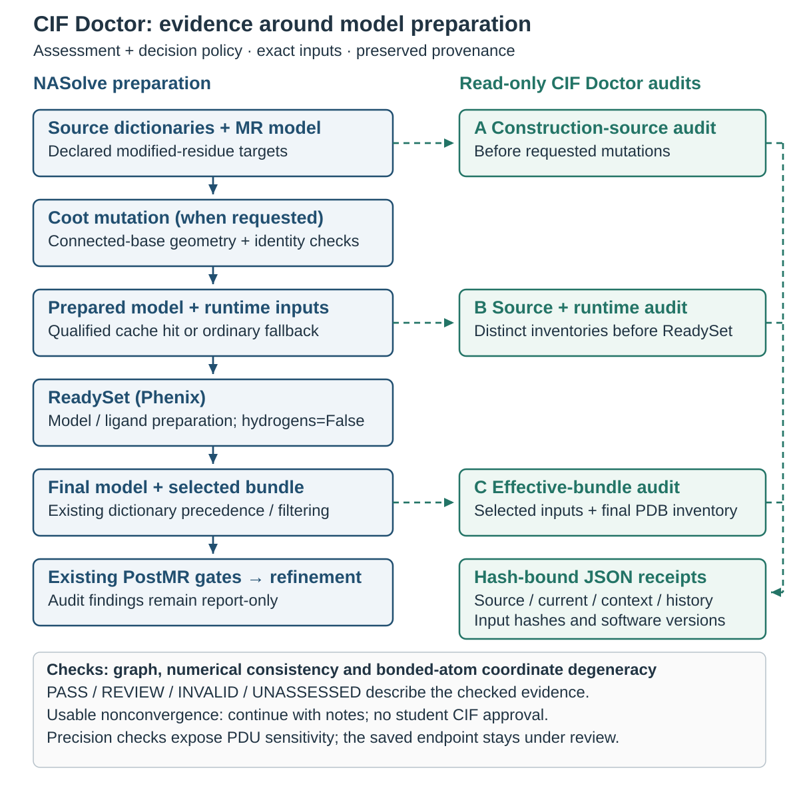

# CIF Doctor: human and manuscript overview

**Implemented scope, updated 2026-10-29:** CIF Doctor assesses component graphs
and numerical restraints, records source-preserving PostMR audits, and provides
explicit preparation, native interpretation and bounded geometry diagnostics.
Supported ordinary construction preserves whole connected modified bases;
source-bound qualified dictionaries can be saved locally and reused by ordinary
PostMR before ReadySet. The diagnostic APIs compare component/linked chemistry,
exact native restraint membership, numerical derivatives and saved coordinate
candidates under declared NARestraints pairing/stacking policy.

The ordinary assessment hooks remain report-only. Explicit diagnostic recovery
and qualification are implemented separately from automatic repair on a cache
miss, ordinary end-to-end candidate adoption and solution-PDF integration.
No individual mechanics or numerical test establishes scientific correctness.
The [command guide](cif-doctor.md) owns operational contracts; the
[implementation map](cif-restraint-doctor-implementation.json) distinguishes
implemented APIs from planned orchestration. This overview and its editable
figure describe the current capabilities and their limits.

## Catalogue scope and progression

The generalizer programme includes every ligand in the selected NARestraints
catalogue, including ATL and alternative backbones such as PNA. C105 supplies
a read-only baseline: it joins the exact workbook rows to exact CCD source files,
checks graphs and mapped atom names, and records missing sources and conflicting
mappings. All 618 rows / 599 codes of the pinned local workbook are represented.
This is inspection coverage, not a claim that all 599 ligands can be built or
refined. Exact sugar labels help organize further work without imposing DNA
phosphate rules on other backbones.

The census preserves source hashes and worksheet locations, and reproduces after
relocation without native tools. It does not repair the workbook or chemistry.
C106 adds graph-based source attachment evidence. It recognizes three initial
cores and reports their actual ports, charges, hydrogens and stereo declarations,
without choosing terminal chemistry or forming bonds. Twenty-six of 37 selected
DNA, LNA and PNA-labelled sources match; the other cases remain visible. Renamed
atoms give the same structural bindings, and exact cold replay preserves evidence.

This distinguishes topology from a chemical operation: an ammonium group and a
neutral amine can share a core without sharing a protonation state. Likewise,
ATL's phosphate oxygen named OXT cannot be deleted merely by analogy with OP3.
C107 now binds an explicit PDB site to a proposed source projection and checks
an optional candidate for exactly those table changes. A retained terminal
phosphate stays intact; an internal leaving O must be explicitly selected,
graph-checked and absent from the model. The other phosphate O–H remains.
PDU/ATL and DA/LCC transfer checks pass; APN/40A link states remain unresolved
without a protonation policy. These are synthetic context checks, not native
linkage proof. C108 composes these inspections so both sites must declare the
same bond between their source-defined ports. An O5′ oxygen cannot substitute
for the required alcohol port merely because both are oxygen. The whole declared
set remains unresolved if any operation lacks authority or any supplied source
projection mismatches; unselected sites and partial candidate coverage stay
explicit. Five sugar pair controls pass; PNA source ports bind while chemical
state changes remain open. C109 then checks preserved native captures against
those literal endpoints. A fresh DNA control has the declared bond, while its
native atom names/hydrogen states still differ from the source. Both installed-
library ATL directions fail because usable energy types are missing. These
outcomes guide recovery; they do not authorize deleting atoms or copying DNA
types to ATL. C112 captures actual indexed native name bindings and adds a
separate comparison using only those observed aliases. In DNA, OP3→O3T and
C7→C5M are observed, while hydrogen differences remain visible. In the L-DNA
control, all 855 atoms bind without aliases, so the earlier phosphate changes
cannot be dismissed as renaming. The same tool reads both cases; no model-specific
repair is added. C113 groups hydrogen definitions by their observed heavy-atom
parent, distinguishing counts/isotopes and moved attachments from equal-count
label differences. The DNA methyl group has three H on each side under different
names, while phosphate/O3′ hydrogen deficits remain separate. No individual
H alias or protonation state is inferred.
C114 adds a named, optional PNA amide operation: source-declared neutral NH2
loses one explicitly chosen H/D, while its partner's source COOH loses only
the selected hydroxyl O and H/D. Reciprocal source ports, local charge/valence,
retained stereo and exact candidate tables must agree. Ten of 14 frozen-source
controls produce matching proposals; four charged reactive amines stay unresolved.
Unreacted charged termini are preserved. All 22 new/legacy controls replay after
relocation, without native execution. This expands the general source-operation
contract; it supplies no PNA numerical dictionary or refinement proof. See the
[operation policy](cif-doctor.md#explicit-neutral-pna-amide-operations-c114).
C115 supplies isolated numerical evidence: 40C passes both native coordinate
controls, while 40A/APN stop at the reader's purine bond-order representation.
Separate local source-order diagnostics expose a later 40A extra bond and an
APN candidate retaining atoms/H/charges but returning unsupported aromatic
orders. These attempts do not change production chemistry. New generic receipt
diagnostics distinguish those stages and actual changed fields. Linked PNA
numerical targets remain unqualified; see the
[C115 controls](cif-doctor.md#candidate-generation-diagnostics-and-pna-controls-c115).
C116 separates coordinate bookkeeping from chemistry: a deterministic traversal
of source heavy-atom connectivity reorders whole atom rows without changing
any values. In a bounded 40A diagnostic it avoids native promotion of a
nonbonded coordinate reference into an extra bond. Purine orders remain
rejected, while ordered 40C passes both isolated native controls. This explicit
preparation is not an automatic retry or a general native correctness proof;
see the [ordering contract](cif-doctor.md#explicit-connected-atom-ordering-c116).
C117 now gives the purine representation its own narrow opt-in contract. The
source must declare the aromatic graph, with exact atoms/H/charges and a complete
neutral-ring valence pattern; carbonyl and charged-ring extensions stay open.
Preserved 40A/APN candidates and 40C pass all 21 isolated native checks at both
coordinate sets, including exact fixed covalent restraints and finite repeated
energy/gradient evaluation. Historical attempts are not rewritten. This is
isolated usability evidence; ordinary generation integration and linked PNA
numerical targets still need qualification. See the
[purine contract](cif-doctor.md#explicit-neutral-purine-representation-c117).
C118 now threads that explicit representation through maintained generation,
checking source chemistry at each native handoff without rewriting aromatic
orders. Fresh 40A/APN/40C candidates pass the independent isolated controls.
C119 freezes the complete explicitly authorized PNA source network, retaining
site/atom identities and exact amide operations. Ten controls prepare and replay;
four unresolved reacting charged amines stay blocked. The graph carries no
assigned coordinates, numerical restraints or final CIP. It is a chemical input
for the next linked-generation step. See the
[generation contract](cif-doctor.md#explicit-purine-generation-handoff-c118) and
[source-network contract](cif-doctor.md#explicit-pna-source-network-packages-c119).
C120 introduces explicit FANA source/candidate checking. It locates 2′ fluorine
by connectivity and checks source-declared arabino configuration, preserving
whole-source chemistry and all four sugar hands in completed candidates. All
ten catalogue FANA controls match; three fluororibo comparators do not. A/C/T/U
candidates pass isolated native checks in C120; C121 adds G under a separate
source-declared 6-oxo purine representation policy. OFC illustrates why names
are insufficient: its workbook abbreviation says L-FANA, while its source declares the L-ribo configuration. Neither source
nor catalogue is rewritten. Whole-sugar model construction and linked native
qualification remain separate. See the [FANA contract](cif-doctor.md#fana-source-and-candidate-preservation-c120).

C121 resolves a shared guanine representation boundary: the source explicitly
marks a five-membered ring aromatic, including the shared fusion bond. The
carbonyl and all nonshared bonds in the adjoining ring are preserved.
The new graph rule permits exactly that complete conversion, keeps source H,
charge and stereochemistry, and uses the same independent native checks. It works
for GFL, L-DNA G and PNA-G controls. Ordinary DNA-G also generates correctly but
Phenix's standard atom-name interpreter asserts on a retained phosphate hydrogen;
that remains a separate failure, with all evidence preserved. No phosphate repair,
linked qualification or convergence is claimed. See the
[6-oxo contract](cif-doctor.md#neutral-6-oxo-purine-source-representation-c121).

C122 adds a prerequisite for L-FANA model work: a read-only check of an explicitly
proposed whole-component mirror under a distinct target code. It preserves the
complete graph, hydrogens and charge; reverses the four sugar declarations; and
checks every atom-pair distance and sugar hand in each coordinate family. One
explicitly derived L-FANA-C reference passes generation and both isolated native
controls. Target NAR registration and insertion into an L-DNA scaffold remain
separate. This is source-relative evidence, not independently assigned absolute
CIP. See the [enantiomer contract](cif-doctor.md#explicit-fana-enantiomer-source-check-c122).

Native linked typing, chemical-state reconciliation and terminal
reconstruction remain open. Further milestones cover bounded recovery,
qualified usable fallback and ordinary workflow integration. PDU's open numerical
checks remain a separate current boundary. See the [catalogue contract](cif-doctor.md#catalogue-coverage-census-c105),
the [attachment contract](cif-doctor.md#source-attachment-topology-and-ports-c106),
[site-projection contract](cif-doctor.md#explicit-single-site-source-projections-c107),
[reciprocal-link contract](cif-doctor.md#reciprocal-source-link-contracts-c108),
[native-link audit](cif-doctor.md#native-attachment-link-audit-c109)
and [milestones](development-handoff.md#generalizer-milestones-and-interruption-boundary).

## Current result and interpretation

The actual Mac C95 test passes: a relocated 863-atom model, 23 dictionaries and
12 parameter files reach the ordinary reader unchanged, with zero new native
calls. C96 displays the selected model and original stopping note in ordinary
text output, alongside explicit limits already represented by the saved proof.
Endpoint selection does not clear source-chemistry findings, and derivative
qualification of the NASolve-local corrected evaluator does not qualify
ordinary Phenix refinement. Scientific qualification remains unassessed.
C97 makes the source comparison inspectable: it lists current component
changes separately from earlier rejected generation outputs and the declared
site modifications. For example, internal OP3 deletion is a recorded linkage
operation, not permission to change an OP2 proton or a sugar bond. Missing
metadata, partial charge and formal charge remain distinct. This is evidence
for choosing recovery work; no chemical state or numerical target is repaired.
C98 tests one concrete recovery: the preserved DF candidate now passes fresh
isolated and full-model native checks in the current 863-atom fixture. Its source
sugar bonds and OP2 hydrogen are retained; explicit linkage preparation removes
incoming OP3/HOP3 and outgoing HO3′. The old bundle remains intact. This changes
the restraint objective, so C99 repeats the sampled derivative audit for the
exact repaired manager. All 168 directions and both orders of 58 planes plus
six controls pass with unchanged native energies and coordinates. Five
directions need the two smallest existing step sizes; tolerances are unchanged.
C100 then tests bounded geometry: its target falls 12.54%, but a line-search
rounding error and six full-precision/four rounded derivative reviews retain
the verified starting model. Native reread is skipped, and all endpoint evidence
is preserved. A saved-data screen highlights a nearly collinear PDU torsion;
C101 now isolates all 22 remaining sampled local full-precision failures to
that one PDU D:5 torsion; seven other selected torsions and the remainder group
pass. Native group sums reproduce the saved values. Initial and rounded
local/group checks pass at finer steps. The same full-precision PDU torsion also
retains a strict atom-order reversal finding. C100 stays unqualified. A separate
C102 resolution-aware audit passes only two local and four rounded broader
rechecks; all six full-precision broader checks still fail. Some apparently
close derivatives are rejected because the requested coordinate displacement
is not represented accurately enough. The order discrepancy reproduces.
C103 independently evaluates the periodic torsion function with exact binary
inputs and high-precision arithmetic. Its supported reference checks pass in both
orders, while the full-precision PDU torsion remains highly sensitive to a single
floating-point coordinate step. Current PDU declarations match the earlier
triple/180° prerequisites. C104 now prepares a separate complete candidate:
six PDU dictionary torsions and three active native torsion restraints are
omitted, while the rest of the current linked inventory matches exactly.
Phosphate state, NAR terms and the 5PC bystander are preserved. Fixed-coordinate
energy/gradient attribution and derivative checks are next; no endpoint approval follows.
Neither native mechanics nor initial derivatives confer the old endpoint proof.
ATL remains an independent source/compiler and attachment-topology control.
Future chemical-reference
input, potentially from ChemDraw exports, belongs to restraints preparation;
drawing-to-model construction is outside CIF Doctor. The
[current capability map](cif-doctor.md#current-capability-boundary-c106) is the
concise authority for these distinctions and next steps.

## What it does

CIF Doctor checks the instructions that tell crystallographic software how a
modified nucleotide is connected and restrained. Those instructions are stored
in component CIF dictionaries: they name atoms and bonds, and may specify ideal
bond lengths, angles, torsions, chirality and planar groups. A plausible-looking
model can still be restrained by the wrong atom reference or incompatible
targets. CIF Doctor makes these problems visible before the dictionary is used
for model construction and after ReadySet has prepared the refinement inputs.

The output is a reproducible audit with the exact input hashes, software
versions, component inventories, rule identifiers and measurements. The current
PostMR audit hooks record findings without changing coordinates, selecting new
chemistry or adding a readiness gate. Ordinary Coot construction separately uses
the connected-base restoration described below. Researchers can also assess a
frozen checkpoint without altering the run.

## Automatic decisions and reporting

The student-facing contract is automatic recovery and usable fallback, with
plain-language reporting. A bounded optimizer can miss its convergence limit
while leaving a usable dictionary; NASolve should continue and disclose that
limitation. A chemically broken alternative is excluded, and an intact native
or repaired fallback can still be used. DNA pucker changes are permitted;
stereochemical inversion is a distinct chemical change, including for ATL.

The implemented decision core preserves source authority, excludes demonstrated
unusable candidates and compares energy only for the same fixed objective.
Unknown stereochemistry remains unknown. PostMR stores a concise solution-report
summary alongside its detailed assessment. Explicit native diagnostics test
isolated components, declared DNA metadata, linked sites and full-model bundles;
bounded geometry trials can select a separately checked endpoint or retain the
verified original automatically. Nonconvergence and pucker changes are notes;
contradictory chemistry, missing identities or failed fixed-mechanics evidence
exclude the optional candidate. Scientific qualification remains a separate task.

Ordinary construction and cache acquisition are implemented: Coot construction
uses source-qualified phosphate contexts and whole connected-base restoration,
and PostMR can reuse an eligible saved dictionary before ReadySet. Explicit
NARestraints compilation and fresh native membership/derivative controls are
available through diagnostics. Automatic recovery on a cache miss, integration
of newly qualified candidate bundles into the complete ordinary diffraction
run, production checkpoint adoption and automatic solution-PDF rendering remain
planned. Development diagnostics may retain `REVIEW` without asking students
to inspect CIFs. See the [continuation contract](cif-doctor.md#automatic-continuation-and-student-facing-decisions).

### Reuse qualified dictionaries locally

The persistent component store saves qualified numerical dictionaries and
reuses their exact bytes for later matching source chemistry. Entries are bound
to source hashes and authority, preparation recipe, check policy and consumer
identity; a residue label alone is not a cache key. Original producer and
nonconvergence notes survive reuse. Each run freezes independent selected copies,
so a later cache update cannot rewrite an earlier result.

Ordinary PostMR consults this store before ReadySet. A missing, changed,
unsupported or corrupt entry retains ordinary source preparation with notes.
Changed consumers need requalification; current site modifiers and linked/model
compatibility remain separate checks. The stored component numerics describe
chemistry, not a transferable set of crystal coordinates. See
[persistent local reuse](cif-doctor.md#persistent-local-reuse-of-qualified-repairs).

## How it works

The assessor parses each CIF data block separately and builds an adjacency graph
from the declared atom and bond tables. Exact atom names remain distinct: `C5`
and `C5'` cannot collapse into one atom. It then applies deterministic checks:

- **Identity and connectivity:** unique atom identifiers, valid references,
  duplicate/conflicting definitions, component-ID agreement, declared bond
  orders and aromatic flags.
- **Numerical restraints:** finite targets and valid uncertainties, missing
  numerical fields, angle paths, proper-torsion paths, supported alternate
  torsions, and chirality-neighbor references.
- **Internal consistency:** whether angle targets at a shared planar center
  can represent planar directions. The test considers both interior and exterior
  angle configurations; adding every angle to 360° is not a universal rule.
- **Dictionary coordinate degeneracy:** exact coincidence of bonded heavy
  atoms in supplied numerical components. This checks dictionary coordinates,
  separately from achieved geometry in the experimental model. It catches a
  collapsed pair even if its bond target has been manually made positive.
- **Optional model correspondence:** a PDB atom inventory retains model,
  chain, residue, insertion-code and alternate-conformer identifiers. This
  detects unknown or duplicated atom identities; it does not calculate the
  model's bond lengths or infer missing site chemistry.

An explicit source/candidate comparison reports changes in atom identity,
connectivity, bond order, aromatic annotation, hydrogen attachment, declared
charges, stereochemistry and numerical restraints. It does not decide which
dictionary is chemically correct. Unspecified charge remains different from
zero, and signed-volume restraints remain distinct from absolute R/S assignment.

Graph information and numerical parameterization are assessed separately. A
valid wwPDB CCD source can describe a molecule without supplying refinement
targets. CIF Doctor records that numerical layer as unassessed in source mode;
the same omission requires review in an effective refinement dictionary.

## Where it sits in NASolve

| Audit point | What is inspected | Why it matters |
| --- | --- | --- |
| Before a requested Coot mutation | Exact target construction dictionaries, preserved as audit snapshots | Construction should use atom identities and connectivity that have been inspected. |
| Immediately before ReadySet | Frozen source definitions and a separate inventory of the actual normalized runtime inputs and prepared PDB | Preserve source evidence while showing the inputs that will enter preparation. |
| After ReadySet and dictionary selection | The complete selected effective input bundle and final prepared PDB | Audit the files retained for subsequent refinement, including the existing precedence and normalization decisions. |

ReadySet remains the external model-preparation program. NASolve currently
invokes it with hydrogen addition disabled and retains its existing identity,
phosphate, parameterization and dictionary-precedence checks. CIF Doctor wraps
this preparation with evidence; it does not replace ReadySet or its ligand
generation tools. The post-ReadySet assessment describes selected files, not
the native geometry-restraint proxies constructed by Phenix.

## What tools and data it uses

| Tool or resource | Role in this feature |
| --- | --- |
| Python standard library | Graph traversal, numerical consistency calculations, hashing and JSON receipts. |
| Biopython `Bio.PDB.MMCIF2Dict` | Existing NASolve reader parses each supported CIF1 data block. A lexical preflight additionally detects duplicate tags. |
| NASolve dictionary-compatibility adapter | Inventories supported CCP4 alternate-torsion relationships; explicit preparation reuses the established normalizer. |
| NASolve checkpoint and run-context utilities | Resolve declared frozen inputs, verify hashes and retain portable provenance without changing checkpoint selection. |
| Phenix ReadySet and Coot | External PostMR preparation/construction programs surrounding the audit hooks; neither is required for a standalone dictionary assessment. |
| Phenix eLBOW, explicitly requested | Generates a separate numerical candidate from frozen chemical input and independent source ideal coordinates; never adopts it automatically. |
| Installation-bound `phenix.python`, explicitly requested | Uses installed iotbx/libtbx/mmtbx readers and monomer libraries to interpret a copied model/effective dictionary/parameter bundle and inventory the resulting atom/proxy evidence. |
| wwPDB CCD and NARestraints | CCD supplies source chemical definitions. NARestraints supplies declared pairing roles and stacking policy; explicit native diagnostics disable competing secondary-structure guessing. Neither selects an experimental protonation or tautomer state. |

Standalone assessment runs locally and offline. It uses no language model,
chemical-restraint generator or new cheminformatics package. Public CCD
downloads used in testing are separate, frozen inputs; assessment itself does
not fetch a newer dictionary over the network.

Explicit `generate-candidate` is a separate native operation. It freezes the
source, creates an exact-name initial-geometry template from complete supplier
ideal coordinates, checks the installed generator's advertised options, and
requests eLBOW optimization with hydrogen addition off,
source chirality retained and its explicit input-state retention mode selected.
That mode requests retention instead of default acid-hydrogen removal; it is not an
experimental pH claim or a determination of the correct crystal protonation.
The candidate is assessed and compared with the
source, including explicit hydrogen, charge and stereochemical differences.
Missing/unrepresentable seed data, invalid targets or contradictory chemistry
remain rejected or under review. Experimental MR coordinates and previous
prepared numerical dictionaries are not used to invent replacement targets.
Logs, commands, versions, capability evidence and hashes remain in a fresh
candidate folder. A CLI incompatibility is recorded separately from a chemistry
or optimization failure; unsupported required controls stop generation.
The requested optimization option and the backend reported by the native log
are recorded separately, because installed implementations can differ.

The generation-v4 comparison recognizes complete, source-declared aromatic
representations of isolated neutral six-member C/N rings. It requires an
alternating source order pattern, affirmative flags on every ring bond,
unchanged single-bond substituents and no contradictory ring stereochemistry.
This is declaration checking, without aromaticity perception or tautomer
selection. Raw source/candidate differences remain visible and all independent
atom, hydrogen, charge and numerical checks still apply. The returned CGY
candidate supplies the native regression case; [its evidence record](cif-linked-source-recovery-evidence.json)
separates completed eLBOW generation from the pending linked interpretation.

An explicit native bundle diagnostic is the next separate operation. It freezes
the prepared model, selected CIFs and parameter files in an external folder,
then invokes the selected Phenix installation's Python and monomer library.
An opt-in, recorded namespace adapter can remove only the parsed top-level
`refinement` wrapper from NASolve parameter files; all child values and
selections are retained, and unused native parameters are reported. The
diagnostic records installed parsing, interpreted atom identities and geometry
proxy inventories without minimizing or writing replacement coordinates.
Native interpretation may normalize the internal hierarchy; original model
bytes remain separately preserved and hash-bound. Exit-zero interpretation
remains REVIEW and does not certify chemistry, expected links, custom-restraint
coverage or achieved geometry. Unsupported API layers remain visible.

The separate linked-state diagnostic reuses source comparison and candidate
generation before applying declared DNA linkage/end states. It preserves
source-specific OP2 protonation, removes leaving atoms and attached H through
bond-graph adjacency, and writes per-site modifiers rather than changing every
instance of a residue code. An opt-in native inventory records full effective
site definitions and proxy targets/weights. Checks compare exact backbone and
custom pair/stacking coverage, preserve unaffected definitions, and include a
shared-code internal/free-OH control. These are external candidate/diagnostic
operations, with no automatic adoption or PostMR recovery. Cedar 08 completed
their native linked execution, preserving exact site atoms/H/types, backbone
links and requested proxies; numerical and stereochemical reviews stay separate.

Each modifier is serialized in its own native `data_mod_<ID>` block. The
returned Cedar 07 reader registered the previous shared block name rather than
the four requested IDs and stopped before linked interpretation. Exact
returned-input replay verifies corrected registration without altering base
dictionaries, PHIL requests, deletions or site plans. Detailed native inventories
also report formal-charge readback availability: unknown native values remain
unqualified, distinct from an observed charge contradiction. Partial charges
cannot substitute for formal charges. Cedar 08 recovered the requested native
IDs and exposed a second serialization issue: single-row component-list
metadata had collapsed to scalar fields and was skipped by the reader. Native
group is null even though the interpreted classification logs identify DNA.
The writer now preserves the metadata loop; detailed readback records
classification separately, and atom/group checks remain independent required
gates. [The registration evidence](cif-linked-native-registration-evidence.json)
owns the returns, including Cedar 09's successful installed group readback.
All 29 evaluable checks pass while four unavailable charge readbacks keep the
aggregate result REVIEW. The synthetic terminal control has distinct selected
atoms but undetermined native classification and incomplete O5′-OH treatment;
complete terminal support is not established. Corrected group readback does
not certify formal charges, numerical geometry or experimental chemistry.

The source-resource diagnostic explicitly prepares the reviewed 5CM
derivative and records the installed terminal-modification parameters alongside
an in-memory canonical control requested as DG. Native residue-name translation
selects the library identity and records the requested/resolved names. The
native reader's own row fields and
numerical values are preserved with source hashes. These are sources for a
subsequent terminal recipe, with no coordinate model, invented targets or
automatic adoption. Actual returned-source replay reproduces the reviewed
5CM candidate. Cedar 10 also captured the installed terminal modification,
but its direct DG lookup bypassed PDB-to-library name translation and did not
produce the canonical control. Cedar 11 completes installed lookup and the
in-memory control, preserving all unaffected restraint rows. The canonical
5′-OH end also has undetermined classification despite retained DNA group;
that label alone does not establish a modified-end defect. The earlier missing
modified O5′ hydrogen/type treatment and unavailable native formal charges
remain separate limits. Numerical targets and qualification gates are unchanged.

The explicit modified-terminal candidate layer now transfers the captured
native hydroxyl atom types, bond and angle only to a declared free 5′ end.
It preserves the shared dictionary and other site contexts, retains existing
formal charges and marks the added H formal charge unassessed. A separate
bundle trial includes the reviewed 5CM candidate and compares complete projected
native definitions, corrected torsion/alternate proxies, unchanged model atoms,
backbone/custom restraints and all recorded unaffected proxies. Returned
Cedar 12 completes both installed interpretations and records 95 passing
checks. Six formal-charge checks remain unsupported, and a graph audit retains
O3′ hydrogens at four pre-existing internal curated sites for review. The
aggregate verdict remains REVIEW. These deterministic checks do not infer pH,
approve chemistry or minimize/refine a model.

An explicit curated outgoing-oxygen layer now addresses that bounded linkage
motif. It first proves complete source/native row agreement, then removes only
the graph-identified O3′ H/D at a declared outgoing link and uses the captured
canonical OC2 oxygen type. It preserves true free ends, existing modifiers,
all remaining targets and charges, and the coordinate model. Before/after
assessments retain existing source reviews. Cedar 13 prepares these four
candidates from the returned Cedar 12 bundle. Its returned preparation succeeds,
but installation selection stops before native interpretation; Cedar 14 corrects
that launcher default. Both Cedar 14 installed interpretations now complete;
all 141 payloads verify and qualification replay reproduces 138 passing checks
and nine unsupported formal-charge readbacks. All four outgoing-H findings
clear. Captured-baseline replay, exact modifier IDs, projected definitions and
retained definitions/proxies pass. The aggregate stays REVIEW, with charge,
source, numerical, stereochemical and achieved-geometry limits preserved.

The reusable rule selects H/D by element and bond graph at an explicitly
declared link. Tests use synthetic `ZZZ`, misleading names, deuterium and true
free ends, and preserve OP2 H and terminal phosphate. Unknown motifs or missing
authority require review. This supports the declared linkage motif; the
experiment's hash-bound runner and source-specific 5CM correction do not
establish arbitrary-component production support.

A separate captured-geometry diagnostic measures Cartesian simple-bond
distances, angles and ordered chirality volumes against the recorded native
targets. It validates identities, indices and coordinate correspondence before
measuring, retains missing/zero-weight and degenerate cases, and preserves all
source inputs. Its nominal weighted deviations are descriptive rankings; the
capture does not retain all symmetry/slack/top-out conventions needed for
native residuals. Pucker, absolute stereochemistry and other proxy categories
remain unassessed. The explicit Cedar 15 runner performs this review on the
verified Cedar 14 bundle without new native execution or coordinate changes;
successful analysis retains REVIEW. It is separate from production PostMR and
complete geometry qualification.

The returned Cedar 15 capsule verifies all 51 payloads and the preserved native
capture. Its large bond/angle deviations include a DX bond at 5.13 Å against a
1.215 Å target; the declared dictionary coordinates match that target closely.
All 858 atomic identities shared with Cedar 05 retain exactly the same model
coordinates. These comparisons expose existing coordinate distortions and
motivate a construction/atom-correspondence provenance audit. They do not
identify the responsible construction step, justify target retuning or turn
ordered chirality sign agreement into absolute stereochemical approval.

The explicit construction-provenance layer now freezes original stage models
under a reviewed model hash. It parses saved Coot artifact declarations without
executing the script and compares captured intramonomer geometry findings
across exact atom identities in available single-model PDB stages. Missing
stages cannot prove a transition. Same-name parent-coordinate matches are
descriptive evidence rather than a semantic atom map or proof of cause. The
Cedar 16 return verifies all 74 payloads and locates 55 raw→restored crossings.
Controlled replay of the legacy restoration reproduces the entire damaged
restored model byte for byte. This demonstrates that coordinate copying is
the damaging operation for these transitions, without explaining every
pre-existing raw/MR defect or proving source chemistry.

The separate Cedar 17 candidate addresses that mechanism by transporting a
complete connected base fragment from raw Coot into the preserved sugar frame,
using a proper rigid rotation/translation at C1′/O4′/C2′. Connectivity selects
the base and its single C1′ attachment; parent base names supply no coordinates.
The rule requires the complete explicit DNA scaffold and preserves all
backbone/unselected coordinates and metadata. Unsupported graphs and contexts
are refused. DF's effective aromatic sugar bonds remain visible and its site unchanged;
eight supported contexts move 84 base atoms. Captured-proxy prediction changes
bond/angle outlier counts 50/107→34/72, with zero recorded chirality sign
conflicts. This preserves raw fragment geometry within PDB rounding; it does
not optimize or approve it. The runner tests unchanged native definitions,
targets, detailed proxies and exact candidate coordinates using the selected
Phenix installation. Generic regressions, the complete suite and actual-input
relocation pass. Returned Cedar 17 verifies all 129 payloads and 14 native
mechanics checks. Native/predicted measurements agree within computed roundoff.
Intrasite improvements do not establish a sound pairing pose: CGY–DX contacts
include 9.357476 and 6.818964 Å versus 2.8 Å targets, and the latter worsens
from 2.947120 Å. These outcomes remain visible alongside lower total outliers.

Cedar 18 separates effective/source recovery from further coordinate changes.
A graph rule requires an unsupported effective scaffold, an exact recorded
original source hash and a supported source DNA graph. DF's source sugar bonds
are single; its effective aromatic declarations are not copied into the source.
Existing whole-component generation retains source atoms/H/bonds/formal charges
and stereochemistry, then linked/native projection checks run at fixed model
coordinates. Only passing mechanics and the explicit unavailable charge API
can continue to a separate fragment restoration/native check. Definition and
coordinate effects are reported separately; unlike objectives are not ranked
as like-for-like geometry improvements. Returned Cedar 18 verifies independent
generation, 68 passing dictionary checks/one unavailable charge readback and 14
fragment checks. The linked files and nine-atom DF candidate replay byte for byte;
raw base geometry and the unresolved CGY–DX pose remain visible.

A separate Cedar 19 diagnostic reconstructs and exactly matches that captured
manager before one bounded geometry-only L-BFGS trial with fixed definitions.
Native per-term energy and gradients, actual stopping/limits/errors, symmetry
and installed optimizer hashes are recorded. Full-precision endpoints remain
separate from PDB rounding, per-site displacement and a new exact native proxy
postcheck. A target decrease, limit stop or tolerated rounding error cannot
establish convergence or scientific approval. This local trial uses no diffraction
input and makes no automatic choice; source/charge, absolute stereochemistry,
pucker, separate contact/clash inventory, pose and full qualification stay under
review. Returned Cedar 19 completes 500 iterations with fixed constraint
signatures and a lower target, but reaches the cap with its native criterion
false. Serialization then exposes native/PDB atom-order differences. The
corrected serializer uses a checked identity bijection and preserves PDB record
order/metadata. Cedar 20 resumes its saved endpoints without another optimization;
its returned native PDB check preserves identities/definitions and adds five
hydrogen bonds/ten angles as contacts cross an unchanged distance cutoff. The
old exact comparison retains 11 PASS/three REVIEW. A read-only audit explains
that pattern separately from the saved fixed-manager PDB endpoint equivalence;
neither report changes the original checks or claims chemical approval. Explicit
hydrogen-bond membership, convergence, full qualification, production integration
and adoption remain separate.

The accepted project policy makes NARestraints' pair selections, stacking
relationships, mapped base planes and recipe targets authoritative over Phenix's
automatic secondary-structure guesses.
The separate membership compiler reuses NARestraints' recipe and stacking
builders, preserving frozen selection provenance. It compiles declared intent
without rerunning the guesser on moved coordinates. Intended contacts must
survive poor starting geometry, and Phenix inference must not add competing
terms. Run continuity can rescue weak pairing geometry; chemistry, overlap and
achieved-geometry checks remain necessary. The diagnostic compiler is
implemented and passes both returned native membership checks; geometry
qualification remains open.

Stacking reuses the existing NARestraints base-class plane mapping and
neighbour builder. Its canonical native declarations and explicit modified-base
parallelities both carry that policy; suppressing competing inference must
preserve their requested relationships. Unknown-mapping warnings and actual
native coverage remain visible, with stacks distinguished from base-pair planes.

A separate **explicit NARestraints membership diagnostic** now compiles the
remaining generic pair/stack declarations before disabling competing native
secondary-structure construction. Existing explicit modified-base edits and
component modifiers remain intact. It resolves workbook-mapped atoms and planes,
checks duplicate requests, and records the source of each relationship. Cedar
21 applies that same policy to the preserved initial model and saved endpoints,
checking exact native requests, targets/weights and unaffected proxies. The
installed origin registry is recorded rather than assumed. Offline compilation
and synthetic transport are verified. Both returned Phenix 2.2.1-6174 cases pass
14/14 exact membership checks, retaining all 52 explicit bonds, 86 angles, eight
planes and 58 parallelities with no competing SS-origin terms. All captured
static proxy rows remain identical across the saved coordinates.
This is a new explicit objective, with no coordinate editing or minimization.

The separate Cedar 22 diagnostic now tests one bounded geometry trial under
that verified policy. It starts from the saved endpoint, preserves all source
dictionaries and compiled restraint inputs, and checks the exact manager before
optimization. Stopping, gradients, displacement and full-precision versus PDB
rounding evidence stay separate. A fresh native reread must preserve identities,
definitions, all static proxies and the NARestraints policy. The returned trial
passes all 17 native mechanics checks, lowers the objective by 24.26% and stops
with a line-search error at 905 iterations. Three long CGY–DX hydrogen-bond
distances and ten angle outliers remain, with no recorded chirality sign
conflicts. This verifies consumer mechanics through actual coordinate movement;
convergence and complete chemistry/geometry remain under review.

Cedar 23 now prepares a separate numerical check of those saved coordinates.
It compares native gradients with small central energy differences at several
step sizes, alongside category controls, repeated evaluations and the existing
dictionary checks. Exact manager/policy/source matching remains mandatory.
No minimizer runs, coordinates or targets are edited, or model is adopted.
The check can localize sampled numerical inconsistencies; it cannot establish
convergence or chemical correctness. Returned Cedar 23 verifies all inputs
and localizes stable sampled derivative disagreement to native parallelity,
the plane-orientation term used by declared pairing/stacking restraints.
The other six category controls pass every sampled direction at both
precisions. Independent plane-energy/derivative calculations reproduce the
finite differences, while the public CCTBX accumulation-loop bounds reproduce
the saved native gradient to numerical precision. This strongly indicates
omitted second-plane gradient contributions, subsequently reproduced in
the installed Cedar 24 check below. This does not reject the NARestraints
policy or prove the cause of the optimizer stall.

Cedar 24 now supplies a separate installed diagnostic to distinguish an
individual plane derivative from failure to add all atom contributions. It
checks every captured plane at both saved precisions and both plane orders,
with tilted equal/unequal-size controls. It preserves the NARestraints policy
and performs no optimization. The returned audit confirms an installed
accumulation defect: every sampled individual-restraint direction agrees,
while every accumulated order loses second-plane contributions. The same
pattern occurs for tilted controls, independently of residue chemistry.
The installed loop-bound model reproduces the returned accumulation arrays
exactly. Restoring complete contributions in saved data explains all earlier
sampled discrepancies.

Cedar 25 now implements an explicit NASolve-local correction. It keeps the
native energy, replaces only the incomplete plane-gradient contribution with
the complete sum, and leaves all NARestraints selections and chemical targets
fixed. A separate audit freshly compares derivatives with energy differences
at the initial coordinates and both saved endpoints. It checks the same native
sources and mechanics before evaluating; no optimizer runs or installed Phenix
file is edited. Returned Cedar 25 passes both endpoints and retains six
initial-coordinate failures. An independent normal-orientation sign model
reproduces the remaining gradient; four ordinary stacks exercise that branch.
Cedar 26 therefore uses each plane's first-plane derivative by evaluating both
orders. Fresh checks cover every plane, all three coordinate sets and rigidly
rotated controls. Returned Cedar 26 passes all 504 global/category and 1,080
corrected per-plane directions with zero native energy change. This clears the
sampled derivative prerequisite for a separate bounded geometry trial.

Cedar 27 now supplies that trial, restarting from the same original initial
coordinates as the earlier stalled run. The exact qualified correction and
initial gradient must match before optimization. Fresh endpoint derivatives,
stopping evidence and native PDB mechanics are reported independently. The
returned trial passes all 17 mechanics checks and all 336 sampled endpoint
directions. Its target falls 28.72% but reaches the 1,000-iteration limit with
the native criterion false. Accepted steps still lower the target at the end;
Cedar 28 supplies a bounded continuation from saved full precision, after a
fresh match of the entire starting corrected gradient and target.
Returned Cedar 28 passes the same mechanics/derivative checks and decreases
the target another 3.64%. The 2,000 cumulative iterations still end at the
limit; the same strained pair/DP angle remains, and chemical qualification is
open. Cedar 29 supplies a separate graph-selected base-orientation audit to
measure the response of the same fixed objective to temporary rigid-base
rotations. Source/endpoint matching, fresh rotational derivatives, periodic
controls and exact angle/plane context accompany the scan. Returned native
execution passes all 96 sampled rotation directions; no independent coarse
sample improves the objective. Cedar 30 separately prepares a source-graph
numerical candidate for the retained DP conflict. Cedar 30 stops before
generation on external coordinate-tag spelling; Cedar 31 fixes serialization
and adds PDU as a separate public chemistry/policy control. Returned Cedar 31
finds missing DP alias metadata and a distinct PDU optimizer/restart crash,
with no output dictionaries. Cedar 32 adds a general alias-column fallback and
installed-source/read-only input checks. Returned Cedar 32 passes PDU and
identifies DP's broader reader-dialect mismatch. Cedar 33 supplies a checked
format projection and a bounded candidate trial after installed option/source
proof, retaining nonconvergence evidence. Its return separates preparatory DP
chirality failure from a nonconverged PDU dictionary. Cedar 34 audits saved stereo
and printed energy evidence plus isolated native reader controls, without new
generation. Numerical and scientific qualification
remain open; no candidate is applied to a model.
All diagnostic policies are opt-in; production defaults are unchanged.

An [offline ZIP shuttle](cif-doctor.md#offline-runner-for-the-public-control-zip)
packages the exact assessor and required reader code into one Python script.
It verifies the frozen public-control ZIP and writes new audits without an
installed NASolve checkout. Screening the same CCD sources in effective mode
tests numerical completeness; it does not run ReadySet or generate restraints.

## What the findings mean

`PASS` means that the implemented invariants passed. `REVIEW` identifies a
conflict or incomplete evidence requiring interpretation. `INVALID` identifies
a failure of the implemented checks. `UNASSESSED`, `NOT_RUN` and `UNSUPPORTED`
make missing coverage explicit at the relevant assessment layer or finding.
None of these labels alone constitutes chemical or crystallographic approval.

Two explicit preparation recipes can write a new candidate while preserving
the source. One normalizes supported alternate-torsion representations. The
other applies the single reviewed historical 5CM `C2` → `C2'` torsion-reference
correction, only when the source has the exact reviewed SHA-256, then runs the
same normalizer. Preparation records field-level differences and before/after
assessments, refuses existing destinations and does not automatically adopt
the candidate. This is a bounded repair capability, not a general atom-name or
bond-order fixer.

The first implementation has automated regression coverage, frozen public CCD
controls and historical dictionary replays. These establish offline behavior
and input preservation. They are separate from the earlier bespoke native
5CM/DF/DP diagnostics and do not establish a native Phenix/Coot validation of
the new general assessor. Exact counts and hashes belong in the
[development handoff](development-handoff.md) and
[public control manifest](cif-doctor-ccd-controls.json).

The fresh mixed-DNA test supplied a native regression case: IGU's generated
C2–N3 target was zero and both dictionary atoms had identical coordinates;
nearby targets were also distorted. The generalized PostMR guard quarantines
invalid generated generic components and identifies the actual failing atoms.
An explicit regeneration probe completed eLBOW optimization and restored the
C2–N3 target to 1.387 Å. It also exposed a separate default-state change:
phosphate hydrogens disappeared and formal charges changed, so the candidate
was rejected. The v3 native probe then retained all 37 atoms, hydrogen
attachments, bond orders and formal charges using explicit source-state
retention. Its C2–N3 target is 1.397 Å. Five small plane-angle discrepancies
remain REVIEW findings. Source CIP/aromatic metadata is omitted by the generator,
which still labels the candidate non-polymer; native linked-site qualification
remains pending. These limits are recorded without promoting the candidate to
chemical approval. Candidate generation,
source-state preservation and native linked-site qualification are separate
gates; their pending status is recorded in the
[synthetic test descriptor](synthetic-dna-mechanics-test.md).
Shuttle filenames now begin with a short delivery identifier, also printed in
the console and retained in receipts; review ZIPs include the run token near
the front so clipped filenames remain distinguishable.

## Current limits and planned extensions

CIF Doctor inventories declared chemistry; it does not infer valence,
protonation, tautomer choice, absolute stereochemistry or phosphate termination
from a residue label. Explicit diagnostic preparation uses declared linkage
and end states; current production PostMR does not adopt these derivatives.
Installed linked execution is now recorded, with native formal-charge readback
still unsupported. Complete synthetic free-OH end chemistry is not qualified.
The dictionary assessment layer does not calculate
achieved coordinate geometry or sugar pucker, assess maps, or repair/stitch
fractured assembly arms. Plane-angle discrepancies include raw measurements
and uncertainty-based lower bounds, but a material-strain threshold has not
been calibrated.
The separate captured Cartesian diagnostic provides limited coordinate
measurements; it does not complete the broader geometry qualification above.

The proposed next layers are completion of qualification and integration of
the explicit linked-state diagnostic, mapped chemical
descriptors, qualified automatic candidate adoption and model geometry/connectivity
assessment. Guided sticky-end stitching would require declared strand routing,
symmetry and terminal intent, with a new child checkpoint. These are planned
capabilities. The existing `refine-doctor` remains the separate data/Free-R and
refinement-strategy diagnostic tool.

## Methods paragraph for adaptation

> Component dictionaries were assessed using CIF Doctor, a deterministic audit
> layer in NASolve. Supported CIF1 data blocks were parsed with Biopython
> MMCIF2Dict, retaining exact atom identifiers and declared connectivity.
> Checks covered atom and restraint references, duplicate or conflicting
> declarations, numerical completeness, torsion and chirality references, and
> compatibility between angle targets and shared planar groups. PostMR recorded
> audits before requested Coot mutations, immediately before Phenix ReadySet,
> and after selection of the effective refinement dictionary bundle. Receipts
> bound findings to ordered input SHA-256 hashes and software versions.
> Assessment was report-only and did not alter model coordinates or automatically
> replace dictionaries. Native restraint-proxy interpretation, achieved model
> geometry and experimental validation remained outside this assessment layer.

Replace the software-version/commit citation with the exact version used for
the manuscript's runs. Mention preparation recipes only if they were actually
used, naming the recipe and candidate/source hashes. Describe any subsequent
native or experimental validation separately.

## Figure files and caption

The [SVG](figures/cif-doctor-overview.svg) contains editable text and vector
objects. The [Python source](figures/build_cif_doctor_overview.py) regenerates the
layout using the standard library. [Figure editing notes](figures/README.md)
explain export and maintenance.

**Suggested caption:** Placement of CIF Doctor in NASolve's PostMR workflow.
Solid arrows indicate the existing model-preparation path; dashed arrows
indicate read-only audits of exact construction sources, frozen source/runtime
inputs and the selected effective restraint bundle. ReadySet remains the
external preparation program. Separate catalogue/core inspection binds source
ports; explicit site contracts propose bounded source-table deletions and
require reciprocal source ports across the declared link set. Exact projections
and source binding leave native linkage unqualified. Saved native captures then
supply literal bond membership and effective-definition observations, with failed
interpretations, naming differences and missing charge readback kept explicit.
Hash-bound JSON receipts preserve audit findings
without changing coordinates, dictionary precedence or readiness decisions.
The mixed-bundle source inventory distinguishes current base declarations,
declared site modifications and historical generation findings; equality does
not establish chemical validity or qualify installed canonical numerics.
A separately tested preserved DF recovery passes current linked/native mechanics;
C99 separately passes fresh sampled derivatives for the repaired manager with
the explicit corrected evaluator. C100 tests bounded geometry and retains the
verified start when the endpoint derivatives remain under review. Target
improvement alone does not select the endpoint. C101 diagnoses the saved
torsions at fixed coordinates and leaves that decision intact. All remaining
sampled local full-precision failures belong to one nearly collinear PDU
torsion. C102 tests finer resolution and retains review; both displacement
uncertainty and strict atom-order sensitivity remain visible. Numerical
agreement, useful conditioning and scientific chemistry are separate questions.
C103 supplies independent decimal arithmetic and input-sensitivity evidence;
C104 separately verifies the complete declaration-based omission candidate
against native inventories. This preserves the bystander, phosphate and NAR
terms; energy/gradient and derivative qualification remain separate.
The figure depicts the implemented assessment layer and notes separate linked
candidate/native-proxy diagnostics. C112 adds observed native name bindings to
the source/native comparison layer, preserving literal findings and keeping
hydrogen/charge changes outside alias authority. C113 reports hydrogen parent/count
and label differences separately within that same comparison layer. C114 adds an
explicit neutral PNA amide operation to the source/site contract, preserving
all unrelated chemical state. C115 adds precise generation-stage diagnostics and
isolated 40C native evidence; purine representation and linked PNA targets remain
open. The local diagnostic order-restoration trials grant no production support.
C116 adds explicit source-table ordering before native construction, preserving
all chemical declarations. Its bounded 40A extra-bond workaround leaves the
purine representation and linked-PNA qualification gates open.
C117 extends explicit assessment to a bounded source-declared neutral purine
representation, retaining exact atoms/H/charges and independent numerical/stereo
checks. Preserved 40A/APN candidates pass fresh isolated native controls; ordinary
generation integration and linked PNA targets remain separate.
C118 extends the explicit purine policy through fresh generation and exact
native handoffs; new 40A/APN/40C candidates pass isolated checks. C119 freezes
source-authorized PNA graphs with explicit amide edges, portable evidence and no
assigned geometry or numerical targets. Linked native qualification stays open.
C120 adds graph-bound FANA declaration and candidate-preservation checks; four
core candidates pass isolated native controls. C121 adds GFL, completing isolated
A/C/G/T/U controls; linked FANA and ordinary modified-sugar construction remain
unqualified.
C122 adds an explicit whole-component mirror check and one native L-FANA-C
control; target registration and whole-model replacement remain open.
A separate fixed-definition geometry trial
records numerical stopping/gradient and PDB round-trip evidence. Native
optimization reaches its explicit limit; saved-endpoint serialization by atom
identity and fresh native proxy generation are assessed separately. A read-only
reload audit keeps conditional-restraint differences visible without passing
the original exact comparison. Automatic adoption, full geometry qualification
and assembly stitching remain future extensions.
Dictionary coordinate-degeneracy checks and the explicit candidate-generation
scope are included; candidate generation does not add an automatic adoption path.
Explicit generation records installed-tool capability evidence before chemistry.
It requests source-state retention and preserves soft numerical reviews without
granting chemical approval. The v3 diagnostic demonstrated atom/bond/H/formal-charge
retention; generation-v4 additionally checks bounded source-declared aromatic
ring representations while preserving raw differences. Omitted metadata and
native-link qualification remain explicit.
Modifiers use exact native block IDs and component-list metadata retains its
loop layout. Native classification is separate from group metadata;
unavailable formal-charge readback is
reported independently and does not become a chemical pass.
Returned Cedar 09 interpretation records 29 evaluable checks passing, with four
charge readbacks unsupported. Source-coordinate sugar-sign agreement and
file-level charge retention are separate from independent stereochemistry,
complete terminal chemistry and achieved model geometry.
An explicit terminal-source review records installed modification parameters,
native canonical-name resolution and a separate reviewed 5CM derivative before
any new terminal adaptation or geometry trial.
The completed installed canonical hydroxyl control preserves unrelated targets;
its undetermined classification is recorded separately from formal-charge
availability and incomplete modified-end treatment.
The subsequent explicit candidate layer uses those captured parameters at one
selected free end. Its completed installed bundle trial verifies exact projected
definitions, reviewed torsion/alternate targets and unaffected native proxies.
Six unavailable charge readbacks and four existing curated O3′-H findings
retain REVIEW. The new H formal charge stays unassessed.
For the separate outgoing-oxygen candidates, complete captured source/native
row comparisons precede graph-selected H/D removal and canonical type transfer.
Source dictionaries and prior modifiers remain unchanged; exact projected
definitions, all unselected definitions, unaffected proxies and modifier IDs are then
checked in a separate native trial. Returned Cedar 14 passes these checks
and clears all four outgoing-H findings; its aggregate REVIEW retains nine
unsupported charge readbacks and separate source/geometry limits. The rule
uses declared links and H/D connectivity, with synthetic-name/free-end
regressions; the experiment remains hash-bound. Existing source reviews are
retained, without inferred targets or pH.
The separate captured Cartesian review measures distances, angles and ordered
volumes from recorded manager sites. Nominal weighted deviations rank the
evidence; missing native conventions and deferred geometry remain unassessed,
and no coordinate repair, target retuning or qualification pass is implied.
Returned source-versus-model and coordinate-lineage comparisons motivate an
earlier construction/atom-correspondence audit. The returned stage evidence
and controlled legacy replay now reproduce the damaging coordinate-copy step
for the captured transitions; other MR/raw/source defects remain unresolved.
An explicit construction-provenance diagnostic can freeze original models and
saved declarations under a reviewed run binding, then compare available stage
coordinates. Missing evidence and correspondence limits remain visible; it
does not execute the saved script or alter the original run.
An explicit attached-fragment candidate retains the reviewed scaffold and uses
the captured graph to select a connected base with one C1′ attachment. Raw
base coordinates move together through right-handed sugar frames. Unsupported
graphs stay unchanged under review. Native comparison requires the same atom
identities, site definitions, custom requests and full proxy targets/weights;
neither descriptive outlier reductions nor successful interpretation approve
complete geometry. The candidate is not integrated into production PostMR.
Returned evidence retains worsened intersite contacts alongside improved
intrasite geometry. A separate source/effective recovery requires exact source
hashes, whole-component generation and linked/native projection gates at fixed
coordinates before a fragment trial; it infers no replacement targets from
residual strain. A further explicit geometry-only trial uses the same native
manager and flags before/after, records numerical stopping/gradient evidence
and preserves full-precision results separately from PDB round-trip checks.
It remains a separate candidate; no scientific/adoption pass follows from a
smaller objective or successful execution. Identity-based serialization
preserves original PDB ordering even when native hierarchy order differs;
verified saved endpoints can continue to a native PDB check without another
minimization. Fresh native managers can activate distance-filtered hydrogen
bonds at changed coordinates. Attribution retains the changed proxy set and
original REVIEW alongside a separate fixed-manager endpoint comparison.
The separate native diagnostic inventories interpreted atoms/proxies and
parameter handling; it does not authorize adoption.
A separate explicit NARestraints pair/stack compiler now precedes a two-coordinate
native mechanics check; existing edits survive and both returned cases pass
exact membership checks. Geometry/convergence qualification remains open.
Cedar 22 extends the fixed-definition engine with opt-in native policy matching
for a separate bounded trial and 17-check native PDB readback. It reuses the
verified compiled inputs rather than selecting contacts again after movement.
Returned native mechanics pass, while the optimizer's line-search error and
remaining pairing/local-angle strain preserve scientific REVIEW.
Cedar 23 adds bounded directional finite differences at saved full-precision
and rounded coordinates, with isolated category, repeat and additivity controls.
It reuses CIF Doctor's planar-angle rule and generic distance-group reporting;
the fixed policy and all exact native gates remain unchanged. Its returned
parallelity mismatch is independently checked using centered scatter matrices,
smallest-eigenvector plane normals and spectral derivatives of
`sum(weight * (1 - abs(dot(n_i, n_j))))` for the captured zero-target,
zero-slack, non-top-out proxies. Both energies agree within 6e-12; selected
central derivatives agree within 1.2e-6. A model of the public CCTBX second-plane
accumulation-loop bounds matches all 2,631 stored gradient components per case
to approximately 1.5e-12 in norm. Installed C++ source identity and native
reproduction are subsequently recorded by Cedar 24. Exact source/blob identities, scope and
limits are in the native ledger; this is numerical evidence, not a new
optimization or chemistry approval. Cedar 24 compares the installed
per-restraint Cartesian derivatives with identity-scattered sums, native
singleton/full containers and the saved manager. Complete repeated arrays,
plane-order invariance, four-step numerical derivatives and tilted equal/unequal
controls retain the distinction between derivative and accumulation errors.
Available installed header/binding sources are captured with checksums while
remaining distinct from binary build provenance. The returned audit verifies
732 payloads and 2,856 finite-difference sample records: all 714 sampled
single-restraint directions pass, and all 238 accumulation orders fail their
second-plane and alternating controls. The installed loop-bound model matches
the accumulation vectors exactly. Algebraically replacing only parallelity
contributions makes all 84 prior full/parallelity directional checks agree
at unchanged energies and coordinates. This explains the sampled mismatch
without validating optimizer convergence or chemical definitions. Cedar 25
implements a local evaluation adapter that subtracts only the native accumulated
parallelity gradient and scatters all original single-restraint contributions
by atom index, including shared atoms. It preserves the unnormalized native
energy and works unchanged when native accumulation already agrees. The new
source-pinned diagnostic repeats the four-step finite differences under the
full objective and seven category controls at initial and both saved coordinate
sets, preserving raw snapshots separately from corrected gradients. Repeat and
additivity checks, exact static constraints and complete plane residual
agreement remain mandatory. Symmetry-bearing planes and special positions are
unsupported. Local tests use independent analytic oracles and explicit native
API fakes. The returned 794-payload audit matches all source/mechanics gates
and completes 4,101 evaluations with zero energy change: 498/504 sampled
directions agree, with six initial-coordinate failures in the full and plane
categories. A model of the header's omitted chain-rule sign after normal
alignment reproduces the stored initial gradient within 3e-12 in norm.
Spectral recombination explains all six failures at unchanged energy samples;
this is offline inference rather than a newly corrected native evaluation.

Cedar 26 takes the native first-plane gradient in the original order and for a
parameter-preserving swapped copy, then scatters both by original atom index.
Every original/copied target and residual is checked; the manager's proxies,
other gradient contributions and full energy remain fixed. Fresh derivative
checks compare original complete and corrected gradients for every plane at
all three coordinate sets in both orders. Equal/unequal tilted controls also
receive a 30-degree rigid rotation, testing energy invariance and covariant
gradient rotation across the native normal-sign branch. The same four-step
criteria and exact source/mechanics gates apply. The returned 857-payload audit
passes every corrected sampled direction while preserving all native complete
gradient failures: eight initial orders and six rotated control orders require
review. The corrected gradient is invariant under order and covariant under
rotation, with zero native energy change. This qualifies sampled derivatives
for the captured supported profile and does not establish chemical correctness.

Cedar 27 passes that evidence explicitly to the bounded geometry engine. It
recomputes the stored derivative comparisons, requires the identical correction
source, and matches the full corrected initial gradient, native sources and
static constraints before native L-BFGS starts. The same initial coordinates,
energy, compiled NARestraints policy and default bounds as Cedar 22 support a
controlled comparison. Accepted-step/stopping evidence and corrected versus raw
gradient norms are preserved. Fresh four-step endpoint checks cover the full
objective and seven category controls at full and PDB-rounded precision. Exact
atom identity mapping preserves noncoordinate PDB records, followed by fresh
17-check fixed-policy native readback. Stopping, derivatives, mechanics and
scientific qualification remain separate outcomes. The returned 980-payload
capsule verifies all 17 native mechanics checks and all 336 sampled endpoint
directions. The target decreases from 3784.7499 to 2697.7623 and the corrected
norm from 1110.5207 to 372.5374, but the native criterion is false after 1,000
iterations / 1,028 calls. The stop remains NOT_CONVERGED_LIMIT. Every accepted
target decreases; the last 100 transitions lower it by 31.2321. The rounded
fixed-manager target/norm are separately 2700.8561 / 905.6215. Three distance
and ten angle outliers remain at nominal deviation at least five, with no
sign conflicts among 158 captured chirality proxies. A future continuation
must start from saved full precision, freshly match the entire corrected
start vector and fixed source/proxy identities, and repeat endpoint derivative
and PDB mechanics checks. Cedar 28 now supplies that opt-in continuation,
with a fresh L-BFGS history and at most 1,000 further iterations / 20,000 calls.
Its worker verifies the original manager before loading the saved native
atom-order coordinates, then matches the complete corrected start vector and
target. Prior/new stopping and cumulative optimizer counts remain separate.
The returned 1,104-payload capsule verifies all 980 prior payloads and their
manifest, all 17 mechanics checks and all 336 sampled endpoint directions.
The new target/norm are 2599.5276 / 144.1650, reductions of 3.64% / 61.30%
from the prior full-precision endpoint. The additional 1,000 iterations / 1,036
calls retain NOT_CONVERGED_LIMIT, with the native criterion false; cumulative
counts are 2,000 / 2,064. All accepted targets decrease, including 8.7054 in
the final 100 iterations. The PDB-rounded target/norm are separately
2602.9712 / 950.9056. Three distance and ten angle outliers persist, with no
recorded chirality sign conflicts. Review the remaining exact terms/source
definitions and numerical tail before choosing another bounded test; no next
delivery is prepared. No target tuning, diffraction refinement or adoption
occurs.

## Temporary base-orientation diagnostic

Cedar 29 asks which fixed restraint families resist or favor a base rotation.
The generic rule selects sites from measured nominal bond/angle outliers and
follows each supported component graph to its single attached base. Proper
rotations around the C1-prime/attachment axis keep the sugar/backbone and all
internal base geometry fixed. Each of nine predefined angles is a separate
temporary energy evaluation; no preferred model is selected or written.

The exact qualified original manager and complete initial/endpoint family
gradients must match before the scan. Full and PDB-rounded endpoints remain
separate. The full native objective and isolated category controls expose
opposing rotational slopes; the slope is the sum of each atom's Cartesian
gradient dotted with its angular displacement tangent. Four fresh numerical
steps test every full-objective angular sample and each family at zero angle.
Repeated baselines, category additivity, 180-degree periodic agreement, rigid
distance preservation and native source/static identity checks retain their
own outcomes. Selected angle rows/types and common planes give the source
context for internal discrepancies that a rigid-base scan cannot repair.

This is a bounded diagnostic: at most six supported groups and 3,000 native
energy evaluations, with a 1,200-second default timeout. A low grid value is
neither an optimum nor a chemically validated candidate. Coupled backbone/base
motions, complete geometry, pucker, charge, absolute stereochemistry and
experimental fit remain separate. The implemented source transport and tests
pass. The returned installed audit verifies all 1,173 payloads and all 96
sampled rotational directions. Every independent coarse grid favors the
starting angle; validated nonzero slopes remain, so no minimum is claimed.
Ordinary PostMR is unchanged.

### Separate numerical recovery from a source contradiction

Cedar 30 addresses the retained DP angle/plane disagreement through independent
whole-component generation. The general selector uses a declared restraint
conflict, with explicit component selection for this reviewed experiment. It
does not derive replacement targets from the distorted model. The exact source
atoms, bond state, explicit H/charges and signed chirality are exported into a
graph-only input; old energy types and numerical targets remain in the frozen
original. Source coordinates supply only naming/starting geometry, with their
origin stated explicitly rather than treated as independent ideal validation.

The existing guarded eLBOW adapter generates a separate numerical dictionary.
Chemical and numerical comparisons against both the graph input and original
source retain every discrepancy; complete formal-charge declarations must
survive. A candidate is not installed or combined with existing modifiers in
this slice. Native proxy qualification, achieved geometry, convergence and
scientific approval remain separate. The Cedar 30 return identifies an input
parser incompatibility before any candidate exists: eLBOW accesses mixed-case
CCD coordinate attributes. Canonical external tag spelling now preserves the
same parsed coordinates/chemistry and is covered at that consumer boundary.
This methods step is reusable for explicitly selected graph-valid source conflicts;
the DP-specific delivery and prior positive bespoke trial are evidence, not a
universal correction rule.

### Additional T-derivative control: PDU

PDU is 5-propynyl-deoxyuridine. The pinned public CCD source preserves its full
C5 substituent, including a carbon-carbon triple bond, and the declared sugar,
H and phosphate state. It is a graph description rather than a complete
numerical refinement dictionary. The existing NARestraints T-role mapping
resolves its AT contact atoms and stacking plane; the C7 role selects C5A.
Source-atom and bidirectional stacking compiler checks pass. The apparent H2
name on the O3-prime hydrogen is handled by connectivity, not a naming guess.

Cedar 31 tests that source independently alongside the DP retry. The public
fixture is a test input, not an installed curated dictionary or a new scaffold
site. Synthetic canonical partner roles test compiler selections only, with
no experimental pairing inference. The installed return reads all 38 PDU
atoms, 39 bonds and the R/S/R sugar centres, then runs RM1/GDIIS. It reports
nonconvergence before failing on an empty XYZ restart file; no numerical
dictionary is produced. This is an execution failure, not a chemical rejection.

Cedar 32 separates the two boundaries. Missing optional alias columns use exact
primary atom IDs as naming metadata, without overwriting declared aliases or
changing chemistry. A separate installed-source capture and read-only input
check records the reader/optimizer contract before another optimization.
Captured code is inspected as text and never executed or patched. A successful
read-only check proves only that CLI input path, not generated geometry, native
interpretation or scientific qualification. The returned check passes PDU; DP
requires legacy restraint-field names to be expressed in the CCD reader dialect.

Cedar 33 adds a separate consumer projection. It translates declared bond
orders/flags and charge aliases, keeps missing atom aromatic/CIP values unknown,
and preserves the signed chiral volumes. PDU's already complete input is byte
identical. A fresh read-only check gates each numerical generation. The captured
optimizer source exposes a failing default macro restart on an empty XYZ file.
An explicit step count bypasses that restart condition; the installed options
parser must confirm one effective 180-step block, with its default tolerance
unchanged. Source/options hashes are checked before and after the trial.

A generated file or zero exit status never establishes convergence. Explicit
nonconvergence is recorded, other unreported stopping stays unreported, and
candidates retain every original-source chemistry/numerical review. No native
dictionary, policy change or scaffold result is adopted by this experiment.

The Cedar 33 return passes both readers, then stops DP in preparatory chirality
handling before optimization. The captured reader assigns every stereo token
other than N to a native chirality marker, including ?. All 35 DP atom tokens
are unknown; the original four signed-volume declarations remain separate.
This is evidence of a transport-semantics problem, not permission to relabel
unknown atoms as nonchiral or infer R/S values from an experimental model.

PDU writes a dictionary after 181 logged evaluations, explicitly without
convergence. Its exact graph, propynyl triple bond and complete formal charges
survive. R/S atom labels disappear, but all three generated signed sugar terms
agree with both the source ideal coordinates and generated coordinates. These
determinants compare handedness in the same ordered atom neighborhoods; they
do not independently assign absolute CIP configurations. The printed energy
trace rises by 40.1883 between rows 146 and 147; endpoint files do not locate a
cause or establish an optimum.

Cedar 34 is a separate read-only stereo diagnostic. It verifies the full return,
replays source/candidate chemical checks and measures signed coordinate volumes
without changing either file. A bounded installed-reader control records actual
atom markers and exercises that reader's own chirals=True constructor, capturing
the three additional molecule/topology/chirality modules as non-importable text. This isolated entry
point is not a replay of the full builder. Native sources, snapshots, dispatcher
and frozen inputs are checked before and after. Constructor exceptions remain
evidence. No whole-molecule trial, dictionary writer, pickle, model change or adoption is
requested. Constructor-local template operations are described below. Missing metadata, absolute stereo, convergence and native dictionary
qualification remain distinct open gates.

Returned Cedar 34 reproduces the DP assertion with all 35 unknown tokens marked
as native chirality; PDU retains its three known markers and completes the
constructor. There is a scope correction: native Chiralise internally calls
ChiralClass.Optimise on local templates. The earlier NOT_RUN flag meant no
explicit whole-molecule trial and did not instrument those internal operations.
No saved source, candidate or crystal model changed.

The original DP source is a monomer restraint dictionary with a comp_list block.
The graph-only export removed that block, which directs the installed dispatcher
into the CCD path. Preserving the source's reader dialect avoids inventing
nonchiral or R/S atom declarations to satisfy that different input contract.
Cedar 35 restores the explicit list layout and exact coordinate aliases in a
separate target-free input; signed volumes and chemical declarations survive.
PDU keeps its original CCD route and byte-identical input. A bounded installed
parser read records the actual format and atom/bond/charge/coordinate inventory,
plus the exact dispatcher and monomer-parser sources. It requests no chiral
constructor or numerical generation. Parser internals are not instrumented;
signed stereo, formal-charge semantics and full generation still need review.
The first audit stops before native parsing at an internal temporary-path guard.
Cedar 36 resolves that owned temporary directory, a portability fix exercised
for both dictionary formats, and retries the same parser checks while retaining
the failed attempt. The chemical definitions and qualification limits are unchanged.
Returned Cedar 36 passes the PDU control. DP reaches the correct reader and
keeps its atoms, coordinates and signed markers, but the monomer parser silently
treats uppercase order tokens as single and does not load its formal charges.
Cedar 37 translates only the declared order vocabulary. It then separately tests
copying the explicit integer charges into the temporary parsed object, after
exact graph/coordinate checks and under pinned native API source proofs. The raw
reader failure stays recorded. Before/after recorded graph and stereo fields
must match, and the existing CCD control requires no charge assignment.
This component-object control requests no optimizer or generation; full native
stereo, generator and scientific qualification remain open.

## Declared triple bonds and installed restraint membership

Returned Cedar 37 confirms the declared-order translation and isolated
source-charge controls. The separate Cedar 38 diagnostic asks whether the
selected installation actually restrains a declared triple bond with an
appropriate length and linear neighbors. Public PDU and 5PC exercise different
atom names (C5A/C5B and C7/C8). The same graph walk selects every triple edge
and its adjacent angles; it contains no PDU-specific chemistry repair.

**Methods.** Freeze the exact predecessor and replay its mechanics and raw/
controlled reader inventories. Capture the selected monomer server's lookup,
resolved component ID, full parameter rows and exact installed CIF bytes. Build
one separate fixed-coordinate control per public source from declared ideal
seeds. Compare native interpretation without an explicit CIF, with the captured
installed CIF, and with the saved PDU candidate. Record active bond/angle
membership, targets, ESDs derived from positive weights, coordinate geometry and
torsions that contain an expected-linear angle. Native secondary-structure
inference is explicitly disabled. Report screening thresholds and all failures;
change no targets, coordinates or production selection.

This checks isolated component mechanics, not the complete ReadySet path.
Source-seed agreement is not independent chemical validation. The saved PDU
candidate has a 1.174 Å triple target and two 180° targets, but its coordinates
bend and six torsions contain the linear axis. It remains nonconverged and
stereochemically unqualified. Those torsions merit review; they are not yet an
established cause of nonconvergence. Two matching 5PC workbook records remain
unresolved, so this control chooses no pairing/stacking policy for 5PC. Returned Cedar 38 finds no component through the default monomer lookup for
either code. The supplied PDU dictionary does install the triple/linear terms;
six torsions remain flagged. The native geometry uses fixed source seeds, so
its straight bonds do not establish a repaired candidate or convergence.
Production defaults and NARestraints pairing/stacking authority stay unchanged.

### Numerical libraries and CCD chemistry are different sources

Cedar 39 separates missing numerical monomer resources from available CCD
chemistry. It reads only exact CCD paths under the already selected Phenix
Python-library anchor. It compares their full declared graph/charge/stereo state
and SMILES descriptor text with the public references; textual equality is not
an independent mapped-SMILES validation. Fresh direct and residue-name monomer
lookups, DG/DC canonical controls and native root paths calibrate the resource
context. Captured Utilities/GeoStd/monomer/CCD helper code and the ReadySet
dispatcher describe available routes without executing those helpers or ReadySet.
Simple installed CCD reads record bond-order/charge/coordinate inventories.
No chemistry, numerical target or experimental model is changed. This source
catalogue informs a later controlled ReadySet test; it does not reproduce one.
Its return verifies both installed CCD declaration/text comparisons and all raw
reader inventories, with four missing direct/wrapped numerical monomer lookups.
DG/DC canonical controls resolve normally.

Cedar 40 follows the hash-matched dispatcher to its literal ReadySet Python
entrypoint and captures bounded first-party import text. A separate fresh native
worker calls only the previously captured CCD filename and SMILES accessors,
recording the actual selected string and matching descriptor metadata. Static
source evidence does not establish an executed ReadySet path, and descriptor
selection does not establish a mapped chemical graph or numerical restraint.
The worker has a 30 s deadline; ReadySet, generation and optimization remain
unrequested. This boundary identifies which implementation must be reviewed
before a controlled reproduction of the reported PDU behavior. The return records
both CACTVS canonical selections and 24 source files. One inspected generation
branch deletes the SMILES and requests the CCD component directly; its executed
selection must be observed separately.

The isolated ReadySet diagnostic runs the original selected Python API on
source-seed heavy-atom PDU/5PC models. Returned Cedar 41 identifies a wrapper
invocation error: leaked ReadySet options stop both nested eLBOW parsers before
numerical generation. Its surviving dictionaries are unchanged source copies,
not evidence of missing generated triple restraints. Cedar 42 passes ReadySet
arguments only through its API and leaves process options empty, matching the
captured native entrypoint. Original builder calls and chemistry stay fixed.
Worker completion, native success and output provenance are reported separately;
failed evidence and exact seed-model/triple-screen replay remain preserved.
The returned C42 test completes both controls and verifies generated/native
triple lengths and linear-angle targets. Its file-input builder route supplies
no SMILES argument. It does not reproduce a missing-triple defect at these
isolated controls; historical behavior and linked-model geometry remain open.

Cedar 43 examines the remaining linear-axis torsions without deleting them.
Three existing heavy-atom proxies per component are rebuilt under the exact
captured manager. Single-restraint/container kernels and six-step central
differences are evaluated at the preserved source seeds and generated full/
rounded coordinates. Plane-normal sines describe conditioning; bent and exact
collinear numerical controls keep a finite zero gradient from being mistaken
for a defined torsion. Original parameter/membership signatures and installed
hashes are checked before and after. The 3,000-pair/180 s bound applies per
component. No optimizer or coordinate-model writer runs. Source phosphate
charge/hydrogen changes and 5PC's separate angle/plane review remain visible;
this is numerical evidence, not a chemistry decision or a repair. Returned C43
passes all sampled derivatives, including 234 independently recomputed
real-coordinate directions, but every selected torsion stays near-collinear.
Large forces grow as the defining atoms approach a straight line; a correctly
calculated derivative can still be poorly conditioned.

Cedar 44 prepares separate test dictionaries. A torsion is selected only when
its graph contains an explicit triple-bond flank whose angle is declared as
180°. Such a straight defining triple has no unique torsion plane. The rule
uses declarations, without fitting to the model or naming PDU/5PC atoms. Six
whole dictionary rows are omitted per control; every other parsed field must
remain identical. Fresh native comparisons must reproduce the original manager
and show only the six planned definition-row and three heavy-proxy omissions.
The strong triple-bond distance and straight-angle restraints stay intact.
This is an opt-in candidate test: no model optimization, charge/stereo repair
or adoption occurs. Returned C44 passes both native comparisons: three active
torsions are removed from each 28-torsion manager, with all unrelated terms and
triple targets intact. All earlier chemical-state and plane reviews stay visible.

Cedar 45 asks what those exact omissions change numerically. Rebuild both saved
managers and evaluate them at identical source, generated full-precision and
rounded coordinates. The difference in total and torsion energy/gradient must
match the sum of the three omitted terms; other families must give the same
values. Repeated evaluations and family sums test consistency. Candidate total
and torsion derivatives are sampled with six finite-difference steps in graph-
selected Cartesian and gradient directions. A lower total gradient is not an
acceptance rule: removing a contribution can expose strain that it previously
cancelled. Both managers retain their exact signatures and source/API hashes.
The audit is bounded to 2,000 evaluations/180 s per control, without optimization,
model output or adoption. Returned C45 passes all 246 derivative arithmetic
directions and confirms that the omitted terms explain the numerical deltas.
PDU passes every strict case. Two 5PC cases retain changing neighbour-count
reviews even though repeated energies and gradients are exactly unchanged.

Cedar 46 tests the cache explanation directly. Record each native energy
object's actual pair list, parameters and individual pair energies/gradients,
checking their sum against the native container calculation. Compare the early
and repeated lists: every added/removed pair must contribute exactly zero, and
shared pairs must keep the same parameters and contributions. Only after the
full/nonbonded lists settle does a separate retry use the unchanged strict
numerical checks, now also tracking pair identities and function parameters.
Original failures remain visible; counts and tolerances are not waived.
Returned C46 passes all six preflights and strict numerical cases. The 48 raw
pair-transition comparisons independently replay: each changed pair contributes
exactly zero energy and force, and shared terms and native sums remain fixed.
All 246 strict derivative directions agree. The pinned worker reports stable
pair identities during temporary perturbations; those perturbed lists are not
retained for independent offline replay. This closes the cache-count question
at the tested coordinates. It does not settle charge/protonation, absolute
stereochemistry, 5PC plane/angle findings or linked-scaffold geometry. No
dictionary/model, state choice or optimizer changes.

Cedar 47 returns to the earlier DP constructor failure. Preserve the correct
source reader and declared graph, record the raw native inventory, then apply
only the already tested source-charge transfer. Promote the parsed component
with the installed class adapter and require its inventory to remain identical.
Invoke the original native chiral constructor on this temporary object, retaining
completion/exception and full after-snapshots. Compare names, elements, orders,
charges, declared markers and nondegenerate source-relative signed volumes.
An explicit “both” sign remains permissive; fixed sugar hands stay protected.
Proper rigid motions are allowed. DP and both public controls share this generic
check. Existing installed sources, inputs and all earlier failures stay pinned.
The constructor may optimize local chiral templates internally, so the receipt
keeps this separate from whole-molecule optimization and full generation. A
handoff pass does not independently assign absolute CIP or settle phosphate,
5PC plane, linked geometry or scientific approval.

The C47 return records three exceptions after the source/charge gates pass.
Our diagnostic missed an installed-reader prerequisite: select the CCTBX
backend before asking for chiral construction. Without it, DP/PDU stop during
chirality setup and 5PC reaches an unavailable legacy optimizer. The failed
local coordinates stay evidence, with no completed-candidate claim. The old
route warning means missing after-format metadata, not a proven reader switch.

C48 supplies the native prerequisite explicitly. Check the selected reader's
source, resolve and capture the actual backend methods, then record both flags
and full molecular inventories around `SetCCTBX(True)`. Refuse any change to
chemistry, coordinates or reader format at that step. Only then call the same
native constructor and apply the existing hand/marker/graph/charge gates.
Replay and preserve all C47 failures, and restart original source bytes rather
than their partial temporary coordinates. This generic control changes no
chemical targets and requires no installed Phenix patch. Corrected native
construction now completes in all three returned cases, with every backend and
chemical-inventory gate passing. The source-relative hand warnings remain:
DP/5PC C1-prime and PDU C1/C3/C4-prime. Stored labels survive while temporary
coordinates disagree. All-neighbor analysis also exposes DP C4-prime and a
mixed-basis 5PC C4-prime finding. These measurements neither assign absolute
CIP independently nor qualify a complete molecule.

C49 observes the local construction rather than choosing a chemistry fix from
an endpoint. Separate fresh native runs compare an unobserved control with an
observed constructor. Selected-source wrappers forward the original calls once
and record complete parent state, local atom order/shared-object evidence,
arguments, returns and exceptions at Z-matrix, local construction, restraint,
CCTBX optimization, tightening and native R/S-return boundaries. They restore
the original methods even on exception and retain existing source/hash checks.
Maintained replay checks the nested ledger and all four neighbor triples plus
the four-neighbor determinant, then identifies the first observed reviewed
boundary. Nested timing alone does not establish a causal defect. Exact fresh
repeat agreement is a separate observation; random state is not reset and
differences remain visible. The six owned workers have 30 s caps; each trace
has at most 256 calls. Returned C49 completes all six constructors: fresh
observed/unobserved endpoints and earlier C48 endpoints match exactly. Hand
warnings remain. DP's native marker fields change while its signed-volume
metadata survives; retain the failed continuity gate. Reviews can clear and
recur as overlapping local templates move shared atoms into temporary frames.
A parent endpoint is therefore not a completed-molecule stereo verdict.

C50 follows coordinates by name through local native read/write order and
actual manager chirality proxy indices. The observer records original vectors,
local indices, native signed volume targets/weights and both-sign flags.
Maintained replay checks exact vector assignment and maps each ordered proxy
basis to source atom names, then compares the source volume with the native
target sign. A separate replay identifies any sorted-index transfer between
final restraint tightening and native R/S inspection and reports local hand
before/after. These are observations before a repair: source warnings, marker
gates, native arguments/targets and NARestraints authority remain fixed.
The same six 30 s workers/256-call bounds apply, with 64-row vector/proxy caps.
Returned C50 passes all vector read/write checks, exact repeats and nine
observed sorted-index transfers. Its local-order interpretation still reviews
one proxy origin per component. Sorting saved names by native index explains
all PDU/5PC source target signs, while DP C1-prime still disagrees. That
reinterpretation is a hypothesis; a proxy offset belongs to a particular
array, not permanently to a name or a local-list position.

C51 therefore records native restraint dictionary atom keys and stored
coordinates alongside the original returned array. Exact alignment with
named keys ordered by native index must prove the restraint basis; duplicate
stored vectors keep the result under review. The actual
local getter order remains separately visible, with the same proxies/targets
mapped in both views. Selected native producer/factory source and methods are
captured; no extra GetRestraints call, kernel edit or coordinate rewrite occurs.
Keep the original hand/metadata findings and fresh controls. Returned C51
verifies six constructors but all nine atom-key inventories are empty: the
observer expected atom objects and the native dictionary uses integer keys.
C52 records those integer keys, existing native link positions and exact
named local indices, honoring unique_index before index. It fingerprints the
selected native key/coordinate methods without calling them again. All
inventories/returned vectors must agree; no native computation is reindexed.
Returned C52 proves all nine bindings and all public-control source target
signs; DP C1-prime retains the opposite target sign. Temporary frame/marker
warnings remain separate from a finished molecule's configuration.

C53 tests the native builder preparation that stores input_xyz before chiral
construction. It calls selected native Setup once, checks exact unchanged
component state and original-coordinate caching, then compares fresh prepared
unobserved/observed constructors. The old unprepared endpoint remains a separate
comparison; an effect of preparation is not observer divergence. Cached values
are recorded again afterward to expose alias/mutation behavior. Original native
kernels, targets and source chemistry stay fixed. This is an isolated setup
control, not a complete builder or independent absolute CIP assignment. Native
C53 evidence now passes all setup/cache checks and nine native-basis target
signs, with exact fresh repeats. DP changes from the unprepared endpoint while
PDU/5PC do not. Temporary hand/marker warnings remain separate.

C54 moves from local templates to complete independent dictionaries. It passes
the source-prepared molecule into the installed full-builder API, whose own
Setup, construction, optimization and writing remain unchanged. One 180-step
block and a 600-second worker deadline bound each component. Written output is
kept across nonconvergence and later exceptions for automatic native usability
and fallback qualification. Finished configuration uses four named neighbors,
so central deformation/pucker is not inversion. Source chemistry, charges and
numerical completeness are still checked. Students do not inspect these CIFs;
production selection/adoption and the solution PDF adapter remain planned.
Returned C54 completes all three builders and preserves charges and all nine
finished source-relative configurations. PDU is nonconverged; DP/5PC stopping is
unreported. DP's raw rejection is one omitted phosphate volume term marked
`both`, which permits either hand; the three fixed sugar definitions match.
That volume term still constrains geometry, so its omission remains explicit.

C55 reuses the saved outputs at source-seed and generated coordinates to test
isolated native usability. Exact effective definitions, complete essential
restraints and fixed covalent targets/weights must survive. The omitted `both`
term requires four active bonds and six angles at its centre. Two fixed native
energy/gradient evaluations per case must be finite and repeatable; their size
is not an acceptance threshold. Six workers have 60-second deadlines, with no
regeneration or optimization. Verified evidence reaches the existing automatic
decision core for this isolated generated-candidate pool only. Nonconvergence
is a note, and unselected generated output leaves production dictionaries
untouched. Returned C55 completes all six native interpretations. Its twelve
recorded energy/gradient evaluations are finite and repeat exactly. The auditor
needs two representation corrections: allow 1e-12 A Cartesian roundtrip error
and recognise period-zero/zero-ESD native constant torsions. Signed torsion
sorting must also transform target and alternate angles. These checks preserve
every native row and keep positive-weight requirements for active restraints.

Corrected v2 replay passes all six cases and retains three isolated candidates
with notes, preserving the original failed records. C56 pins and replays those
saved receipts, source snapshots and data without executing captured Python or
starting Phenix again. This is native usability evidence, not convergence,
linked polymer classification or scientific approval. Students do not inspect
CIFs, and production dictionaries are not replaced by this diagnostic.

**Methods.** Freeze and hash the prior output; compare named chemical graphs,
explicit formal charges, fixed signed definitions and finished four-neighbor
configuration. Keep the old rejection alongside the narrower reassessment.
Interpret each candidate independently at two coordinate sets, pin selected
native energy implementation sources, compare complete effective definitions
and name-normalized covalent proxies, and record two unnormalized energies and
gradients per case. Continue decisions depend on verified usability rather than
convergence. Unsupported native formal-charge access remains unassessed and
never uses partial charge as a replacement. The generated ligand/non-polymer
classification, phosphate state, triple-axis torsions, absolute CIP and linked
scaffold integration remain separate qualifications. No student CIF inspection
or automatic production adoption is involved.

C56 returned all six saved passes and three continue decisions. C57 restores
DNA labels from the source into separate written headers.
Phenix already classified all three components as DNA, even though the files
say ligand/non-polymer. The test asks whether clearer source metadata preserves
the same mechanics; it does not claim that a DNA chain has been linked.

**Methods.** Use only explicit consistent source DNA declarations. Change the
two group/type fields, preserve every other parsed value and both original
files, then reinterpret the same two frozen coordinate sets per component.
Require native DNA metadata, the same fixed covalent restraints, and matching
full targets and named gradients. If either comparison fails, automatically
retain the already-verified original. Software preparation/fallback tests and
relocated actual-C56 replay pass. The six Mac interpretations have now returned
PASS and their twelve finite evaluations repeat exactly; all worker/source and
selection evidence replays from the preserved C57 capsule. No optimization, production adoption or student approval is involved.
Polymer links, nonbonded pair identities and final structure qualification are
separate evidence.

C58 places each qualified component between two explicitly declared DNA
neighbors in a separate three-residue control. Its baseline is the same short
canonical strand. Backbone and flanking coordinates stay fixed; the connected
base is transported rigidly into the sugar frame. The existing graph rule
removes only the incoming OP3 group and outgoing oxygen H, and uses the reviewed
outgoing-oxygen type. The passed isolated evidence is hash-bound before this
preparation; old callers retain their existing source gates.

**Methods.** Reinterpret one canonical and three modified controls under the
same native API/energy policy, with explicit site modifiers and no automatic
secondary-structure guesses. Require both backbone links, unchanged link targets,
all selected projected/heavy-atom restraints and phosphate tetrahedral coverage,
with flanking mechanics preserved. Fixed energies must be finite and repeatable;
no optimization or cross-component energy ranking occurs. Returned C58 passes
all three modified linkage controls after four completed native interpretations
and eight finite, exactly repeated evaluations. Formal-charge readback remains
unsupported without contradictions. These synthetic linkage controls establish
neither full-scaffold adoption nor scientific structure qualification.

C59 tests the new DP dictionary at B:4 in a separate copy of the preserved full
model and NARestraints bundle. This asks whether a usable component can enter
the real model without disturbing its neighbors or designed interactions. The
original bundle remains available automatically if the candidate is unusable.

**Methods.** Keep all 877 atoms and 43 sites at the saved PDB-rounded coordinates.
Replace only the selected dictionary and that site's old modifier requests;
preserve shared definitions and other sites' requests byte for byte. Apply the
qualified source-graph incoming/outgoing preparation. Rebuild and match the
original native manager, then test the candidate, with two fixed evaluations
and a 60-second deadline per worker. Require every one of the 38 backbone links,
unselected definition/proxy and explicit NARestraints pairing/stacking request
to survive, alongside the selected projected restraints and phosphate coverage.
Select the qualified candidate or retain the verified original automatically;
no student CIF decision is introduced. Returned C59 passes the twelve baseline
checks and 67 candidate checks, retaining only unsupported formal-charge
readback, and selects qualified_candidate with notes. Every model identity,
backbone link and designed pairing/stacking request survives. The independently
generated DP angle target is a new fixed definition; fixed-coordinate outlier
counts under different objectives are not an optimization comparison.

C60 performs one bounded geometry-only trial under that replacement manager.
It starts from the verified C59 coordinates and retains them automatically if
the trial is unusable. This allows the workflow to progress without asking a
student to diagnose a bond table or run indefinite continuation cycles.

**Methods.** Audit fresh corrected derivatives at the new initial coordinates.
Carry the established general plane correction proof only when complete
plane/parallelity inventories, atom-name mapping and native API/source pins
match; the replacement covalent manager receives a new constraint signature
and fresh full-objective derivative evidence. Preserve the qualified correction,
native kernels, dictionaries and NARestraints policy. Use the existing geometry
worker, L-BFGS and termination rules for at most 1,000 iterations. Check endpoint
derivatives in full precision and after PDB rounding, exact native readback and
serialization/source hashes. Both full-precision and freshly reread rounded
geometry must have zero fixed-hand sign conflicts; both targets must be no worse
than the new trial's initial target under the same objective. Retain a usable
endpoint or the verified initial model automatically, including when no endpoint
is produced. Nonconvergence, pucker and residual outliers alone do not require
failure or further cycles. Returned C60 passes its initial and two endpoint
sampled derivative cases, all 17 native readback checks and all eight selection
checks. It retains a usable endpoint with notes while preserving the 1,000-step
iteration-limit verdict. The fixed-objective target decreases 6.09% and gradient
norm 96.62%; full-precision and written-PDB values remain separately reported.
Both geometries retain zero fixed-hand conflicts and three bond/nine angle
outlier descriptions. This supports progression without another continuation
cycle; scientific geometry, state/CIP, production adoption and PDF rendering
remain separate.

C61 packages the selected written model and its exact 19 dictionary/14 parameter
resources into a portable runtime bundle. The practical purpose is to let an
ordinary NASolve reader consume the verified resource choice after the original
diagnostic paths disappear, without manufacturing a completed structure run.

**Methods.** Copy exact bytes into a separate manifest-bound bundle, retaining
ordered resources, source hashes, continuation notes and activation evidence.
Every operational path stays relative to the bundle root. The evidence retains
the initial model so the coordinate choice can be reproduced. A generic resolver
checks integrity, then the public `cif-doctor assess --bundle PATH` uses the
existing read-only assessor. Its plain-language solution_report preserves the
selected model, stopping verdict and continuation notes; PDF rendering remains
planned. One separate native readback from this staged
layout must reproduce the qualified rounded manager and explicit NARestraints
policy. Returned C61 passes all 15 fresh native checks and two finite repeatable
evaluations, preserving the exact selected model/19 CIFs/14 PHILs. The ordinary
33-input assessment remains REVIEW with continuation notes. There is no
parameter generation, optimization, new pairing/stacking guess or diffraction/
refinement run. The current bundle summary labels native selection as inherited
VERIFIED_SOURCE_CAPTURE, with native_selection_executed false; old receipts
remain unchanged.

This is a resource/reader bridge toward production and the eight-pair test.
Automatic acquisition/repair, ordinary PostMR adoption, production checkpoints
and PDF rendering remain future work. The capsule lacks observations and an
ordinary PostMR report; neither an AutoMR run nor a checkpoint is fabricated.
Students do not approve CIFs. Curated sources and NARestraints retain their
authority.

C62 fixes ordinary modified-base construction. It prevents the restoration step
from combining part of a parent base with a newly built substituent merely
because atom names match. The complete connected base now moves together while
the intended parent DNA scaffold is restored. The fresh controls call the same
construction API used by ordinary PostMR, rather than replaying an old damaged
model or running another geometry continuation.

**Methods.** Read the explicit source graph, select the heavy base connected only
through C1-prime, and apply a proper rigid transformation between raw Coot and
parent C1-prime/O4-prime/C2-prime frames. Preserve the base's internal geometry
and attachment hand within PDB rounding and restore parent sugar/backbone
coordinates. Canonical mutation backbones and explicit curated substitution/
ring placements retain their previous semantics. Unsupported, ambiguous or
bridged components keep their whole raw Coot site with notes; ATL is an
independent example. No partial base copying or forced bridged-sugar conversion
is used. Returned C62 completes Coot 1.3.3 for DP, PDU and 5PC, but each site
keeps its
whole raw coordinates: the raw OP3 has no parent scaffold match. The fallback
works as intended; this return does not exercise rigid base transport.

C63 supplies the missing internal-phosphate context in ordinary construction.
Use frozen connectivity and atom identities to authorize selected serial
normalization. A discarded shadow places only matched sugar/backbone atoms in
the parent frame so the existing phosphate sanitizer can prove internal OP3
removal. Transfer only the proved deletions to the original raw coordinates,
then move the complete base with the existing proper transform and recheck
phosphates. Shadow coordinates never enter the model. The frozen allowed-OP3
and passthrough policy is unchanged; ambiguous proof retains the whole raw site
with notes. This changes ordinary coordinate preparation, not dictionary
chemistry or native restraint mechanics.

The saved-C62 study proves three deletions and preserves base geometry within
PDB rounding; it is not a fresh Coot result. Returned C63 now independently
completes fresh Coot construction: all three bases are transported, three internal
OP3 atoms are removed under the existing policy and no raw fallback occurs.
The final model retains 854 atoms at 42 sites; 788 unselected atoms retain their
identities, elements and coordinates. C63 tests the same ordinary API
with one fresh process bounded at 600 seconds, plus an independent context
change audit. Completed reports describe observed raw/context composition;
inspect-only remains unobserved. Portable diagnostic-backup mapping preserves
legacy timestamped backup bytes without relaxing scientific paths. ATL remains
public graph/restoration eligibility only, with no fresh Coot outcome claimed.
Observations, ReadySet, generic NAR compilation, repair/adoption, production
checkpoints/refinement and PDF output remain separate integration work before
the planned full eight-pair run. No student CIF decision is added.

C64 checks that exact constructed model in native Phenix before another
production boundary. A canonical reference and the constructed model use the
same secondary-structure-disabled policy, with existing source-qualified site
modifiers for the three internal components. The implementation compares native
backbone links, effective chemical definitions, heavy-atom proxies and active
triple length/linearity terms, then records two fixed evaluations per model.
The different objectives are not compared as an optimization improvement.
The returned workers both complete and retain active PDU/5PC triple targets.
Six reviews come from display-label residue-name padding. C65 compares complete
structured atom identities and every ordered restraint parameter instead: all
3,148 unaffected terms match exactly. Label/index bindings and unique identities
are required before comparison; altered targets, weights, symmetry, origins,
endpoints or multiplicity remain failures. Saved preparations, native workers,
specifications and results are replayed as data with zero new native calls, and
the original REVIEW receipt remains unchanged. Scientific geometry and full-run
integration stay separate. Returned C65 verifies all 3,587 payloads and
independently reproduces 93 passing checks, zero review checks and three
unsupported formal-charge readbacks. Both active triple screens pass.

This readback is bounded to two 60-second workers and changes no model, native
kernel, numerical target or optimizer. Pairing/stacking compilation and ordinary
repair/adoption remain subsequent integration work; no student CIF gate is added.

Methods: preserve the exact Coot-built coordinates and frozen canonical input,
prepare explicit source-graph component modifiers, and interpret both layouts
with Phenix 2.2.1-6174. Compare named native atom identities, canonical backbone
link targets/weights, projected site definitions and active heavy-atom proxies.
Require complete phosphate tetrahedral coverage and finite repeatable native
evaluations. Assess graph-declared triples at the same explicit native site;
keep residual geometry and linear-axis torsion findings separate from numerical
membership. No diffraction or convergence claim follows from this test.

ATL is now a separate public control: its bridged sugar and four declared
stereocentres survive graph assessment and the existing NARestraints T-class
pairing/bidirectional stacking compiler. Its source fixture is hash-pinned;
the workbook already contains alpha-LNA-T. These are source/compiler checks,
without native construction, a forced standard-DNA sugar, or scaffold approval.
The three native baseline components and planned eight-pair live run stay fixed.

Process-local observers forward the original eLBOW
builder/template calls unchanged and record their arguments, call sites,
returned graphs or caught failures. A 180 s deadline bounds generation, followed
by at most 60 s native interpretation per control. Ligand AM1 and final hydrogen
optimization are disabled; native internal template operations may still run.
Any generated dictionary is assessed against the full source, then triple
length/linearity targets, positive weights, membership and torsions are checked
at fixed heavy-atom source seeds. Hydrogen/stereo/charge differences remain
explicit review evidence. No linked model, refinement or adoption is involved.

5PC is already recorded twice in the NARestraints cytosine sheet, with identical
C-like roles. The former review came from the auditor's duplicate guard,
descriptive modification columns and arbitrary synthetic-partner order. The
auditor now accepts equal operational mappings while retaining raw aliases,
excludes explicit annotation columns and prefers a registered canonical partner
for the compiler check. Conflicting or absent atom roles still require review.
This changes the diagnostic, with no NARestraints workbook, recipe or release
change. It does not certify protonation or experimental pairing geometry.

## Primary references

The following documentation was checked on 2026-10-11. Cite the corresponding
software/data publications and exact versions required by the journal; these
links explain each tool's role and are not validation receipts for NASolve.

- [Biopython MMCIF2Dict API](https://biopython.org/docs/latest/api/Bio.PDB.MMCIF2Dict.html).
- [Phenix ReadySet documentation](https://phenix-online.org/documentation/reference/ready_set.html).
- [Phenix eLBOW documentation](https://phenix-online.org/documentation/reference/elbow.html).
- [wwPDB Chemical Component Dictionary](https://www.wwpdb.org/data/ccd);
  Westbrook et al., *The chemical component dictionary: complete descriptions
  of constituent molecules in experimentally determined 3D macromolecules in
  the Protein Data Bank*, DOI [10.1093/bioinformatics/btu789](https://doi.org/10.1093/bioinformatics/btu789).
- [CCTBX geometry-manager API](https://cctbx.github.io/cctbx/cctbx.geometry_restraints.manager.html)
  and [scitbx L-BFGS API](https://cctbx.github.io/scitbx/scitbx.lbfgs.html), checked
  2026-10-17; exact installed optimizer hashes are recorded separately.
- [NASolve implementation and provenance](cif-doctor.md),
  [scientific audit design](cif-restraint-audit-methods.md) and
  [NARestraints](https://github.com/vecchioni-lab/NARestraints).

## Persistent reusable component numerics (Cedar 66)

Repeated crystals should not repeat a successful component repair. The shared
store/resolver saves usable numerical dictionaries locally, including a finite
nonconverged candidate and its original notes, and consults them before another
acquisition callback. Source authority and exact declared chemical state are
preserved. Ordinary PostMR acquisition/adoption orchestration is still separate;
C66 exercises the implemented API explicitly with DP, PDU and 5PC.

The algorithm uses SHA-256 content identities, standard-library JSON/filesystem
operations and the existing usable-candidate policy. A semantic source/recipe/
backend-family lookup is separate from an immutable entry digest containing
candidate bytes, complete original producer and native consumer provenance,
qualification and stopping evidence. Publication uses an owned staging
directory and atomic rename. Current-source/configuration checks and artifact
hashes precede reuse. Source/state mismatch creates another request; a changed
consumer or check policy requalifies saved numerics before regeneration. An
upgraded Phenix builder is not misattributed as the producer of old bytes.

The resolver freezes source, numerics and immutable evidence per run with
relative anchored references. Removing the cache cannot change that run.
Terminal/linkage modifiers and new-model geometry remain separate qualification
layers; cache reuse never certifies a new crystal. C66 uses saved Phenix
2.2.1-6174 evidence without new native processes or an installed energy-library
resource-file qualification. It does not upload chemistry, change native
mechanics or ask students to inspect CIFs.

Methods: accept only complete source/candidate-bound isolated native evidence,
reassess the current declared graph/configuration, look up reusable numerical
bytes, and copy their checksummed source/qualification/provenance into an owned
run snapshot. Preserve nonconvergence and unsupported evidence as notes. Test
source/authority/consumer invalidation and consume relocated snapshots after
removing an owned cache copy. Producer/consumer/check-policy upgrades retain
base numerics for requalification; automatic ordinary-pipeline and PDF consumers
remain to be integrated.

Returned C66 verifies all **3,659 payloads** and the byte-identical C65
parent and manifest. DP, PDU and 5PC each pass ten reuse controls: their
first qualified dictionaries are saved and repeated requests reuse the exact
bytes without acquisition. Source/authority mismatches are excluded and a
changed consumer requires requalification before generation. Independent
replay reproduces all 30 controls and nine frozen snapshots, including original
stopping/limitation notes, with every subprocess forbidden. Ordinary PostMR
orchestration and the requested eight-pair live run remain separate work.

The Mac return preserves PDU's reported nonconvergence and DP/5PC's unknown
convergence evidence. A reuse pass certifies retained isolated numerics and
their provenance; it does not certify a new crystal or installed runtime.

## Ordinary sources and the intended pair matrix (Cedar 67)

Returned C67 verifies all **3,713 payloads**, including the unchanged C66
parent and manifest. The ordinary source selector passes **15/15 sources**
(six curated, nine installed CCD), and NARestraints compiles **8/8 declared
pairs and 16/16 stacking orientations**. Independent maintained replay
reproduces all 39 source/PHIL files exactly; report differences are limited
to historical source paths. DP/PDU/5PC saved repairs correctly miss because
their raw source bytes/authority differ; all inventoried chemical declarations
match. No repair is substituted by component name.
No native process or adoption occurs; full-run integration remains open.

A repair is useful only if it belongs to the chemistry the pipeline actually
selected. C67 therefore asks the ordinary source selector first and preserves
curated priority. It records source/repair differences instead of substituting
a cached component by name. Two compatibility defects are fixed generally:
equivalent descriptive workbook aliases no longer block construction, and
valid native loop metadata no longer fails scalar-only identity validation.

Methods: compare every operational role and sugar/phosphate/attachment context;
reject conflicts; freeze selected source bytes with SHA-256 references; map
NARestraints roles onto those exact atom names; compile each explicitly
requested pair and both stacking orientations using the existing library.
These controls have no observed coordinates or native restraints. The Mac
return establishes ordinary selection from the configured installation and
the exact declared-role compiler behavior. Independent replay uses those
captured source bytes; automatic repair/adoption and current native/site
qualification remain separate integration work. No student inspects CIFs.

## Keeping a repair when source packaging differs (Cedar 68)

C68 adds an ordinary-source reuse API without weakening exact cache keys.
It selects the ordinary source first, verifies a saved projection against its
named chemistry and configuration, then requires current isolated native
usability before publishing a new source/authority-bound entry. Numerical bytes,
original producer and stopping notes are retained; repeats reuse them. Failed
candidates retain the selected source for standard preparation. No student
CIF inspection, generation, optimizer or production adoption is introduced.
Returned C68 preserves all 3,766 payloads and the complete C67 parent.
All three source projections pass, but native input/output placement triggers
the preservation guard before any worker launches. Its historical call count
of three records attempts; it supplies no fresh native qualification.
Returned C69 completes all three native reads: 63/63 usability checks and
six fixed repeat evaluations pass. A later reporting call supplies two mutually
exclusive auditor inputs, so source-bound publication/repeats are not selected.
Returned C70 verifies all 4,008 payloads and the complete C69 parent. DP,
PDU and 5PC each publish a qualified source-bound entry and immediately REUSE
the exact numerical bytes. Maintained code reproduces all 63 native checks,
both triple reports and 72 result artifacts; only explicitly nonoperational
source paths rebase. All six frozen copies resolve after original source/cache/
evidence removal with external scientific reads forbidden. Original producer
and stopping notes survive, including PDU nonconvergence. No new native process
runs. Current installation/site/model checks and ordinary PostMR/full-run
integration remain separate; no repeat of this saved cache gate is needed.

C71 connects local reuse to ordinary PostMR. Before ReadySet,
`prepare_postmr_dictionaries` selects and freezes ordinary sources, then checks
eligible source-bound cached numerics. Original sources still drive Coot and
remain in source receipts. The existing normalization/combination and dictionary
precedence receive cached numerical inputs only when their exact source,
authority, supported recipe/backend and current native consumer match.
Fresh version discovery is lazy and runs once per eligible batch; the selected
native dispatcher and all eight recorded API/three energy source hashes must
match inside the configured installation. This is the recorded identity scope,
not an exhaustive compiled-kernel or energy-library-data fingerprint.

Missing, corrupt, unsupported or changed-consumer entries retain ordinary
preparation with notes. Missing curated sources keep their existing refusal.
The cache is read-only and each run freezes independent relative/hash-bound
copies with original producer/stopping evidence. Nonconvergence remains a note;
no student inspects CIFs. PostMR records reuse/fallback and plain-language notes.
This adapter does not generate or optimize a dictionary. Uncached components
continue through the existing preparation path.

Methods: validate indexed entries against the selected source and the existing
isolated qualifier, verify the current recorded consumer identity, use the
existing automatic usable-candidate policy and exact-key resolver, then freeze
source and numerics separately. C71's explicit `--postmr-dictionary-reuse-only`
probe consumes exact returned C70 and calls this same ordinary API. The actual
Mac return verifies all three REUSED cases and POSTMR_CACHE_HANDOFF_PASS: exact
saved numerical bytes pass all 63 checks in three fresh Phenix 2.2.1-6174 native
readbacks. Six fixed energy/gradient evaluations are finite and exactly repeated;
all worker dispatcher/API/energy inventories match the selected recorded consumer.
Existing normalization changes none of the three dictionaries. The combined
31,252-byte ReadySet input reproduces exactly. Both triple/180-degree target
screens pass for PDU/5PC; linear-axis torsions and seed bending remain notes.

All 4,231 payloads, the unchanged C70 parent and 159 runtime members verify.
Reconstructing only NAR dirty-state metadata reproduces the reported runner SHA.
All three independent run copies resolve after original source/cache/evidence
removal with external scientific reads and every subprocess forbidden. Original
producer/stopping notes, including usable PDU nonconvergence, are unchanged.
No ReadySet, Coot, generator or optimizer executes in this probe. The next
boundary is observing ordinary ReadySet consumption/no-regeneration and current
linked/whole-model NARestraints membership. The eight-pair full run, refinement
and solution PDF remain separate. Inspect-only remains a captured-source fallback
check with no current-consumer/cache-hit/native claim. This returned-evidence
update changes no runtime, schema, chemistry, mechanics or dependency.

C72 methods: consume the exact verified C71 capsule and preserve all 4,231
payloads. Separate DP/PDU/5PC controls use the ordinary `_run_readyset` helper
and its unchanged CLI arguments. An optional private execution hook launches
the selected Phenix Python on the dispatcher's verified literal entrypoint as
`__main__`; the shell dispatcher itself is not executed. A process-local profile
observer records selected eLBOW builder/template calls, Python subprocess calls
and effective ReadySet actions. It replaces no native function and overrides no
native argument. Fresh bounded source snapshots and the recorded consumer
identity are verified before/after execution. An absent call is reported only
within this observer scope, never as exhaustive native/optimizer coverage.

The copied heavy seed omits H/D records while retaining exact heavy coordinates.
Require a completed untruncated observation, the requested actions, no observed
builder/template/child calls, unchanged named heavy sites and exact cached
numerics under ordinary parameterized-input precedence. Only then read back
effective terms on the unchanged C71 full-H seed, with current consumer checks,
the existing 21-check qualifier and separate triple screens. The native H sites
are saved control coordinates, not new ReadySet placements. Each of at most
three ReadySet calls is capped at 180 seconds; each fixed readback at 60 seconds.
There are no retries. Failed observations retain verified inputs and notes.

Frozen relative/hash-bound inputs, outputs, worker/spec and source evidence make
the diagnostic auditable. Inspect-only prepares three input controls without
any installed process or cache access. Default ordinary execution, chemical
definitions, target mechanics, native kernels and NARestraints remain unchanged.
No dependency, cache migration or NAR release is needed. Actual Mac consumption,
whole-model links and exact pairing/stacking, the eight-pair full live run,
refinement and solution PDF remain separate; students do not approve CIFs.

Returned C72 verifies all 4,482 payloads, unchanged C71 parent, 160 runtime
members and the reported runner SHA (only NAR dirty-state metadata differs).
The source scanner captured 24 files, including the routing module that imports
`elbow.command_line.builder`, but does not traverse that non-ReadySet module.
The required observer target is absent, so the source guard stops before any
ReadySet or fixed native readback. Preserve the original failure receipt and its
false completion/preservation flags; independent replay verifies the four copied
5PC inputs and complete C71 lineage without changing those recorded flags.

C73 methods: retain the bounded literal-import scan and explicitly freeze each
named observer module that it does not discover. Enforce the same selected-root,
32-file, 1 MiB per-file, 8 MiB total and before/after hash checks. Add explicit
observer-root/source metadata without claiming transitive or native-internal
coverage. The actual captured 24-file layout plus 13 identical prior builder
snapshots reproduces a 25-file source inventory without executing captured code.
A generic indirect-import fixture now covers both no-builder and observed-builder
paths; missing, escaped, oversized and changed sources remain blocked.

Returned C73 verifies 4,830 payloads, the unchanged C72 parent and reported
runner SHA; only recorded NAR dirty-state metadata differs from the clean build.
Three Phenix 2.2.1-6174 ReadySet controls complete with all 25 source proofs,
exact cached effective numerics, unchanged heavy sites and requested effective
actions. Maintained replay reproduces all 24 checks: 21 true and three false
no-subprocess checks. Each untruncated trace records one Popen constructor call,
zero builder/template calls, and no command or caller. The child activity remains
unclassified; no fixed native readback runs. Preserve the original receipt's
generic native_execution label while reading its explicit zero native counter.

C74 methods: observe literal subprocess arguments, executable, shell and cwd
separately, with bounded caller source/function/line metadata. Do not capture the
environment or call conversion methods on opaque values. Preserve bytes as hex
metadata; mark truncated or unsupported parameters explicitly. Cap 64 arguments,
2,048 characters/bytes each, 8,192 total before encoding and 16 caller frames;
retain the 128-event cap. These are constructor-call observations, not a child
completion or exhaustive native-internals proof. No native function or argument
is replaced, and the existing no-child acceptance rule remains unchanged.

Returned C74 verifies all 5,304 payloads, the exact C73 parent, runtime inventory
and reported runner checksum. Each completed control preserves cached numerics
and heavy sites and records the same literal system_profiler hardware query.
The five nearest caller frames lead through libtbx machine-memory introspection
to scitbx neighbor-grid initialization. The remaining import frames are truncated,
but the trace/event/parameter budgets are complete. C74 captures no source for
these three caller modules; its v1 no-child review and zero native-readback count
remain unchanged. Current upstream CCTBX source supports the memory-query purpose,
but does not establish identity with this installed Phenix version.

C75 methods: capture libtbx easy_run/introspection and scitbx cubicle_neighbors
with the same selected-root, 32-file/1 MiB each/8 MiB total and before/after hash
guards. Parse those frozen bytes without executing them. Require the literal
system_profiler program/hardware argument and the native producer, process-wrapper,
memory-constructor and neighbor-grid call structure. Match all five observed
caller paths/functions and call-line spans against this source. Require the exact
recorded shell command and complete literal parameters; deeper import-frame
truncation is permitted only after the complete checked prefix.

V2 keeps the seven other consumption checks and replaces the blanket no-child
guard with no unclassified subprocesses. Preserve every raw event/count; record
known resource queries separately. Extra commands, different programs/arguments,
nonempty loader prefixes, changed callers/sources or incomplete evidence retain
review. Old v1 reports remain readable and retain their original verdicts. No
native function, ordinary argument, numerical dictionary or target changes.

The C75 retry preserves exact C74 and all prior evidence, reuses verified C71
inputs and performs the same three bounded controls. Only passing controls receive
the unchanged fixed native checks on the unchanged full-H seeds. No installation,
generation, optimization or student CIF approval is requested. Returned C75
verifies all 5,949 payloads and the exact C74 parent. All three Phenix 2.2.1-6174
controls pass their eight checks. Each retains zero builder/template calls and
one source-proved resource query with zero unclassified children. Fresh native
readback passes all 63 usability checks and six finite repeated evaluations with
matching consumer identity. The 28-source installed snapshots, classifier and
native qualification replay as data; no captured Python is executed. Original
C73/C74 reviews, nonconvergence and retained torsion/bending notes remain intact.

C76 methods: resolve current-source-bound resources from exact C75 and the full
constructed model/canonical reference from the verified C63/C64 lineage. Reuse
the existing source-qualified site modifiers at DP A:6, 5PC A:7 and PDU A:9.
Require a fixed native readback to pass the unchanged construction qualifier
against the saved canonical reference, with freshly matching dispatcher/version,
eight API and three energy-source fingerprints. No Coot or optimizer is rerun.

Merge only the three prepared base dictionaries for one ordinary whole-model
ReadySet call. The bundle wrapper requires matching declared source/numerical
components and their presence in the model; it uses the same arguments, observer,
resource-query proof and eight consumption checks. A passing result receives one
fixed native readback with unchanged site modifiers and explicit PHILs. Require
all backbone links, exact projected site definitions and every ordered named
proxy/parameter/origin/symmetry/multiplicity in all eight families to survive.
Only display padding in structured identities is normalized. Both fixed reads
retain the existing finite/repeatable energy/gradient checks; no derivative or
scientific geometry verdict is inferred.

Select the checked endpoint only after every gate passes; otherwise retain the
verified constructed start with notes. Unverified starts cannot be selected.
Inspect-only prepares portable inputs and reports NOT_ASSESSED. This is at most
one ReadySet call (180 seconds) and two native reads (60 seconds each), with no
retry, generation or model optimization requested. No cache key/entry, numerical
target, ordinary production behavior or NARestraints policy changes. Pair/stack
guessing stays disabled; the intended eight-pair/16-stacking live-model membership
and full-run qualification remain separate. No student CIF approval is required.

Returned C76: all 6,691 payloads, exact C75 parent, clean runtime inventory and
reported runner identity verify. Native mechanics pass (93 PASS, three unsupported
formal-charge readbacks), including all 38 links and 3,148 unaffected named terms.
ReadySet finishes with unchanged heavy sites and exact cached numerical bytes,
but three builder calls fail the unchanged consumption guard. The verified
constructed model remains selected; the endpoint native readback was not run.
Its original REVIEW and decision are preserved, rather than relabeled as a pass.

C77 methods: freeze each already-prepared DP/PDU/5PC dictionary independently and
require one parameterized component per file, exact declared coverage and a
byte-identical recombination to the original combined dictionary. Supply separate
repeatable CIF arguments to the same ordinary helper. Native actions, observer,
resource-query proof, all eight consumption checks, site modifiers and native
qualifiers stay unchanged. The captured input reader registers one returned mol.id
per file and skips objects without id; together with C75/C76 traces this supports
a combined-container registration mismatch. The native parser return type was
not independently probed. C77 stops during staging; returned C78 establishes the
separate-file route below. At C77 delivery, default production orchestration still
supplied the combined path; C79 changes that narrow handoff.

The v2 report separates intentionally excluded serialized outputs from required
portable files. A v1 reader recognizes only exact matching nested exclusion
metadata for absent opaque payloads; no pickle is loaded. Saved preparation replay
also allows the existing 1e-12 bound for duplicated derived determinant/eigenvalue
notes only. Scientific bytes, parameters, hashes and verdicts stay exact. These
are compatibility and argument-transport changes; cache identity and chemical
mechanics remain unchanged. The same verified-start fallback and bounds apply.

C77 consumer transport failure and C78 methods: the reported macOS trace stops
in `stage_review_members` before the native phase, then its exception handler
repeats the long-path lookup. No C77 ZIP was created. The verified C76 archive
has a 939-byte logical member path; Linux transport checks did not impose the
consumer limit. This is transport evidence, not a new chemistry verdict.

Explicit `cif-review-member-transport-v2` stages all accepted members at bounded
hash-derived object paths. Its checked index binds exact logical names, sizes
and SHA-256 values; readers and archive export preserve every original byte/name
and manifest without materializing the historical path. The cached-model action
uses this layout and a shallow prerequisite view selected through the declared
C29 lineage prefix (1,174 files, maximum relative path 281 bytes). The legacy
v1 layout/backup-name exception remains supported, and scientific references
retain their strict validation. No captured Python or opaque backup is executed.

Bulk preservation validation reads each indexed payload once. Incomplete staging
reports false. Failure reporting prints the original exception first and writes
an owned atomic receipt. If complete collection is unavailable, a reduced-scope
failure ZIP retains the receipt and verified input members directly from memory;
it explicitly excludes uncollected outputs and never claims incomplete staging
was preserved. A ZIP-writing failure leaves the receipt and secondary diagnostic.
C78 repeats C77 on exact C76, retaining the same chemical definitions, separate
CIF arguments, native checks and automatic verified-start fallback. At delivery,
fresh Mac qualification was pending; returned C78 is recorded below. Prior failed
directories and runs stay untouched.

Returned C78 closes the explicit whole-model cached-dictionary/ReadySet gate.
The verified 8,741-payload archive preserves the exact C76 parent and manifest.
Phenix 2.2.1-6174 completes one ReadySet control and two fixed native readbacks.
All eight consumption checks pass with no observed builder/template calls and
one source-verified memory query. Before and after each pass 93 checks with only
three unsupported formal-charge readbacks; all 28 roundtrip checks pass. Exact
cached numerics, heavy coordinates, 38 backbone links and 3,148 unaffected named
restraints survive. The automatic decision selects `readyset_checked_model` with
notes. This evidence qualifies the preserved construction control, not an eight-pair
solution or a diffraction experiment.

C79 ordinary handoff methods: after shared source/cache acquisition and existing
normalization, pass the ordered complete component-file tuple (or no input when
empty) to the existing ordinary ReadySet helper. Include cached, curated and
uncached fallback files; do not reselect sources or infer coverage by filenames.
Keep the combined dictionary for assessment/refinement and its existing
`readyset_dictionary_input` receipt reference. Add ordered checksum-bound
`readyset_dictionary_inputs` references and `per-component-files-v1` policy so
receipts identify the operational arguments. Source authority, cache keys,
normalization, generic numerical-generation checks, effective precedence, native
mechanics and NARestraints are unchanged. Local validation passes 139 focused / 4,408 full tests, including five
fail-before cases and source-removed cold ordinary-route checks; no new native cycle is required only to repeat C78's
qualified argument representation.

C80 provides the separate explicitly mapped eight-pair construction fixture.
It starts from the packaged `MR_frames/5W6W/C_G.pdb`, whose twenty disjoint pairs
come from seventeen literal secondary-structure declarations and the three-pair
central stretch. The eight requested replacements bind sixteen unique internal
sites; twelve modified sites require Coot parent overlap and four canonical
partners already have the requested identity. Full annotated chain sequences and
all source/declaration hashes are frozen. Existing free-five-prime preparation
removes ten declared terminal atoms in a separate input; the public source frame
is preserved. The prior DP:C construction control is not reused as pair intent.

| Requested pair | Exact components | First site | Second site |
| --- | --- | --- | --- |
| K:X | CGY:DX | A:20 | D:3 |
| D:T | 1AP:DT | A:5 | C:11 |
| Z:P | DZ:DP | A:12 | B:4 |
| B:S | IGU:IMC | A:6 | C:10 |
| PDU:A | PDU:DA | D:5 | A:18 |
| 5PC:G | 5PC:DG | A:4 | C:12 |
| 5CM:Q | 5CM:S6G | A:7 | C:9 |
| F:A | DF:DA | A:19 | D:4 |

Methods: freeze the fifteen ordinary selected requested-component sources plus
canonical DC for background roles, preserving ordinary authority and priority.
The exact source copies feed the ordinary `construct_postmr_model` entrypoint for
one Coot construction with a deadline of at most 600 seconds. Ordinary Coot
version and embedded-Python validation probes are recorded separately. First
check global atom composition, metadata, unchanged unselected coordinates and
internal-phosphate context. Ten graph-selected sites use the existing independent
connected-fragment or exact whole-raw-site auditor. S6G at C:9 and DF at A:19 use
exact replays of their existing curated placement rules, frozen-parent scaffolds
and declared substitution bond intent. Their existing parent occupancy/B transfer
is checked by exact replay; rigid preservation of raw curated fragments is not
claimed. A separate identity check covers all sixteen requested sites. Audited
whole-raw-site fallback retains notes, while a failed mixed fixture cannot select
its canonical template as though the requested chemistry were built.

The original C80 mixed-batch regression fixes an ordinary-path serial-authority
error: explicitly mutated curated sites join serial collision repair. That
delivery still excludes them from graph/OP3 context candidates; C81's separately
recorded extension below applies only after the existing source-graph proofs.
Frozen passthrough sites remain excluded and final placement/sanitizer mechanics
are unchanged.

The new explicit-site compiler uses the pinned NARestraints role table and pair
recipes on the actual constructed PDB. It preserves twelve canonical background
pairs and compiles all twenty pairs. It also emits one mapped parallelity for
each of the thirty-eight declared consecutive-chain relationships, following
NARestraints' existing chain-order policy. Chain adjacency is declared topology;
it is not evidence that a physical stack or covalent link has been observed.
All emitted selectors bind to actual PDB atoms and frozen source graph roles.
Request indices are explicitly `PDB_RECORD_ORDER`, not native capture indices.
Native secondary-structure guessing is disabled in the resulting PHIL.

The earlier sixteen stacking orientations are two plane-order compiler controls
per requested pair. C80 writes them as separate files and never concatenates both
orders into the active policy. They are not sixteen physical stacking edges;
including both orders would duplicate restraints. The requested eight pair
recipes emit 38 angle, 22 bond and eight pair-parallelity requests. Native proxy
membership and achieved geometry are still unassessed.

`80_Cedar_probe_mixed_pairs.py` carries an independent frozen runtime and public
frame; it accepts no historical review capsule and reads no donor observations.
Inspect-only mode freezes the plan/sources without Coot. Fresh mode records one
construction and its PDB-selector compiler evidence, not a fabricated MR result
or completed NASolve run. Relative checksum-bound artifacts support independent
readback; existing opaque Coot-backup transport and first-error/failure capsules
preserve diagnostics. ATL remains an independent public source-graph control.
The mixed-context, existing-context and construction regression passes 53 tests
in 2.05 seconds after the new case fails before the serial-authority fix. Combined
focused validation passes 154 tests in 30.71 seconds, followed by one additional
fixture integration test. The four new files contain 68 cases: twenty-one fixture,
thirty-one compiler, twelve delivery and four mixed-context cases. These groups
overlap and their counts are not additive.

Source-removed inspect-only validation passes with 162 frozen runtime members
and fifty capsule payloads, all subprocesses forbidden, a poisoned ambient import
path, aliased temporary directory and macOS path budgets. A standalone reader
passes after the source clones are removed. It uses fifteen exact ordinary C67
component sources and an explicit synthetic nonnative DC fixture; it establishes
transport and plan integrity, not chemical or native SDK qualification. The full
suite passes 4,475 tests, with two skips and 276 subtests, in 420.39 seconds. One
integration test added after collection passes separately in 1.99 seconds, with
no production-code change; these two runs cover all current test cases. Maintained
C76 and prior-lineage replay also pass with every subprocess forbidden and no
captured Python executed. These are the original local-delivery checks. Returned
Mac C80 completes Coot 1.3.3 and verifies all 138 capsule payloads, its frozen
runtime, source/preflight artifacts and all forty-two final site identities.
Maintained replay reproduces the original context receipt and all twelve
restoration-rule outcomes exactly without executing captured Python or a new
external process. The original REVIEW receipt remains unchanged.

The context transaction retains raw coordinates because curated DF A:19 has an
implausibly short raw incoming O3'-P distance in the proof shadow. Eight generic
sites therefore retain their whole raw site; only 5PC A:4 and IGU A:6 exercise
graph transport. Both curated placement rules complete, but DF retains OP3,
which has no frozen-parent counterpart. The independent scaffold guard correctly
stops here. Common DF scaffold coordinates and the entire S6G C:9 scaffold match
their frozen parents exactly. This is an unproved polymer context, not permission
to relax the guard. Constructed twenty-pair policy compilation does not run;
the separate source-only eight-pair/sixteen-orientation preflight does pass.

C81 extends the ordinary context eligibility check to explicit source-validated
curated DNA. Methods: run the same source-connectivity and discarded proper-frame
transport preflight used for supported DNA sites; build a discarded shadow with
only exact frozen-parent scaffold coordinates; let the existing phosphate
sanitizer prove selected internal OP3 removals. Transfer only those exact deletions
and independently authorized selected serial fields to the original raw records.
Retained raw coordinates and metadata stay exact. The unchanged graph transport
and explicit curated final placement rules then run, followed by the unchanged
final sanitizer recheck. Source graph, parent correspondence, inherited CONECT,
unselected identity/coordinates, frozen passthrough and phosphate-intent guards
remain active. A failed proof retains the complete raw context transaction.

The additive `curated_context` receipt uses
`postmr-source-graph-curated-phosphate-context-v1` and binds eligible/candidate
sites to exact source and parent hashes, scaffold atoms and discarded preflight.
It records context scope only; it does not turn curated final placements into
generic rigid-fragment transport. Generic-only and invalid-curated source
receipts keep their existing scope. No component-specific oxygen exception,
source dictionary edit, target change or native-mechanics change is introduced.

The C81 delivery uses the same builder and independent source runtime with
`--delivery-prefix 81_Cedar`, no historical review ZIP and one fresh Coot
construction. Exact saved-C80 replay is private local evidence, not a new public
replay API or fresh native result. Final combined focused validation passes 132
cases in 26.45 seconds, including eight new curated-context cases and seven new
receipt-binding cases. The source/parent/site/candidate/scope checks are independently
audited; tampered declarations are rejected. Original fail-before evidence is
preserved separately from overlapping focused totals.

Current maintained replay on exact saved-C80 bytes proves nine internal OP3
deletions and 267 selected serial repairs, with original sources, raw coordinates
and parent snapshots preserved. All ten graph transports and both existing curated
rules pass the independent mixed audit, with no whole-raw-site fallback. The same
phosphate auditor rechecks all nine final sites and changes no candidate bytes.
All twenty declared pairs, thirty-eight chain-adjacency stacks and sixteen separate
orientation controls compile and pass portable readback. This uses no captured
Python or new Coot/Phenix/ReadySet process and establishes no active native
membership. Source-removed cold replay passes on code checkpoint
`b568129b639aba400680b61b90378f7486f70d8c` using all sixteen exact C80 source
files, including captured background DC. Both build clones are removed before
launch; original repository/archive reads and subprocesses are forbidden, ambient
imports are poisoned, and an aliased temporary path passes macOS byte budgets.
The complete context/restoration/audit/compiler result reproduces, and standalone
policy readback passes after original scientific inputs, candidate and runtime
paths are removed. Everyday edits, configuration and component storage are
preserved. This uses no synthetic DC and provides no fresh SDK qualification.
Maintained C76 and all prior-lineage checks also pass under the current code,
with subprocesses forbidden and original reviews/fallbacks preserved. The full
suite passes 4,491 tests, two skips and 276 subtests in 424.25 seconds. All fifteen
new cases are collected before launch; no supplement is needed. These original
local checks remain separate from the subsequent Mac return.

Returned C81 verifies all 175 payloads and completes Coot 1.3.3. Independent
trusted-source replay reproduces nine OP3 deletions, 267 selected serial repairs,
ten graph transports and both curated rules, with no raw fallback. All forty-two
site identities and the twenty-pair/thirty-eight-stack policy match the declared
fixture; all sixteen plane-order controls remain separate from the active policy.
The final model matches the private saved-data prediction exactly. No ReadySet or
native interpretation ran in C81. Active native dictionary/link/triple-target and
pair/stack membership, ordinary end-to-end execution, observations/refinement,
solution PDF and scientific qualification remain separate. Students do not inspect
or approve CIF tables.

C82 connects that exact construction to the ordinary numerical handoff. Its
independent `build_mixed_native_probe.py` ferry reads the exact verified C81 ZIP
as data, preserves it through indexed transport and materializes a shallow
scientific view. It freezes the constructed model, all sixteen source components
and the active NARestraints PHIL without another Coot process. `--inspect-only`
stages and checks these inputs without discovering or running an external SDK.

Methods: call the existing ordinary ReadySet helper once with separate component
CIF arguments and its unchanged hydrogen/ligand actions. Preserve parameterized
input precedence through the ordinary effective-dictionary selector; source-only
CCD graphs may require native numerical generation. All sixteen still enter
ReadySet; omit only exact single-component, unparameterized canonical CCD graphs
from native dictionary arguments so the installed canonical numerical library
remains authoritative. Never rewrite a mixed container. Retain raw generated output
and per-component source comparisons, including chemical-state differences.
Compare actual native site definitions to the effective inputs; context mismatches
remain review findings, without a site-modifier or DNA-header repair in this slice.
Require unchanged named heavy coordinates and complete modified-component numerics
before at most two fixed native reads: secondary-structure guessing disabled,
then the same inputs plus the exact explicit NAR policy. Resolve that policy's
selections against fresh native atoms; compiler PDB-order indices are never reused.
The existing membership qualifier requires the exact added requests, every
unaffected proxy and no competing native secondary-structure terms. Separate
checks cover the declared backbone links, effective site inventory, finite
parameters/repeated evaluations and PDU/5PC triple targets. The sixteen separate
plane-order controls do not enter the active policy.

ReadySet has a maximum 600-second deadline; each fixed interpretation has at most
60 seconds. This test may generate dictionaries but requests no model optimization,
refinement or checkpoint. Chemical-source changes cannot be hidden by a native
membership pass, and the original constructed model remains available with notes
without a student CIF gate. Native internal operations are not exhaustively
instrumented. Final local validation on code checkpoint
`3aabb468ee668e12db3fa0ef2fd14448ad868f20` passes 188 focused tests and the complete
4,519-test suite (two skips, 276 subtests, 406.52 seconds), with all twenty-eight
new cases collected before launch. Source-removed cold preparation preserves all
sixteen actual C81 sources, the exact constructed model and declared policy;
all 175 parent payloads and its manifest survive, with no captured program
materialized into the scientific view. The prepared reader still passes after
original sources, fixture, session and runtime are removed. Configuration, everyday
edits and component storage remain untouched; simulated macOS path checks pass.
These original packaging/prepared-input and fake-tool checks use no local Phenix
or Coot. The subsequent C82 return and C83 recovery boundary are recorded below.
Returned C82 verifies all 364 payloads and the exact runtime, with ordinary
effective-authority replay matching the saved bytes. Its single Phenix 2.2.1-6174
ReadySet call completes in 65.95 seconds with unchanged named heavy coordinates.
The nested C81 manifest verifies all 175 parent payloads; the original C81 ZIP is
absent from this verification snapshot, so direct original-archive comparison is
not claimed. IGU alone fails numerical capability: its generated C2/N3 coordinates
coincide and the written C2–N3 target is 0.000 Å with 0.020 Å ESD. Source ideal,
source model and constructed distances are 1.327, 1.361 and 1.362 Å respectively.
Other generated IGU bonds stretch to 1.9–2.5 Å. The guard correctly prevents every
fixed native interpretation; the original REVIEW remains immutable. Phosphate
hydrogen/charge changes in generated definitions are separate source-state
findings. The saved evidence does not identify a specific native causal step or
prove a SMILES/seed defect.

C83 tests a separate source-preserving recovery for the saved numerically deficient
component set, currently IGU, through `audit_mixed_recovery` and its source-bundled
`build_mixed_recovery_probe.py` ferry. Read the exact C82 capsule as data, preserve
its full logical members through indexed transport, and use a temporary shallow
scientific view outside the new returned session. Explicit 128 MiB total and
32 MiB member limits accommodate the verified 52.9 MB parent and 20.8 MB receipt;
checksums, safe names and the exact input archive pin remain required.
Selection recomputes hard capability failures from the actual frozen numerical
rows, independent of residue code. Renamed-component, multiple-failure and valid-
bystander regressions protect the same general rule; at most four components
may enter a single bounded recovery. IGU is the observed case, with no exception.

Methods: freshly probe the selected installed Python-library anchor and capture
four complete-builder source modules as hash-bound text. This supplies new
installation evidence, not borrowed historical qualification. Reuse the existing
source-native complete-candidate adapter: the explicit source reader, declared
charge handoff and prepared-object CCTBX route feed the native complete builder
with original source ideal geometry. The source graph, names, charge, protonation
and stereo declarations remain authoritative. The default bounded block is 180
steps with at most 600 seconds per selected component. Retain regular written
outputs and stopping evidence across nonconvergence and worker failure. A usable
candidate is tested at source-seed and generated-output coordinates through the
existing isolated native qualifier, finite repeated evaluations, exact fixed
covalent-proxy comparison and automatic decision-with-notes. Each read has at most
60 seconds; secondary-structure guessing stays disabled. The resource-anchor
probe and generator help/version checks are separate from these fixed reads.

The mixed constructed model and all original dictionaries remain unchanged.
This slice requests no new Coot or ReadySet run, model optimization, linked/full
scaffold substitution, component-store publication, refinement or production
checkpoint. Isolated usability is not full NAR membership or scientific approval;
other C82 source-state reviews remain open. Local focused validation passes 242
tests in 28.86 seconds on code checkpoint
`6b941bcc37a6603ca24ecc3b4245eeeef8c3f7f0`. The frozen full suite passes
4,553 tests, two skips and 276 subtests in 520.98 seconds, including all thirty-four
new recovery/ferry cases. Earlier fail-before runs record eighteen recovery and
ten ferry failures on C82; those are distinct from the expanded final case set.
Source-removed cold preparation/readback passes with 163 frozen runtime members
and a 398-payload capsule preserving all 364 parent payloads exactly. All
subprocesses are forbidden; the standalone reader survives parent/session/runtime
removal.
Configuration, everyday edits and storage are preserved, with 52,410 simulated
macOS path operations bounded at 210 absolute/68 component bytes. These are
packaging and prepared-input checks; the subsequent fresh C83 result and C84
linked-mechanics boundary are recorded below.

Returned C83 verifies all 445 payloads, the exact 163-member runtime and the
complete C82 parent: all 364 payloads plus its manifest remain byte-identical.
Maintained trusted-source replay reproduces the source pins, prepared-object
worker, candidate and isolated decision without executing captured Python.
The Phenix 2.2.1-6174 source-native complete builder finishes in 20.95 seconds
with exit zero and stopping `NOT_REPORTED`. It preserves the neutral source's
37 atoms, 39 bonds, formal charges and finished source-relative sugar
configuration. The recovered C2–N3 target is 1.397 Å / 0.030 Å ESD; the original
zero target remains immutable in C82. Source-seed and generated-output native
reads each pass all twenty-one usability checks and two finite repeated fixed
energy/gradient evaluations, with the same covalent proxies and installed API
sources. Native formal-charge readback remains unsupported. NASolve selects
`source_native_generated` with `CONTINUE_WITH_NOTES`, without student CIF review.
This is isolated usability: the written group is still non-polymer despite native
DNA classification, and A:6 requires explicit source-qualified internal context.
Convergence, independent absolute CIP, other source-state findings and linked
mixed-model membership remain separate.

C84 tests that remaining linked mechanics boundary in a separate bundle. Select
recovered components from the verified isolated choices and actual model sites,
independently of residue name; IGU is the current observed case. Reuse existing
`prepare_linked_component` source-qualified DNA metadata and site-context
preparation. Replace only the selected component definitions in copied mixed
containers, preserving every unselected parsed row and unrelated resource byte.
The exact constructed coordinates, frozen plan and declared NARestraints
pairing/stacking policy remain unchanged. Only recovered-component metadata is
projected; unrelated non-polymer/ligand groups and the existing full-model DNA
classification gate are retained. Overall REVIEW may therefore coexist with
passing specific link/NAR checks. No general header or source-state repair is
claimed. An additive optional `site_projections` argument binds the existing
mixed native qualifier to exact declared site/component projections; calls
without it retain their original behavior. Retained parsed block text is exact
after the existing reader's newline normalization and trailing CR/LF separator
trimming; unselected parsed rows are exact.
Parent report/source hashes bind preserved findings without using derived
floating geometry as a content identity.

Methods: `audit_mixed_linked_recovery` reads the same prepared bundle twice at
fixed coordinates: the baseline disables declared NA additions, and the active
read uses the original NARestraints policy and declared contexts. Native
secondary-structure guessing stays disabled in both. Supported nonbranched
contexts follow frozen declared incoming/outgoing topology and exact terminal
inventory; ambiguous or branched contexts require a wider explicit adapter.
Require exact named native membership/link checks, finite fixed evaluations,
selected modifiers/heavy proxies and linked-phosphate neighbor/angle coverage.
Each interpretation has at most sixty seconds. The existing unsupported-formal-charge allowance is
retained without claiming native charge confirmation. Chemical-state findings
remain visible separately from mechanics. The ferry accepts the exact C83 ZIP,
explicit Phenix root, native deadline and inspect-only mode, with no generation/step flags. Parent transport
retains 128 MiB total / 32 MiB member limits and all original payloads; compact
report references avoid another large receipt copy. Keep the original model and
resources available with notes. This diagnostic requests no Coot, ReadySet, generation,
model optimization, component-store publication, production adoption,
refinement or diffraction input. Local focused validation passes 343 tests in
45.73 seconds across sixteen files on code checkpoint
`2ba5f388405196f550bd98cde7bf64c8ff45748c`. All forty-five new cases (thirty-two
module, thirteen ferry) are frozen before full-suite collection. The full suite
passes 4,598 tests, two skips and 276 subtests in 637.71 seconds, with no source,
script or test changes after the checkpoint and no post-collection supplement. Source-removed cold preparation and standalone readback pass with
164 frozen runtime members and a 543-payload capsule preserving all 445 C83
payloads plus its manifest exactly. The original sixteen sources, nine effective
dictionary files, model, plan and active/disabled policy remain intact. The IGU
internal A:6 projection has 34 atoms/22 heavy atoms, removes only `OP3`, `HOP3`
and `HO3'`, and retains `HOP2`. Source clones are absent and all subprocesses are forbidden.
Configuration, everyday edits and the component store remain unchanged; 88,707
simulated macOS path operations stay within 237 absolute/68 component bytes.
Standalone readback succeeds after parent/archive/session/runtime removal and
explicit retirement of owned temporary views. Private OS instrumentation
disturbed temporary cleanup, so guarded automatic cleanup is not qualified;
no product cleanup defect is inferred. These original prepared-input/fake-tool
checks are not SDK qualification; the actual C84 return and next replay boundary
are recorded below.

The original C84 report contract is
`cif-mixed-linked-component-recovery-v1`, stored in `mixed_linked_recovery.json`
under the `mixed_linked_recovery_directory` anchor. Its portable reader verifies
exact frozen selection, preparation, native input/specification/output and
qualification; a mechanics pass does not adopt the bundle.

Returned C84 verifies all 580 payloads, the exact 164-member runtime and the
complete C83 parent (445 payloads plus its manifest). Both Phenix 2.2.1-6174
fixed reads complete with exit zero in 4.35 and 1.52 seconds, each recording 863
atoms, forty-two sites and two fixed evaluations. The same prepared bundle
preserves the model and sixteen source files. All thirty-eight backbone links,
exact declared NARestraints additions, selected linked projections and active
PDU/5PC triple targets pass. Full membership still records REVIEW on four
baseline/active heavy-coverage and DNA-group gates. Actual native classification
is DNA at all forty-two sites, with no unexpected atoms. The recorded group fields retain six non-polymer
components and one ligand, and ten sites record only OP3 missing against their
effective definitions. Selected IGU A:6 has DNA group/classification and complete
heavy inventory. Keep those existing four verdicts unchanged pending separate
group/context coverage work. The automatic coordinate decision retains the
verified constructed model with notes; no bundle is adopted.

The subsequent report-reader exception is separate. Two UNSUPPORTED
formal-charge evidence lists contain identical complete rows for thirty-four
unique atoms each, but their order changes from the preparation dictionary's
insertion order to JSON's sorted keys. Sixty-six positional differences are
confined to those two `unavailable` lists; all other qualification fields and
verdicts match exactly. Formal-charge readback remains unsupported, with no new
contradiction. Preserve the failed receipt and original REVIEW; do not relax
coverage or DNA-classification gates to repair evidence ordering.

C85 makes that evidence deterministic and replays the saved native work. The
mixed-linked qualification writer orders atom-keyed formal-charge evidence
by atom ID. The shared `site_definition_checks` helper and its other legacy
consumers stay unchanged. A narrow legacy comparison accepts permutations only
in the named formal-charge `unavailable` and `contradictions` evidence lists,
with unique atom IDs and exact complete row types, values, statuses and every
other field/list order. This rule supports valid site identities, including
insertion codes, independently of residue code; it does not sort native proxies,
promote a verdict or make chemistry changes.

Methods: build the existing linked-recovery ferry with `--delivery-prefix
85_Cedar` and run `--saved-native-only` against the exact verified C84 archive.
Preserve the complete parent, including its failed receipt, through indexed
transport. The maintained reader verifies saved preparation, native inputs,
worker/specification/output bindings and qualification using a temporary shallow
view outside the returned session. Emit only a compact `saved_linked_recovery.json`
summary with hash-bound logical report/qualification references under
`preserved_review`; the probe receipt points to that summary under
`probe_directory`. The schema-1 policy is `cif-saved-mixed-linked-recovery-v1`.
Historical native calls remain two and new calls remain zero. No scientific
subtree is copied into the new result, and no new public replay API is added.

C85 requests no SDK discovery, native process, Coot, ReadySet, generation,
coordinate optimization, store write, adoption or refinement. It preserves the
C84 REVIEW and all four hard failures, without a PDU/5PC or broader state/header
fix. Final focused validation passes 395 tests in 26.83 seconds across sixteen
files on `919cd7a96f0609e76e91afaeacba1af24b5e66f6`. All thirty-eight new cases
(twenty module, eighteen ferry) are frozen before full-suite collection. The full
suite passes 4,636 tests, two skips and 276 subtests in 627.18 seconds, with no
source/script/test changes after the checkpoint or post-collection supplement. Independent actual-C84 replay preserves all 132 scientific files,
the original REVIEW and all four gates with zero processes. Source-removed cold
ferry/readback also passes with 164 runtime members and a 584-payload capsule
preserving all 580 C84 payloads plus its manifest exactly. Both historical native
captures remain exact; no SDK is discovered and no process starts. Configuration,
everyday edits and the store remain intact; 78,013 simulated macOS path operations
stay within 220 absolute/68 component bytes. Standalone readback passes after
parent/archive/session/runtime removal and explicit owned-view retirement; guarded
automatic temporary cleanup is not claimed. These original local checks are
preserved; the actual C85 return and source-bound context boundary are below.

Returned C85 verifies all 584 payloads and the exact 580-payload C84 parent plus
its manifest. Saved-summary and scientific-reader replay match exactly with zero
new native calls and two historical calls. All 132 scientific files, original
qualification hash, model and fallback decision remain unchanged. The same four
coverage/written-group gates retain REVIEW; source-state findings and scientific
qualification are not promoted. The saved replay path is now observed on the
user's Mac without SDK execution.

C86 tests only source-declared group metadata and incoming-phosphate context.
Selection follows the exact old native findings and frozen model topology,
independently of residue code: the current fixture selects eleven components,
ten incoming OP3 site modifications and seven group changes. Four canonical
components and the already-qualified IGU context remain unchanged. Require
explicit source DNA declarations and the original strict `source_graph_fragment`
for a complete unbridged deoxy sugar, one base at C1 and ordinary phosphate.
Bind the effective heavy atom names/elements, heavy-atom adjacency and relevant
phosphate endpoints, allowing only the already-recorded source OP3 omission.
These are context-eligibility checks; existing DF aromatic-sugar/six-delocalized-
phosphate findings and all other chemical-state reviews remain recorded.

The separate preparation changes only group metadata to source-declared DNA and
applies site-specific deletion of incoming OP3 plus hydrogens attached to that
atom. `_chem_comp.type`, outgoing O3′ hydrogen/energy type, surviving charges,
bond orders, stereo and all surviving numerical rows remain unchanged. No
whole-component OP3 deletion or broader source-state recipe is introduced.
Preserve all surviving parsed rows and bystanders, the exact constructed
coordinates, plan and original NARestraints policy.

Methods: `audit_mixed_context(linked_parent_directory, phenix, output, *,
timeout_seconds=60)` prepares a new result bound to the exact C84 native/effective
inputs retained inside C85. At most two fresh Phenix reads use the same prepared
bundle with declared NA additions disabled or the original active policy, keeping
native secondary-structure guessing disabled. Compare each new read with its
corresponding saved C84 read: all eight structured named-proxy families must be
exact, with exact structured atom inventories and energy proxy counts. Fixed
same-policy total/category targets and named gradients must satisfy the
established energy-repeat tolerance. These comparisons are at fixed coordinates;
nonbonded pair identities are not independently compared. Apply the existing
strict full qualifier, including backbone links, NAR additions, definitions,
group and coverage gates, without relaxation. Local SDK execution is unavailable;
actual Mac equivalence and mechanics remain unassessed until their native return.

The report is `mixed_context.json`, policy `cif-mixed-linked-context-v1`, under
`mixed_context_directory`. `read_mixed_context(directory, *,
linked_parent_directory)` requires its explicit hash-bound external parent anchor.
The ferry preserves the complete C85 parent once through indexed transport and
materializes only a temporary external C84 view; it does not copy the old 31 MB
scientific subtree into the new result. Status is `PREPARED_ONLY`, `REVIEW` or
`MIXED_CONTEXT_MECHANICS_PASS`. No Coot, ReadySet, generation, optimization, store
write, adoption, refinement or diffraction input is requested. Actual Mac C86
fixed-native checks remain pending; scientific qualification and ordinary
end-to-end solving remain separate.

Final local validation passes 413 focused tests in 31.60 seconds and 4,710 full
tests (two skips, 276 subtests) in 555.57 seconds on
`ffeb6e9f7d7c180985743baf64e99df94284d887`. All seventy-four final new cases
are frozen before full collection, with no later source/script/test changes or
supplement. Generic selection, source/adjacency binding, terminal preservation,
unchanged bystanders, exact row scope and anchored reader controls are covered.
Copied saved-native-record controls accept consistent reindexing/padding and
reject coordinate, target, canceling-category and count changes; these checks
provide no fresh SDK qualification.

Source-removed cold preparation/readback passes with 165 runtime members and a
643-payload capsule preserving all 584 C85 payloads plus its manifest exactly.
The new context data are 452,735 bytes, without a second old scientific subtree;
eleven selected components, seven group changes and ten OP3 site modifications
reproduce with canonical/IGU resources unchanged. SDK/native/other process calls
remain zero. Configuration, everyday edits and store fixtures survive; 112,812
simulated macOS path operations stay within 217 absolute/68 component bytes.
Standalone readback reconstructs its explicit parent from the copied new capsule
after original ZIP/session/runtime removal and explicit owned-view retirement;
guarded automatic temporary cleanup is not claimed. Prepared-input and fake-tool
QA remain separate from installed native execution. These original C86 local
checks are preserved; the subsequent return and C87 boundary are below.

Returned C86 stops at a native modifier grammar boundary before model
interpretation. Its first Phenix 2.2.1-6174 worker exits two while loading the
1AP OP3-only modification; the active read and full qualification do not run.
Biopython's `MMCIFIO` serializes a category containing one row as scalar items.
The native modification reader expects a loop table, so its conversion returns
no table object before `atom_list` access. This is a serialization failure;
it supplies no new verdict on the model's coordinates or restraint parameters.
All 697 payloads and the exact 584-payload C85 parent plus its manifest verify.
The context and parent readers reproduce exactly with zero verification
processes; all 110 context files and the fallback remain unchanged. All ten new
OP3-only modifiers have the same scalar shape. Original C86 local validation
remains unchanged, and the return supplies no new model/energy qualification.

C87 makes the modifier grammar independent of row count. Every nonempty
`_chem_mod_atom` category is written as an explicit `loop_` table, for both
single-row and multiple-row deletions. Keep the same MMCIF value formatter and
require one nonempty rectangular atom-modification category. Parsed rows and
modifier IDs are unchanged.
The shared `_emit`, previous linked preparation, native kernels, source selection,
chemical state and all strict mechanics/qualification gates stay unchanged.
Existing DF source-state findings and the verified fallback remain separate.

Methods: the context writer records `cif-mixed-linked-context-v2` in the existing
schema-1 `mixed_context.json`. The maintained reader accepts v1 and v2 and
regenerates each using its recorded policy. Legacy
`cif-mixed-linked-context-v1` retains its exact scalar serialization and original
failed report bytes; replaying it does not relabel the old attempt as successful.
V2 artifacts require the updated reader; legacy files are not migrated.
The public audit/reader signatures, `mixed_context_directory` local anchor and
required hash-bound `linked_parent_directory` anchor remain unchanged.

Build the existing `scripts/build_mixed_context_probe.py` with explicit
`--delivery-prefix 87_Cedar`; the builder default remains `86_Cedar` for
compatibility. The ferry verifies the exact failed C86 capsule as data through
the v1 reader, preserves every payload once with indexed transport, and prepares
a separate v2 retry. A temporary external C84 view avoids copying the old
scientific subtree. At most two fresh fixed native reads, sixty seconds each,
use the same disabled/original active NARestraints policy and existing native
secondary-structure settings. Require unchanged structured atom/proxy inventories,
fixed-coordinate total/category targets, named gradients and strict full
qualification. Nonbonded pair identities are not independently compared.
No Coot, ReadySet, generation, optimization, cache write, adoption, refinement
or scientific qualification is requested. Actual Mac C87 modifier parsing and
native context qualification remain pending.

Final local validation passes 451 focused tests in 32.33 seconds and 4,748 full
tests (two skips, 276 subtests) in 641.54 seconds on
`b8da8cb21b69087248ddcd9e4c5d0ff40b422ef1`. All thirty-eight final new cases
are frozen before full collection, with no later source/script/test changes or
supplement. Generic single/multiple-row grammar, token formatting, exact legacy
replay, input binding, failure preservation and strict unchanged mechanics are
covered. Initial fail-before subsets remain separate from the final case count.

Source-removed cold preparation/readback passes with 165 runtime members and a
756-payload capsule preserving all 697 C86 payloads plus its manifest exactly.
Its 452,195 bytes of new context data contain ten explicit one-row modifier loops;
base dictionaries, projected definitions, site PHIL, canonical/IGU resources and
the one no-op remain unchanged. No old scientific subtree is duplicated and no
SDK/native/other process starts. Configuration, everyday edits and store fixtures
survive; 141,546 simulated macOS path operations stay within 217 absolute/68
component bytes. Standalone legacy v1 and new v2 readers pass from the copied
new capsule after original ZIP/session/runtime removal and explicit owned-view
retirement; guarded automatic temporary cleanup is not claimed. These are local
grammar/preparation/replay checks, not fresh installed native qualification. These
original local checks remain preserved; the actual C87 return is below.

Returned C87 completes both Phenix 2.2.1-6174 reads with
`MIXED_CONTEXT_MECHANICS_PASS`. All 865 payloads and the complete 697-payload C86
parent plus its manifest verify. The workers exit zero in 3.962889 / 1.460846
seconds, each with 863 atoms, forty-two complete DNA sites and two fixed energy
snapshots. All thirty-four membership checks and all twenty saved-parent
equivalence checks on each side pass. The qualification contains 291 PASS and
24 unsupported formal-charge checks, with no contradiction. Source-state
findings and scientific qualification remain separate; no optimization,
refinement or adoption occurs.

The envelope fails later on check-row order: site-projection insertion order
changes when JSON sorts map keys, moving 132 positions among 315 unique complete
check rows. Every row matches recursively by full check ID, including value
types and nested list order; every other qualification field and the PASS verdict
are identical. Preserve the failed receipt and original report/qualification
bytes. The native-mechanics PASS precedes this replay error. Original C87 local
validation remains unchanged, with the actual return recorded separately.

C88 deterministically orders only the context qualification's top-level check
rows by unique complete ID. The legacy reader accepts a row permutation only
with exactly the same unique IDs, complete typed rows, statuses and other fields.
Nested order remains exact under the existing unchanged C85 atom-keyed formal-
charge evidence rule; C88 adds no nested-list allowance. Duplicate or missing IDs
and changed values/statuses remain rejected; no verdict is promoted. Shared C85 comparison,
other qualification helpers, context policies v1/v2, source chemistry, native
kernels and all scientific gates remain unchanged.

Methods: build the existing `scripts/build_mixed_context_probe.py` with explicit
`--delivery-prefix 88_Cedar` and run `--saved-native-only` on the exact C87
capsule. Builder default 86 remains compatible. The maintained reader reconstructs
temporary external context/linked-parent views and verifies the saved native
inputs, captures, preparation and qualification without SDK discovery or a native
process. Preserve every parent payload once through indexed transport; do not
copy another scientific subtree. Emit only `saved_mixed_context.json`, schema 1,
policy `cif-saved-mixed-context-v1`, with hash-bound logical report/qualification
references under `parent_review`. The receipt references this compact summary
under `probe_directory`; original scientific files remain byte-exact.

The saved summary retains `MIXED_CONTEXT_MECHANICS_PASS`, two historical and zero
new native calls, and the original `CONTINUE_WITH_NOTES` coordinate decision with
`native_usable: true`. Students do not approve CIF tables. Scientific qualification,
source-state findings, formal-charge API limits, ordinary full-run integration
and production adoption remain separate. No Coot, ReadySet, generation,
optimization, store write, refinement or new native qualification is requested.
The actual Mac C88 saved replay is verified below; it requests no new native
qualification.

Final local validation passes 512 focused tests in 25.61 seconds and 4,809 full
tests (two skips, 276 subtests) in 599.28 seconds on
`aaed1955b166c507ba94be8157bf1bc89c69fd6e`. All sixty-one final new cases are
frozen before full collection, with no later source/script/test changes or
supplement. Generic unique-ID order, complete typed rows, missing/duplicate IDs,
nested order, statuses, legacy replay, input binding and failure preservation
are covered. Initial fail-before subsets remain separate from final case counts.

Source-removed cold saved replay passes with 165 runtime members and an
869-payload capsule preserving all 865 C87 payloads plus its manifest exactly.
Its compact summary is 1,088 bytes, with no duplicated scientific subtree.
All 297 scientific/context/parent files remain exact; 315 checks reproduce the
original 291 PASS / 24 unsupported-formal-charge result and mechanics PASS.
SDK discovery, context audit and process calls are forbidden. Configuration,
everyday edits and store fixtures survive; 119,864 simulated macOS path operations
stay within 217 absolute/68 component bytes. The standalone reader reconstructs
its explicit parent from the copied new capsule after original ZIP/session/
runtime removal and explicit owned-view retirement; guarded automatic temporary
cleanup is not claimed. Shared C85 readers remain byte-exact. This validates
saved evidence and packaging, with zero new native qualification.

Returned C88 verifies all 869 payloads plus the outer manifest, including all
866 original C87 members byte-exact. The archive has 870 entries and 121,527,577
uncompressed bytes. Its 1,088-byte summary reproduces exactly, retaining all 315
checks (291 PASS / 24 unsupported formal-charge readbacks), all 297 scientific
context/parent files and the original mechanics PASS. The saved native-call count
is two; new native calls are zero. The maintained explicit-parent reader preserves
`CONTINUE_WITH_NOTES`, native usability and the original failed C87 envelope.
No scientific verdict or student CIF approval is added.

### Fresh initial-only gradients of the exact mixed manager (C89)

The exact mixed manager has 863 atoms, forty-two sites and fifty-eight parallelity
restraints. Earlier geometry/plane qualifications belong to a different
877-atom/forty-three-site manager and cannot be relabeled as proof for this model.
C89 therefore supplies one fresh initial-only audit before a geometry trial;
it does not invent historical endpoints or optimize coordinates.

Methods: verify the exact C88 capsule and its explicit context/linked-parent
anchors, then rebuild and match the saved active C87 manager. Captured programs remain
data and are never imported or executed. Bind the fresh job's native API/source
pins and unchanged correction core before applying the existing
`native-parallelity-both-first-planes-v1` correction with unchanged native energy
and fixed chemical definitions and NARestraints pairing/stacking policy. Use the
existing fixed evaluator, finite-difference category/global gradient audit and
per-plane order audit on all fifty-eight actual restraints, with six fresh
tilted/rotated controls. The single coordinate case is the saved initial state.
Selection of sampled atoms follows numerical/outlier evidence rather than a
component-name exception. Bind the trusted worker, correction core, inputs and
saved numerical evidence in `mixed_initial_gradients.json`, policy
`cif-mixed-initial-native-gradient-v1`; its reader recomputes qualification from
the saved records. Keep external parent references explicit and preserve the
complete parent once through indexed transport, without another scientific-tree
copy or a larger archive bound.

The new `scripts/build_mixed_gradient_probe.py` creates
`89_Cedar_probe_mixed_initial_gradients.py`; `--inspect-only` prepares inputs
without SDK execution, while the fresh audit uses one native worker bounded at
600 seconds. With six sampled atoms, the expected algorithm uses 1,367 whole-
energy evaluations within a 2,000 maximum and 3,328 plane/control evaluation
pairs within a 5,000 maximum; the actual Mac counts and qualification are verified below.
No Coot, ReadySet, dictionary generation, optimizer, store publication, production
adoption, refinement or diffraction run is added. A failed derivative check
retains usable input and notes for the next bounded step; students do not approve
CIF tables. Local focused validation passes 600 tests across twenty-two files
in 83.01 seconds on `cad81fb394433767d270577cfbc923792672c01f`; all 106 final
new cases (61 module / 45 ferry) are frozen before full collection. Initial
fail-before subsets contain four module and four ferry cases, separate from the
final case count. Actual-parent inspect prepares 455,931 bytes and 3,328 plane
pairs with zero SDK calls and all 297 parent scientific files exact. The complete
suite passes 4,915 tests, two skips and 276 subtests in 694.66 seconds at that
checkpoint. No source, script, test or figure changes follow full collection and
there is no later test supplement. Actual Mac C89 derivative qualification passes
as recorded below; source-state findings and scientific qualification remain separate.

Source-removed cold inspect passes at the same checkpoint with 166 runtime members.
The 918-payload capsule preserves every C88 payload and its manifest byte-exact
once, totaling 122,235,229 uncompressed bytes; the largest member is 20,829,148
bytes. Its 484,997 bytes of new data leave 11,982,499 bytes below the unchanged
128 MiB limit. The standalone explicitly anchored reader passes after the owned
source clones, original input copy, session and runtime are removed; all 165
context, 132 linked-parent and 46 new files remain exact. Inspect stays
`PREPARED_ONLY` with zero SDK/discovery/subprocess/captured-code calls. Configuration,
everyday edits and store fixtures remain intact; 164,380 guarded path operations
stay within 232 absolute/68 component bytes. Temporary views are explicitly
retired; guarded automatic cleanup is not claimed. This is preparation/portability
evidence, not a fresh installed derivative result.

Returned C89 passes the fresh installed audit in one Phenix 2.2.1-6174 job
(24.122224 seconds, exit zero). The exact 863-atom/forty-two-site manager matches
the saved inputs. All eight sampled gradient families, repeats, target/gradient
additivity and the captured snapshot pass in 1,367 of 2,000 energy evaluations.
All fifty-eight actual planes pass in both orders, together with six tilted/
rotated controls and three rotation checks, in 3,328 of 5,000 evaluation pairs.
The original native complete-gradient controls retain twelve actual and six toy
review orders; the order-safe correction has none. This verifies the correction
rather than changing targets: native energy remains 27,518.185419949943, with
coordinates, source definitions, source pins and static constraints unchanged.
All 937 payloads and the exact C88 parent verify. The maintained reader replays
qualification with zero new SDK processes; captured programs remain data. These
are sampled numerical results, not convergence, source-state repair or scientific
qualification. Original C89 local validation remains unchanged.

### Bounded geometry from the qualified mixed manager (C90)

C90 supplies one optional geometry-only trial from the exact C89 initial state.
The existing geometry worker, native corrected evaluator, optimizer settings and
atom-identity serializer remain unchanged. A separate precondition adapter verifies
the genuine C89 initial-only proof, source fingerprints, static constraints and
corrected initial target/gradient before optimization; it does not relabel an old
three-coordinate-case qualification. Chemical definitions, weights and the
NARestraints pairing/stacking policy remain fixed, with native secondary-structure
guessing disabled.

Methods: bind C89 through explicit gradient/context/linked-parent anchors; stage
trusted current Git sources and a fresh optimizer history; run one trial bounded
at 1,000 iterations and 600 seconds, with at most 20,000 optimizer calls and the
existing 1e-5 convergence tolerance. Check full-precision and PDB-rounded endpoint
derivatives, serialize by exact atom identity, then interpret the separate PDB
with the same dictionary/PHIL bundle and exact fixed-policy proxy checks. Select
a usable endpoint only when its fixed objective does not worsen and its mechanics
and derivative evidence qualify.
Retain the verified usable initial model automatically when the optional phase
cannot qualify an endpoint. Usable nonconvergence, iteration limits and descriptive
pucker/chirality findings become notes, with no student CIF inspection or approval.
Fixed definitions and mechanically unusable evidence remain strict.

The report is `mixed_geometry_trial.json`, schema 1, policy
`cif-mixed-qualified-geometry-trial-v1`. The builder
`scripts/build_mixed_geometry_probe.py` creates `90_Cedar_probe_mixed_geometry.py`.
`--inspect-only` prepares the trial without SDK execution; a complete diagnostic
allows at most two SDK jobs including native candidate readback, bounded at the
smaller of the requested timeout and sixty seconds. Preserve the
original C89 ZIP byte-exact once as opaque `inputs/parent_review.zip`, rather than
flattening its 128,249,071-byte ancestry again. The exact 10,963,258-byte parent
archive and all its payloads remain available. Only three declared scientific
views are materialized temporarily; captured programs are never executed. The
128 MiB total, 32 MiB member and 1,024-entry outer limits stay unchanged.

Focused local validation passes 917 tests across thirty files in 149.00 seconds
on `f759d4c9561d0af1a82d5f9336eb1fa8496f2fb4`. All 116 final new cases (64
module / 52 ferry) are frozen before complete-suite collection. The original
four-case fail-before subsets remain distinct from final counts. The real C89
prepared trial and maintained reader pass with zero SDK processes, 53 prepared
files and 7,256,286 bytes. The genuine 863-atom precondition adapter passes and
rejects a tampered proof without SDK execution. The complete suite passes 5,031
tests, two skips and 276 subtests in 718.58 seconds at the same frozen checkpoint.
No source, script, test or figure changes follow full collection, and there is no
later test supplement.

Source-removed inspect and standalone readback also pass after removing the
original session, runtime and input archive, with zero SDK/subprocess launches.
The portable runtime has 167 members; the new outer archive has 57 payloads plus
its manifest and 18,257,745 uncompressed bytes. Its largest member is the exact
10,963,258-byte original C89 ZIP, preserved once with all 937 payloads and its
original manifest. New data occupies 7,285,687 bytes, leaving 115,959,983 bytes
under the unchanged 128 MiB limit without duplicating the old scientific tree.
The standalone reader reproduces all 65 gradient, 165 context, 132 parent and 54
new files unchanged. The path guard checks 125,071 operations, with maximum path
and component lengths of 232 and 45 bytes. Authorized edits, user configuration,
the component store and ambient import isolation remain intact. Owned temporary
views are explicitly retired; guarded automatic cleanup is not claimed.

Those original local checks precede the installed C90 return below. No Coot,
ReadySet, dictionary generation, cache publication, production adoption,
refinement or ordinary diffraction solve is added. Source-state findings and
scientific qualification remain separate from optional coordinate usability.

Returned C90 completes one Phenix 2.2.1-6174 geometry worker in 53.99432 seconds.
The fixed target falls from 27,518.185419949943 to 4,294.46458796323 (84.394%)
over 257 iterations and 311 calls, then stops on a line-search rounding error.
This objective decrease does not qualify the endpoint: the full-precision global
and dihedral audits each retain three REVIEW directions out of twenty-one;
the other six families pass, while all eight PDB-rounded families pass. Repeats,
snapshot matching and target/gradient additivity remain consistent. The saved
full-precision gradient norm is 88,852.6173130985, versus 14,419.934751481616 after
PDB rounding. Native candidate readback does not run. The report retains its
`Mixed geometry evidence does not reproduce` finding and automatically keeps the
verified usable initial model with `CONTINUE_WITH_NOTES`; no student CIF approval
or production adoption occurs.

The strongest endpoint forces involve the PDU propynyl atoms C5A/C5B/C5M at D:5.
Its triple-bond distance is about 1.196736 Å against a 1.203 Å target, with an
adjacent angle about 179.999810°. These observations motivate a fixed-coordinate
torsion-conditioning test; they do not establish a native gradient defect.
All 76 returned payloads, the trusted 167-member runtime and exact opaque C89
archive verify; all 937 C89 payloads and its original manifest remain byte-exact.
Independent maintained read-only replay reproduces the original `REVIEW`, one
historical native call and the same initial-model selection in 38.73 seconds.
All 435 scientific-view files remain unchanged, with SDK discovery, new native
calls, pickle loading and captured-program execution forbidden. The actual return
is appended separately to `mixed_qualified_geometry_trial_2026_10_24` without
changing its original local validation. Source chemistry, static
constraints, scientific qualification and ordinary full-run scope remain separate.

### Fixed-endpoint torsion conditioning (C91)

C91 investigates the saved C90 endpoint without moving its atoms or changing
restraints. It rebuilds the exact fixed manager from four explicit geometry,
gradient, context and linked-parent anchors, with the original C90 archive SHA-256
bound into the report. Source fingerprints, atom identities, fixed definitions,
NARestraints pairing/stacking targets and the existing plane-gradient correction
remain authoritative. The verified initial-model fallback is unchanged.

Methods: rank ordinary native dihedral proxies by near-collinearity and atom-
gradient evidence across the initial, saved full-precision and PDB-rounded cases,
independently of residue code. Record declared bond-path support for each row.
Select at most six near-linear proxies and two atom-disjoint non-near-linear
high-gradient controls, capped at eight; record ranking and truncation. The
near-linear screen uses the sine of five degrees. Constant zero-weight torsions
remain inventoried separately. In all three coordinate cases, compare each
selected native single-proxy evaluation with its container, in both endpoint
orders. Sample up to fourteen Cartesian, local-gradient and alternating directions
over seven finite-difference steps from
1e-3 to 1e-9 Å, retaining separate original-coarse (1e-3 through 1e-6) and finer
(1e-7 through 1e-9) agreement counters. Adjacent-step agreement is diagnostic and
never requalifies the endpoint. Use the unchanged earlier native torsion
evaluator; compare the selected group, remainder and complete dihedral family
with fixed-coordinate energy/gradient additivity checks. At most 10,000 paired
single/container evaluations and 600 group evaluations are allowed, in one
native worker with a 120-second default and a 600-second hard maximum. These are
separate diagnostic caps; the unchanged native energy worker additionally records
two initial raw full-manager snapshots for source/manager binding, visible in
`native_validation.energy_inventory`.

The schema-1 report is `mixed_torsion_audit.json`, policy
`cif-mixed-fixed-torsion-audit-v1`, anchored at `mixed_torsion_directory`.
`audit_mixed_torsions` and `read_mixed_torsions` require the four explicit parent
views and original C90 archive checksum. `PREPARED_ONLY` means no SDK execution.
`MIXED_TORSION_AUDIT_COMPLETE` means bounded numerical evidence and arithmetic
replay completed; it does not approve derivatives, converge a model or prove a
native defect. Numerical disagreement and near-collinearity remain explicit
findings. Missing or unreproducible evidence retains `REVIEW`. This is an additive
diagnostic and report schema; existing artifact readers, native kernels and
production paths remain unchanged, with no migration of earlier runs.

The builder `scripts/build_mixed_torsion_probe.py` and its maintained template
`scripts/mixed_torsion_probe_template.py` produce `91_Cedar_probe_mixed_torsions.py`.
The ferry preserves the exact compressed C90 archive once as opaque parent data,
reconstructing only declared temporary views. Its C89 archive stays
nested and byte-exact; no old scientific tree is flattened. Existing 128 MiB
total, 32 MiB member and 1,024-entry outer bounds remain. Captured programs remain
data. No optimizer, generator, Coot, ReadySet, cache publication, chemical edit,
mechanical correction, refinement, adoption or student CIF approval is added.
SDK-free selection on the actual saved parent inventories 975 torsions: 607
positive-weight ordinary terms and 368 zero-weight constants. It selects all six
near-linear rows without truncation and two disjoint gradient controls; all eight
have native bond-path support. The worst minimum sine is 3.314055611181453e-6.
No native kernel is evaluated by this selection check. At the maximum eight rows
and three cases, the declared schedule requires at most 9,504 paired kernels and
528 group calls, within its unchanged 10,000/600 caps. All 131 final new cases
are frozen before complete-suite collection: 66 module cases pass in 67.57 seconds
and 65 ferry cases pass in 3.09 seconds. The initial nine module / four ferry
fail-before subsets remain distinct from those final counts. The frozen code
checkpoint is `c6a3743f4294a7cce4b87d9053a7952a95799b13`. Actual-parent SDK-free
preparation and standalone exact replay pass in 152.49 seconds, with all 435
protected scientific-view files unchanged and zero SDK processes. The report
stays `PREPARED_ONLY`; the original C90 REVIEW and usable initial-model decision
remain unchanged. Combined focused validation passes 1,133 tests across thirty-five
files in 229.90 seconds at that frozen checkpoint. All 131 final new cases enter
complete-suite collection before launch. The complete suite passes 5,162 tests,
two skips and 276 subtests in 862.21 seconds at the same checkpoint. Source,
script, test and figure bytes remain frozen after collection, with no later
supplement.

Source-removed inspect and standalone readback pass after removing the original
session, runtime and input archive, with zero SDK/subprocess launches. The frozen
runtime has 168 members. The new outer capsule has 50 payloads plus manifest and
18,366,235 uncompressed bytes; its largest member is the exact 12,504,004-byte C90
ZIP, preserved once with all 76 payloads and its manifest. The embedded original
C89 archive also remains byte-exact, with all 937 payloads and its manifest.
New data occupies 5,854,629 bytes, leaving 115,851,493 bytes under the unchanged
128 MiB cap without duplicating old scientific trees. All 73 geometry, 65
gradient, 165 context, 132 parent and 47 new files replay unchanged. The path
guard checks 186,255 operations at maximum path/component lengths of 231/45 bytes;
configuration, authorized edits, the component store and ambient import isolation
remain intact. Five owned temporary views are explicitly retired; guarded
automatic cleanup is not claimed. The report stays `PREPARED_ONLY`. Actual Mac
C91 fixed-endpoint execution was pending at that original validation checkpoint;
its actual return is recorded separately below. Scientific qualification and the
ordinary full run remain separate.

### Returned fixed-endpoint torsion evidence

Returned C91 completes one Phenix 2.2.1-6174 worker in 6.156328 seconds. All 68
payloads and their manifest verify; the exact compressed C90 archive and its
embedded C89 archive remain byte-identical. The 168-member runtime and reported
runner hash reproduce exactly. All 9,504 paired single/container and 528 group
evaluations complete within their separate limits. Full/selected/remainder
attribution, saved-family agreement and finer group derivatives pass at all
three saved coordinate cases. Initial and PDB-rounded local derivatives pass.

Six full-precision local direction/order pairs remain under review: three unique
directions in both orders of one PDU D:5 C5-C5A-C5B-C5M torsion. Every smallest
1e-9 Å sample agrees within the original tolerance, but 1e-8 Å does not, so the
required adjacent passing pair is absent. The roughly hundredfold error decrease
for a tenfold step reduction supports second-order finite-step conditioning near
collinearity; it does not establish a native analytical-gradient defect. This
returned component/site is an observation, not a selection exception.

Maintained SDK-free replay reproduces the report in 52.203912 seconds, preserving
all 500 staged scientific files with zero subprocess, native or pickle calls.
Original C90/C91 records and C91 local validation remain unchanged. C91 does not
requalify the endpoint: `verified_constructed_model` remains selected with
`CONTINUE_WITH_NOTES`, source-state findings and scientific qualification intact.

### Qualified mixed runtime handoff (C95)

The qualified mixed model can now travel as an ordinary CIF Doctor runtime
bundle. Its selected coordinates, ordered component dictionaries, site
modifiers and NARestraints policy are copied exactly. One preserved source
capsule supplies the complete saved proof; no historical machine path is needed.
The public bundle reader rebuilds bounded temporary data views and reproduces
the saved qualification before accepting the inputs, then performs ordinary
read-only dictionary assessment. The original line-search stop and chemistry
findings remain plain-language solution notes. Students do not inspect CIFs.

This step packages already qualified evidence; it does not move atoms or run
another optimizer. The explicit C95 test relocates its owned output before
public assessment, preserving user runs, caches and checkpoints. The ordinary
diffraction pipeline and final scientific validation remain separate. See the
[C95 contract](cif-doctor.md#qualified-mixed-runtime-handoff-c95) for schemas,
methods and validation boundaries.

### Portable saved-endpoint replay (C94)

C93 qualifies the existing saved model automatically after its derivative and
native PDB checks pass. C94 verifies that evidence on another computer without
running Phenix or optimizing again. Some mathematical library calculations
produce slightly different final floating-point bits; demanding identical text
for those calculated distances, angles or volumes would incorrectly reject a
portable report.

The shared comparator therefore permits a small, propagated 64-ULP allowance
only in calculated scalar measurements. Identities, targets, weights, signs,
warning classes, ranked atoms and native proxies still match exactly. This does
not widen chemical restraints or lower a geometry acceptance threshold. The
original C93 code, reports and negative earlier results remain intact; students
continue without a CIF-table approval step.

Methods: reconstruct the original recipe and scientific inputs, replay native
response arithmetic, regenerate the PDB, and verify native mechanics and the
automatic decision. A separate report records any descriptive rounding
differences and zero new native calls. See the
[C94 contract](cif-doctor.md#portable-saved-endpoint-report-replay-c94) for bounds
and evidence. Ordinary full-run adoption and scientific approval remain open.

### Uniform saved-endpoint resolution window (C93)

The tool works on two coordinate layers. Source-native dictionary generation
can optimize isolated component coordinates to prepare numerical definitions.
Ordinary supported Coot construction moves connected modified-base fragments
through a preserved sugar frame; optional geometry trials move a separate model
candidate under fixed definitions and NARestraints targets. Existing models and
checkpoints are preserved. Routine report-only assessment moves no atoms.

C93 itself performs fixed-coordinate numerical tests: temporary perturbations
measure slopes and are discarded. If all derivative and native-readback gates
pass, its diagnostic decision can select the existing saved C90 endpoint. It
does not run another optimizer or adopt a production checkpoint.

C92 resolved all six local rows and five of six broader rows, retaining the
usable original for one unresolved global sampling window. C93 supplies the
missing intermediate 3e-8 A step in a uniform 1-3-10 grid. Both tolerances stay
1e-4, two adjacent fresh passing samples are required, and floating-resolution
guards remain active. The earlier policy and negative evidence stay immutable.

Methods: bind exact C92/C91 evidence, recheck the same generically selected
original directions and all fresh family snapshots, then apply unchanged atom-
identity serialization, native definitions/proxies and nonworse-objective gates.
Any optional failure continues with the verified constructed model and plain
notes. No student CIF-table decision is requested. See the
[authoritative resolution-window contract](cif-doctor.md#uniform-saved-endpoint-resolution-window-c93)
for bounds, schemas and original software validation. Returned C93 qualifies
the saved endpoint; the portable C94 replay is described below.

### Guarded qualification of a saved endpoint (C92)

C92 qualifies the already saved endpoint through a separate evidence policy;
it does not rerun optimization or relabel the original C90/C91 verdicts. Its
inputs are five explicit torsion, geometry, gradient, context and linked-parent
views, bound to the exact original C91 archive. The bound C91 report supplies
the C90 checksum required by the unchanged earlier reader. All source chemistry,
NARestraints pairing/stacking authority, native kernels and previous run artifacts
remain unchanged.

Methods: select unresolved local direction/order pairs from verified C91 evidence
and reconstruct the exact failed original C90 whole-objective/family directions,
without residue-name or proxy-index exceptions. Retain every original positive
sampled proof. At fixed coordinates evaluate a six-step resolution window,
1e-7, 1e-8, 3e-9, 1e-9, 3e-10 and 1e-10 Å, using the same absolute/relative 1e-4
tolerances. These are fresh observations, not six steps all smaller than C91's;
the wider window is needed when the tiniest displacements become quantized.
Require two adjacent passing new samples, actual representable central
displacement, central symmetry and derivative floating-point resolution.
Representation and target-ULP resolution screens each consume at most ten percent
of the unchanged comparison bound; they do not rigorously bound every internal
native-kernel error. Fresh repeated baselines for all eight
families at the initial, full-precision and PDB-rounded coordinates must match
the pinned sources, exact manager and saved objective. Failed, unresolved or
unsupported numerical evidence cannot qualify a new endpoint.

Only positive complete sampled derivative evidence permits serialization of the
saved endpoint and a conditional fresh native PDB readback. The unchanged atom-
identity serializer and native definition/proxy validators must pass, and the
same fixed objective must not worsen, before the separate endpoint can be
selected as `qualified_geometry_endpoint`. Any failed or missing optional gate
retains `verified_constructed_model` automatically, with notes. Native stopping,
sugar pucker, source-state limitations and scientific qualification stay distinct
from this selection; students do not inspect or approve CIF tables.

The additive schema-1 report is `mixed_endpoint_qualification.json`, policy
`cif-mixed-saved-endpoint-qualification-v1`, anchored at
`mixed_endpoint_directory`. The API is `qualify_saved_mixed_endpoint` with
`read_saved_mixed_endpoint` for independent saved arithmetic replay. A fresh
adaptive worker and at most one conditional native readback are allowed, with a
120-second default and 600-second maximum deadline. The shared adaptive budget
is 2,000 calls and 128 selected direction/order or family-direction rows; its
maximum schedule needs 1,840 calls including 48 fresh family snapshots. The
actual verified parent selects six local and six family rows, scheduling 204
calls including those 48 snapshots. Two initial raw full-manager bootstrap
snapshots are recorded separately and are not part of the adaptive-call counter.
`PREPARED_ONLY` means no SDK execution. `ADAPTIVE_ENDPOINT_DERIVATIVES_PASS` describes the new sampled proof;
`MIXED_ENDPOINT_QUALIFIED` additionally requires serialized native readback and
selection gates. Neither status proves convergence or scientific correctness.

`scripts/build_mixed_endpoint_probe.py` and
`scripts/mixed_endpoint_probe_template.py` build `92_Cedar_probe_mixed_endpoint.py`.
The ferry preserves the exact original C91 ZIP once; C90 and C89 stay nested and
byte-exact, with only five declared temporary views materialized. Existing
128 MiB total, 32 MiB member and 1,024-entry bounds remain. Captured programs stay
data. No optimizer, generator, Coot, ReadySet, chemical/mechanical edit, cache
publication, refinement or production adoption is added.

All 149 final new cases are frozen before complete-suite collection at
`514db13083e50ac75d53cbf325b7e242dabb7443`: 61 module cases pass in 116.41 seconds
and 88 ferry cases pass in 5.13 seconds. The module suite executes the actual new
adaptive worker and conditional native PDB readback through a pinned fake SDK;
no installed Phenix execution is claimed. Initial fail-before subsets record
four core API, seven core integration and four ferry failures, separately from
the final case totals. Broader focused validation passes 1,282 tests across
thirty-seven files in 446.93 seconds on the same frozen checkpoint. The complete
suite passes 5,311 tests, two skips and 276 subtests in 1,027.37 seconds. All eight
source, script, test and figure hashes remain frozen after collection, with no
later supplement. Final source-removed inspect and independent replay also pass;
the actual Mac C92 result is recorded separately under C93.

Source-removed inspect and standalone replay pass at the same frozen checkpoint.
Both original source clones are gone before launch; the original session, runtime
and input archive are removed before independent readback from the new capsule.
The 169-member runtime is fixed by SHA-256. The outer archive contains 54 payloads
plus manifest and 23,571,221 uncompressed bytes. Its largest member is the exact
15,023,841-byte C91 archive, preserving all 68 parent payloads and its manifest;
C90 and C89 remain nested and byte-exact, with 76 and 937 payloads respectively.
New data occupies 8,539,119 bytes, leaving 110,646,507 bytes beneath the unchanged
128 MiB bound. No ancestor scientific tree is duplicated.

All 65 torsion, 73 geometry, 65 gradient, 165 context, 132 linked-parent and 51 new
files replay unchanged, with zero SDK, native-discovery or subprocess calls.
The Mac path guard checks 370,241 operations at maximum path/component lengths
of 237/45 bytes. Configuration, the authorized everyday edit, the component
store and ambient import isolation remain intact. Thirty-two owned temporary
views are explicitly retired; guarded automatic cleanup is not claimed.
QA-only in-place forbidden-entrypoint guards and import-only profiling preserve
existing function aliases. Independent review blocks all 105 canary calls and
preserves 129 source files; process, captured-code, original-path, archive and
preservation guards remain unchanged. No application source or native kernel is
changed by this QA instrumentation. The inspect report remains `PREPARED_ONLY`;
the actual Mac C92 native return is recorded separately under C93; scientific approval remains open.

Methods: compare all seven inventoried named chemical fields and the repair
recipe/backend; reassess completed source-relative configuration; require
current isolated native qualification; publish a new entry bound to the selected
raw source/authority while crediting the original numerical producer. Keep the
old entry immutable and freeze both provenance records with relative hashes.
A failed or mutating adapter receives disposable inputs and excludes only that
candidate. A changed consumer requalifies saved bytes first. Optional cache-write
failure retains a qualified run copy. An unparameterized fallback source still
requires ordinary preparation; it is not a native-usability verdict.

Local integration uses actual returned source bytes and saved native data:
all 63 checks pass and six qualified/reused results survive source/cache removal
and relocation, with external scientific reads forbidden. This does not claim
fresh Phenix execution. C68 stops before launch; C69 corrects that layout and
completes all three native reads. C70 replays their exact inputs, worker/specs,
outputs and consumer bindings, recomputes the unchanged usability checks and
finishes the source-bound store/repeat stage. Owned source-layout replay uses
the captured C69 bytes/authority, not a new live installation selection. Separate
dictionary/native triple reports preserve torsion and seed-bending findings.
No captured Python or new native process is executed.
Native guessing stays disabled. Native energy resource files are not inventoried;
current linked/model qualification and production PostMR adoption remain open.

### Locally binding an explicitly mirrored FANA component

A verified mirror needs a usable identity and base mapping before model placement.
C123 freezes the parent, target and unchanged NARestraints workbook, checks the
explicit local code namespace, and derives a local NAR record with identical
base roles. Its reader repeats that derivation; consumer binding checks current
code occupancy again. It neither installs a component globally nor changes the
workbook. The L-FANA-C control passes actual pair/stack compilation and isolated
Phenix generation/native checks. Model placement and linked geometry remain
open. The [technical contract](cif-doctor.md#local-fana-component-identity-and-narestraints-binding-c123)
contains the methods, exact scope and evidence.

### Placing the modified sugar without replacing it with DNA

C124 places a complete verified FANA residue into a separate three-residue DNA
control. This preserves the modification that ordinary DNA-backbone restoration
would erase. The first L-FANA-C example keeps all four sugar hands and leaves
its neighbours unchanged. Its phosphate junctions nevertheless open to about
3.98 and 2.55 Å; Phenix omits the incoming bond. Preserved internal chemistry
therefore does not establish a connected, refinement-ready model. These gaps
describe this rigidly placed conformer; they do not show that FANA cannot fit
a phosphodiester backbone. Later adjustment can explore permitted torsions and
pucker while preserving chemical identity and stereochemistry.

Methods: bind the source/enantiomer package and complete numerical candidate;
read host atom roles from NARestraints; validate explicitly declared neutral
leaving groups; transform the whole residue through a proper sugar frame;
check internal distances and sugar volumes after serialization; measure both
junctions; and compare exact native definitions and proxies. The diagnostic
uses Phenix 2.2.1-6174 and NARestraints 1.1.3. Its L-DNA flank dictionaries retain
C110's known chemical-state limits. No optimizer or diffraction refinement runs.
The next construction step must adjust the junctions while preserving FANA,
then establish complete native linkage. A translation-only control restores the
incoming bond but still lacks its two phosphate-oxygen angles, showing why bond
presence alone is insufficient. The [contract](cif-doctor.md#whole-residue-fana-placement-control-c124)
records scope and evidence; ordinary model mutation remains unchanged.

### Making every phosphate angle visible to the native interpreter

C125 resolves the two missing angles exposed by the L-FANA-C placement control.
Phenix's naming conversion treats each entire angle as one naming convention;
the source combines prime sugar names with O1P/O2P. A separate adapter resolves
each atom role while retaining those source names and the installed template's
108° target and 3° sigma. The bonded diagnostic now has all six phosphate angles. The two restored
terms measure about 37.7° and 86.5° in the unchanged translated model, so they
expose serious geometric distortion rather than establish a usable junction.
The original gapped placement is refused, so extra restraints cannot conceal an
absent bond. Coordinates, definitions, source hydrogens and all other captured
covalent restraints remain unchanged.

Methods: rederive the source projection from the immutable placement package;
bind the exact native model, bond and existing anchor angles; map the two
phosphate oxygen roles through their source graph; emit only missing PHIL angle
edits; and compare a fresh Phenix manager against exactly those requests. All
17 checks pass in Phenix 2.2.1-6174. Offline replay also recomputes the supplement
and verifies the native capture provenance from relocated files. This establishes
mechanical coverage, not chemical validation of the retained protonation state
or good junction geometry. Bounded geometry adjustment and qualified flanks
remain necessary before whole-model integration. See the
[technical contract](cif-doctor.md#source-bound-fana-junction-angles-c125).

### Joining the FANA seed without changing its sugar

C126 gives the separate L-FANA-C control a much better starting pose. We rotate
three single bonds along the phosphate arm and move the complete residue with
a proper rigid transform. The explicitly declared leaving oxygen marks the
direction where the incoming partner should be; it is a virtual fitting point,
not an extra atom written into the model. Internal heavy bond lengths/angles,
the FANA sugar and its four hands survive. Source chemistry and flanks are exact.

Phenix now recognizes both backbone links. Written P–O distances are
1.6293/1.6827 Å, compared with the original 3.9828/2.5461 Å; the native target
remains 1.607 Å. The exact angle supplement completes all six angles at each
phosphate. The two previously missing angles are about 101°/114° against 108°,
instead of the translation control's 38°/87°. This is a construction improvement,
not a chemistry or final geometry pass: strain, clashes, retained protonation
and the diagnostic flank dictionaries still need qualification.

Methods: a bounded 27-start torsion search with proper weighted rigid fitting,
full-precision/serialized invariance checks, immutable source-bound readback,
two fresh Phenix interpretations and an exact native restraint comparison.
221 focused tests and a 301-file cold replay pass. The deferred C126 full
regression subsequently passes in the combined C126/C127 suite; no native
optimization or diffraction refinement was run.
NARestraints continues to own pair/stack intent. See the
[technical contract](cif-doctor.md#source-preserving-fana-bridge-seed-c126).

### Explaining where a connected model still collides

C127 turns the native nonbonded total into an attributable report. It records
the actual pairs used by Phenix and checks that their individual contributions
sum to the captured manager. The bridge seed's crowding is concentrated between
the modified residue and its next neighbour: two N4 contacts are only about
1.34 and 1.45 Å apart. The outgoing C3′–O3′–P angle also remains strongly bent.
Connecting the backbone and supplying every phosphate angle did not solve those
placement problems.

The older translation control has a lower nonbonded total but a different native
bond network: its outgoing backbone bond is absent and an unintended inter-base
bond is inferred. Those scores therefore cannot rank the candidates on a common
objective. Exact declared topology must be checked before geometry ranking,
while intentional NARestraints hydrogen-bond restraints stay distinguishable
from covalent links.

Methods: two fixed native pair snapshots, exact atom/coordinate binding,
per-pair native residual/gradient sums, offline replay of the captured repulsion
function, repeat checks and per-residue attribution. Zero-contribution pairs
are retained. The current version handles identity-only prolsq pairs and fails
explicitly on unsupported symmetry/functions. No coordinates, chemistry or
acceptance thresholds change; no physical clashscore or automatic adoption is
claimed. Focused tests, real native captures and cold replay pass; the complete
suite status is in the [technical contract](cif-doctor.md#native-nonbonded-pair-attribution-c127).
