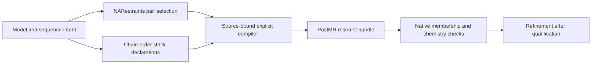

# Full-model NARestraints recipe

Implemented on Cedar in C110. This recipe asks NARestraints to select pairing
relationships from the prepared model and compile pairing and stacking
restraints across its nucleotide chains. It supports supplied search models
with explicit sequence targets and mirrored L-DNA. It does not require a new
frame-specific pair manifest for each construct.

## Input card

Add this line to the dataset's existing `nasolve.txt` `[automr]` section:

```ini
restraint_scope = all
```

For a supplied D-DNA search model that must be mirrored for L-DNA diffraction:

```ini
[automr]
mode = nonstandard
model = 3gbi.pdb
mirror = true
restraint_scope = all
sequence_file = construct.fasta
```

The sequence file must describe the intended chains. Inline `[sequences]` is
also supported. Mirroring is separate from sequence intent. For the L-3GBI
control, the operator explicitly chose the supplied PDB's exact sequence;
its four chain sequences were therefore copied into the local input card.
Sequence alone does not identify spatial partners or prove base-pair geometry.

AutoMR freezes the scope into the input snapshot and PostMR plan. Campaign
planning and preflight preserve it through their existing frozen resources.
For an already completed MR run, an explicit one-run override is available:

```bash
nasolve postmr RUN --restraint-scope all
```

The report distinguishes this override from a frozen input card. Omit the
setting to retain existing behavior: W's selected-pair/scaffold recipe and the
separate `--modified-pairs-only` path keep their established scope. Combining
`all` with that flag or a frame-specific forced pair geometry is rejected
before allocating PostMR output.

## What the recipe does

1. Read one unambiguous nucleotide PDB and require registered, unambiguous
   NARestraints component records. Source dictionary lookup is independent of
   whether Coot has a supported construction parent for that sugar.
2. Run NARestraints' existing pair finder with noncanonical recipes enabled.
   Preserve its warnings and all selected relationships, without filtering by
   whether a residue is canonical or modified.
3. Declare consecutive same-chain stacks, respecting PDB `TER` boundaries.
   Chain adjacency is a restraint policy, not proof of a covalent bond or an
   observed physical stack.
4. Use the existing explicit-site compiler to bind recipe atoms to actual PDB
   atoms and selected source graphs. Compile pair bonds/angles/parallelities
   and one mapped parallelity per stack; disable competing native
   secondary-structure guessing. This prevents a second pairing/stacking source.
5. Freeze the source model, dictionaries, compiled PHIL and compiler receipt.
   PostMR records run-relative references and checksums, then follows ordinary
   ReadySet and checkpoint preparation. The recipe changes no coordinates.



`full_model_restraints.json` records selection warnings, pair/stack counts,
unpaired sites, sites with no selected relationships, source authority and
relative paths to the compiler artifacts. Its schema is 1. Existing run and
checkpoint schemas are unchanged. `automatic_adoption = false` retains the
compiler's chemical-candidate policy: including the generated PHIL does not
authorize repairing or adopting a new chemical state.

## L-3GBI evidence

The supplied model contains 855 atoms and 42 residues. NARestraints 1.1.3 maps
canonical D components to `0DA/0DC/0DG/0DT`, including the renamed adenine and
thymine base atoms. The mirror reverses all 126 distinct tested sugar centres
(147 ordered-volume checks) and a second mirror restores atom identities,
coordinates, occupancy, B factors, elements and ATOM/HETATM classification.
This is a relative mirror/round-trip check; PDB header preservation and an
independent absolute CIP assignment are not claimed.

Phenix **2.2.1-6174** completes molecular replacement with **TFZ 15.8 / LLG 324**.
The pair finder selects the same 19 relationships before and after reflection.
The complete recipe compiles 19 pairs and 38 chain-order stacks: **49 bonds,
82 angles and 57 parallelities**. Exact native comparisons, including a fresh
read of the ordinary PostMR bundle, confirm these additions and preserve all
other captured proxy families. The diagnostic dictionaries retain all 38
in-model O3-prime–P links and 126 signed sugar proxies, with no sign conflicts.
Ordinary PostMR reaches `POSTMR_READY`; this is a preparation result.

Two installed-library-only interpretations fail because the four L components
lack numerical monomers there. ReadySet supplies numerical dictionaries in
both an explicit-source probe and the ordinary workflow; four subsequent
interpretations succeed. The source comparison nevertheless rejects exact
chemical-state preservation: phosphate hydrogens are removed, OP2/OP3 charges
change from 0 to -1, phosphate bond-order representations change, and R/S
metadata is omitted. Purine aromatic representation also changes. Preserved
L-sugar volume signs do not settle those separate questions. No coordinate
refinement or pair-geometry improvement is claimed.

Four end residues (`A:101`, `A:102`, `D:101`, `D:102`) remain unpaired within
the supplied asymmetric unit. Symmetry-related partners have not been searched
or qualified. These sites remain visible in the report; `all` means the full
model is considered, not that every possible relationship is known.

Exact commands, hashes and validation results are recorded under
`l_dna_full_model_recipe_2026_10_28` in the
[evidence ledger](cif-linked-native-registration-evidence.json). Raw supplied
data, native logs, models and generated dictionaries stay in the local test
capsule. The original four input files retain their bytes and timestamps.

## Current limits and next checks

The initial compiler accepts one fixed-column PDB without alternate conformers
or insertion codes, registered nucleotide components, at least one detected
pair, and the existing bounds of 64 pairs / 256 stacks. Unknown components,
ambiguous role records, unresolved selectors, unsupported source graphs and
duplicate/multiply paired sites stop preparation. A mixed model containing
unmapped waters/metals or other non-nucleotide residues needs an explicit
exclusion/scope policy; it is not silently treated as completely restrained.

The pair finder can miss badly displaced or symmetry-related partners.
Reported unpaired sites are evidence to investigate, not automatic deletion
requests. Neither a successful compilation nor `POSTMR_READY` establishes
source chemistry, numerical derivatives, convergence or scientific approval.
Next L-3GBI gates are source-preserving numerical L-component definitions,
explicit linkage/protonation qualification, periodic end-pair coverage and a
fresh, bounded refinement with before/after pair measurements. The existing
Cedar native-gradient qualification requirements still apply.

## Methods paragraph

NASolve selected all model-derived base pairs using NARestraints 1.1.3 and
compiled its atom-role-mapped pairing recipes together with declared
consecutive-chain stacking restraints. A source-bound compiler checked each
selection against the model and component graph, froze its provenance and
disabled competing native secondary-structure guessing. Fixed-coordinate
Phenix 2.2.1-6174 interpretations compared the complete native restraint
inventory before and after the generated policy. Mirroring, chemical-state
preservation, native membership and achieved geometry were evaluated as
separate validation claims.
