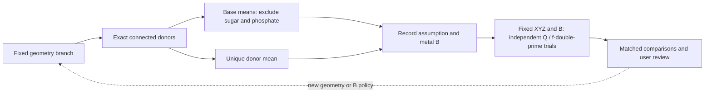
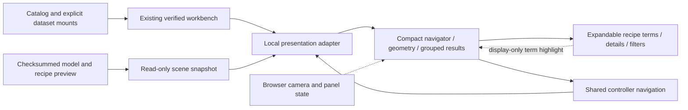
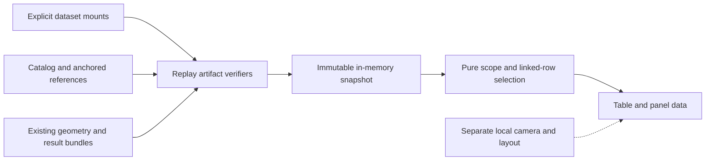
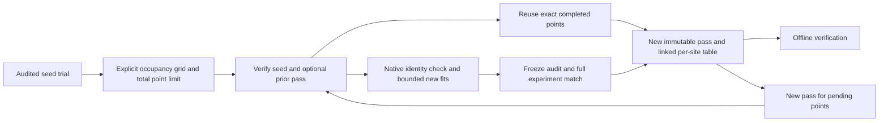
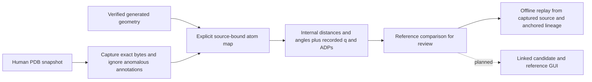
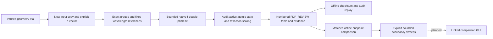
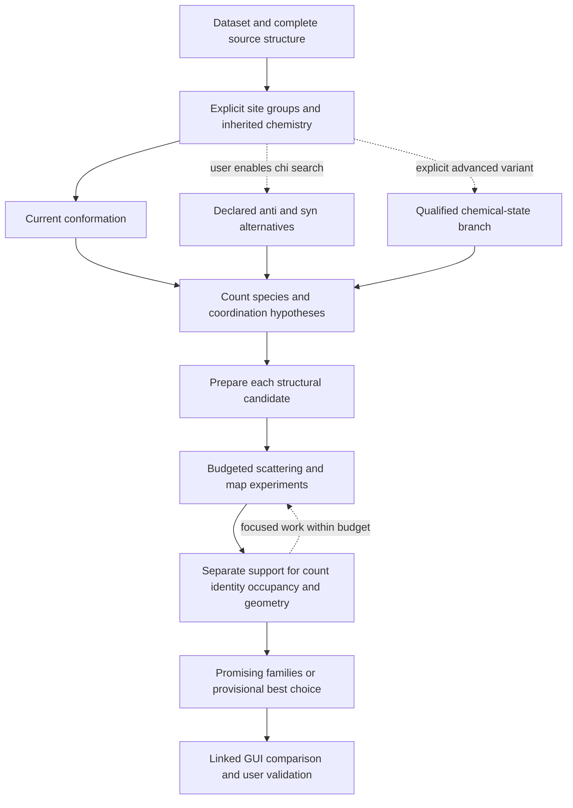

# Metal hypotheses and anomalous-scattering diagnostics

Status: **single-trial frozen f-double-prime diagnostics, matched endpoint comparisons, bounded occupancy sweeps, human reference snapshots, offline workbench navigation and a local read-only results viewer, explicit construction and bounded recipe-only preparation implemented**.
Implementation updated 2026-10-28. Explicit bounded occupancy sweeps are implemented; automatic search and scientific decision qualification remain planned.
Solution-space search, decision logic, maps and editable GUI behavior below remain planned. This contract
defines a bounded diagnostic workflow for metal identity, site count, occupancy
and cluster hypotheses. It complements the [restraint builder](metal-restraint-builder.md)
and the existing refinement Doctor; it is not a new Cedar/Pine integration gate.

The planned [explicit metal-screen mode](metal-screen.md) starts from AutoSol
sites and phase products, explores counts up and down, and records the campaign
no-metal fallback policy. This is an opt-in experimental recipe; ordinary
NASolve's conditional AutoSol behavior remains unchanged.

## Implemented environmental metal B preparation

For quantitative use, the source must be the **completed XYZ/ADP-open refinement
endpoint for this candidate**, followed by pinning XYZ. Parent scaffold B is not
the intended source. The current calculator accepts its supplied geometry and
does not yet enforce that refined-endpoint provenance; the
[endpoint bridge](metal-screen.md#geometry-refinement-environmental-b-and-frozen-trials)
remains to be implemented and qualified. A separate
[phase-restrained XYZ review API](metal-screen.md#implemented-phase-restrained-xyz-probe)
now captures a native refined endpoint with exact phases and fixed-Q/scattering
audits; it does not yet feed this calculator or make an eligible fdp seed.

Each fixed-geometry branch prepares metal B **before** fixed-occupancy
f-double-prime quantitation. The assumption is that metal displacement resembles
its local ligand environment; this is an explicit model assumption, not an
independent measurement. XYZ, Q and f-prime remain frozen during each native
f-double-prime fit. Occupancy trials from the same seed reuse the identical B
preparation; changing geometry or policy requires a distinct seed/basis.

`metal fdp --metal-b-policy base-mean` is the new CLI default. For each fitted
metal, enabled resolved recipe distance terms select its exact coordinating donor
atoms. **Base-mean** takes all available non-H/D atoms of each connected
nucleobase, computes each base mean separately, then gives those base means equal
weight. Sugar and phosphate are excluded. Captured component connectivity selects
the modified base fragment across its C1-prime attachment; standard nucleobase
inventories cover canonical components when no dictionary is supplied. Ambiguous
or unavailable modified-component graphs require an explicit alternate policy.

`donor-mean` averages each unique coordinating atom once. `keep` explicitly
retains the input metal B. No proximity search or hidden fallback chooses ligands.
High B values such as 170–400 Ų are valid; only the PDB representation limit
applies. Both methods retain individual base means and their spread so a mismatch
between bases is visible. These are arithmetic, unweighted means; each method's
weighting is recorded. A branch needing a different environmental assumption
must select it explicitly. Anisotropic target metals require separate ADP handling
and are rejected by averaging policies rather than changing B while retaining Uij.

The immutable trial records source-model checksum, exact contributing atom keys,
reported B/ANISOU presence, method, previous metal B, separate base means, full
mean and applied two-decimal PDB B. Parent coordinates/files remain unchanged.
Replay independently regenerates this preparation from the checked geometry and
CIF inputs. Comparison and scan reuse require the same preparation basis;
legacy and prepared trials cannot silently enter one matched comparison.

**Methods and compatibility.** `metal.environment.calibrate_b` implements the
preparation, using `metal.chemistry` for captured component graphs. `fdp.make_plan`
applies it before Q overrides and native execution. The native worker and frozen
protocol remain unchanged. Trial schema 1 gains optional `b_calibration` plus
`options.metal_b_policy`; replay of older files omits them and is byte-compatible.
Programmatic `run_fdp` calls without the new argument retain legacy B behavior;
new integrations should pass the intended policy explicitly. Updated readers are
required for prepared trials. Existing data are neither migrated nor rescaled.
The viewer is read-only and previews this step; it does not launch preparation or
fitting. The process strip is a workflow guide, not a fabricated execution tree.



**Evidence and limits.** Regression controls include high B, unequal base sizes,
sugar/phosphate exclusion, source identity, missing chemistry, anisotropic metals,
legacy replay, scan inheritance and source-removed relocation. Four complete
Phenix **2.2.1-6174** trials on the saved Hg/AuAg controls exercised both independent
Q changes and preserved input/final atomic-state audits; all prior files were
preserved. Their generated nucleobase atoms all have B = 20 Ų, so this validates
mechanics, not experimental f-double-prime/occupancy inference. A credible base-B
field from the candidate XYZ/ADP-open refinement endpoint is still required.
Uniform contributing B values are flagged
in the preview for inspection. No new Coot execution or scientific solution
qualification is claimed.

## Implemented local saved-results viewer

`metal serve-workbench` presents the shared verified controller in a local,
read-only browser interface. It is an initial comparison viewer, not the full
NASolve GUI or an editable restraint builder. Initial and revised interfaces
received user visual review on 2026-10-28; the revised viewer was positively
received. Table/plot organization remains provisional pending representative
real data, not a settled presentation contract. Scientific navigation and the
HTTP boundary have regression coverage; visual review is not scientific acceptance.

```sh
nasolve metal serve-workbench --catalog /path/to/local/catalog.json --dataset hg=/path/to/HgDataset --dataset mixed=/path/to/AuAgDataset
```

Supply exactly the dataset IDs in the existing catalog. After verification, open
the printed local URL in a browser. Keep the terminal running; Ctrl-C stops the
viewer. `--port 0` (the default) chooses a free loopback port. An explicit port is
optional. No Node installation, internet service, Phenix discovery or Coot process
is required to use the viewer. Node is used only for presentation-helper tests.

The navigator selects dataset, structure, candidate, site group and result set.
A result row opens its exact parents through `Workbench.select_row`; **All
results** clears the navigation scope. The initial view opens the first saved
row in catalog order as a viewing convenience, without ranking or checkpoint
selection. Selecting a dataset or structure fills its first available descendant
in catalog order; the underlying controller still clears children on parent
changes. One table per dataset/structure/candidate contains numbered trial row
groups. Each group retains its metals and aliases when comparison and scan
reports reuse the same exact trial identity.
The compact columns show **Q (occ)**, refined f-double-prime, expected wavelength
reference and their ratio. B, fixed f-prime, wavelength and source links expand
beneath the table, grouped by trial. This ratio is descriptive, not a fitted calibration or ranking. Missing values display
an em dash rather than zero. Human-reference rows display the candidate q/B;
the inspector separates the reference snapshot and retains exact source values.
Complete reports expose pending scan points, failures and unmapped scatterers.

The molecular panel projects the verified candidate PDB coordinates in 3D.
Automatic fitting uses principal axes to open the broadest molecular plane,
then fits the projected bounds. Rotate controls two axes; Roll controls the third;
Pan controls both screen axes. Shift-drag pans and scrolling zooms; a zoom slider
and keyboard arrows provide alternatives. These are view operations. Clicking an atom selects
its exact identity, XYZ/q/B and ANISOU presence in **Show details**. These are **geometry-model**
values; the selected frozen trial may use different Q and prepared B, shown separately above.
A selected result/coordinate atom remains visible even outside all named groups
(for example an unassigned background scatterer); this is display focus only.
Site, surrounding-residue and whole-model contexts expand the display without
changing group membership, restraints or fitted parameters. Surrounding residues
means residues containing the selected site's atoms (including exact alternate,
model and symmetry identity), not a distance-neighbor or symmetry expansion.
Blue dotted lines represent enabled, resolved saved **distance restraints**;
an expandable **Coordination recipe** section lists all saved terms, including
angles and disabled terms, with current values, targets and sigma. Selecting a
term highlights its distance or ordered angle arms in orange without changing
its enabled state. The middle atom is labelled as the angle vertex. Exact atom
identities, restraint sets and provenance remain expandable. Faint lines show captured component bonds when available; otherwise
conservative within-residue distance contacts are explicitly display-only.
Neither contact source changes the recipe or environmental B selection. Metals
are larger lilac markers and have their own inspector list. Ligand/metal labels
are hidden at low magnification, show elements at intermediate magnification,
and atom names close up, with collision avoidance. Maps and reference-coordinate
overlays remain unimplemented.
A reference's Cartesian displacement remains absent when its coordinate frame
has not been explicitly established.

The dark panels are separate renderers for navigation, geometry, inspector and
results. Dataset, structure, candidate and camera controls stay visible. Site/result
filters, view help, recipe terms and result explanations are collapsed until
requested; **Show details** opens the initially hidden inspector. The scene/inspector can be resized vertically;
responsive layouts stack panels on narrow windows. Camera/context state is kept
per exact candidate and geometry identity in browser memory. Reloading clears
that local state. No camera or layout field enters the scientific selection.
General panel docking, saved layouts, cross-candidate plots, editing and job
controls remain later milestones.

**Methods and compatibility.** `open_viewer(catalog, mounts)` first calls the
existing offline verifier/controller, then imports checksummed geometry-model
and preview bytes. `Viewer.present` supplies detached presentation values;
`Viewer.navigate` delegates every selection transition to the shared controller.
The transient `metal-workbench-presentation` schema 1 adds a selected scene and
campaign label around the existing view; the scene now also includes recipe
id/name/revision/sets for inspection. Existing catalogs, scientific artifact
schemas and CLI behavior do not change. The pure JavaScript projection preserves
all three input coordinates, applies camera rotations and scales around the
projected bounds. Camera bases, three rotations and two pan coordinates stay in
browser memory. Pure presentation helpers group exact trial IDs and lay out
labels and preserve angle-vertex order; no fitted values or scientific normalizations are invented. Environmental
B previews are computed offline from the geometry, with contributing atoms and
unavailable-method reasons; they do not retrofit any existing result.



The stdlib HTTP server binds only `127.0.0.1`, serves a fixed package-resource
allowlist behind a random per-process URL, checks Host/Origin, accepts bounded
same-origin JSON navigation requests, emits no access logs and disables browser
caching. It has no filesystem, upload, job, editing or checkpoint endpoint. Tabs
send their own selections; the server does not share mutable selection state.
Stop and reopen to refresh/reverify source evidence. No scientific data is
uploaded or written into the package. Keep the local URL and all resulting views
private with the dataset.

**Evidence and limits.** Tests cover exact scene/row linkage, colliding dataset
IDs, snapshot isolation, tampered input, rejected HTTP origins/routes/bodies,
CLI mounts and fresh-interpreter relocation after the original source tree is
gone. Pure JavaScript tests cover exact identities, context expansion, 3D
projection, missing values and camera scopes. The saved Hg/AuAg numerical
controls open without native processes, preserving their input files. Browser
automation was blocked by the host's administrator policy for local URLs, so no
automated rendered-layout or browser-interaction pass is claimed. The initial
manual review supplied screenshots; this revision awaits manual review. See the [current
handoff](development-handoff.md#recipe-import-and-compact-review-2026-10-28) for commands
and receipts. These generated controls remain scientifically unqualified;
viewing them does not resolve geometry, identity, occupancy or model quality.

## Implemented offline workbench controller

The shared `metal.workbench` backend now opens verified saved evidence across
explicit datasets, structures and hypotheses. It supplies stable linked rows
and pure navigation for future interchangeable panels. It does not require a
GUI or a Phenix installation. The current inputs are verified geometry bundles
with optional saved f-double-prime comparisons, finalized occupancy scans and
human-reference comparisons. These remain separate scientific experiments;
placing them in one catalog does not establish cross-candidate comparability.

A catalog describes campaign → dataset → structure → hypothesis. Each structure
names one run; each hypothesis names one exact geometry manifest. Its optional
named site groups contain exact atom identities from that geometry, including
neighboring residues, background scatterers or metals. Groups can overlap. They
only organize the view: they do not change recipe membership, atom coordinates,
restraint targets or fit selections. General-site **model construction** beyond
the current W adapter remains a separate milestone.

The API is `capture_catalog(request, mounts)`, `open_workbench(catalog, mounts)`
and the returned immutable `Workbench` snapshot's `initial_selection`, `select`,
`select_row`, `view` and `to_dict`. Returned objects are detached JSON copies.
`select` changes one parent and clears dependent selections. Site and result
filters are siblings; changing either clears the selected row. `select_row`
opens the row's exact dataset/structure/hypothesis/result; it retains a compatible
current site or chooses the sole matching site. For overlapping memberships it
leaves the site unset unless the caller specifies one. Unassigned atoms remain
visible in the unfiltered result table. Saved selections bind the exact catalog
ID, so a revised catalog cannot silently inherit an old selection. Camera,
layout and overlay state are outside these schemas.

```sh
nasolve metal capture-workbench --request /path/to/local/request.json --dataset hg=/path/to/HgDataset --output /path/to/local/catalog.json
nasolve metal inspect-workbench --catalog /path/to/local/catalog.json --dataset hg=/path/to/HgDataset --json
```

Add a repeated `--dataset ID=PATH` for every dataset. On another machine supply
new mounts for the same declared IDs; mounts are never saved in the catalog.
There is no basename search or fallback to historical absolute paths. The
catalog's run directories use `dataset` anchors; all geometry/result manifests
use checksummed `run` anchors. Source lineage continues to use existing
run/dataset/repository references. Missing, changed or wrong-parent artifacts
reject the entire open operation; partial unavailable-dataset browsing remains
future work. Explicit mounts must be distinct directories; aliases of the same
mount are rejected. Each mount must match the existing run-context dataset root.

An input request has this shape (use actual exact atom keys when adding sites):

```json
{
  "kind": "metal-workbench-request", "schema_version": 1,
  "campaign_id": "controls", "label": "Metal controls",
  "datasets": [{
    "dataset_id": "hg", "label": "Mercury dataset",
    "structures": [{
      "structure_id": "scaffold", "label": "Prepared scaffold",
      "run": {"anchor": "dataset", "relative_path": "AutoMR/run_001"},
      "hypotheses": [{
        "hypothesis_id": "single", "label": "One mercury candidate",
        "geometry": {"anchor": "run", "relative_path": "Metal/geometry_001/manifest.json"},
        "sites": [],
        "results": [{
          "result_id": "profile", "label": "Occupancy profile", "kind": "fdp-scan",
          "manifest": {"anchor": "run", "relative_path": "Metal/fdp_scan_002/manifest.json"}
        }]
      }]
    }]
  }]
}
```

A site entry is `{ "site_id": "pair", "label": "Coordination site", "atoms":
[ATOM_KEY, ...] }`. `ATOM_KEY` uses the exact `model_id`, `chain_id`, `residue_id`,
`component_id`, `atom_name`, insertion/alternate/segment fields and symmetry
identity from the candidate inventory. Existing keys can be taken from saved
preview or result records. No residue numbers are hardcoded into this controller.
All identifiers are stable within their parent scope; labels can be descriptive.
Lists are bounded to 1,024 members and each site to 4,096 atoms. These are input
validation limits, not a campaign-scale performance qualification.

`capture-workbench` verifies source bundles before adding checksums and writing
a new catalog file. `inspect-workbench` replays the complete catalog and returns
a view. `--row ROW_ID` opens a printed linked row; `--site SITE_ID` disambiguates
its membership. `--selection FILE` accepts the `selection` object from a prior
view. `--output` saves a new JSON file and never overwrites an existing file.
Keep catalogs, requests, selections and exported views in user-local storage,
such as the ignored branch artifact directory, outside source commits.

The new schema-1 types are `metal-workbench-request`, `metal-workbench-catalog`,
`metal-workbench-snapshot`, `metal-workbench-selection` and `metal-workbench-view`;
snapshots/views use protocol `metal-workbench-v1`. The catalog stores only labels,
groups and checksummed references. Reports are loaded into an in-memory snapshot
without creating new run artifacts or copying models/reflections. Row IDs bind
campaign/scope, source manifest and source row identity: the existing comparison
row ID, scan point plus node, or reference node. Those original keys and all
scientific fields remain available. Complete source reports preserve
pending scan points, controls, unmatched scatterers and qualification notes.
There is no cross-result ranking, averaging or new scientific normalization.
The existing matched-comparison backend remains the authority for its derived
values; human-reference stored anomalous values remain untrusted and ignored.

**Methods.** Capture and reopen use one strict schema and source-verification
path. The existing geometry, comparison, scan and reference verifiers replay
scientific derivations and checksums. Results must name the exact geometry
registered for their hypothesis. Exact atom-key membership joins rows to zero,
one or several viewing groups; scope plus source identity hashes disambiguate
local names reused across datasets. Pure transitions validate parent scopes and
produce new selection objects. The view returns saved report values without
scientific recomputation, native execution, checkpoint adoption or file writes.



**Evidence and limits.** Synthetic tests cover namespace collisions, overlapping
and unassigned sites, pending points, parent changes, wrong geometry, source
corruption, CLI behavior and fresh-interpreter replay after source removal and
relocation. Read-only controls also open the existing single-Hg and mixed-Au/Ag
results together. See the [current handoff](development-handoff.md#offline-workbench-controller-2026-10-28)
for exact validation and local receipts. A snapshot describes evidence verified
at opening; reopen before relying on current source availability. This is not a
cache hit, independent scientific qualification, automatic solution decision,
campaign scheduler, editable recipe controller or production graphical panel.
The local viewer above now consumes this API without duplicating scientific
logic; rendered visual review remains outstanding.

## Implemented bounded occupancy sweeps

`metal plan-fdp-scan` freezes an explicit Cartesian occupancy grid from one
verified frozen f-double-prime seed trial. `metal run-fdp-scan` executes a bounded
sequential pass; `metal verify-fdp-scan` replays its saved results offline. The
shared API is `metal.fdp_scan.create_plan`, `verify_plan`, `pending_count`,
`run_scan` and `verify_scan`. This supplies a controlled experiment runner for
later GUI panels. It does not choose occupancy values, converge a structure or
refine occupancy and f-double-prime simultaneously.

```sh
nasolve metal plan-fdp-scan /path/to/dataset/AutoMR/run_001 --seed Metal/fdp_008 --occupancies m1=0.50,0.60,0.70 --occupancies m2=0.70,0.80 --max-trials 6
nasolve metal run-fdp-scan /path/to/dataset/AutoMR/run_001 --plan Metal/fdp_scan_plan_001 --job-budget 2
nasolve metal run-fdp-scan /path/to/dataset/AutoMR/run_001 --plan Metal/fdp_scan_plan_001 --job-budget 3 --resume Metal/fdp_scan_001
nasolve metal verify-fdp-scan /path/to/dataset/AutoMR/run_001 --scan Metal/fdp_scan_002
```

Use the exact plan/pass paths printed by each command. A broad or focused grid
uses explicit per-site values; the seed supplies all omitted sites' fixed q.
A singleton axis locks that site to the declared value. Values require PDB's
two-decimal representation, are sorted deterministically and cannot repeat.
Fitted sites require positive occupancy. Independent metal sites do not share
an occupancy sum constraint. Mixed alternate species at one physical site still
require a future explicit mixture policy.

The complete product must fit the caller's `--max-trials` limit, between 1 and
128 points. Each execution pass requires `--job-budget` between 0 and 128;
this caps **trial attempts**, including failed requests, without counting reused
results. Zero permits an offline progress snapshot. The seed's timeout applies
to each trial; there is no total-wall-time or disk-byte budget yet. Native identity
probes and input inspection accompany a new fit and are not additional refinement
experiments. Execution is sequential with the existing one-process fitting policy.

Every point uses the same geometry, model, observations, original Free-R,
restraints, dictionary resources, fitted groups, wavelength references, nuisance
policy, starting f-double-prime and iteration budgets as its seed. Only the
complete placed-metal q vector varies between independent trials. XYZ/ADPs/q
stay fixed within each fit and f-prime remains fixed. The runner checks the
installed native version, worker, refinement-source and compiled-kernel hashes
against the seed before launching jobs. Completed trials must match the seed's
full comparison basis, settings and planned q vector, including actual reflection
selection. A mismatch stops the pass and cannot become a completed point.

Reuse is deliberately scoped: an exactly matching **explicit seed** or a verified
completed point from the **explicit resume lineage** can satisfy a grid point.
There is no directory search or general experiment cache. Reuse retains the
original trial ID, manifest and unresolved scientific status. Every referenced
trial and its input lineage must remain available and verify. A completed resume
can run entirely offline, even with a nonzero budget. Missing/corrupt evidence
fails validation rather than silently rerunning or accepting a summary alone.

Plans use schema-1 `metal-fdp-scan-plan` under `Metal/fdp_scan_plan_NNN`.
Execution passes use schema-1 `metal-fdp-scan` / `metal-fdp-scan-report` under
`Metal/fdp_scan_NNN`, protocol `metal-fdp-scan-v1`. A pass stores immutable
per-point receipts, a report and manifest with checksummed run anchors. The
report links each full q vector to per-site f-double-prime/reference values and
states `REUSED_SEED`, `REUSED_SCAN`, `EXECUTED` or `PENDING`. Native trials remain
ordinary `fdp_NNN` bundles; existing formats and fit defaults need no migration.

A full pass is `SCAN_REVIEW`; a budget-limited or handled-error pass is
`PARTIAL_REVIEW`. Trial failure or a handled keyboard interrupt stops further
work, preserves completed results and records the failed point/error. Resume
creates a **new** numbered pass and retries only pending points, leaving its
predecessor untouched. Resume lineage verification accepts at most 128 passes. A hard kill, power loss or publication failure may leave
an unfinalized pass with per-point receipts. Such a pass is retained but is not
accepted by `--resume`; automatic recovery of unfinalized passes remains planned.
The existing native fitter retains its failed numbered attempts separately.

**Evidence and limits.** Synthetic controls cover Cartesian/locked vectors,
zero and positive budgets, exact seed/resume reuse, failures and interrupts,
incompatible trials/native identities, rehashed tampering, offline CLI use and
source-removed fresh-process relocation. Complete native controls use the
existing generated one-Hg and mixed Au/Ag geometries with Phenix 2.2.1-6174.
They exercise five new fits across two resumed grids and a later fully reused
offline pass. These are numerical workflow controls, not qualified human
endpoints. Native anisotropic qualification, optimizer stopping/conditioning,
geometry/identity/count decisions, automatic recentering, conditional occupancy
refinement, general caching, pruning and GUI attachment remain separate work.
See the [validation handoff](development-handoff.md#bounded-occupancy-sweeps-2026-10-28).

**Methods.** NASolve derives a deterministic occupancy product from a fully
audited seed experiment, retaining the full experimental basis. Bounded passes
reuse exact verified seed/ancestor results and submit remaining points as
independent frozen-coordinate fixed-q fits. Each successful result is re-audited
and matched to its requested vector before a durable receipt is written. A
new pass resumes finalized progress through anchored references; offline replay
reconstructs every row from the original trial evidence.



## Implemented human reference snapshots

A supplied human endpoint is optional comparison evidence. It does not replace
NASolve's generated scaffold. `metal inspect-reference` inventories one explicit
single-model PDB and its declared elements of interest. It retains exact atom
identities, XYZ, occupancy, the reported PDB B field, raw ANISOU integers, charge
text and CRYST1 records. Occupancy/B are recorded snapshots rather than accepted
estimates; out-of-range occupancy and negative reported B are counted as warnings.
Stored f-prime/f-double-prime annotations are always `UNTRUSTED_IGNORED`, including
models subsequently refined for deposition outputs.

```sh
nasolve metal inspect-reference /path/to/human.pdb --element Hg --element Ag --element I --json
nasolve metal compare-reference /path/to/dataset/AutoMR/run_001 --geometry Metal/geometry_001 --reference /path/to/human.pdb --mapping /path/to/reference-map.json
nasolve metal verify-reference-comparison /path/to/dataset/AutoMR/run_001 --comparison Metal/reference_comparison_001
```

The mapping is explicit and bound to the verified geometry ID and original PDB
SHA-256. Example shape (replace IDs/checksum with the exact values and add the
required donor correspondences to compare recipe distances and angles):

```json
{
  "kind": "metal-reference-map",
  "schema_version": 1,
  "geometry_id": "<geometry manifest geometry_id>",
  "reference_sha256": "<inspect-reference source_sha256>",
  "elements": ["Hg", "Ag", "I"],
  "nodes": {
    "m1": {
      "model_id": "1", "chain_id": "E", "residue_id": "1",
      "component_id": "HG", "atom_name": "Hg",
      "insertion_code": "", "altloc": "", "segment_id": "", "symmetry": "x,y,z"
    }
  },
  "note": "Explicitly reviewed correspondence to the reference metal"
}
```

Map 1–64 recipe nodes, including a metal, one-to-one to exact reference atoms.
Case, component, alternate, insertion, model and segment identities matter.
No component alias, nearest-metal assignment or chemical equivalence is inferred.
An element mismatch remains visible for review. The declared elements determine
which **unmapped reference scatterers** are listed; include iodine/bromine when
relevant. All source bytes are captured regardless of the selected elements.
Reference mapping can identify arbitrary residues, but candidate nodes still
come from the existing geometry adapter; this does not implement general-site
candidate construction.

The comparison reports every mapped pair's stored-coordinate distance and each
recipe distance/angle, with signed candidate-minus-reference differences. Pair
distances do not assert bonds. Unmapped/undefined terms remain explicit. Original
recipe targets and sigmas are contextual fields and are never learned from the
human model. Per-node records retain both XYZ/q/ADP snapshots, q and reported-B
differences, element agreement and ADP-representation agreement. ANISOU is retained
as six PDB integers; the B field is not silently interpreted as an isotropic
model or an equivalent B derived from that tensor.

The ordinary `compare-reference` and `verify-reference-comparison` text views
show per-node candidate/reference q and reported B, signed differences, exact
atom labels and ADP representation. Element/ADP mismatches and reference field
warnings remain visible. Unmapped scatterers are listed individually, including
recorded q/B and exact labels; unmapped candidate nodes are named. This display
reads the verified report without modifying it. JSON and all artifact schemas
remain unchanged; reported-B arithmetic does not compare ANISOU tensors.

Coordinate frames are independent: there is no Cartesian displacement/RMSD,
superposition, symmetry expansion, nearest-image search, chirality/chi
classification or map score. Rigid motions leave these internal distances and
angles unchanged; mirrored or differently wrapped structures can remain ambiguous.
An internal-distance comparison alone cannot establish the correct structural
hypothesis. Review CRYST1, mapping, local geometry and model quality separately.

The API is `metal.reference.inspect_reference`, `compare_reference` and
`verify_reference_comparison`. A new `Metal/reference_comparison_NNN` holds the
exact reference PDB, explicit mapping, calculated report and manifest. Schema-1
`metal-reference-map`, `metal-reference-inventory`, `metal-reference-comparison`
and `metal-reference-comparison-report` are additive; comparison protocol is
`metal-reference-comparison-v1`, status `REFERENCE_COMPARISON_REVIEW`.
Operational references use checksummed anchors. The original reference path is
historical provenance only; replay uses the captured bytes and verified candidate
lineage even after that original file is removed. Failed numbered attempts remain.
Existing models/checkpoints and prior formats need no migration. No fitting,
coordinate transfer, automatic selection or production GUI attachment occurs.

**Evidence.** Synthetic controls cover rigid-frame changes, exact labels and
ANISOU, state/geometry differences, incomplete and invalid maps, source mutation,
rehashed tampering, offline CLI use and fresh-process replay from a relocated
checkout with the original source/reference removed. Six supplied reference
models were inventoried locally; FT_Hg and FF_AuAg were compared against existing
generated geometry controls. The additional unmapped Ag in FF_AuAg stays visible.
PDU is deferred. No Phenix or Coot process was run for this feature; human
anisotropic snapshots do not extend native f-double-prime qualification. Exact
validation commands and local evidence are in the
[handoff](development-handoff.md#human-reference-snapshots-and-comparison-2026-10-28).

**Methods.** NASolve parses a source-preserved PDB snapshot, verifies candidate
lineage and applies declared exact atom correspondences. The existing geometry
kernel computes internal distances and recipe angles independently in each
stored frame. Raw atomic-state fields and explicit unmatched scatterers accompany
the comparison. A checksummed numbered bundle permits offline recalculation
without reopening the original human model or running refinement.



## Implemented single-trial frozen diagnostic

`metal fdp` runs one conditional experiment from an explicit verified geometry
trial. Select each fitted metal by its recipe node ID; optional occupancies
change only that new trial's input. Repeat `--fit` or `--occupancy` for distinct
sites. The default is three macrocycles, three anomalous minimizer cycles,
20 iterations per minimizer, a zero f-double-prime start and a 240-second timeout.

```sh
nasolve metal fdp /path/to/dataset/AutoMR/run_001 --geometry Metal/geometry_001 --fit m1 --occupancy m1=0.40
nasolve metal verify-fdp /path/to/dataset/AutoMR/run_001 --trial Metal/fdp_001
```

The shared API is `metal.fdp.run_fdp` / `verify_fdp`. Every attempt gets a new
`Metal/fdp_NNN` directory; failures keep their inputs and available evidence.
A successful schema-1 `metal-fdp-trial` uses protocol `metal-frozen-fdp-v1` and
status `FDP_REVIEW`. It neither creates nor selects a refinement checkpoint.
Older recipes, contexts, hypotheses and geometry artifacts need no migration.

The initial native boundary is Phenix **2.2.1-6174**, model-1 H/D-free PDB inputs,
one explicit standard anomalous amplitude quartet and its positive MTZ dataset
wavelength. Select 1–12 explicitly placed metal nodes; that software bound does
not qualify every count or cluster geometry. Fitted sites require positive q,
and q overrides use PDB's two-decimal representation. The inherited W importer
remains A:12/B:4; general site-group mapping is a separate milestone.

Each fitted metal has an independent exact atom selection. All f-prime values
are fixed to local CCTBX Sasaki references at the actual wavelength. Every other
atom, including iodine and unfitted metals, has fixed reference f-prime and
f-double-prime. The table provider, native version and binary checksum are saved.
There is no automatic anomalous-site search, added solvent/hydrogen, N/Q/H flip,
external phase restraint, coordinate/ADP refinement or occupancy refinement.
The original Free-R column and explicit test value (default zero) are audited;
invalid or unavailable flags stop the attempt. A usable noisy audit is retained
with its warning. This does not use processing anomalous statistics as a gate.

The maintained worker uses Phenix's standard refinement Program. Its explicit
outer target is ML; this native version temporarily uses least squares for the
anomalous-group minimizer, then restores ML. Bulk-solvent and overall scales
remain profiled nuisance parameters. Both overall isotropic ADP transfer and
bulk-scaling backtrace are disabled. Native Phenix can uniformly rescale all
F and sigma values internally: the audit permits exactly one positive common
factor, with identical HKL and Free-R membership. Every F and sigma must match
that factor (relative tolerance 1e-10, absolute 1e-9). Original MTZ bytes remain
unchanged. This is a declared scaling policy, not a promise of fixed nuisance
parameters or byte-identical internal amplitudes.

The worker captures the active fmodel and requires agreement with the model's
atomic state. Readback checks every atom's identity, charge, normal scattering
type, XYZ, q, isotropic B or anisotropic tensor, and fixed anomalous terms. It
also checks exact anomalous-group membership and parameter freedoms. Freeze
tolerances are 1e-7 Šfor XYZ, 1e-10 for q, 1e-7 Ų for B, 1e-8 Ų for Ucart and
1e-10 electrons for fixed scattering. A separate serialized PDB readback must
preserve the complete input atomic state exactly. Current complete native
controls cover isotropic models; ANISOU checking is not broad native qualification.

Each bundle retains input model/observations/restraints, planned and effective
parameters, native log, final PDB, per-site results and compressed full-precision
atomic/reflection evidence. Native refinement/minimizer and compiled-kernel
fingerprints accompany the worker hash. Maps, MTZ/reflection-CIF exports and
duplicate model-CIF exports are disabled. Local example bundles occupy roughly
0.8–1.0 MB each including their input copies; this is not a general size bound.
Disk budgeting, shared-input deduplication and recovery-aware pruning remain
planned. `verify-fdp` checks anchored hashes, reconstructs inputs and repeats the
saved-evidence audit offline after relocation. It does not rerun the optimizer
or establish bitwise reproducibility of a future native fit.

**Evidence and limits.** One-Hg controls at q=0.6 and 0.4 and independent mixed
Au/Ag and swapped Ag/Au controls completed on the declared native version with
freeze audits and offline replay passing. They use generated scaffolds and
seed-derived numerical geometry targets. The fitted Hg values changed with q;
that demonstrates response, not a solved geometry or correct metal count.
The report deliberately labels convergence `NOT_INDEPENDENTLY_ASSESSED` and
scientific acceptance `NOT_ASSESSED`. Native completion alone does not establish
an optimizer endpoint. Negative fitted values are retained with a warning.
Initial start/cycle and occupancy controls now accompany the comparison layer
below. Conditioning, optimizer stopping/gradient qualification, weak/correlated-site
controls, scientific ranking, adaptive scan orchestration, general caching and GUI integration
remain follow-up work.
See the current [validation handoff](development-handoff.md#metal-frozen-f-double-prime-diagnostic-2026-10-28)
for exact commands, results and retained failed attempts.

**Methods.** From a verified recipe-prepared model, NASolve constructs an
independent fixed-q experiment with complete per-atom anomalous coverage and
wavelength-specific references. A version-gated standard Phenix refinement fits
only the selected f-double-prime groups while profiling declared scale terms.
Full-precision atomic and reflection readback is audited against the plan, with
an independent PDB check and checksummed immutable lineage. The resulting table
is a conditional diagnostic for review, not automatic structural acceptance.



## Implemented matched endpoint comparisons

`metal compare-fdp` reads 2–128 explicit completed trials from one run, verifies
their saved inputs and audits, and publishes a new `Metal/fdp_comparison_NNN`
bundle. It launches no native process. The shared functions are
`metal.fdp_compare.build_comparison` and `verify_comparison`.

```sh
nasolve metal compare-fdp /path/to/dataset/AutoMR/run_001 --trial Metal/fdp_001 --trial Metal/fdp_002
nasolve metal verify-fdp-comparison /path/to/dataset/AutoMR/run_001 --comparison Metal/fdp_comparison_001
```

Each row links an exact trial ID, manifest and metal node to the complete
placed-metal occupancy vector, starting f-double-prime, macrocycle/minimizer
budgets, fitted/reference scattering, q times f-double-prime and wavelength.
The signed reference deviation is `(fitted - reference) / reference`; a zero
reference produces an explicitly undefined value. This is a display quantity,
not a score or an acceptance cutoff. Rwork/Rfree remain contextual values.

Comparability requires identical geometry lineage, observations and effective
reflection selection, Free-R policy, groups, fixed background scattering,
references, nuisance/phase policy and native worker/kernel fingerprints.
Only placed-metal q, starting f-double-prime and the declared iteration budgets
may vary. Different datasets, geometries or identity assignments require separate
comparisons at this stage; broader hypothesis comparison is still planned.
Trials with different environments or policies are not silently pooled.

The report groups **one changed variable at a time**. Start sensitivity fixes the
entire q vector and all budgets. Macrocycle/minimizer/iteration-budget sensitivity
fixes all other settings. A site's occupancy response fixes every other placed
metal's q and all optimizer settings. Changing both sites' q together therefore
does not become an isolated occupancy response for either site. Replicate rows
remain separate; no averaging hides disagreements. An axis with fewer than two
distinct tested values is `NOT_TESTED`, including identical repeated runs.
`COMPARED` means only that matched endpoints exist. Ranges describe observed
endpoints and are neither confidence intervals nor a convergence test.

The schema-1 `metal-fdp-comparison` manifest uses protocol
`metal-fdp-comparison-v1` and status `COMPARISON_REVIEW`. A checksummed report
references the original immutable trials, without copying their models or MTZs.
Verification reconstructs the report from those trials after anchored-path
resolution. Missing or changed evidence fails verification; a compact summary
cannot stand in for the full trial. All parents are rechecked before publication,
and failed publications retain their own numbered attempt. Existing trial
formats, default fitting behavior and checkpoint selection remain unchanged.

**Evidence and limits.** Additional complete Phenix 2.2.1-6174 controls compare
starts of 0 and 10 electrons at 3/6/10 macrocycles for the one-Hg endpoint and
3/6 cycles for one mixed Au/Ag endpoint. Longer-budget Hg controls also compare
q=0.4, 0.6 and 0.8. Early Hg endpoints still move with extra cycles; the tested
starts become much closer at the longer budgets. Mixed-metal endpoints also
show reduced start dependence. These are conditional results on generated
numerical geometries, with all original freeze audits passing. Endpoint agreement
does not establish global convergence, identifiable occupancy or correct metal
chemistry. The comparator never chooses a winning structure or a next q value.
See the [current comparison handoff](development-handoff.md#metal-endpoint-comparison-and-sensitivity-controls-2026-10-28)
for exact control inventory and validation commands.

**Methods.** NASolve revalidates each explicit frozen-fit artifact, requires a
shared experimental basis, and groups per-site endpoints by all fixed controls.
It reports ranges across starts, budgets or one site's occupancy, preserving
replicates and exact trial-to-row lineage. A new immutable summary is replayable
from its source trials without Phenix. Its status deliberately leaves optimizer
convergence and structural acceptance unresolved.

## Purpose and experimental stages

The scientist defines plausible metal arrangements and NASolve executes and
records the comparison. The output is a set of traceable alternatives, including
an unresolved result when the data cannot discriminate them. A fitted f'' value
is a conditional scattering estimate, not an atom counter or a chemical verdict.

Keep these operations separate:

1. **Design:** create reusable donor/metal graphs and restraints without data.
2. **Bind and prepare:** bind the recipe to an explicit model/checkpoint; create
   a derived model only when requested. Audit dictionaries, chemistry, symmetry
   and effective restraints, then prepare each candidate geometry under the same
   declared protocol. Preserve each geometry endpoint and its limitations.
3. **Freeze and probe:** snapshot the chosen endpoint for each hypothesis;
   run independent fixed-occupancy f'' fits with fixed coordinates and ADPs.
4. **Compare:** inspect per-site response, maps, geometry, fitted parameters and
   alternative hypotheses through linked tables and model views.
5. **Continue:** explicitly select an eligible checkpoint or request a separate
   follow-up experiment. Browsing or sorting results never selects a checkpoint.

Different geometric hypotheses need their own preparation. Comparing their
frozen endpoints is distinct from a matched-coordinate identity substitution
control; record which experiment was performed. Final joint refinement, if
requested, creates another child and does not retroactively validate the scan.

## Solution-space search and provisional decisions

**Planned intent.** The automation should explore many small, controlled Phenix
experiments and expose the most promising regions of the evaluated solution
space for user validation. A case may reasonably need about 75 jobs across
geometry, scattering and map questions. This is a workload example, not a
minimum, default or ceiling. A bounded search has declared resource limits and
traceable decisions; it need not contain only a handful of trials.

Campaigns organize independent datasets. Within each dataset, retain a solution
tree of whole-structure hypotheses and experiments, with explicit site-group
scope. Named coordination groups may map to arbitrary declared residues and
atoms and may contain several metals. A:12/B:4 remains only the current W
importer's mapping. Group navigation never discards other scatterers or implies
that their fits are independent. Shared atoms, phase/scale policies and nearby
signal require explicit joint or separate experiment definitions.

Inherit ligand chemistry from the attached NARestraints/CIF Doctor/PostMR state.
Advanced chemical variants require explicit declarations and derived resources.
Chi exploration is an optional user toggle per group, off by default; an enabled
pair search can explore declared anti/syn combinations in explicit residue
order. Coordinate preparation, count/species, coordination graph, occupancy/B
assumptions and scattering trials form further branches. No universal ordering
or exhaustive Cartesian product is required. Record the parent, changed
assumptions, reason for branching and exact resources at every node.

Return to any saved node and create another child without rewriting its history.
A prepared anti-syn/two-metal/mixed-species candidate can be compared with a
syn-syn/one-metal candidate from the same dataset under a matched diagnostic
protocol. Switching the displayed dataset, structure or group does not choose
a scientific result. Every leaf retains its exact artifact identity and retention status. Protected
comparison candidates keep their models/maps; compacted trials retain audited
results and recovery inputs under the storage policy below.

Report support separately for count, identity, occupancy and coordination
geometry. For example, two Hg sites may be well supported while the competing
N3-O4/O2-N3 slip arrangements still require visual inspection. Auto mode may
choose a provisional best candidate or exact next seed under a declared policy
and budget. Preserve alternatives and the evidence for selection/pruning; close
competitors lead to a focused GUI comparison. An unresolved result is valid.
Provisional choices do not silently change the current checkpoint or establish
a final structure: final structural validation remains with the user.

Present multiple promising candidate families when the evidence warrants them.
These are the user's solution-space "islands": groups of evaluated candidates
with related structures/coordination and useful, stable evidence. Define and
display the grouping criteria and representative rows; there is no implemented
clustering or confidence formula yet. More sampled trials in a family do not
make it more probable, repeated cache hits add no evidence, and nearby points
are not independent confirmations. Retain meaningful tradeoffs instead of
concealing them inside one arbitrary score. Distinguish rejected, unrun,
budget-limited, technically failed and scientifically ambiguous alternatives.

**Planned methods.** Generate eligible candidates from inherited components,
explicit group mappings and user-enabled conformational/chemical options;
freeze compatible comparison plans; evaluate broad samples; use recorded
evidence to allocate focused work within the remaining budget; reuse verified
identical experiments; then present representative candidates with their local
alternatives and limitations. Audit the decision logic separately from successful
model construction and native job completion.



## Fixed dispersive term and campaign scope

The [materialization adapter](metal-restraint-builder.md#explicit-metal-model-construction)
now creates source-bound numbered review models with explicit metal identities,
positions, q, B and separate formal-charge declarations. It preserves all parent
atoms and observations and supports unrestrained floating sites. Exact saved
derivation replay is available through `metal verify`. Its native controls prove
consumption, not chemistry qualification. A separate
[bounded recipe-only preparation step](metal-restraint-builder.md#bounded-metal-only-recipe-preparation)
now moves selected metals against explicit targets, preserves the scaffold and
all q/ADPs, and reports residuals and unconstrained motion. It does not optimize
the inherited whole-model objective or qualify chemistry/clashes. The
implemented single-trial adapter above probes these endpoints conditionally;
whole-model qualification and comparison workflows remain separate. Identical targets and coordinates produce identical
prepared geometry under an Au/Ag identity swap; element discrimination remains
a task for experimental evidence.

In this metal workflow f-prime is fixed at the declared element/wavelength
reference throughout diagnostic fits. It is not offered as a freely fitted
parameter at the working resolutions. Geometry preparation and the later
conditional occupancy fit retain an explicit fixed f-prime policy too. This
contract does not silently change the existing ordinary AutoRefine default.
The generated-run inspector reports reference f-prime/f-double-prime separately
from future fitted values; it starts no refinement.

The implemented offline controller and future campaign GUI must retain explicit campaign, dataset, run,
checkpoint, hypothesis, round and trial identities. Switching the viewed dataset
or structure only changes the view; it never changes a checkpoint, reuses a
selection from another model or launches jobs. Different crystals remain
separate observations even when they share a recipe or chemical design.
All seven known-positive test cases should eventually be staged together, with
independent status/lineage and linked per-site tables in the same GUI. The PDU
two-metal slip case waits for integrated qualified PDU restraints.

Automatic proposals and provisional choices follow the planned solution-space
policy above. Declared metal identities,
iodine/bromine sites, possible clusters and experimental evidence can define
priors and constrain geometry alternatives. Focused anomalous phasing and local
map/geometry evidence can evaluate those alternatives. Record the origin and
strength of each prior, avoid counting prior information as another diffraction
observation, and retain phase-model dependence and unresolved alternatives.
Joint multi-wavelength fitting requires explicitly related datasets; campaign
membership alone does not establish a MAD experiment or common occupancy.

## What occupancy and f'' can establish

For an isotropic atom its anomalous contribution contains the factor
`q * f''(lambda) * exp(-B*s^2)`, where `q` is occupancy and
`s = sin(theta)/lambda`. Spatial phases, the rest of the model and experimental
scaling also matter. This expression explains parameter coupling; it is not a
replacement refinement target or a universal inverse-response law.

At fixed coordinates and ADPs, changing q may be compensated by fitted f''.
Seeing f'' respond therefore helps diagnose whether the fit is active and
sensitive, but does not by itself establish occupancy, element or metal count.
Conversely, a weak or flat response can arise from poor signal, coupled sites,
incorrect selections, parameter bounds, scaling or nonconvergence; it does not
automatically establish a mixed metal. Keep those alternatives explicit.

Two complementary experiments answer different questions:

| Experiment | Fitted | Fixed | Interpretation |
| --- | --- | --- | --- |
| Occupancy profile | f'' for declared anomalous groups | XYZ, all ADPs, q, f' | Scattering required at each assumed occupancy |
| Element-conditioned occupancy | q under explicit constraints | XYZ, ADPs and reference f'/f'' | Occupancy conditional on that element/reference |
| B or geometry sensitivity | Only the declared extra parameters | All other controls | Dependence on the prepared geometry/ADPs |

Do not simultaneously free q, B and f'' and present their output as a uniquely
identified solution. Initial B choices and any neighborhood-derived B policy
remain recorded assumptions. A B sensitivity check is a separate experiment.
Use `occupancy`/`q` and `formal_charge` explicitly; a cluster charge Q is not q.

## Inputs and comparison groups

### Iodinated bases as internal experimental controls

Known iodinated bases provide identifiable anomalous sites alongside candidate
metals. Use the actual wavelength reference and explicit occupancy/ADP assumptions;
comparable atomic f-double-prime values do not guarantee equal effective signal.
First evaluate iodine independently as a recovery/control site. An optional
constrained-reference experiment is separate: agreement forced by fixing iodine
to its reference is not an independent validation result or a reason to silently
renormalize every metal estimate.

Plan individual and joint omission controls for iodine and nearby metals. Inspect
whether signal returns at omitted positions and whether another site's fitted
response changes as hypotheses vary. Recovering nearby I/Ag sites can support
separability at similar effective strength, separation and disorder. It does not
guarantee separation of a closer or more disordered Ag/Ag pair. Chi variants must
carry attached iodine with the base; an iodine control is bound to that exact
structural hypothesis and complete anomalous-group policy.

### Matched experimental inputs

Freeze the source checkpoint/model, observations, original Free-R flags and test
value, symmetry, dictionaries, active restraints, source recipe and atom mapping.
Use declared anchors and checksums for operational references. Keep explicit
CLI paths available. No basename discovery or writable reference to a cache
may substitute for independent frozen inputs.

Require actual separate Friedel observations, their labels and uncertainties,
and a known wavelength for a wavelength-referenced diagnostic. Report anomalous
completeness, multiplicity and resolution support where available; overall
diffraction resolution does not prove equal anomalous resolution. Mean-only
data can support design/geometric work but cannot silently enter this scan.
Audit Free-R consistency under the existing rules without regenerating flags.

A comparison group shares observations, flags, resolution treatment, likelihood,
phase policy and nuisance-parameter policy. Keep excluded reflections and all
selection rules visible. An MR/SAD phase source generated under a competing
heavy-atom hypothesis can bias comparisons: use a common declared phase policy
and separately test phase dependence when appropriate. Never pool different
crystals or processing alternatives into one same-data rank.

Reference f'/f'' values carry element, exact wavelength/energy, table or scan
source/version, interpolation and calibration provenance. Atomic tabulations
near an absorption edge need not capture white-line or chemical-state effects.
A calibrated scan and a tabulation remain distinct reference options. No
universal Ag/Hg cutoff, tolerance of one electron, or target from a particular
paper becomes a default for Au, other energies or other experiments.

## Frozen diagnostic protocol

For each eligible geometry endpoint:

- Resolve explicit anomalous groups to exact atom identities, including altloc
  and symmetry. Check empty, overlapping and ambiguous selections. Keep other
  known anomalous atoms, such as iodine in modified bases, in the model with an
  explicit fixed or fitted policy. Do not merge distinct sites by element alone.
- Build each q-vector trial independently from that endpoint. Change q only in
  the new input. q=0 is an omitted-site control with f'' marked not identifiable,
  not a division-by-zero point on a fitted response curve.
- Disable XYZ, real-space, ADP/TLS and occupancy refinement, automatic atom
  addition/removal, coordinate corrections and other unintended model changes.
  Fix f' to the declared reference and fit only the requested f'' parameters.
- Freeze or explicitly profile bulk-solvent/overall scale and other nuisance
  terms with the same policy across a comparison. Audit automatic ADP rescaling
  too: absence of an ADP strategy alone does not demonstrate fixed output B.
- Record starting f'', bounds, cycles, stopping reason and sensitivity to
  declared alternate starts. Starting at zero is one reproducible protocol;
  preserve any failed zero-start attempt before trying another start.
- Read back effective parameters and actual output atom identities, coordinates,
  occupancies, ADPs and fixed scattering values. A violated freeze invalidates
  the diagnostic even if the process exits successfully. Report failures and
  partial evidence without promoting them to usable model checkpoints.

Validate the installed Phenix version with a dry run and then a complete native
control before claiming this protocol works. Native finite-precision and model
serialization tolerances must be justified and versioned, not silently widened.

## Hypotheses, mixtures and clusters

Support explicit one-, two- and three-metal base-pair hypotheses, mixed Ag/Au
assignments, two-versus-three Au arrangements, and a zero-metal control. A graph
of stable metal slots and edges extends the representation to larger clusters.
Cluster hypotheses can include metal-metal edges and donors from neighboring
residues, with explicit symmetry ownership. A polyhedral template proposes
geometry; it does not establish a cluster's existence or bonding.

Distinguish separate coexisting sites from mutually exclusive elements at one
physical site. For same-site alternatives the physical occupancy sum is at
most one (including a vacant state); distinct sites have separate budgets.
Special-position multiplicity and the native occupancy convention must be
resolved explicitly before applying that constraint to serialized atoms.
For a cluster, offer a shared occupancy only as an explicit intact-cluster
model; independent site occupancies describe a different disorder hypothesis.

Shared f'' groups reduce parameter count but impose equality. Per-site groups
allow different values but may be unidentifiable at limited resolution. Show
the grouping, fitted parameter count and sensitivity instead of quietly choosing
the grouping that gives the most favorable identity assignment.

Report these quantities separately:

- modeled site count and symmetry scope;
- expected occupied atom count, `sum(q_i)` over the declared physical sites;
- each fitted f'' and its element/wavelength reference;
- optional arithmetic sum of per-atom f'', clearly labeled and with group
  values expanded per atom exactly once;
- optional occupancy-weighted sum `sum(q_i*f''_i)` with identical site scope;
- resolution-dependent attenuation and actual modeled diffraction evidence.

These sums are bookkeeping summaries, not the measured total anomalous signal:
interference, B factors, symmetry and resolution remain in the structure-factor
calculation. Do not divide a cluster summary by one atomic f'' to infer a
unique count. If a source table does not define weighting or grouping, retain
that ambiguity rather than interpreting its number as a runtime target.

Close sites must also be assessed together. Use omitted-site controls and
residual/anomalous maps to examine whether adding a site changes the fitted
signal at neighboring sites. Keep atomic-species hypotheses, oxidation states,
cluster charge and protonation separate. Optical, chemical and computational
evidence may inform declared priors, but is not another diffraction observation
or automatic proof of atom count/charge.

## Bounded, scriptable experiments

Freeze a finite plan containing hypothesis IDs, occupancy vectors/grouping,
starts, controls, resources, parameter policies and maximum jobs/cycles/time.
Preview known job counts and the adaptive allowance before execution. Support
tens to hundreds of jobs when that budget is declared. Start with broad samples
and allocate focused trials where they can discriminate candidates. Report
requested rows, unique experiments, reused results, queued/running/completed
jobs and remaining budget separately. Do not enumerate an unbounded Cartesian
product of every geometry, identity, occupancy and B value. No-data or exhausted
budget status is not evidence against a candidate.

Each job has a stable ID, independent input/output directory and checksummed
parent. Resume validates completed jobs and preserves failed/interrupted attempt
identities and diagnostics; payload retention follows the declared policy below.
Share the planner, executor and report reader between CLI and GUI. Scheduling
must respect a total processor budget, including other active NASolve work.
Guided mode lets the user choose the next exact seed. Authorized auto mode may
choose that seed and further tests under the declared decision policy, preserving
the rationale and lineage. Neither mode silently expands its resource budget,
enables chi/chemical search options or validates a final chemical model.

Use Rwork/Rfree as context and comparable diagnostics, not a repeated Rfree
optimization objective. Adding sites/parameters can improve fit without being
supported. Preserve the number and history of tried hypotheses and any held-out
validation strategy. Confidence intervals require an implemented statistical
procedure; starting-point spread is sensitivity, not a confidence interval.

Multiple wavelengths can help distinguish elements when suitably collected.
Bind each to its own observations, calibration, dose/order and sample identity.
Common geometry/occupancy must be a tested assumption, especially across
different crystals, reactions or radiation damage. Multi-dataset joint fitting
is a later explicit protocol, not implicit merging of independently refined rows.

## Optional local map evidence

**Planned.** Offer ordinary 2mFo-DFc, signed mFo-DFc, anomalous difference/LLG
and optional omit-map layers. Display toggles affect visualization only;
including a map metric in ranking is a separate explicit experiment policy.
Use matched local regions, resolution, phase treatment, bulk-solvent treatment
and normalization for comparisons. Preserve provenance and limitations of
model-dependent maps, including whether held-out reflections enter them; map
selection must not be represented as independent Rfree validation.

Map patterns suggest controlled tests, not automatic atom editing:

| Observation | Candidate experiment |
| --- | --- |
| Negative residual near a metal | Test declared occupancy, ADP, scattering identity or positional alternatives |
| Positive residual nearby | Compare an existing-site displacement, alternate arrangement or extra-site hypothesis |
| Adjacent positive and negative lobes | Test relocation before interpreting the feature as another atom |
| Weak, unstable or diffuse residuals | Record map evidence as uninformative |

Begin with interpretable local measurements: positive/negative residual magnitude
and extent, position relative to donors/metals, and stability across controlled
starts. No universal sigma cutoff or automatic weighting is established. Noisy
or missing map evidence is not a rejection. More sites can reduce residuals
without being supported; retain complexity and alternative explanations.
Map and f-double-prime metrics use overlapping diffraction evidence, so do not
count them as independent votes. Omit/LLG controls are additional diagnostics
with their own assumptions, not a guarantee of unbiased truth. See the
[Phenix refinement FAQ](https://www.phenix-online.org/documentation/faqs/refine.html),
[anomalous refinement reference](https://www.phenix-online.org/documentation/reference/refinement.html)
and [polder-map methods](https://journals.iucr.org/d/issues/2017/02/00/ba5254/ba5254.pdf).

## Broad scans, focused iteration and occupancy refinement

Explicit seed-bound occupancy grids and finalized-pass resume are now [implemented](#implemented-bounded-occupancy-sweeps). Automatic recentering, coupled occupancy refinement and the broader GUI workflow below remain planned.

The guided sequence below retains explicit user-selected centers. Future auto
mode may choose exact saved centers under the solution-space policy and budget;
both modes preserve the same parameter separation and per-site controls:

1. **Broad f'' profile:** evaluate a sparse declared occupancy range and the
   competing identity/count hypotheses. Every trial has fixed atomic XYZ, ADPs,
   q and f', with only its declared f'' groups fitted.
2. **Focused f'' profile:** select one or more exact result rows as centers.
   Each metal has its own q center, bounds and lock; a shared q is optional.
   A local step of 0.1 occupancy is a useful editable default, not an accuracy
   claim. Vary unlocked sites around the selected vector, retaining locked
   values exactly. Preview which sites change in every row. One-at-a-time
   perturbations limit the initial budget; explicit joint grids can diagnose
   coupling when needed. Neither implies that interactions are absent.
3. **Conditional occupancy refinement:** optionally allow all selected unlocked
   metal occupancies to refine independently in a separate child. Fix XYZ, ADPs
   and declared f'/f'' references, preserve any physical mixture constraints,
   and explicitly exclude locked metals and unrelated partial-occupancy atoms
   from automatic native selections. A selected fitted f'' may instead be used
   as a conditional fixed value if its provenance is retained; this is not
   independent evidence validating the same selected occupancy.
4. **Recheck:** a later fixed-q/f'' pass can probe the new occupancy endpoint.
   Record each stage, frozen values and interpretation separately. Do not free
   q and f'' together by default and label the result uniquely identified.

In guided mode the user chooses the next center and which parameters may move.
An Iterate action freezes the seed row/artifacts, per-site locks, local grid and round/job
budget; it does not automatically chase the lowest Rfree. Clip to declared
physical bounds, deduplicate coincident vectors and show boundary truncation.
For same-site mixtures also validate the shared physical occupancy budget.
Zero occupancy remains an omitted-site control, not an identifiable f'' fit.
Preserve broad and focused rounds, failures, discarded alternatives and the
history of manual selections. Finalize creates an explicitly selected child;
the label is not proof that identity/count is resolved.

## Reusing completed experiments

Reuse an already completed identical experiment, even when native execution
takes only seconds. Metal identity, coordinates, occupancy and f'' alone are
insufficient to identify it. Build a versioned fingerprint from the full input
model (including all atoms, ADPs, occupancies and scattering parameters), exact
observations/labels/Free-R, resolution and phase policy, wavelength/reference
provenance, dictionaries/restraints, resolved selections/anomalous groups,
effective parameter and nuisance policies, starts/seeds, native software and
protocol versions. Resolve inputs through declared anchors and content hashes;
cache identity must not depend on the checkout's absolute location.

A reusable result must be complete, qualified for that protocol and supported
by checksum-valid model/map/report artifacts and its required freeze audit.
Scientific ambiguity can remain a reusable completed outcome when the protocol
executed correctly; reuse preserves its unresolved status, not a success claim.
Do not use a partial/interrupted attempt as a successful cache hit, accept a
missing artifact, or treat a different parameter-freeing strategy as equivalent.
Deduplicate pending identical jobs too, preserving all plan references to them.

Each iteration row records **reused** versus **new execution**, the original
execution ID and a separate current-round association. Reuse references the
immutable evidence; it does not copy a result into a new run and imply Phenix
ran again. Preview total requested rows, unique experiments, verified reusable
results and remaining native jobs. Revalidation of stale or incompatible
receipts requires an explicit new attempt; previous provenance remains retained.
A compacted result can supply its preserved table values, but cannot satisfy a
request for an absent model/map or a complete-artifact cache hit.

## Disk budgets and recoverable trial retention

**Planned, with no cleanup of existing runs in this change.** Hundreds of jobs
across thousands of datasets require a campaign-wide disk budget as well as
job/time/processor limits. Estimate peak scratch/output space, reserve space
across concurrent jobs and retain a free-space margin before launching work.
Measure actual usage and stop scheduling when the budget cannot be met safely;
pruning after a large campaign has finished is too late.

Pruning a search branch removes it from active exploration, not from history.
Keep compact, versioned rows containing exact atom/group IDs, species, XYZ,
occupancy, all ADPs, fixed f-prime, fitted/reference f-double-prime, geometry and
restraint metrics, map summaries, convergence, failures, freeze audit, selection
reasons and provenance. Preserve sufficient evidence to audit a claim after its
bulky visualization output is removed. A compact value table alone is not a
recoverable experiment.

Retain the exact starting model, observations and Free-R flags, dictionaries,
restraints, recipes/bindings, resolved effective parameters, commands, seeds,
software/protocol versions and reference data. Store repeated immutable inputs
once in a protected, checksummed dataset/campaign store with declared anchors
and tracked references. A link into disposable scratch or an external original
that can disappear does not preserve inputs. Effective parameter files are often
small and essential: keep their complete resolved content, deduplicated or
compressed where useful, rather than deleting every `.eff` by extension.

The proposed retention tiers are:

| Tier | Retained payload and behavior |
| --- | --- |
| Active or recovery-critical | Inputs, working payload and restart requirements; no pruning during execution |
| Selected, pinned or representative comparison | Complete validated models/maps and evidence required for viewing, continuation and export |
| Completed, compacted trial | Audited structured results, recovery inputs and explicit inventory of removed disposable outputs; detailed view may require regeneration |
| Failed or interrupted | Attempt identity, failure/restart diagnostics and required inputs; disposable payload only after its recovery role is resolved |

Under a declared retention policy, compaction may automatically remove eligible
heavy maps, redundant output models and scratch from pruned trials. Protect
selected checkpoints, pinned results, representative alternatives, active jobs
and any payload required by another retained child or consumer. A trial may be
pruned from one plan while still referenced by another. Garbage collection must
check all references, including shared inputs and cross-group experiments.
Never infer disposability from a basename or file extension alone.

This requires a future versioned trial-storage contract. Existing immutable
numbered runs, hypothesis/geometry bundles and their checksum manifests remain
untouched. Future disposable payloads must be declared separately from the
immutable scientific record. Append retention receipts with object IDs, original
hashes, removed byte counts, reason/policy and time; do not rewrite history or
make an absent file appear checksum-valid. Distinguish verified result-summary
reuse from full-artifact reuse. The GUI must show retained, compacted, unavailable
and regenerated states and offer explicit regeneration for missing detail.

Recovery resolves and verifies the retained inputs and qualified software before
launching a new attempt linked to the original execution. Preserve old results
and report differences. A native rerun is not guaranteed to reproduce identical
bytes or a previous fit across versions, platforms or stochastic paths. Record
whether recovery is exact replay, qualified numerical reproduction, or currently
unavailable. A rehydrated input bundle alone does not establish recoverability.

Before enabling destructive compaction, validate recovery on representative
native trials after disposable outputs and original source paths are removed.
Check retained parameter/atom/freeze results with declared tolerances, linked
views, shared references, pin protection, interrupted cleanup/resume and disk
reservation under concurrency. Measure realistic peak and retained bytes for
large simulated campaigns, then check native examples; no arbitrary per-PDB size
promise is established. These checks are future work, not claims made by the
current documentation regression tests.

## Tables, plots and GUI selection

**Open design questions, 2026-10-28.** Revisit layout after obtaining representative
refined data. The preferred direction is **one compact table per geometry**,
with each multi-site trial condensed into one or two rows, rather than a separate
table for every trial. Roughly ten occupancy trials should be understandable at
once, with another geometry available side by side. Preserve the Q vector and
exact site identities within a trial. Primary values remain Q (occ), observed
and expected f-double-prime, and their ratio; secondary details expand on demand.
The current viewer's trial boxes are a working presentation, not the final design.

Still to settle using real data: packing variable site counts without ambiguity;
linking equivalent sites across geometries; displaying locked versus varied Q;
handling pending/failed trials and different comparison bases; and whether
response plots and a branch tree add useful information at realistic scale.
No new table/graph implementation is requested until those examples are available.

Use an overview row per hypothesis/trial with expandable per-site details.
Include count, species assignments, geometry endpoint, q-vector, B policy,
f' policy, reference and refined f'', q*f'', resolution/wavelength, grouping,
fit metrics, local geometry, residual-map findings, convergence, freeze audit
and diagnostic status. Unavailable values remain unavailable, not zero.

Plot f'' versus q and q*f'' versus q for matched trials, with reference lines
and explicit fixed parameters. Multi-site vectors must be labeled; points from
different hypotheses or nuisance policies must not become one response curve.
The linked table and molecular view remain primary. Optional per-metal response
plots make flat, unstable or compensating responses easier to spot. A plot of
f'' versus one site's q must hold the other coordinates of the occupancy vector
fixed, or label separate slices explicitly; a connected line through arbitrary
multi-site vectors implies an experiment that was never performed. A two-site
heatmap is appropriate only for an actually sampled grid with the remaining
sites fixed. Plot selection resolves the exact table row and artifacts. Never
draw synthetic scientific trends to fill an unrun view.

An additional normalized view plots
`100 * (f_double_prime_fit / f_double_prime_reference - 1)` against occupancy,
using each site's element and actual dataset wavelength. Label raw values and
ratios alongside it: twice the reference is 200% **of** the reference, or +100%
**deviation**, not +200% deviation. This enables comparison of departures on
unequal element reference scales without making deviation a calibrated
probability or a universal ranking score. At q=0 fitted f-double-prime is not
identifiable; near-zero references require raw differences instead of unstable
division. Keep reference uncertainty and calibration assumptions visible.

Use soft pink/red, green, blue, grey and lilac to distinguish candidates and
line widths with labels/markers to distinguish sites. Use explicit atom/group
correspondence across candidates; a two-metal candidate and a three-metal
candidate do not acquire equivalent site identities from their row order.
Keep unsampled regions empty and link every plotted point to its exact trial.

Cluster summary rows expand to their per-site evidence. Keep rejected and failed
alternatives discoverable, with scientific uncertainty separate from execution
failure and from an unrun plan.

Every row resolves the exact model, maps, recipe and checkpoint/diagnostic
artifact identities and their retention state. A compacted row displays its
retained evidence and requires regeneration for missing detailed artifacts.
Selecting a row focuses the same sites in the molecular view and can open the
exact retained or regenerated model/maps in Coot with their attempt provenance. Preview, pin, compare and select-as-current
are distinct actions. A diagnostic without an eligible checkpoint cannot be
selected as current. CSV/TSV and JSON exports retain IDs, units and provenance.

## Existing backend and implementation order

`autorefine.py` already exposes coordinate/ADP/occupancy strategy switches,
explicit anomalous groups, fdp-only mode, wavelength-derived references and
per-site diagnostics. These are foundations, not a qualified new workflow.
The current `RefineDoctor/ML-fdp-only` trial still has coordinate refinement and
group ADPs enabled by default. Its name means f'' rather than f' is fitted;
it does **not** mean all other atomic parameters are frozen.

Implement in bounded stages:

1. Preserve the implemented recipe, W-context, construction and bounded
   metal-only preparation boundaries; qualify whole-model preparation separately.
2. Add explicit general site groups and overlapping neighborhood bindings;
   optional chi candidates need their own whole-base and restraint validation.
3. Extend the single-trial adapter and matched comparison layer with explicit
   optimizer stopping/gradient checks, then a bounded occupancy-study scheduler.
   Initial start/cycle and small occupancy controls are recorded in the handoff.
4. Add linked comparison tables, verified reuse, disk-budgeted retention/recovery
   and user selection, including unresolved controls.
5. Connect the campaign/site-group GUI, optional maps and linked response plots.
6. Qualify staged many-job search and decision logic separately, including
   multiple identities/counts, mixtures and larger clusters.

These dependencies follow the [M1b–M6 milestones](metal-restraint-builder.md#integration-objectives-and-milestones).
A narrow W-based f-double-prime control need not wait for a general importer,
but broader workflows must not inherit its A:12/B:4 assumption.

Core graph types should allow clusters now; native support is earned per tested
policy rather than implied by drawing additional nodes. Keep upstream CIF
acquisition and numerical-kernel work separate. The new single-trial commands are additive; existing checkpoint schemas,
scientific thresholds and old reports remain unchanged.

## Validation cases and published precedents

Required future controls include: known single metal; no anomalous observations;
wrong/empty/overlapping selection; q=0; invariants deliberately violated; a weak
site; two nearby correlated sites; a third-site overfit; ambiguous mixed identity;
shared versus independent groups; charge-versus-occupancy labels; special-position
counting; missing wavelength; failed/restarted jobs; and relocation with original
paths removed. A complete native test must verify emitted restraints, all frozen
parameters and row-to-artifact linkage, not only subprocess completion.

Decision quality requires a separate evaluation from model construction, native
completion and intent-file checks. Use solved controls with the answers hidden
from the decision engine and reserve held-out cases for threshold evaluation.
Do not hardcode a winner from a dataset name. Include one-Hg, two-Hg slip,
mixed-species and swapped-species controls, wrong counts, third-site overfit,
optional chi alternatives, multiple overlapping groups, iodine/metal separation
and degraded/noisy evidence. Track correct provisional choices, appropriate
deferral and confident wrong choices separately. Evaluate whether alternatives
remain visible and whether budget exhaustion is reported without a false
scientific rejection. Test resume/deduplication and retention/recovery at the
many-job scale. Numerical acceptance thresholds and automatic family grouping
remain unqualified until these tests establish their behavior.

Published precedents inform those tests, not universal acceptance thresholds:

- [Vecchioni et al., Advanced Materials 35, 2210938 (2023)](https://doi.org/10.1002/adma.202210938),
  supporting information, "Disambiguation of Metal Sites and f'' Refinement":
  staged B/reference/occupancy treatment and independent heavy-atom controls.
- [Lu et al., JACS (2023)](https://doi.org/10.1021/jacs.3c05478), supporting
  information, anomalous-group refinement and gold structure determination:
  occupancy sensitivity, close-site interference and single-wavelength ambiguity.
- [De et al., Small (2025)](https://doi.org/10.1002/smll.202411518), supporting
  information, heavy-atom identification, ambiguous sites and Tables S2-S3:
  time-series context, map evidence and retained ambiguity.
- [Liu et al., Matter 9, 102470 (2026)](https://doi.org/10.1016/j.matt.2025.102470):
  related metal-exchange experiments; independent samples remain distinct.
- [Phenix refinement reference](https://www.phenix-online.org/documentation/reference/refinement.html),
  f'/f'' refinement: explicit groups, starts, fixed f' and anomalous LLG maps.

The supplied private cluster manuscript remains outside Git. Its experimental
results, unpublished figures and numerical tables are not redistributed here.
Concrete native fixtures and recipe target/uncertainty values still require
selection; reading a paper is not a native qualification receipt.
