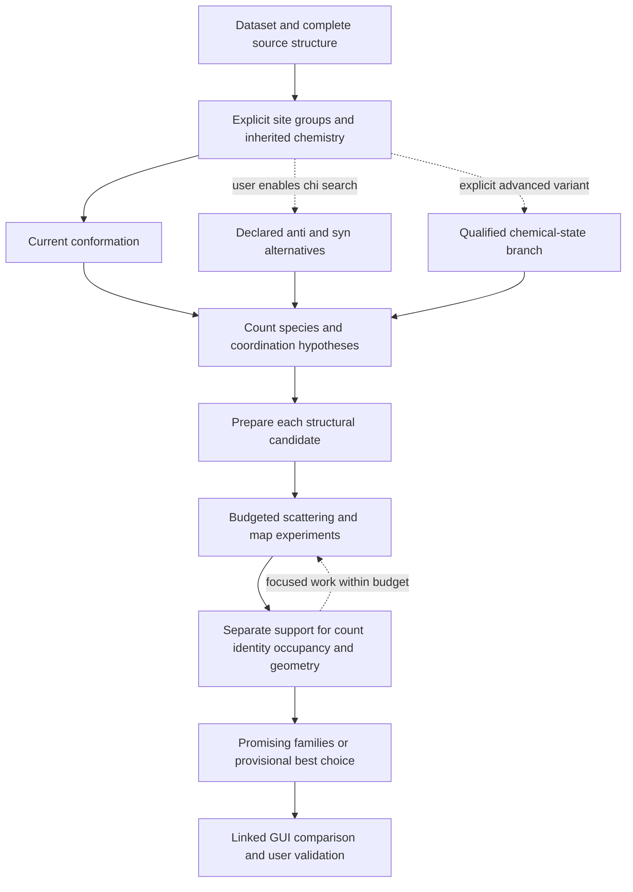

# Metal hypotheses and anomalous-scattering diagnostics

Status: **anomalous fits planned; explicit hypothesis construction and bounded recipe-only preparation implemented**.
Design expanded through 2026-10-27; construction and local preparation are implemented.
Solution-space search, decision logic, maps and GUI behavior below remain planned. This contract
defines a bounded diagnostic workflow for metal identity, site count, occupancy
and cluster hypotheses. It complements the [restraint builder](metal-restraint-builder.md)
and the existing refinement Doctor; it is not a new Cedar/Pine integration gate.

## Purpose and experimental stages

The scientist defines plausible metal arrangements and NASolve executes and
records the comparison. The output is a set of traceable alternatives, including
an unresolved result when the data cannot discriminate them. A fitted f'' value
is a conditional scattering estimate, not an atom counter or a chemical verdict.

Keep these operations separate:

1. **Design:** create reusable donor/metal graphs and restraints without data.
2. **Bind and prepare:** bind the recipe to an explicit model/checkpoint; create
   a derived model only when requested. Audit dictionaries, chemistry, symmetry
   and effective restraints, then prepare each candidate geometry under the same
   declared protocol. Preserve each geometry endpoint and its limitations.
3. **Freeze and probe:** snapshot the chosen endpoint for each hypothesis;
   run independent fixed-occupancy f'' fits with fixed coordinates and ADPs.
4. **Compare:** inspect per-site response, maps, geometry, fitted parameters and
   alternative hypotheses through linked tables and model views.
5. **Continue:** explicitly select an eligible checkpoint or request a separate
   follow-up experiment. Browsing or sorting results never selects a checkpoint.

Different geometric hypotheses need their own preparation. Comparing their
frozen endpoints is distinct from a matched-coordinate identity substitution
control; record which experiment was performed. Final joint refinement, if
requested, creates another child and does not retroactively validate the scan.

## Solution-space search and provisional decisions

**Planned intent.** The automation should explore many small, controlled Phenix
experiments and expose the most promising regions of the evaluated solution
space for user validation. A case may reasonably need about 75 jobs across
geometry, scattering and map questions. This is a workload example, not a
minimum, default or ceiling. A bounded search has declared resource limits and
traceable decisions; it need not contain only a handful of trials.

Campaigns organize independent datasets. Within each dataset, retain a solution
tree of whole-structure hypotheses and experiments, with explicit site-group
scope. Named coordination groups may map to arbitrary declared residues and
atoms and may contain several metals. A:12/B:4 remains only the current W
importer's mapping. Group navigation never discards other scatterers or implies
that their fits are independent. Shared atoms, phase/scale policies and nearby
signal require explicit joint or separate experiment definitions.

Inherit ligand chemistry from the attached NARestraints/CIF Doctor/PostMR state.
Advanced chemical variants require explicit declarations and derived resources.
Chi exploration is an optional user toggle per group, off by default; an enabled
pair search can explore declared anti/syn combinations in explicit residue
order. Coordinate preparation, count/species, coordination graph, occupancy/B
assumptions and scattering trials form further branches. No universal ordering
or exhaustive Cartesian product is required. Record the parent, changed
assumptions, reason for branching and exact resources at every node.

Return to any saved node and create another child without rewriting its history.
A prepared anti-syn/two-metal/mixed-species candidate can be compared with a
syn-syn/one-metal candidate from the same dataset under a matched diagnostic
protocol. Switching the displayed dataset, structure or group does not choose
a scientific result. Every leaf retains its exact artifact identity and retention status. Protected
comparison candidates keep their models/maps; compacted trials retain audited
results and recovery inputs under the storage policy below.

Report support separately for count, identity, occupancy and coordination
geometry. For example, two Hg sites may be well supported while the competing
N3-O4/O2-N3 slip arrangements still require visual inspection. Auto mode may
choose a provisional best candidate or exact next seed under a declared policy
and budget. Preserve alternatives and the evidence for selection/pruning; close
competitors lead to a focused GUI comparison. An unresolved result is valid.
Provisional choices do not silently change the current checkpoint or establish
a final structure: final structural validation remains with the user.

Present multiple promising candidate families when the evidence warrants them.
These are the user's solution-space "islands": groups of evaluated candidates
with related structures/coordination and useful, stable evidence. Define and
display the grouping criteria and representative rows; there is no implemented
clustering or confidence formula yet. More sampled trials in a family do not
make it more probable, repeated cache hits add no evidence, and nearby points
are not independent confirmations. Retain meaningful tradeoffs instead of
concealing them inside one arbitrary score. Distinguish rejected, unrun,
budget-limited, technically failed and scientifically ambiguous alternatives.

**Planned methods.** Generate eligible candidates from inherited components,
explicit group mappings and user-enabled conformational/chemical options;
freeze compatible comparison plans; evaluate broad samples; use recorded
evidence to allocate focused work within the remaining budget; reuse verified
identical experiments; then present representative candidates with their local
alternatives and limitations. Audit the decision logic separately from successful
model construction and native job completion.

## Fixed dispersive term and campaign scope

The [materialization adapter](metal-restraint-builder.md#explicit-metal-model-construction)
now creates source-bound numbered review models with explicit metal identities,
positions, q, B and separate formal-charge declarations. It preserves all parent
atoms and observations and supports unrestrained floating sites. Exact saved
derivation replay is available through `metal verify`. Its native controls prove
consumption, not chemistry qualification. A separate
[bounded recipe-only preparation step](metal-restraint-builder.md#bounded-metal-only-recipe-preparation)
now moves selected metals against explicit targets, preserves the scaffold and
all q/ADPs, and reports residuals and unconstrained motion. It does not optimize
the inherited whole-model objective or qualify chemistry/clashes. The
f-double-prime workflow below still requires a separate audited
geometry/experiment adapter. Identical targets and coordinates produce identical
prepared geometry under an Au/Ag identity swap; element discrimination remains
a task for experimental evidence.

In this metal workflow f-prime is fixed at the declared element/wavelength
reference throughout diagnostic fits. It is not offered as a freely fitted
parameter at the working resolutions. Geometry preparation and the later
conditional occupancy fit retain an explicit fixed f-prime policy too. This
contract does not silently change the existing ordinary AutoRefine default.
The generated-run inspector reports reference f-prime/f-double-prime separately
from future fitted values; it starts no refinement.

The future campaign workbench must retain explicit campaign, dataset, run,
checkpoint, hypothesis, round and trial identities. Switching the viewed dataset
or structure only changes the view; it never changes a checkpoint, reuses a
selection from another model or launches jobs. Different crystals remain
separate observations even when they share a recipe or chemical design.
All seven known-positive test cases should eventually be staged together, with
independent status/lineage and linked per-site tables in the same GUI. The PDU
two-metal slip case waits for integrated qualified PDU restraints.

Automatic proposals and provisional choices follow the planned solution-space
policy above. Declared metal identities,
iodine/bromine sites, possible clusters and experimental evidence can define
priors and constrain geometry alternatives. Focused anomalous phasing and local
map/geometry evidence can evaluate those alternatives. Record the origin and
strength of each prior, avoid counting prior information as another diffraction
observation, and retain phase-model dependence and unresolved alternatives.
Joint multi-wavelength fitting requires explicitly related datasets; campaign
membership alone does not establish a MAD experiment or common occupancy.

## What occupancy and f'' can establish

For an isotropic atom its anomalous contribution contains the factor
`q * f''(lambda) * exp(-B*s^2)`, where `q` is occupancy and
`s = sin(theta)/lambda`. Spatial phases, the rest of the model and experimental
scaling also matter. This expression explains parameter coupling; it is not a
replacement refinement target or a universal inverse-response law.

At fixed coordinates and ADPs, changing q may be compensated by fitted f''.
Seeing f'' respond therefore helps diagnose whether the fit is active and
sensitive, but does not by itself establish occupancy, element or metal count.
Conversely, a weak or flat response can arise from poor signal, coupled sites,
incorrect selections, parameter bounds, scaling or nonconvergence; it does not
automatically establish a mixed metal. Keep those alternatives explicit.

Two complementary experiments answer different questions:

| Experiment | Fitted | Fixed | Interpretation |
| --- | --- | --- | --- |
| Occupancy profile | f'' for declared anomalous groups | XYZ, all ADPs, q, f' | Scattering required at each assumed occupancy |
| Element-conditioned occupancy | q under explicit constraints | XYZ, ADPs and reference f'/f'' | Occupancy conditional on that element/reference |
| B or geometry sensitivity | Only the declared extra parameters | All other controls | Dependence on the prepared geometry/ADPs |

Do not simultaneously free q, B and f'' and present their output as a uniquely
identified solution. Initial B choices and any neighborhood-derived B policy
remain recorded assumptions. A B sensitivity check is a separate experiment.
Use `occupancy`/`q` and `formal_charge` explicitly; a cluster charge Q is not q.

## Inputs and comparison groups

### Iodinated bases as internal experimental controls

Known iodinated bases provide identifiable anomalous sites alongside candidate
metals. Use the actual wavelength reference and explicit occupancy/ADP assumptions;
comparable atomic f-double-prime values do not guarantee equal effective signal.
First evaluate iodine independently as a recovery/control site. An optional
constrained-reference experiment is separate: agreement forced by fixing iodine
to its reference is not an independent validation result or a reason to silently
renormalize every metal estimate.

Plan individual and joint omission controls for iodine and nearby metals. Inspect
whether signal returns at omitted positions and whether another site's fitted
response changes as hypotheses vary. Recovering nearby I/Ag sites can support
separability at similar effective strength, separation and disorder. It does not
guarantee separation of a closer or more disordered Ag/Ag pair. Chi variants must
carry attached iodine with the base; an iodine control is bound to that exact
structural hypothesis and complete anomalous-group policy.

### Matched experimental inputs

Freeze the source checkpoint/model, observations, original Free-R flags and test
value, symmetry, dictionaries, active restraints, source recipe and atom mapping.
Use declared anchors and checksums for operational references. Keep explicit
CLI paths available. No basename discovery or writable reference to a cache
may substitute for independent frozen inputs.

Require actual separate Friedel observations, their labels and uncertainties,
and a known wavelength for a wavelength-referenced diagnostic. Report anomalous
completeness, multiplicity and resolution support where available; overall
diffraction resolution does not prove equal anomalous resolution. Mean-only
data can support design/geometric work but cannot silently enter this scan.
Audit Free-R consistency under the existing rules without regenerating flags.

A comparison group shares observations, flags, resolution treatment, likelihood,
phase policy and nuisance-parameter policy. Keep excluded reflections and all
selection rules visible. An MR/SAD phase source generated under a competing
heavy-atom hypothesis can bias comparisons: use a common declared phase policy
and separately test phase dependence when appropriate. Never pool different
crystals or processing alternatives into one same-data rank.

Reference f'/f'' values carry element, exact wavelength/energy, table or scan
source/version, interpolation and calibration provenance. Atomic tabulations
near an absorption edge need not capture white-line or chemical-state effects.
A calibrated scan and a tabulation remain distinct reference options. No
universal Ag/Hg cutoff, tolerance of one electron, or target from a particular
paper becomes a default for Au, other energies or other experiments.

## Frozen diagnostic protocol

For each eligible geometry endpoint:

- Resolve explicit anomalous groups to exact atom identities, including altloc
  and symmetry. Check empty, overlapping and ambiguous selections. Keep other
  known anomalous atoms, such as iodine in modified bases, in the model with an
  explicit fixed or fitted policy. Do not merge distinct sites by element alone.
- Build each q-vector trial independently from that endpoint. Change q only in
  the new input. q=0 is an omitted-site control with f'' marked not identifiable,
  not a division-by-zero point on a fitted response curve.
- Disable XYZ, real-space, ADP/TLS and occupancy refinement, automatic atom
  addition/removal, coordinate corrections and other unintended model changes.
  Fix f' to the declared reference and fit only the requested f'' parameters.
- Freeze or explicitly profile bulk-solvent/overall scale and other nuisance
  terms with the same policy across a comparison. Audit automatic ADP rescaling
  too: absence of an ADP strategy alone does not demonstrate fixed output B.
- Record starting f'', bounds, cycles, stopping reason and sensitivity to
  declared alternate starts. Starting at zero is one reproducible protocol;
  preserve any failed zero-start attempt before trying another start.
- Read back effective parameters and actual output atom identities, coordinates,
  occupancies, ADPs and fixed scattering values. A violated freeze invalidates
  the diagnostic even if the process exits successfully. Report failures and
  partial evidence without promoting them to usable model checkpoints.

Validate the installed Phenix version with a dry run and then a complete native
control before claiming this protocol works. Native finite-precision and model
serialization tolerances must be justified and versioned, not silently widened.

## Hypotheses, mixtures and clusters

Support explicit one-, two- and three-metal base-pair hypotheses, mixed Ag/Au
assignments, two-versus-three Au arrangements, and a zero-metal control. A graph
of stable metal slots and edges extends the representation to larger clusters.
Cluster hypotheses can include metal-metal edges and donors from neighboring
residues, with explicit symmetry ownership. A polyhedral template proposes
geometry; it does not establish a cluster's existence or bonding.

Distinguish separate coexisting sites from mutually exclusive elements at one
physical site. For same-site alternatives the physical occupancy sum is at
most one (including a vacant state); distinct sites have separate budgets.
Special-position multiplicity and the native occupancy convention must be
resolved explicitly before applying that constraint to serialized atoms.
For a cluster, offer a shared occupancy only as an explicit intact-cluster
model; independent site occupancies describe a different disorder hypothesis.

Shared f'' groups reduce parameter count but impose equality. Per-site groups
allow different values but may be unidentifiable at limited resolution. Show
the grouping, fitted parameter count and sensitivity instead of quietly choosing
the grouping that gives the most favorable identity assignment.

Report these quantities separately:

- modeled site count and symmetry scope;
- expected occupied atom count, `sum(q_i)` over the declared physical sites;
- each fitted f'' and its element/wavelength reference;
- optional arithmetic sum of per-atom f'', clearly labeled and with group
  values expanded per atom exactly once;
- optional occupancy-weighted sum `sum(q_i*f''_i)` with identical site scope;
- resolution-dependent attenuation and actual modeled diffraction evidence.

These sums are bookkeeping summaries, not the measured total anomalous signal:
interference, B factors, symmetry and resolution remain in the structure-factor
calculation. Do not divide a cluster summary by one atomic f'' to infer a
unique count. If a source table does not define weighting or grouping, retain
that ambiguity rather than interpreting its number as a runtime target.

Close sites must also be assessed together. Use omitted-site controls and
residual/anomalous maps to examine whether adding a site changes the fitted
signal at neighboring sites. Keep atomic-species hypotheses, oxidation states,
cluster charge and protonation separate. Optical, chemical and computational
evidence may inform declared priors, but is not another diffraction observation
or automatic proof of atom count/charge.

## Bounded, scriptable experiments

Freeze a finite plan containing hypothesis IDs, occupancy vectors/grouping,
starts, controls, resources, parameter policies and maximum jobs/cycles/time.
Preview known job counts and the adaptive allowance before execution. Support
tens to hundreds of jobs when that budget is declared. Start with broad samples
and allocate focused trials where they can discriminate candidates. Report
requested rows, unique experiments, reused results, queued/running/completed
jobs and remaining budget separately. Do not enumerate an unbounded Cartesian
product of every geometry, identity, occupancy and B value. No-data or exhausted
budget status is not evidence against a candidate.

Each job has a stable ID, independent input/output directory and checksummed
parent. Resume validates completed jobs and preserves failed/interrupted attempt
identities and diagnostics; payload retention follows the declared policy below.
Share the planner, executor and report reader between CLI and GUI. Scheduling
must respect a total processor budget, including other active NASolve work.
Guided mode lets the user choose the next exact seed. Authorized auto mode may
choose that seed and further tests under the declared decision policy, preserving
the rationale and lineage. Neither mode silently expands its resource budget,
enables chi/chemical search options or validates a final chemical model.

Use Rwork/Rfree as context and comparable diagnostics, not a repeated Rfree
optimization objective. Adding sites/parameters can improve fit without being
supported. Preserve the number and history of tried hypotheses and any held-out
validation strategy. Confidence intervals require an implemented statistical
procedure; starting-point spread is sensitivity, not a confidence interval.

Multiple wavelengths can help distinguish elements when suitably collected.
Bind each to its own observations, calibration, dose/order and sample identity.
Common geometry/occupancy must be a tested assumption, especially across
different crystals, reactions or radiation damage. Multi-dataset joint fitting
is a later explicit protocol, not implicit merging of independently refined rows.

## Optional local map evidence

**Planned.** Offer ordinary 2mFo-DFc, signed mFo-DFc, anomalous difference/LLG
and optional omit-map layers. Display toggles affect visualization only;
including a map metric in ranking is a separate explicit experiment policy.
Use matched local regions, resolution, phase treatment, bulk-solvent treatment
and normalization for comparisons. Preserve provenance and limitations of
model-dependent maps, including whether held-out reflections enter them; map
selection must not be represented as independent Rfree validation.

Map patterns suggest controlled tests, not automatic atom editing:

| Observation | Candidate experiment |
| --- | --- |
| Negative residual near a metal | Test declared occupancy, ADP, scattering identity or positional alternatives |
| Positive residual nearby | Compare an existing-site displacement, alternate arrangement or extra-site hypothesis |
| Adjacent positive and negative lobes | Test relocation before interpreting the feature as another atom |
| Weak, unstable or diffuse residuals | Record map evidence as uninformative |

Begin with interpretable local measurements: positive/negative residual magnitude
and extent, position relative to donors/metals, and stability across controlled
starts. No universal sigma cutoff or automatic weighting is established. Noisy
or missing map evidence is not a rejection. More sites can reduce residuals
without being supported; retain complexity and alternative explanations.
Map and f-double-prime metrics use overlapping diffraction evidence, so do not
count them as independent votes. Omit/LLG controls are additional diagnostics
with their own assumptions, not a guarantee of unbiased truth. See the
[Phenix refinement FAQ](https://www.phenix-online.org/documentation/faqs/refine.html),
[anomalous refinement reference](https://www.phenix-online.org/documentation/reference/refinement.html)
and [polder-map methods](https://journals.iucr.org/d/issues/2017/02/00/ba5254/ba5254.pdf).

## Broad scans, focused iteration and occupancy refinement

The guided sequence below retains explicit user-selected centers. Future auto
mode may choose exact saved centers under the solution-space policy and budget;
both modes preserve the same parameter separation and per-site controls:

1. **Broad f'' profile:** evaluate a sparse declared occupancy range and the
   competing identity/count hypotheses. Every trial has fixed atomic XYZ, ADPs,
   q and f', with only its declared f'' groups fitted.
2. **Focused f'' profile:** select one or more exact result rows as centers.
   Each metal has its own q center, bounds and lock; a shared q is optional.
   A local step of 0.1 occupancy is a useful editable default, not an accuracy
   claim. Vary unlocked sites around the selected vector, retaining locked
   values exactly. Preview which sites change in every row. One-at-a-time
   perturbations limit the initial budget; explicit joint grids can diagnose
   coupling when needed. Neither implies that interactions are absent.
3. **Conditional occupancy refinement:** optionally allow all selected unlocked
   metal occupancies to refine independently in a separate child. Fix XYZ, ADPs
   and declared f'/f'' references, preserve any physical mixture constraints,
   and explicitly exclude locked metals and unrelated partial-occupancy atoms
   from automatic native selections. A selected fitted f'' may instead be used
   as a conditional fixed value if its provenance is retained; this is not
   independent evidence validating the same selected occupancy.
4. **Recheck:** a later fixed-q/f'' pass can probe the new occupancy endpoint.
   Record each stage, frozen values and interpretation separately. Do not free
   q and f'' together by default and label the result uniquely identified.

In guided mode the user chooses the next center and which parameters may move.
An Iterate action freezes the seed row/artifacts, per-site locks, local grid and round/job
budget; it does not automatically chase the lowest Rfree. Clip to declared
physical bounds, deduplicate coincident vectors and show boundary truncation.
For same-site mixtures also validate the shared physical occupancy budget.
Zero occupancy remains an omitted-site control, not an identifiable f'' fit.
Preserve broad and focused rounds, failures, discarded alternatives and the
history of manual selections. Finalize creates an explicitly selected child;
the label is not proof that identity/count is resolved.

## Reusing completed experiments

Reuse an already completed identical experiment, even when native execution
takes only seconds. Metal identity, coordinates, occupancy and f'' alone are
insufficient to identify it. Build a versioned fingerprint from the full input
model (including all atoms, ADPs, occupancies and scattering parameters), exact
observations/labels/Free-R, resolution and phase policy, wavelength/reference
provenance, dictionaries/restraints, resolved selections/anomalous groups,
effective parameter and nuisance policies, starts/seeds, native software and
protocol versions. Resolve inputs through declared anchors and content hashes;
cache identity must not depend on the checkout's absolute location.

A reusable result must be complete, qualified for that protocol and supported
by checksum-valid model/map/report artifacts and its required freeze audit.
Scientific ambiguity can remain a reusable completed outcome when the protocol
executed correctly; reuse preserves its unresolved status, not a success claim.
Do not use a partial/interrupted attempt as a successful cache hit, accept a
missing artifact, or treat a different parameter-freeing strategy as equivalent.
Deduplicate pending identical jobs too, preserving all plan references to them.

Each iteration row records **reused** versus **new execution**, the original
execution ID and a separate current-round association. Reuse references the
immutable evidence; it does not copy a result into a new run and imply Phenix
ran again. Preview total requested rows, unique experiments, verified reusable
results and remaining native jobs. Revalidation of stale or incompatible
receipts requires an explicit new attempt; previous provenance remains retained.
A compacted result can supply its preserved table values, but cannot satisfy a
request for an absent model/map or a complete-artifact cache hit.

## Disk budgets and recoverable trial retention

**Planned, with no cleanup of existing runs in this change.** Hundreds of jobs
across thousands of datasets require a campaign-wide disk budget as well as
job/time/processor limits. Estimate peak scratch/output space, reserve space
across concurrent jobs and retain a free-space margin before launching work.
Measure actual usage and stop scheduling when the budget cannot be met safely;
pruning after a large campaign has finished is too late.

Pruning a search branch removes it from active exploration, not from history.
Keep compact, versioned rows containing exact atom/group IDs, species, XYZ,
occupancy, all ADPs, fixed f-prime, fitted/reference f-double-prime, geometry and
restraint metrics, map summaries, convergence, failures, freeze audit, selection
reasons and provenance. Preserve sufficient evidence to audit a claim after its
bulky visualization output is removed. A compact value table alone is not a
recoverable experiment.

Retain the exact starting model, observations and Free-R flags, dictionaries,
restraints, recipes/bindings, resolved effective parameters, commands, seeds,
software/protocol versions and reference data. Store repeated immutable inputs
once in a protected, checksummed dataset/campaign store with declared anchors
and tracked references. A link into disposable scratch or an external original
that can disappear does not preserve inputs. Effective parameter files are often
small and essential: keep their complete resolved content, deduplicated or
compressed where useful, rather than deleting every `.eff` by extension.

The proposed retention tiers are:

| Tier | Retained payload and behavior |
| --- | --- |
| Active or recovery-critical | Inputs, working payload and restart requirements; no pruning during execution |
| Selected, pinned or representative comparison | Complete validated models/maps and evidence required for viewing, continuation and export |
| Completed, compacted trial | Audited structured results, recovery inputs and explicit inventory of removed disposable outputs; detailed view may require regeneration |
| Failed or interrupted | Attempt identity, failure/restart diagnostics and required inputs; disposable payload only after its recovery role is resolved |

Under a declared retention policy, compaction may automatically remove eligible
heavy maps, redundant output models and scratch from pruned trials. Protect
selected checkpoints, pinned results, representative alternatives, active jobs
and any payload required by another retained child or consumer. A trial may be
pruned from one plan while still referenced by another. Garbage collection must
check all references, including shared inputs and cross-group experiments.
Never infer disposability from a basename or file extension alone.

This requires a future versioned trial-storage contract. Existing immutable
numbered runs, hypothesis/geometry bundles and their checksum manifests remain
untouched. Future disposable payloads must be declared separately from the
immutable scientific record. Append retention receipts with object IDs, original
hashes, removed byte counts, reason/policy and time; do not rewrite history or
make an absent file appear checksum-valid. Distinguish verified result-summary
reuse from full-artifact reuse. The GUI must show retained, compacted, unavailable
and regenerated states and offer explicit regeneration for missing detail.

Recovery resolves and verifies the retained inputs and qualified software before
launching a new attempt linked to the original execution. Preserve old results
and report differences. A native rerun is not guaranteed to reproduce identical
bytes or a previous fit across versions, platforms or stochastic paths. Record
whether recovery is exact replay, qualified numerical reproduction, or currently
unavailable. A rehydrated input bundle alone does not establish recoverability.

Before enabling destructive compaction, validate recovery on representative
native trials after disposable outputs and original source paths are removed.
Check retained parameter/atom/freeze results with declared tolerances, linked
views, shared references, pin protection, interrupted cleanup/resume and disk
reservation under concurrency. Measure realistic peak and retained bytes for
large simulated campaigns, then check native examples; no arbitrary per-PDB size
promise is established. These checks are future work, not claims made by the
current documentation regression tests.

## Tables, plots and GUI selection

Use an overview row per hypothesis/trial plus an expandable per-site table.
Include count, species assignments, geometry endpoint, q-vector, B policy,
f' policy, reference and refined f'', q*f'', resolution/wavelength, grouping,
fit metrics, local geometry, residual-map findings, convergence, freeze audit
and diagnostic status. Unavailable values remain unavailable, not zero.

Plot f'' versus q and q*f'' versus q for matched trials, with reference lines
and explicit fixed parameters. Multi-site vectors must be labeled; points from
different hypotheses or nuisance policies must not become one response curve.
The linked table and molecular view remain primary. Optional per-metal response
plots make flat, unstable or compensating responses easier to spot. A plot of
f'' versus one site's q must hold the other coordinates of the occupancy vector
fixed, or label separate slices explicitly; a connected line through arbitrary
multi-site vectors implies an experiment that was never performed. A two-site
heatmap is appropriate only for an actually sampled grid with the remaining
sites fixed. Plot selection resolves the exact table row and artifacts. Never
draw synthetic scientific trends to fill an unrun view.

An additional normalized view plots
`100 * (f_double_prime_fit / f_double_prime_reference - 1)` against occupancy,
using each site's element and actual dataset wavelength. Label raw values and
ratios alongside it: twice the reference is 200% **of** the reference, or +100%
**deviation**, not +200% deviation. This enables comparison of departures on
unequal element reference scales without making deviation a calibrated
probability or a universal ranking score. At q=0 fitted f-double-prime is not
identifiable; near-zero references require raw differences instead of unstable
division. Keep reference uncertainty and calibration assumptions visible.

Use soft pink/red, green, blue, grey and lilac to distinguish candidates and
line widths with labels/markers to distinguish sites. Use explicit atom/group
correspondence across candidates; a two-metal candidate and a three-metal
candidate do not acquire equivalent site identities from their row order.
Keep unsampled regions empty and link every plotted point to its exact trial.

Cluster summary rows expand to their per-site evidence. Keep rejected and failed
alternatives discoverable, with scientific uncertainty separate from execution
failure and from an unrun plan.

Every row resolves the exact model, maps, recipe and checkpoint/diagnostic
artifact identities and their retention state. A compacted row displays its
retained evidence and requires regeneration for missing detailed artifacts.
Selecting a row focuses the same sites in the molecular view and can open the
exact retained or regenerated model/maps in Coot with their attempt provenance. Preview, pin, compare and select-as-current
are distinct actions. A diagnostic without an eligible checkpoint cannot be
selected as current. CSV/TSV and JSON exports retain IDs, units and provenance.

## Existing backend and implementation order

`autorefine.py` already exposes coordinate/ADP/occupancy strategy switches,
explicit anomalous groups, fdp-only mode, wavelength-derived references and
per-site diagnostics. These are foundations, not a qualified new workflow.
The current `RefineDoctor/ML-fdp-only` trial still has coordinate refinement and
group ADPs enabled by default. Its name means f'' rather than f' is fitted;
it does **not** mean all other atomic parameters are frozen.

Implement in bounded stages:

1. Preserve the implemented recipe, W-context, construction and bounded
   metal-only preparation boundaries; qualify whole-model preparation separately.
2. Add explicit general site groups and overlapping neighborhood bindings;
   optional chi candidates need their own whole-base and restraint validation.
3. Complete one audited fixed-q/f'' control, then a small independent q grid.
4. Add linked comparison tables, verified reuse, disk-budgeted retention/recovery
   and user selection, including unresolved controls.
5. Connect the campaign/site-group GUI, optional maps and linked response plots.
6. Qualify staged many-job search and decision logic separately, including
   multiple identities/counts, mixtures and larger clusters.

These dependencies follow the [M1b–M6 milestones](metal-restraint-builder.md#integration-objectives-and-milestones).
A narrow W-based f-double-prime control need not wait for a general importer,
but broader workflows must not inherit its A:12/B:4 assumption.

Core graph types should allow clusters now; native support is earned per tested
policy rather than implied by drawing additional nodes. Keep upstream CIF
acquisition and numerical-kernel work separate. No current CLI behavior,
checkpoint schema, scientific threshold or old report changes with this design.

## Validation cases and published precedents

Required future controls include: known single metal; no anomalous observations;
wrong/empty/overlapping selection; q=0; invariants deliberately violated; a weak
site; two nearby correlated sites; a third-site overfit; ambiguous mixed identity;
shared versus independent groups; charge-versus-occupancy labels; special-position
counting; missing wavelength; failed/restarted jobs; and relocation with original
paths removed. A complete native test must verify emitted restraints, all frozen
parameters and row-to-artifact linkage, not only subprocess completion.

Decision quality requires a separate evaluation from model construction, native
completion and intent-file checks. Use solved controls with the answers hidden
from the decision engine and reserve held-out cases for threshold evaluation.
Do not hardcode a winner from a dataset name. Include one-Hg, two-Hg slip,
mixed-species and swapped-species controls, wrong counts, third-site overfit,
optional chi alternatives, multiple overlapping groups, iodine/metal separation
and degraded/noisy evidence. Track correct provisional choices, appropriate
deferral and confident wrong choices separately. Evaluate whether alternatives
remain visible and whether budget exhaustion is reported without a false
scientific rejection. Test resume/deduplication and retention/recovery at the
many-job scale. Numerical acceptance thresholds and automatic family grouping
remain unqualified until these tests establish their behavior.

Published precedents inform those tests, not universal acceptance thresholds:

- [Vecchioni et al., Advanced Materials 35, 2210938 (2023)](https://doi.org/10.1002/adma.202210938),
  supporting information, "Disambiguation of Metal Sites and f'' Refinement":
  staged B/reference/occupancy treatment and independent heavy-atom controls.
- [Lu et al., JACS (2023)](https://doi.org/10.1021/jacs.3c05478), supporting
  information, anomalous-group refinement and gold structure determination:
  occupancy sensitivity, close-site interference and single-wavelength ambiguity.
- [De et al., Small (2025)](https://doi.org/10.1002/smll.202411518), supporting
  information, heavy-atom identification, ambiguous sites and Tables S2-S3:
  time-series context, map evidence and retained ambiguity.
- [Liu et al., Matter 9, 102470 (2026)](https://doi.org/10.1016/j.matt.2025.102470):
  related metal-exchange experiments; independent samples remain distinct.
- [Phenix refinement reference](https://www.phenix-online.org/documentation/reference/refinement.html),
  f'/f'' refinement: explicit groups, starts, fixed f' and anomalous LLG maps.

The supplied private cluster manuscript remains outside Git. Its experimental
results, unpublished figures and numerical tables are not redistributed here.
Concrete native fixtures and recipe target/uncertainty values still require
selection; reading a paper is not a native qualification receipt.
