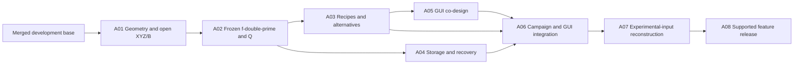

# Post-merge metal-coordination roadmap

Updated **20 November 2026**. Working branch **Alder**. The feature milestones
below are numbered **A01–A09** and are explicitly **post-merge work**. A09 is
further deferred until after the main build and core A01–A08 work. These are
not prerequisites for merging the current experimental implementation.
Historical implementation receipts A37–A40 retain their existing labels and
scientific limits; they are evidence references, not this milestone sequence.

The [handoff](metal-development-handoff.md) owns exact validation and pending work;
the [anomalous workflow](metal-anomalous-doctor.md) and [restraint design](metal-restraint-builder.md)
own scientific contracts. A mechanism passing tests does not close its scientific
gate. Update milestone status, evidence, limitations and next action together.

The latest independent FT source audit leaves two precise input boundaries:
B:1 now has an investigator-declared B:7→B:1 symmetry continuation; its exact
operator realization/native enforcement and the provisional C/D crossover still
need qualification. The private endpoint needs a legitimate ordinary checkpoint
before W173 intake. The existing modified/metal movement restriction remains.
Preserve all phosphates, the 19 supplied pair planes and the separate generic
sequence versus selected-model distinction; see the current handoff. No native
recipe/fit was produced from those incomplete declarations.

A01's source-bound symmetry review now gives explicit B:1–B:7 and C:8–D:7
contact hypotheses (3.100/3.027 Å in the current parent). The investigator then
confirmed B:7→B:1 connectivity; exact D:7→C:8 remains provisional. The existing
non-FT synthetic continuation reader preserves declared, unknown and chemical
boundaries. Whole-model enforcement/slicing provenance remain open; A02 is gated.

A04 now exposes pinned historical result inspection through the normal CLI
(`metal inspect-recorded-fdp`), with 53 focused tests and exact relocated installed
Hg/Ag₄ readback. This closes a workflow surface only; no fresh fit, scientific
acceptance, campaign cleanup or exact regeneration authority follows.

**Scientific milestone: A01 — ligand geometry and open XYZ/B foundation.**
**Parallel engineering step: A04 — compact records and protected parent transport.**
A04 measures saved trials while A01 remains unresolved; it does not bypass A02
or authorize large fan-out. The read-only projection substep now retains complete results with shared
experiment metadata. Exact input and explicit parent-layout transport use the
shared archive owner. Scientific parent selection, complete execution identity
and the compact child lifecycle remain next before retirement. A small
19 November rehearsal recovers four requests from a 251,197-byte archive;
it does not yet retain complete parents or qualify native regeneration.
A later bounded rehearsal recovers both legacy PostMR roots and metal parents
from 782,402 bytes, then exactly reproduces two historical frozen-f″ result
records. This is recovery feasibility, not a new production retention contract;
modern checked ancestry is now recovered in a separate bounded diagnostic proof.
That proof preserves all 392 source files, uses 35.7 MB of compressed parts and
passes 876 cold checks with source reads denied. The explicit parent-layout
adapter is now implemented with focused and installed recovery qualification. A private cold execution cross-binding now ties one saved historical Hg result
to its exact parent, executable inputs, worker/native pins and observed runtime
profile (213 assertions / 11 refusals, no new native job). Complete software
identity, scientific session lifecycle and pruning remain open. The maintained
recorded-result inspector now reads pinned historical results without original
trial folders; 117 focused tests and 718 installed assertions qualify Hg/Ag4
recovery and mismatch/partial refusals. Its recorded status does not confer a
fresh scientific audit or cleanup authority. The full registry walk belongs
to parent intake, not the current frozen-trial verification path; avoid a redundant
per-point validation cache. The [storage contract](metal-campaign-storage.md#modern-parent-recovery-proof)
owns the measured scope, prototype refusals and next production boundaries.
Source-preserving construction, explicit restraint coverage and actual-state
B export have mechanical evidence. Matched geometry, phase, iteration, map and
scale controls leave the FT_Hg open-fit geometry gate unresolved. New native XYZ
execution retains compact optimizer-stopping evidence: a completed job cannot
silently stand for a converged minimizer. Independent convergence and scientific
acceptance remain unassessed. A02 has not advanced.

A later saved-evidence audit confirms exact source/effective/native transfer of
all surviving local heavy-atom bond/angle/plane terms in two FT_Hg controls.
Their achieved geometry remains strained; this closes a transfer check, not A01.
Shared non-triple declared-site capture now has a matched one-cycle native
no-change check and independent cold readback; it is not an Alder integration or
accepted geometry. C412 now supplies checked-parent ordinary continuation evidence; consume that
qualified boundary on the agreed merged base without treating it as a metal
endpoint or root-free archive proof. Refine Doctor forwarding remains separate. Avoid repeating the completed
private weight/iteration controls without new evidence.
The investigator confirmed the Hg-bound donor-state hypothesis, with both N3
hydrogens replaced, but later on 19 November deferred routine donor-state
integration until after NASolve is built. The approved matched neutral/deprotonated
DF–Hg–DT research comparison is complete: the DF attachment shortens but remains
long, with essentially unchanged R values and remaining sulfur strain. The
[handoff](metal-development-handoff.md) records the pair and independent review. Shared Q13 owns
any generalized state qualification needed for that comparison; adopting C409
is not an immediate A01 gate or a prerequisite for otherwise qualified FT_Hg
work. Existing geometry and evidence standards still apply. The separate
C408 matching-data PDU control demonstrates bounded perturbed recovery; it
does not qualify experimental accuracy or FT_Hg and need not be repeated.
A private C413/C415 consumer rehearsal now passes the selected 2,761 tests and
70 subtests in two bounded parts, followed by a relocated installed read of both
saved geometry reports and four compact f″ requests. This is interface evidence;
active source adoption, the next combined integration gate and A01 scientific
acceptance remain separate. Reuse its exact receipts rather than repeating the
same checks or adding a second geometry calculator.
Construction remains chemistry/connectivity driven: PDU and DF are qualification
examples, with related and unchanged-good cases needed before general repair claims.

Latest controls separate the final B transfer from the R deterioration and show
that the longer geometry-only preparation returns after a native line-search
error. Exact passive evaluator capture now shows identical XYZ/raw residual with
different normalization denominators after a neighbor-list change. A private
constant-denominator control retains every dynamic proxy, improves local geometry
and gets past the earlier line-search failure, but reaches its 1,000-step cap.
The subsequent original-profile real-data replay is exact and all 84 XYZ calls
reach their iteration limits, without reproducing the same-site failure. A saved
proxy audit instead exposes pooled pair/covalent bond metrics forcing automatic
weight selection into its Rfree fallback. A matched private covalent-eligibility
control improves local DF/Hg geometry but worsens Rwork/Rfree; forcing all five
searches does not rescue the fit. All 105 calls in that forced-search control
reach their 25-step caps. A matched 100-step allowance recovers Rwork/Rfree to
0.29624/0.29234 with improved Hg geometry, but all five chosen fits still hit
the limit and the attachment remains long. A 400-step allowance improves local
geometry but worsens Rwork/Rfree to 0.31129/0.30495; all 97 trials, including
all five chosen fits, return line-search errors. Saved maps retain strong
negative Hg residuals before environmental-B preparation. The exact passive
replay demonstrates a normalization-dependent target change at identical
coordinates, with unchanged data terms and geometry identical within rounding. A repair is
not yet qualified; this does not close A01. These are distinct from the earlier
pooled-selector experiment; failed unselected trials remain explicit.
A subsequent bounded one-cycle real-data intervention fixes only the returned
geometry contribution at the common initial denominator, with an exact replayed
baseline and unchanged diffraction/raw restraint contributions. Its completed
results and remaining scientific limits are recorded first in the handoff.
No normalization policy or f″ parent is adopted.
Production changes are limited to compact passive weight-selection reporting;
no selector policy, chemical repair or accepted f″ parent follows.
The [handoff](metal-development-handoff.md) records prior attempts, exact validation,
private evidence and compatibility limits. Consult it before scheduling new tests.

## Immediate bridge from A01 to quantitative trials

The explicit coordination-topology adapter now separates exact metal contacts
from covalent/NAR authority without hiding unwanted neighbors. Its 309 focused
tests and 269-check saved FT_Hg readback close this bounded accounting substep.
The legacy whole-model result remains REVIEW: supplied-PHIL delivery and four
qualified local junctions do not supply the missing whole-context authority.
Consume this adapter with the shared retained-parent work; do not repeat its
native control or use it to bypass modified/metal endpoint admission. A01 stays
partial and A02 stays gated; no new milestone or cluster default is introduced.

A later current-parent check now refuses the stale full capture against the
refined FT_Hg endpoint: all 859 XYZ/B values changed, while Q did not. A fresh
fixed-coordinate interpretation of that exact endpoint preserves all 210
supplied terms, 1,009 bonds and the expected observed contact counts; 260 cold
checks pass. This is new parent observation, not retained-manager admission or
an accepted solution. Complete shared admission and actual XYZ/ADP validation
still precede f″. A04 software/execution binding can progress in parallel while
that supported motion interface is pending; do not repeat the same capture.

The 20 November [current-state profiles](metal-development-handoff.md#a01-current-state-profiles)
close the exact-state capture/finite-motion experiment. The neutral source fit
reproduces exactly; contraction gains reverse, while modest reorientation can
lower the target with essentially unchanged attachment angles. These are
completed diagnostics, not accepted models. Small fractional deviations are
descriptive; broad geometry and combined scientific evidence guide review.

1. **A01:** the matched small-movement continuation is complete. Both arms
   improve final Rwork/Rfree to about 0.28/0.29, but reach essentially identical
   DF attachment lengths and retain bent Hg coordination/negative difference
   density. No preferred endpoint or new f″ parent is selected. Close this
   subgoal; reuse the recorded delivery/derivative/weight controls rather than
   repeating them. The completed saved-model review finds both compressed donor
   span and off-line Hg placement: continued N3 spans are 3.49–3.52 Å, with Hg
   about 1.03–1.07 Å off the donor line and nearly centered axially. Parent and
   human-reference C1′ spans agree near 10.40 Å despite different donor spans;
   local base pose matters, not just opening the DNA. The human reference is
   descriptive and has a short DF attachment itself. No recipe or coordinates
   changed. The later actual-state diagnostic separates the conflict: phased
   likelihood opposes tested Hg-only straightening while recipe and nonbonded
   geometry favour it; finite Hg movements worsen the combined target. The
   base-opening finite profile is withheld after one predeclared numerical check
   misses tolerance. Do not repeat or loosen that check. The explicit local
   coordination alternative is now complete: replacing the donor-vertex 0° term
   with a stronger metal-centred 180° term opens the bridge to 154.5°, but leaves
   a 1.686 Å Hg–O4 contact and 1.642 Å DF attachment, with Rwork/Rfree
   0.3057/0.3338 versus 0.2802/0.2902 in the unchanged continuation. Native delivery
   and 263 cold checks pass; this is an unselected result, not an adopted recipe.
   B/scaling differ, so the reduced negative Hg map signal is not independent
   occupancy evidence. Close this angle subgoal. Next scope a bounded linked
   base/metal pose proposal through existing owners, preserving covalent geometry
   and polymer links; no new mover or f″ parent is yet qualified. The coordinated
   reuse audit finds rigid fragment/pair arithmetic and an exact byte/mask guard,
   but no qualified modified-donor/metal move with both junctions closed. Extend
   the shared admission/chemistry boundary deliberately; do not duplicate a B/Q
   guard or treat canonical displacement evidence as metal qualification.
   The read-only movement-region substep is now complete: explicit prepared
   contexts and the full C410 native capture identify 41 FT_Hg atoms, four fixed
   flanks and 36 crossing bonded terms. Saved-model junctions and native target
   delivery are checked without new refinement. This is an inventory ingredient,
   not closure, source authentication, modified-mover admission or A01 completion.
   A private 25-case fixed-endpoint donor study now reuses shared motion
   arithmetic: all four bond lengths stay exact, with at most 2.27° junction-angle
   change and 0.730 Å atom movement. Donor spans remain 3.379–3.938 Å, short of
   the tested idealized 4.20 Å linear-contact span, and inherited attachment
   strain remains. No candidate or native fit is selected. Close this numerical
   substep; do not repeat its grid. Next separate donor/Hg pose choices, review
   crossing geometry/packing and qualify source-bound modified-metal admission,
   protected B/Q and fresh child diffraction through the shared owners.
2. **A01 → A02:** qualify an open XYZ/B endpoint through local chemistry,
   coordination, Rwork/Rfree, stopping evidence and maps. Derive environmental
   metal B from the actual refined donors/base-only atoms, report disagreement
   between bases, and then freeze XYZ/all ADPs/f′ for declared fixed-Q f″ trials.
   First demonstrate a small Hg occupancy-response set before widening the grid.
3. **A04, before fan-out:** retain the complete protected modern parent once per
   bounded session; check each trial's exact inputs and frozen state. The legacy and modern
   ancestry recovery proofs now exist; use the qualified transport adapter, then qualify trusted software identity
   and the scientific child lifecycle before any retirement. Keep structural parents; regenerate cheap frozen
   increments from verified inputs and compact statistics under a disk budget.
4. **A02/A03 → A07:** apply the same mechanics to mixed Au/Ag, then cluster totals
   and anomalous-background controls. Preserve element identities, occupancies,
   cancellation and ambiguity. Withhold human endpoints from construction and
   search; compare against them only after the candidate record is frozen.
   Representative data then support the dedicated A05 GUI discussion and A06
   campaign integration. A09 hydration remains deferred after the main build.

The [cluster placement contract](metal-restraint-builder.md#cluster-placement-and-coupled-dna-accommodation-20-november-intent)
adds an explicit A03 → A02 → A07 experiment: whole-cluster pose proposals and
bounded coupled DNA opening/closing, followed by open XYZ/B, branch-specific
environmental B and frozen f″/Q reassessment. Nucleobase anchoring is the default
cluster hypothesis; exceptions need strong recorded evidence. Keep cluster
shape separate from local metal coordination and preserve count ambiguity.
This is planned work, not a qualified movement mode or accepted cluster fit.

These are bounded bridges to the existing milestones, not additional milestone
numbers or a promise that one profile resolves A01. Reuse recorded controls and
stop when the next hypothesis requires different evidence.

## Merge checkpoint

Cedar→Alder integration resolves the editorial/package conflicts. Installed and
independent delivery checks pass. Its full runtime execution had one test-fixture
failure; the reviewed test-only correction passes the complete affected module
in both scratch layouts. Under the clarified focused cadence, that aggregate
evidence qualifies development integration without a fresh all-green full claim. The
[root integration handoff](development-handoff.md) owns that gate. It is not
a Pine/release merge and closes no scientific milestone.

Merging is the integration checkpoint: agree the destination with the project
owners, reconcile shared interfaces and conflicts, validate the affected
compatibility/integration contracts, and document which capabilities remain
experimental or disabled. Existing scientific records and readers must remain
usable. The post-merge feature qualifications below do not become merge blockers
by being listed here. Merge readiness and a scientifically complete supported
release are different decisions.

Historical pre-integration evidence (not the current conflict state):
a pinned 18 November Cedar/Alder rehearsal passes the 755 distinct affected
metal/CLI/phase tests and an installed/relocated package check. Only the temporary
package-resource conflict was resolved; five documentation/contract conflicts
remain. Pine is still the proposed eventual destination, and this reference-base
check is neither an active merge nor its release qualification. Compact storage
must reuse the integrated Cedar owners. See the handoff for failed setup checks,
reruns and exact scope; no scientific gate closes through this rehearsal.

A later C406/Alder delta rehearsal passes 166 focused tests plus source-free
installed replay of the new recorder and compact records. It preserves the same
five unresolved documentation/contract conflicts after the temporary package
resource union. No active merge, full receiving-branch gate or native run follows.

The separate final Alder source gate now passes the complete tracked suite;
installed/relocated native map sampling also reproduces the saved values exactly.
A later frozen source gate also qualifies the read-only compact projection, with
installed source-free replay of single-metal and cluster samples. These checks
qualify the inventory, projection and shared sampling implementations, not the
receiving branch, compact retirement or A01/A02 science. See the handoff for
the exact source pin, counts, commands and remaining integration boundaries.

## Post-merge milestones

| Milestone | Current evidence | Post-merge completion gate | Dependencies |
| --- | --- | --- | --- |
| **A01 — Ligand geometry and open XYZ/B foundation** | PARTIAL; native stopping evidence implemented; FT_Hg open-fit geometry gate remains | Qualify exact source chemistry, linkage/terminal context, all intended NARestraints and metal recipe terms; demonstrate open XYZ/B refinement, explicit phase/Free-R policy, active-state B export and inspectable maps. FT_Hg first, then mixed Au/Ag. | Merged development base |
| **A02 — Controlled f″/Q quantitation** | PARTIAL; frozen fits, B environments and matched comparisons implemented | Use qualified endpoints; freeze XYZ/all ADPs/f′, prepare metal B from the refined environment, and qualify Q/start/budget responses, mixed elements, cluster sums/cancellation and anomalous-background controls. | A01 |
| **A03 — Editable recipes and structural alternatives** | PARTIAL; recipe core and candidate comparisons implemented | Source-backed ligand/metal-state targets, saved editable recipes, count/identity alternatives, optional chi flips and multiple/adjacent sites; preserve ambiguity and human choice. | A01–A02 |
| **A04 — Lean storage and regeneration** | PARTIAL; [inventory/forecast, compact projection and exact input transport](metal-campaign-storage.md) implemented; explicit parent transport and recorded-result inspection qualified; scientific lifecycle/regeneration/pruning pending | Shared pristine parents, compact frozen-trial records, protected important nodes, size-capped map retention, cold native regeneration, crash-safe retirement and campaign disk reservations. | Qualified A01–A02 examples; before large fan-out |
| **A05 — Dedicated GUI co-design session** | OPEN; earlier sketches and inspection viewer are starting points | Scientist and developer jointly walk through real cases, debate navigation/controls, compare alternatives and agree a usable modular design with recorded decisions and usability checks. | Representative A02/A03 evidence; can run alongside A04 |
| **A06 — Campaign and GUI integration** | PARTIAL; identities, navigation and inspection mechanisms exist | Connect the agreed GUI to bounded multi-dataset execution, structures/sites, compact comparisons, branching history, maps/Coot, selection, reuse and recovery; include no-metal/empty-frame policy. | A02–A05 |
| **A07 — Reconstruct known metal solutions through the mechanics** | OPEN; solved references and diagnostic fixtures available | Reconstruct defensible solutions from declared experimental inputs and general NASolve mechanics, with reference models withheld from construction/search; record intervention and remaining ambiguity against predeclared criteria. | Mechanical rehearsals through A01–A03; campaign demonstration after A06 |
| **A08 — Supported feature completion and release** | OPEN | Complete end-to-end scientific/human review, independent/negative controls, installed/relocated/native integration, compatibility and release regression; publish the supported scope and remaining limits. | A01–A07 |

A01 includes saved-map, recipe/frame and scale controls, plus an exact stopping
replay of a longer geometry-only preparation. None supplies an accepted f″ parent.
The native stopping receipt is a reporting mechanism, not an automated repair or
new acceptance gate. Source-phosphate-state and open-fit geometry questions remain
with their owners. See the current handoff before extending these controls.

Statuses describe evidence already available, not completed post-merge work.
A01–A03 feed both the storage controls and GUI session. A04 must be qualified
before scaling native jobs; a large campaign is not the way to discover an
unbounded storage policy. A07's small mechanical rehearsals start early rather
than waiting until every interface is finished.

## Deferred donor-state research and post-build feature

The approved matched neutral/deprotonated DF–Hg–DT research comparison has
completed without closing A01. It is not routine donor-state integration. Preserve
the approved plane
policy and Hg restraint terms, qualify the compared sources and site/link
contexts, and disclose generation differences that confound attributing the
heavy-atom response to H loss. A model without H3 coordinates does not by itself
resolve the dictionary's chemical state. Reuse C409's isolated qualification and
site map rather than repeating them; they do not qualify a linked refinement.

Routine donor-state selection, generation and workflow integration are explicitly
post-build work, outside the current A01–A08 completion gates. The broader A03
recipe intent does not pull this deferred feature back into the immediate queue.
A01 remains partial and A02 remains gated on a qualified open XYZ/B endpoint;
no chemistry, geometry or scientific acceptance requirement is waived. No further
donor-state jobs or routine implementation are queued by this result.

## A05: a working GUI session, not only visual polish

Schedule a dedicated collaborative session using actual saved single-metal,
mixed-metal and cluster results. Earlier sketches are design evidence, not
validated scientific outputs. We should debate the workflow and test alternatives
before building another large layer of controls.

Walk through choosing a dataset/site, understanding the current geometry,
editing a recipe, requesting refinement or a Q/f″ comparison, inspecting maps,
backtracking to another geometry and pinning a solution. Ask what the user needs
to decide at each step; keep advanced chemistry, fit settings and provenance
compact until opened. Record agreed choices, rejected alternatives, unresolved
questions and a small set of tasks the final interface must support.

Specific design topics include:

- Clear dataset/structure/site context and easy switching, with a sensible first
  selection and an explicit link between each result and its geometry branch.
- One compact trial row or small grouped row set for all its sites, expandable
  details, and side-by-side geometries. Prioritize Q (occ), fitted/expected f″,
  ratios and group/per-element responses; keep cancellation visible.
- Fit-to-atoms, understandable rotation/pan/zoom, light connectivity, distinct
  metal styling and non-overlapping labels that disappear at distant zoom.
- Recipe editing, metal state and ligand overrides without exposing unnecessary
  implementation details; reusable interface modules as the design evolves.
- Soft map controls for ordinary/difference/anomalous maps, direct Coot access,
  meaningful tree navigation and clear selected/pinned/recoverable states.

Close A05 when, in an agreed prototype, the user can follow where a row came
from, compare competing solutions, inspect their evidence and choose or defer
a branch without needing the CLI. This is a usability design gate; implementation and native correctness
remain A06/A08 work. A pretty mockup alone does not close it.

## A07: reconstruct solutions with limited prior knowledge

The test is more demanding than refining a supplied solved structure. Freeze
and record each request's allowed inputs before its run:

- Experimental reflections, original Free-R flags and wavelength metadata.
- Sequence and ligand identities from the experiment and authoritative chemistry
  definitions, plus a generic frame/model-search route appropriate to NASolve.
- Candidate elements and genuinely known experimental conditions, including
  whether reduction/clusters are plausible. Optional site or stronger chemical
  information must be explicit and reported as an additional prior.

Use the MR → PostMR/ligand preparation → AutoSol/phase/site mapping → restrained
open XYZ/B → frozen anomalous/Q → candidate-review mechanics. Preserve AutoSol
failures and the declared metal-free continuation policy. Do not seed from the
human-solved model, copy its metal coordinates/occupancies, use its final metal
count/identity as an unstated input, or encode dataset-name-specific answers.
General recipe families and chemical knowledge are allowed; reference-derived
case-specific geometry is not evidence of reconstruction with limited priors.

Keep human solutions for **endpoint comparison only**. Their XYZ/Q/B snapshots
may be useful, but their stored f″ values may be absent or reflect a later
refinement stage and must not be treated as fitted truth. Coordinate comparisons
must respect symmetry and atom correspondence. Compare local chemistry,
coordination, metal placement/count/identity where identifiable, Q/B plausibility,
f″ response, ordinary/anomalous maps and the recorded Rwork/Rfree context.
Rwork below 0.30 is the existing target, not sufficient scientific acceptance;
never change Free-R membership to improve a result.

The panel starts with **FT_Hg** and **FF_AuAg**, then covers **7CCA_Ag4**,
**7CCA_Ag6**, **FF_3Ag**, **iCiU_Ag**, and **PP_Hg** when its PDU ligand gate is
qualified. Include unresolved cluster geometry, mixed identity, iodinated
background and two-Hg slip alternatives. Exact fixture inputs and numeric
outputs stay local. A separate campaign demonstration stages these cases together.

Predeclare the input contract, resource limits, generic search/recipe policy,
comparison criteria and expected level of human involvement. Record all manual
interventions and stronger-prior retries. An auto run, a guided recipe selection
and a manually rebuilt answer are different results; do not combine them into
one success claim. If development uses a reference to tune a rule, record that
and require independent or withheld controls before claiming generality.

For each known-positive case, report **reconstructed**, **plausible but ambiguous**,
or **unresolved**, with the actual supporting evidence. Honest failure handling
is necessary but does not count as reconstructing that positive case. The gate
remains open for missing demonstrations or unsupported claims. Where the data
cannot distinguish alternatives, recover and expose defensible candidates rather
than force a unique answer. Include negative/failed controls to test that the
mechanics do not manufacture metals merely because a screen was requested.

## Feature-completion finish line

After A01–A08, a user should be able to start a bounded single-wavelength metal
campaign from experimental inputs, obtain qualified geometry candidates, explore
controlled anomalous/occupancy evidence, inspect/select alternatives, and reopen
or regenerate results within a disk budget. No-metal, failure and ambiguity are
usable outcomes. A pilot must demonstrate the whole flow, including recovery,
not just separately passing components.

MAD, wider chemistry/oxidation-state coverage and additional search heuristics
remain later extensions. They are not hidden conditions for the initial
single-wavelength release or for the earlier integration merge.

## A09 — Post-development hydration shells and counterion coordination

**DEFERRED — after the main NASolve build and A01–A08 core feature work.**
This is not a current development priority, merge condition or initial-release
requirement. Recorded investigator intent: 19 November 2026.

Enable this mode when the reported resolution is **better than 3 Å**
(`d_min < 3.0 Å`) **or the user explicitly flags it**, including at lower
resolution. The trigger permits investigation; it does not establish that a
particular shell or ion is supported by the data.

Support water shells around metals and searches for candidate counterions such
as Mg. Represent the **coordination sphere explicitly**: metal identity/state,
coordination number and geometry, each ligand's chemical identity and donor atom,
water versus direct macromolecular coordination, and incomplete or alternative
shells. These choices must be GUI-editable and persist in recipes rather than
being inferred solely from a generic metal atom. Include six-coordinate Mg
hypotheses and intact CoHex complexes, without forcing every site to have six
resolved waters. CoHex's six ammine ligands are chemically distinct from a water
shell; retain that distinction in dictionaries and generated restraints
([RCSB CCD NCO](https://www.rcsb.org/ligand/NCO)).

Reuse the source-backed ligand/ion knowledge, editable distance/angle restraints,
expanded site view, map inspection and bounded XYZ/B refinement. Compare
supported complete, partial and absent shells and alternative ion assignments;
record unresolved coordination instead of filling every proposed position.
Qualify representative water-shell, Mg and CoHex cases, including negative or
ambiguous controls, before offering automatic adoption. Anomalous evidence may
contribute where informative; it must not be the only way to assess a counterion.

### A09 follow-on — water-placement inspector and recipe comparison

Prioritize a dedicated inspector for **sub-2 Å** data, with explicit user access
for borderline or noisier cases (including the motivating approximately 2 Å
CoHex environment). This is part of deferred A09, not an extra current milestone.
The recipe window should propose and compare placements in candidate density
features, exposing water/ligand distances, clashes, coordination geometry,
occupancy/B behavior and the matching model/map view. Distinguish surrounding
waters from the chemically defined ligands of an intact complex.

Use bounded batches analogous to the f″ search interface, but with declared
structural refinement: compare empty, partial and alternative placements, then
rank candidate models using recorded local density fit and residual density,
geometry and refinement stability. Preserve close or conflicting candidates for
review rather than forcing a winner from a noisy score. The purpose is to reduce
dependence on unaided visual intuition while keeping the numerical evidence
inspectable. A proposed water is not accepted solely because it fills a peak.

Before comparing scores, pin observations/Free-R flags, starting parent, restraint
and refinement policies, map coefficients/scattering policy, local masks and
normalization. Keep initial and post-refinement evidence distinct, and show when
map changes or an unsettled fit prevent a fair comparison. Treat model-assisted
map agreement as supporting evidence, not independent validation; define and
qualify score calibration and acceptance thresholds using representative known,
absent-water and ambiguous cases before automatic selection. No particular score
or numerical threshold is settled by this design request.

Retain the important starting/selected geometry nodes, compact per-candidate
measurements and exact reconstruction inputs. Apply task-specific A04 storage
rules to intermediate models/maps, with size assessment before any retirement;
water movement is not the frozen-coordinate cheap f″ case. Tie this inspector to
the later A05 GUI co-design and shared chemistry/map owners, rather than creating
an independent water dictionary or refinement executor now.

Adding or moving waters/ligands changes the structural model and creates a new
protected geometry parent under A04. It is not an expendable frozen-f″ parameter
point. Only subsequent trials that satisfy the existing freeze contract use the
lean incremental retention profile. No shell search, water placement, new GUI
control or native run is implemented by this planning entry.

## Existing implementation evidence (historical checkpoint IDs)

| Update | Scope | Status |
| --- | --- | --- |
| A37 | Fresh MR/PostMR/AutoSol and screenshot-settings rehearsal | Private diagnostic; chemistry and production protocol qualification open |
| A38 | Native trial map/Coot inspection and chemistry discrepancies | Mechanism tested; GUI inspection and target-library work remain |
| A39 | Matched signed cluster responses from saved frozen fits | Implemented and pushed; accounting/provenance evidence, not accepted atom counts |
| A40 | FT_Hg foundation plus storage/roadmap scoping | Preparatory A01 native comparisons; scientific gate open |

A40 resumed as preparatory A01 work. Source-preserving linked DF, explicit
NARestraints and actual-state B export have native evidence. Matched open XYZ/B
comparisons and a source-supported missing-plane derivative are recorded in the
[current handoff](metal-development-handoff.md). Supported mechanics checks pass;
formal-charge readback remains unsupported and scientific geometry/fit review
remains open. No new f″ fit or checkpoint adoption is implied.

## Handoff discipline

Update this queue, current handoff and scientific limitations together at each
substantial result. Use focused tests for affected behavior; broaden for changed
shared contracts or release integration. Record exact native/software versions,
complete versus dry execution, source revisions, input/output hashes and process
shutdown. Keep scientific artifacts local and immutable. Internal working names
are not scientific feature names.

Coordinate chemistry/native runtime and storage primitives with Cedar; coordinate
campaign ownership, navigation and shared budgets with Willow/Pine. Do not fork
shared validators or assume a peer's success qualifies this dataset. Retain
important tree nodes; incremental retention depends on the operation. A source
push is neither a merge nor scientific acceptance.
