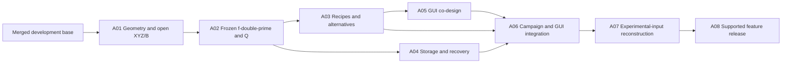

# Post-merge metal-coordination roadmap

Updated **27 November 2026** after retained anomalous-evidence replay and explicit map levels. Working
branch **Alder**; the earlier forward-queue audit is retained at `60a1f084`. The feature milestones
**A01–A09** below remain explicitly post-merge work; A09 follows the main build.
Merge qualification, scientific acceptance and feature completion are separate.

This is the single forward queue. The [metal handoff](metal-development-handoff.md)
retains experiment evidence and validation; the [anomalous workflow](metal-anomalous-doctor.md),
[restraint design](metal-restraint-builder.md) and [screen contract](metal-screen.md)
define behavior and intent. Earlier per-experiment roadmap paragraphs remain
recoverable in Git at `5d2eeed9`; their old “next” statements are not parallel tasks.
No experiment, checkpoint or science checkout was removed by this audit.

## Original aim and usable entry points

The aim remains a general metal-solution workflow: discover supported sites from
experimental data, construct and refine chemically declared alternatives, derive
metal B from each refined environment, compare frozen f″/Q responses and maps,
and let the user inspect and select plausible solutions across a campaign.
The supplied solved models are comparison references, not constructor inputs.
Timing and protection mechanisms enable that workflow; neither is its endpoint.

The following entry points exist on the audited branch. Availability here is
not a claim that an integrated automatic screen is released or that a generated
model is scientifically accepted. The [operating guide](../README.md#inspect-generated-models-for-metal-recipes)
and `src/nasolve/metal/cli.py` own their exact options.

| Intended step | Available now | Remaining delivery |
| --- | --- | --- |
| Build explicit metal hypotheses on generated DNA | `metal inspect`, `preview`, `build`, `geometry`, verification and legacy-restraint import | General construction across multiple site contexts; source-qualified chemistry and whole-model optimization. W A:12/B:4 is the current importer, not a universal site rule. A01/A03. |
| Discover sites from anomalous data and retain phases | Declared phase-restrained XYZ API and existing upstream AutoSol mechanisms | Integrated free-metal screen, covalent I/Br/Se anchors, coherent cluster image mapping, evidence-led count alternatives and explicit no-metal continuation. A03/A06/A07. |
| Obtain an open XYZ/B model | Existing XYZ API and historical returned controls; explicit mixed-scope writer/guard and timing | Current reciprocal XYZ/group-B route now returns checked output and paired maps with process closure; scientific geometry/fit and ordinary admission remain. Historical controls do not qualify a later guard. A01. |
| Quantify anomalous response | `metal fdp`, explicit occupancy scans, comparisons and signed cluster atom-equivalent summaries | Scientifically qualified parents, response/convergence controls, adaptive branching and ambiguity handling. f″ fits hold Q fixed per point; sibling trials vary Q. A02/A03. |
| Inspect and choose | Verified saved-result catalog, `serve-workbench`, grouped reviews, map/Coot inspection | Dedicated user GUI session, editing, coupled execution/selection and side-by-side geometry decisions. A05/A06. |
| Run many datasets without excessive storage | Compact records, input/parent transport, owned child/session and budget mechanisms | Accepted scientific regeneration, safe output retirement and campaign-wide scheduling. Compression/readback alone does not authorize deletion. A04 before fan-out. |

## Current A01 evidence and protected-site boundary

**A01 is partial; A02 scientific quantitation remains gated.** The current
protected reciprocal route completes one cycle with both crystal links: 573 XYZ
and 81 group-B observations, exact returned/written state, restored hooks and
verified process closure. One output replay reproduces that state exactly and
captures paired work-only, nonfilled MLHL maps without changing it. This closes
the execution gap; timing optimization is no longer the immediate blocker.

Scope remains 859 XYZ atoms and 42 DNA B groups (858 atoms). Hg B and all Q/f′/f″
are protected, while Hg XYZ can move. The v3 guard retains original ordered
Free-R/HL and witnesses native common F/sigma normalization. Source files stay
exact. Real-space/sliced and multiprocess scopes remain unqualified.

Rwork/Rfree **0.3098/0.3422**, weak phosphate/sugar density and B1 OP2–P–O5′
**87.5°** versus its 108° target keep scientific acceptance open. The PDB equals
the earlier parameter-scope control byte for byte. Older five-cycle original/
constructed controls (Rfree 0.3371/0.3362) remain evidence, not a reason to repeat
unchanged fits. Returned base B means **50.86/119.57 Ų** yield previews of
**85.21 Ų** (base mean) or **93.95 Ų** (donors); neither is applied.

A subsequent fixed-map spatial analysis finds a continuous negative difference
signal across both N3 donors and Hg (−1.93 to −2.48σ), with positive ordinary
support throughout (+3.81 to +5.43σ). It does not isolate Hg excess or justify
changing metal count/Q. This question is closed for the retained model; it is not
a new fit or geometry acceptance. [Evidence and contour-level implications](metal-development-handoff.md#a01-retained-ft-pocket-density-interpretation--late-26-november).

The [current handoff](metal-development-handoff.md#current-a01--complete-protected-return-and-paired-maps)
owns exact validation and retained failures. Checkout:
`ScienceCheckouts/Hazel/2026-11-26_ft-protected-return/index.html`.
The previous timing stops and storage audit stay preserved at their original pins.

## Immediate bridge from A01 to quantitative trials

New-import source consistency is now checked in the existing metal input owner:
conflicting recorded observation/phase sources and changing records refuse.
The [supply route](metal-ordinary-receiving.md#supply-an-ordinary-parent-for-metal-intake)
is demonstrated with a controlled prepared-publication fixture; the real private
FT parent remains unavailable to ordinary intake. This does not close A01 or
qualify mixed execution/geometry, and needs no repeated native control.

The indexed phase join also has existing qualified owners: a 14-case read-only
control on the original FT arrays distinguishes row reorder, wrong index, swapped
HL and permitted F/σ normalization. Reuse those owners in the missing ordinary
binding; do not create another phase parser or repeat the unchanged FT fit.
[Evidence and source-specific limits](metal-ordinary-receiving.md#indexed-phase-evidence-reuse-the-numerical-owners).

The explicit ordinary-parent binding now joins those numerical owners to a
verified checkpoint and newly declared child policy/scope. Controlled native-array
and installed dry-dispatch checks pass; it adds no ordinary numbered executor or
new FT endpoint. [Exact interface and evidence](metal-ordinary-receiving.md#explicit-ordinary-parent-binding--26-november).
Do not repeat the completed binding controls as a substitute for the next owner
integration and genuinely matched scientific parent.

A genuine PDU parent has now been reread by the pinned installed ordinary owner
and its input roles reviewed by the receiving interface: seven inherited restraints
plus a separately generated symmetry bond, with starting and returned models kept
distinct. This completes the transfer-inventory prerequisite, not native admission.
It has no approved HL; it cannot substitute for phased FT or qualify A02.
[Exact evidence and remaining holds](metal-ordinary-receiving.md#read-only-transfer-from-the-maintained-ordinary-owner).
The 27 November isolated receiving rehearsal now includes the intact pinned
prepared-backbone/phosphate chain and rereads this genuine parent with the
combined ordinary owner. Historical worker bytes stay exact, including V10–V12;
focused and relocated installed checks pass. Delivery to the active branch remains
separate. Do not repeat the inventory: the next owner step is a versioned mixed
child using these source roles and the existing writer/process proofs, plus a
genuine phased FT parent. An unphased PDU control cannot satisfy that requirement.

Five older FT anomalous/f″ trials now have a fresh offline replay inventory.
They share the original observations but use earlier model/B states, and their
model-phased maps do not independently settle current Q/count. That decision is
parked; do not repeat unchanged trials or transplant their fitted values.
[Current evidence and small inspection improvement](metal-development-handoff.md#a01-evidence-inventory-and-bounded-inspection-improvement--27-november).

**Chosen next A01 milestone — ordinary FT metal-site handoff.** One unselected,
numbered child must carry genuinely admitted FT source data/Free-R/AutoSol HL,
prepared restraints and both crystal links through reciprocal XYZ/DNA group-B
execution, protected Hg B/Q/f′/f″, exact written return and inspectable maps. The
compact relocated worker has now passed real zero-cycle initialization; this
prerequisite does not close the milestone. Explicit external-phase admission and
a versioned numbered mixed policy remain. Reuse the existing parent, writer and
process owners, including an immutable input declaration that survives legitimate
registry updates. [Acceptance boundary and evidence](metal-ordinary-receiving.md#compact-source-bound-worker--27-november).

The missing prepared FT parent is now localized one level earlier: the ordinary
local-only context cannot admit incoming B:1/C:8 image bonds. The new explicit
registered-context adapter accounts for all 38 local and two image links without
changing chemistry or model coordinates. Its real-source read, focused tests and
relocated installed checks pass. The complete-request owner now freezes the
explicit registered role and rederives local component contexts; execution remains
blocked. Native input review now binds the exact retained FT capture and all
nine original inputs, with matched local reference terms at both image junctions.
**Next build genuine ordinary construction from declared sources**, then qualify
the complete native/result and publication consumers and numbered image-force
execution. The private neutral control cannot acquire retrospective ancestry.
Input/native review alone provides no ordinary parent, phase admission or
scientific acceptance.
[Implementation boundary](metal-ordinary-receiving.md#registered-phosphate-context-before-preparation--27-november).

Only two next decisions govern the near-term work:

1. **Scientifically qualify the inspectable FT_Hg model.** The protected return,
   actual group-B execution, serialized state, map capture and stopped processes
   are complete for the current one-cycle control. Address the weak/strained
   phosphate and sugar context through a distinct coupled-placement hypothesis
   with the existing chemistry/topology owners; inspect coordination, both crystal
   links, local chemistry, maps and Rwork/Rfree. A01's Rwork target remains below
   0.3, and a low R value alone does not accept geometry. Straight and bent metal
   bridges remain hypotheses; the human endpoint is not ground truth. Reuse the
   older five-cycle comparisons instead of repeating them as new science.
2. **Admit the endpoint through the existing owners before quantitative fan-out.**
   Receive the prepared-parent and numbered-runtime interfaces deliberately,
   connect the now-qualified explicit parent binding to numbered mixed execution,
   and close the output lineage. The explicit post-exit receiver now checks the
   exact returned native state and unchanged parent sources; synchronized written
   model and process closure must still come from the existing owners. Do not
   invent ordinary ancestry for the private
   FT control or treat the genuine PDU example without HL as phased FT admission.
   Once the geometry is scientifically qualified, derive metal B from refined
   base-only/donor atoms (exclude sugar/backbone; retain between-base mismatch),
   freeze XYZ/B/f′ and demonstrate a small fixed-Q f″ response set. Establish A04
   regeneration/retirement authority before broad grids or campaigns.
   The existing frozen f″ worker uses model phases without external HL restraints;
   keep that distinction from MLHL geometry explicit until the downstream phase
   policy is qualified. Preserved phase lineage alone does not resolve it.

No serial 90/180-second fits merely to increase callback counts; no repeat of the
unchanged zero-cycle, normalization, source-selector or group-membership controls.
No new angle/weight/start-pose grid without a distinct scientific question and
matched comparison. Do not disable weight optimization, loosen protected-state
checks, clamp high B, or change chemical state to obtain a pass. Reuse the existing
force/placement/retention evidence before revisiting FT geometry. Routine donor-state
automation and A09 hydration remain deferred. Mixed Au/Ag, clusters and anomalous
background cases follow the first qualified endpoint; cluster placement/rotation
and coupled DNA accommodation retain their [explicit contract](metal-restraint-builder.md#cluster-placement-and-coupled-dna-accommodation-20-november-intent).

## Shared interfaces: reuse rather than parallel implementations

| Owner | Reuse boundary | Not conferred by that boundary |
| --- | --- | --- |
| Cedar preparation/refinement | `refinement_prepared_backbone`, `refinement_phosphate`, ordinary AutoRefine, registered physical phosphate/link chemistry, exclusions and native image forces; shared process/output/storage owners | A private successful fit is not an ordinary prepared parent. Reported target/weight diagnostics do not qualify metal chemistry or change frozen source-policy identity. |
| Willow topology/inspection | Logical site/image registration, representative transport, bounded placement, existing model/map readback; `topostitch_phased.NativePhasedGuard` and `topostitch_endpoint.audit_masked_endpoint` only at their qualified scopes | Six-atom coordinate-only receiving does not authorize whole-duplex/group-B/metal motion. W287 annotation replay is not prepared-input or chemistry authority; W288 local geometry is not an accepted diffraction endpoint. |
| Alder metal refinement | Explicit protected XYZ/B/Q/f′/f″ scope, live mixed-target checks, metal recipes, environmental B, frozen response/count comparisons and branch admission | Source/state protection and timing do not establish structural correctness, converged f″ or a selected solution. |

The [ordinary receiving contract](metal-ordinary-receiving.md#ordered-integration-steps)
owns the ordered integration boundary. Preserve historical native payloads and
receipts; use existing phase, symmetry, map and process owners instead of creating
a second executor, protection scheme or map parser. Upstream newer interfaces are
dependencies to receive, not evidence that they are already on this Alder base.

## Local storage audit — 26 November

At `5d2eeed9`, the clean worktree occupied 75.35 MiB allocated; branch-owned local
artifacts occupied 2.65 GiB across 236 immediate directories. The largest FT
foundation, triage, force and local-preparation directories remain referenced
scientific evidence, not disposable caches. They were retained along with all
unique runs, unrelated dirty work, collaboration notes and science checkouts.
Only the ignored pytest cache was retired: five reproducible cache files, 3,872
logical bytes / 20 KiB allocated; its failure cache was empty and exact-path
reference searches found none. This is small housekeeping, not bulk recovery.

The local audit receipt is `branch-artifacts/Alder/docs-audit-20261126-01/`
under the usual NASolve artifact anchor. Detailed per-experiment roadmap prose
was consolidated into this queue; its exact pre-audit content remains in Git and
the scientific handoff retains underlying evidence. No product code, tests, native
jobs, branch integration, artifact schema or deletion policy changed.

## Merge checkpoint

Cedar→Alder integration resolves the editorial/package conflicts. Installed and
independent delivery checks pass. Its full runtime execution had one test-fixture
failure; the reviewed test-only correction passes the complete affected module
in both scratch layouts. Under the clarified focused cadence, that aggregate
evidence qualifies development integration without a fresh all-green full claim. The
[root integration handoff](development-handoff.md) owns that gate. It is not
a Pine/release merge and closes no scientific milestone.

Merging is the integration checkpoint: agree the destination with the project
owners, reconcile shared interfaces and conflicts, validate the affected
compatibility/integration contracts, and document which capabilities remain
experimental or disabled. Existing scientific records and readers must remain
usable. The post-merge feature qualifications below do not become merge blockers
by being listed here. Merge readiness and a scientifically complete supported
release are different decisions.

Historical pre-integration evidence (not the current conflict state):
a pinned 18 November Cedar/Alder rehearsal passes the 755 distinct affected
metal/CLI/phase tests and an installed/relocated package check. Only the temporary
package-resource conflict was resolved; five documentation/contract conflicts
remain. Pine is still the proposed eventual destination, and this reference-base
check is neither an active merge nor its release qualification. Compact storage
must reuse the integrated Cedar owners. See the handoff for failed setup checks,
reruns and exact scope; no scientific gate closes through this rehearsal.

A later C406/Alder delta rehearsal passes 166 focused tests plus source-free
installed replay of the new recorder and compact records. It preserves the same
five unresolved documentation/contract conflicts after the temporary package
resource union. No active merge, full receiving-branch gate or native run follows.

The separate final Alder source gate now passes the complete tracked suite;
installed/relocated native map sampling also reproduces the saved values exactly.
A later frozen source gate also qualifies the read-only compact projection, with
installed source-free replay of single-metal and cluster samples. These checks
qualify the inventory, projection and shared sampling implementations, not the
receiving branch, compact retirement or A01/A02 science. See the handoff for
the exact source pin, counts, commands and remaining integration boundaries.

## Post-merge milestones

| Milestone | Current evidence | Post-merge completion gate | Dependencies |
| --- | --- | --- | --- |
| **A01 — Ligand geometry and open XYZ/B foundation** | PARTIAL; complete protected one-cycle XYZ/group-B return and paired maps; FT_Hg geometry and ordinary admission remain | Qualify exact source chemistry, linkage/terminal context, all intended NARestraints and metal recipe terms; demonstrate open XYZ/B refinement, explicit phase/Free-R policy, active-state B export and inspectable maps. FT_Hg first, then mixed Au/Ag. | Merged development base |
| **A02 — Controlled f″/Q quantitation** | PARTIAL; frozen fits, B environments and matched comparisons implemented | Use qualified endpoints; freeze XYZ/all ADPs/f′, prepare metal B from the refined environment, and qualify Q/start/budget responses, mixed elements, cluster sums/cancellation and anomalous-background controls. | A01 |
| **A03 — Editable recipes and structural alternatives** | PARTIAL; recipe core and candidate comparisons implemented | Source-backed ligand/metal-state targets, saved editable recipes, count/identity alternatives, optional chi flips and multiple/adjacent sites; preserve ambiguity and human choice. | A01–A02 |
| **A04 — Lean storage and regeneration** | PARTIAL; [inventory/forecast, compact projection and exact input transport](metal-campaign-storage.md) implemented; explicit parent transport, retained execution/cold review and compact publication with declared protected references qualified on bounded controls; v1 one-shot admission and opt-in mixed-scope ledger admission qualified on small controls; ordinary parent closure and retained-child budget admission qualified; owned native preflight qualified; whole audited-session admission and successful/verified-stopped-failure settlement qualified; sealed partial-preflight settlement, read-only held-session diagnosis and forward session/reservation process binding qualified; unsealed-attempt recovery, accepted scientific regeneration, scheduler-wide accounting and pruning pending | Shared pristine parents, compact frozen-trial records, protected important nodes, size-capped map retention, cold native regeneration, crash-safe retirement and campaign disk reservations. | Qualified A01–A02 examples; before large fan-out |
| **A05 — Dedicated GUI co-design session** | OPEN; earlier sketches and inspection viewer are starting points | Scientist and developer jointly walk through real cases, debate navigation/controls, compare alternatives and agree a usable modular design with recorded decisions and usability checks. | Representative A02/A03 evidence; can run alongside A04 |
| **A06 — Campaign and GUI integration** | PARTIAL; identities, navigation and inspection mechanisms exist | Connect the agreed GUI to bounded multi-dataset execution, structures/sites, compact comparisons, branching history, maps/Coot, selection, reuse and recovery; include no-metal/empty-frame policy. | A02–A05 |
| **A07 — Reconstruct known metal solutions through the mechanics** | OPEN; solved references and diagnostic fixtures available | Reconstruct defensible solutions from declared experimental inputs and general NASolve mechanics, with reference models withheld from construction/search; record intervention and remaining ambiguity against predeclared criteria. | Mechanical rehearsals through A01–A03; campaign demonstration after A06 |
| **A08 — Supported feature completion and release** | OPEN | Complete end-to-end scientific/human review, independent/negative controls, installed/relocated/native integration, compatibility and release regression; publish the supported scope and remaining limits. | A01–A07 |

A01 includes saved-map, recipe/frame and scale controls, plus an exact stopping
replay of a longer geometry-only preparation. None supplies an accepted f″ parent.
The native stopping receipt is a reporting mechanism, not an automated repair or
new acceptance gate. Source-phosphate-state and open-fit geometry questions remain
with their owners. See the current handoff before extending these controls.

Statuses describe evidence already available, not completed post-merge work.
A01–A03 feed both the storage controls and GUI session. A04 must be qualified
before scaling native jobs; a large campaign is not the way to discover an
unbounded storage policy. A07's small mechanical rehearsals start early rather
than waiting until every interface is finished.

## Deferred donor-state research and post-build feature

The approved matched neutral/deprotonated DF–Hg–DT research comparison has
completed without closing A01. It is not routine donor-state integration. Preserve
the approved plane
policy and Hg restraint terms, qualify the compared sources and site/link
contexts, and disclose generation differences that confound attributing the
heavy-atom response to H loss. A model without H3 coordinates does not by itself
resolve the dictionary's chemical state. Reuse C409's isolated qualification and
site map rather than repeating them; they do not qualify a linked refinement.

Routine donor-state selection, generation and workflow integration are explicitly
post-build work, outside the current A01–A08 completion gates. The broader A03
recipe intent does not pull this deferred feature back into the immediate queue.
A01 remains partial and A02 remains gated on a qualified open XYZ/B endpoint;
no chemistry, geometry or scientific acceptance requirement is waived. No further
donor-state jobs or routine implementation are queued by this result.

## A05: a working GUI session, not only visual polish

A bounded 27 November improvement adds editable saved-map σ levels, exact map
source/labels in compact details and matching Coot levels. Defaults and science
remain unchanged; focused and real-map checks pass. Browser layout/usability still
needs user review, and this does not close A05.

Schedule a dedicated collaborative session using actual saved single-metal,
mixed-metal and cluster results. Earlier sketches are design evidence, not
validated scientific outputs. We should debate the workflow and test alternatives
before building another large layer of controls.

Walk through choosing a dataset/site, understanding the current geometry,
editing a recipe, requesting refinement or a Q/f″ comparison, inspecting maps,
backtracking to another geometry and pinning a solution. Ask what the user needs
to decide at each step; keep advanced chemistry, fit settings and provenance
compact until opened. Record agreed choices, rejected alternatives, unresolved
questions and a small set of tasks the final interface must support.

The 25 November parameter-protection checkout is an explicit visual reference
for this session: `ScienceCheckouts/Hazel/2026-11-25_parameter-protection/normalization-runtime-display-v2.html`
(PNG and editable SVG alongside it). Carry forward its compact evidence stages,
clear incomplete-state styling and readable metrics. The proposed interface must
let the user toggle which evidence is visible for **one solve or a whole campaign**,
while keeping dataset/site/geometry scope clear. This is a design requirement for
A05/A06, not an implemented GUI. Rwork display is capped at four significant figures;
full-precision source evidence remains available.

User-selected exemplars are collected locally in
`ScienceCheckouts/exemplary images/index.html`: the 24 November FT_Hg base-pair/
metal-pocket and phosphate figures (PNG/editable SVG), plus the original
parameter-protection HTML layout. The gallery preserves source links/checksums
and scientific caveats. Reuse the faint atom constellation, sparse labels, soft
map contours and matched comparison scale; a visual exemplar is not a selected
scientific solution. No crystallographic inputs are duplicated there.

Specific design topics include:

- Clear dataset/structure/site context and easy switching, with a sensible first
  selection and an explicit link between each result and its geometry branch.
- One compact trial row or small grouped row set for all its sites, expandable
  details, and side-by-side geometries. Prioritize Q (occ), fitted/expected f″,
  ratios and group/per-element responses; keep cancellation visible.
- Fit-to-atoms, understandable rotation/pan/zoom, light connectivity, distinct
  metal styling and non-overlapping labels that disappear at distant zoom.
- Recipe editing, metal state and ligand overrides without exposing unnecessary
  implementation details; reusable interface modules as the design evolves.
- Soft map controls for ordinary/difference/anomalous maps, direct Coot access,
  meaningful tree navigation and clear selected/pinned/recoverable states. Show
  editable contour levels and normalization: the retained FT pocket shares a
  negative region at −1.5σ but none of its three centres crosses −3σ. Empty display
  contours cannot mean a clean site or trigger atom/count decisions.

Close A05 when, in an agreed prototype, the user can follow where a row came
from, compare competing solutions, inspect their evidence and choose or defer
a branch without needing the CLI. This is a usability design gate; implementation and native correctness
remain A06/A08 work. A pretty mockup alone does not close it.

## A07: reconstruct solutions with limited prior knowledge

The test is more demanding than refining a supplied solved structure. Freeze
and record each request's allowed inputs before its run:

- Experimental reflections, original Free-R flags and wavelength metadata.
- Sequence and ligand identities from the experiment and authoritative chemistry
  definitions, plus a generic frame/model-search route appropriate to NASolve.
- Candidate elements and genuinely known experimental conditions, including
  whether reduction/clusters are plausible. Optional site or stronger chemical
  information must be explicit and reported as an additional prior.

Use the MR → PostMR/ligand preparation → AutoSol/phase/site mapping → restrained
open XYZ/B → frozen anomalous/Q → candidate-review mechanics. Preserve AutoSol
failures and the declared metal-free continuation policy. Do not seed from the
human-solved model, copy its metal coordinates/occupancies, use its final metal
count/identity as an unstated input, or encode dataset-name-specific answers.
General recipe families and chemical knowledge are allowed; reference-derived
case-specific geometry is not evidence of reconstruction with limited priors.

For A07 reconstruction qualification, keep human solutions for **endpoint comparison only**. Their XYZ/Q/B snapshots
may be useful, but their stored f″ values may be absent or reflect a later
refinement stage and must not be treated as fitted truth. Coordinate comparisons
must respect symmetry and atom correspondence. Compare local chemistry,
coordination, metal placement/count/identity where identifiable, Q/B plausibility,
f″ response, ordinary/anomalous maps and the recorded Rwork/Rfree context.
Rwork below 0.30 is the existing target, not sufficient scientific acceptance;
never change Free-R membership to improve a result.

A separate, explicitly reference-seeded cluster diagnostic may start from the
supplied solved structures to test rigid pocket rotations, a symmetry/permutation
null control and coupled DNA accommodation before re-evaluating f″. This is an
A03/A02 mechanics test, not A07 reconstruction evidence. The
[orientation-control contract](metal-restraint-builder.md#cluster-orientation-controls-and-exploratory-relaxation-22-november-intent)
records this distinction and a separate noncommitted MD/relaxation feasibility
question. De novo cluster qualification continues to withhold solved coordinates.

The panel starts with **FT_Hg** and **FF_AuAg**, then covers **7CCA_Ag4**,
**7CCA_Ag6**, **FF_3Ag**, **iCiU_Ag**, and **PP_Hg** when its PDU ligand gate is
qualified. Include unresolved cluster geometry, mixed identity, iodinated
background and two-Hg slip alternatives. Exact fixture inputs and numeric
outputs stay local. A separate campaign demonstration stages these cases together.

Predeclare the input contract, resource limits, generic search/recipe policy,
comparison criteria and expected level of human involvement. Record all manual
interventions and stronger-prior retries. An auto run, a guided recipe selection
and a manually rebuilt answer are different results; do not combine them into
one success claim. If development uses a reference to tune a rule, record that
and require independent or withheld controls before claiming generality.

For each known-positive case, report **reconstructed**, **plausible but ambiguous**,
or **unresolved**, with the actual supporting evidence. Honest failure handling
is necessary but does not count as reconstructing that positive case. The gate
remains open for missing demonstrations or unsupported claims. Where the data
cannot distinguish alternatives, recover and expose defensible candidates rather
than force a unique answer. Include negative/failed controls to test that the
mechanics do not manufacture metals merely because a screen was requested.

## Feature-completion finish line

After A01–A08, a user should be able to start a bounded single-wavelength metal
campaign from experimental inputs, obtain qualified geometry candidates, explore
controlled anomalous/occupancy evidence, inspect/select alternatives, and reopen
or regenerate results within a disk budget. No-metal, failure and ambiguity are
usable outcomes. A pilot must demonstrate the whole flow, including recovery,
not just separately passing components.

MAD, wider chemistry/oxidation-state coverage and additional search heuristics
remain later extensions. They are not hidden conditions for the initial
single-wavelength release or for the earlier integration merge.

## A09 — Post-development hydration shells and counterion coordination

**DEFERRED — after the main NASolve build and A01–A08 core feature work.**
This is not a current development priority, merge condition or initial-release
requirement. Recorded investigator intent: 19 November 2026.

Enable this mode when the reported resolution is **better than 3 Å**
(`d_min < 3.0 Å`) **or the user explicitly flags it**, including at lower
resolution. The trigger permits investigation; it does not establish that a
particular shell or ion is supported by the data.

Support water shells around metals and searches for candidate counterions such
as Mg. Represent the **coordination sphere explicitly**: metal identity/state,
coordination number and geometry, each ligand's chemical identity and donor atom,
water versus direct macromolecular coordination, and incomplete or alternative
shells. These choices must be GUI-editable and persist in recipes rather than
being inferred solely from a generic metal atom. Include six-coordinate Mg
hypotheses and intact CoHex complexes, without forcing every site to have six
resolved waters. CoHex's six ammine ligands are chemically distinct from a water
shell; retain that distinction in dictionaries and generated restraints
([RCSB CCD NCO](https://www.rcsb.org/ligand/NCO)).

Reuse the source-backed ligand/ion knowledge, editable distance/angle restraints,
expanded site view, map inspection and bounded XYZ/B refinement. Compare
supported complete, partial and absent shells and alternative ion assignments;
record unresolved coordination instead of filling every proposed position.
Qualify representative water-shell, Mg and CoHex cases, including negative or
ambiguous controls, before offering automatic adoption. Anomalous evidence may
contribute where informative; it must not be the only way to assess a counterion.

### A09 follow-on — water-placement inspector and recipe comparison

Prioritize a dedicated inspector for **sub-2 Å** data, with explicit user access
for borderline or noisier cases (including the motivating approximately 2 Å
CoHex environment). This is part of deferred A09, not an extra current milestone.
The recipe window should propose and compare placements in candidate density
features, exposing water/ligand distances, clashes, coordination geometry,
occupancy/B behavior and the matching model/map view. Distinguish surrounding
waters from the chemically defined ligands of an intact complex.

Use bounded batches analogous to the f″ search interface, but with declared
structural refinement: compare empty, partial and alternative placements, then
rank candidate models using recorded local density fit and residual density,
geometry and refinement stability. Preserve close or conflicting candidates for
review rather than forcing a winner from a noisy score. The purpose is to reduce
dependence on unaided visual intuition while keeping the numerical evidence
inspectable. A proposed water is not accepted solely because it fills a peak.

Before comparing scores, pin observations/Free-R flags, starting parent, restraint
and refinement policies, map coefficients/scattering policy, local masks and
normalization. Keep initial and post-refinement evidence distinct, and show when
map changes or an unsettled fit prevent a fair comparison. Treat model-assisted
map agreement as supporting evidence, not independent validation; define and
qualify score calibration and acceptance thresholds using representative known,
absent-water and ambiguous cases before automatic selection. No particular score
or numerical threshold is settled by this design request.

Retain the important starting/selected geometry nodes, compact per-candidate
measurements and exact reconstruction inputs. Apply task-specific A04 storage
rules to intermediate models/maps, with size assessment before any retirement;
water movement is not the frozen-coordinate cheap f″ case. Tie this inspector to
the later A05 GUI co-design and shared chemistry/map owners, rather than creating
an independent water dictionary or refinement executor now.

Adding or moving waters/ligands changes the structural model and creates a new
protected geometry parent under A04. It is not an expendable frozen-f″ parameter
point. Only subsequent trials that satisfy the existing freeze contract use the
lean incremental retention profile. No shell search, water placement, new GUI
control or native run is implemented by this planning entry.

## Existing implementation evidence (historical checkpoint IDs)

| Update | Scope | Status |
| --- | --- | --- |
| A37 | Fresh MR/PostMR/AutoSol and screenshot-settings rehearsal | Private diagnostic; chemistry and production protocol qualification open |
| A38 | Native trial map/Coot inspection and chemistry discrepancies | Mechanism tested; GUI inspection and target-library work remain |
| A39 | Matched signed cluster responses from saved frozen fits | Implemented and pushed; accounting/provenance evidence, not accepted atom counts |
| A40 | FT_Hg foundation plus storage/roadmap scoping | Preparatory A01 native comparisons; scientific gate open |

A40 resumed as preparatory A01 work. Source-preserving linked DF, explicit
NARestraints and actual-state B export have native evidence. Matched open XYZ/B
comparisons and a source-supported missing-plane derivative are recorded in the
[current handoff](metal-development-handoff.md). Supported mechanics checks pass;
formal-charge readback remains unsupported and scientific geometry/fit review
remains open. No new f″ fit or checkpoint adoption is implied.

## Handoff discipline

Update this queue, current handoff and scientific limitations together at each
substantial result. Use focused tests for affected behavior; broaden for changed
shared contracts or release integration. Record exact native/software versions,
complete versus dry execution, source revisions, input/output hashes and process
shutdown. Keep scientific artifacts local and immutable. Internal working names
are not scientific feature names.

Coordinate chemistry/native runtime and storage primitives with Cedar; coordinate
campaign ownership, navigation and shared budgets with Willow/Pine. Do not fork
shared validators or assume a peer's success qualifies this dataset. Retain
important tree nodes; incremental retention depends on the operation. A source
push is neither a merge nor scientific acceptance.
