# Metal-coordination development roadmap

Updated **16 November 2026**. Working branch **Alder**; updates use **A** numbers.
This is the current queue. The [handoff](development-handoff.md) owns exact
validation and pending work; the [anomalous workflow](metal-anomalous-doctor.md)
and [restraint design](metal-restraint-builder.md) own scientific contracts.
An implemented mechanism does not close its scientific qualification gate.

**Current:** A40, FT_Hg ligand/open-XYZ/B foundation. **Paused for the user to
change compute settings** after the storage/roadmap scoping checkpoint. Do not
resume native work until the user says to continue. A39 is pushed at `bcffed56`.

## Current sequence

```mermaid
flowchart LR
    C[Qualified ligand and coordination input] --> X[Open XYZ and B refinement]
    X --> F[Freeze geometry; prepare environmental metal B]
    F --> D[Bounded f-double-prime and Q controls]
    D --> S[Compact storage and proven regeneration]
    S --> R[Recipe alternatives and ambiguous-site review]
    R --> P[Budgeted multi-dataset campaign]
    P --> U[Linked tables, maps and human selection]
```

Small inspection prototypes may precede their scientific gate. Large native
fan-out may not precede storage/recovery qualification. Do not use a table or a
low R value as a substitute for correct chemistry or map review.

## Full merge and feature-completion finish lines

**Full Alder merge readiness** means a declared, supported end-to-end scope can
be integrated into the current Cedar/Pine base, not simply that the feature
branch tests pass. The sequence is:

1. Qualify ligand preparation and open XYZ/B refinement on FT_Hg, then the
   mixed Au/Ag control. Preserve phase, Free-R, chemistry, active-state B and
   map provenance; explain remaining R/geometry disagreements rather than
   accepting a model by one scalar threshold.
2. Qualify frozen f″/Q controls and branch comparisons, including per-element
   mixed-metal responses, cluster sums/cancellation, nearby iodine controls,
   and honest ambiguous or failed outcomes.
3. Deliver source-backed, editable coordination recipes and bounded structural
   alternatives, including count/identity changes and optional chi states.
4. Qualify lean storage, regeneration, important-node protection and disk/CPU
   reservations before enabling large campaign fan-out.
5. Connect the supported workflow to campaign navigation and human inspection:
   datasets, structures and multiple/adjacent site groups; compact tables,
   geometry alternatives, maps/Coot links, selection and branch lineage.
6. Reconcile shared schemas/owners with Cedar and Willow/Pine; validate legacy
   readers, installed and relocated operation, supported native versions and
   platform limits. Run integration/full regression for the proposed merge,
   complete human scientific inspection, and document release/support limits.
   No automatic merge or scientific acceptance is authorized by this roadmap.

**Feature completion** for the initial single-wavelength metal-screen scope is
that a user can start a bounded multi-dataset campaign from declared chemistry
and reflections, obtain qualified geometry candidates, explore controlled
anomalous/occupancy evidence, inspect/select alternatives, and reopen or
regenerate results without unbounded disk use. No-metal/empty-frame policy,
failures and ambiguity must be usable outcomes. A pilot must exercise the full
flow, not only separately tested components.

The validation panel grows from FT_Hg and FF_AuAg to four-/six-Ag clusters,
three-metal pairs, iodinated-background controls and the two-Hg PDU slip case
when its ligand gate is qualified. Known-positive/human-reference cases alone
are insufficient: include negative/failed/ambiguous and independent controls.
Geometry, native mechanics, numerical convergence and human scientific acceptance
are separate gates. Supporting ambiguous solutions does not require an automatic
unique answer where the data cannot distinguish them.

MAD, wider ligand/oxidation-state coverage and additional fully automatic search
heuristics are explicit later extensions, not hidden prerequisites for the first
supported single-wavelength release. Smaller experimental backend merges can be
reviewed separately with unsupported campaign features disabled; they do not
close this full-merge or feature-completion finish line.

## Gates and next actions

| Gate | Status | Delivered scope | Required next evidence |
| --- | --- | --- | --- |
| M01 — Generated models and metal-screen discovery | PARTIAL | Recipe core, generated-run linkage, AutoSol/site/symmetry controls | End-to-end screen policy including no-metal continuation and identity/count ambiguity |
| M02 — Ligand chemistry and coordination input | CURRENT | Source inspection and bounded recipe mechanics; supported Cedar DF recovery exists | Qualify exact FT_Hg DF A:12 dictionary, both backbone links, intended terminal states and all explicit restraints; no raw-CIF substitution |
| M03 — Open XYZ/B endpoint | CURRENT / waiting for M02 | Native XYZ/ADP controls and private screenshot-settings rehearsal | Matched corrected/legacy dictionary controls, explicit phase/group-B/Q policy, actual-manager chemistry, correct exported active B, maps and scientific review |
| M04 — Frozen anomalous quantitation | PARTIAL | Fixed f′, freeze audits, B environments, single fits, bounded Q sweeps and matched comparisons | Use qualified M03 endpoint; demonstrate response to Q/start/budget with independent variable controls; no automatic atom-count claim |
| M05 — Storage and regeneration | SCOPED / not implemented | Existing Cedar archival primitives; [metal-specific plan](metal-campaign-storage.md) | Lean frozen records, shared inputs, important-node protection, measured map cache, cold native regeneration and disk reservations before large fan-out |
| M06 — Structural alternatives | PARTIAL | Explicit recipes, grouped cross-geometry review, cluster sums and cancellation | Qualified mixed Au/Ag, count/identity alternatives, optional chi flips, overlapping sites and maps; preserve ambiguous outcomes |
| M07 — Campaign orchestration | PLANNED | Dataset/structure/site identities and navigation contracts | Bounded jobs/bytes across datasets, reuse and retries, phase/chemistry-qualified branches, no-metal toggle; depends on M04–M06 |
| M08 — Decision and inspection interface | PARTIAL | Read-only geometry viewer, maps/Coot links and snapshots | Compact trial rows, side-by-side geometries, branching history, evidence-level/retention-aware inspection and human selection |
| M09 — Release and scientific panel | OPEN | Known-positive fixtures and human reference snapshots | Independent controls, failure/negative cases, native/relocated/installed integration and human validation; no unsupported general accuracy claim |

## Next bounded steps

1. Finish A40's exact FT_Hg input qualification. Preserve the failed harness
   attempts and current REVIEW results; inspect the unresolved custom-restraint
   realization check rather than relaxing it.
2. Run matched open XYZ/group-B controls only after that gate is understood,
   with the original FreeR flags, all intended NARestraints, explicit phase use,
   f′ fixed and active-state export checks. Preserve chemistry versus R/map
   tradeoffs. Do not force B to a familiar numerical range.
3. Once the endpoint is qualified, derive base-only/donor environmental B,
   freeze XYZ/B, then run a small Q/f″ control set. Use Refine Doctor for R triage
   through its supported exact-context route. No new f″ fit precedes this gate.
4. Build M05 in slices: read-only footprint estimator; shared parent/compact
   frozen record; bounded executor and regeneration; protected-node retention;
   campaign reservations. This is later pipeline work, not a diversion from M02.
5. Expand first to mixed Au/Ag and explicit Ag clusters, then the broader panel.
   Revisit table/plot design with actual data; retain per-element evidence and
   signed cancellation even when displaying whole-cluster responses.

## Recent updates and current evidence

| Update | Scope | Status |
| --- | --- | --- |
| A37 | Fresh MR/PostMR/AutoSol and screenshot-settings rehearsal | Private diagnostic; chemistry and production protocol qualification open |
| A38 | Native trial map/Coot inspection and chemistry discrepancies | Mechanism tested; GUI inspection and target-library work remain |
| A39 | Matched signed cluster responses from saved frozen fits | Implemented and pushed; accounting/provenance evidence, not accepted atom counts |
| A40 | FT_Hg foundation plus storage/roadmap scoping | In progress, paused before further native work |

A40 fresh DF source/candidate isolated checks and fixed-model interpretation
completed. The old verifier rejected its missing terminal context; a newer
captured Cedar readback preserves PostMR's explicit D:1 phosphate. The latest
check remains **REVIEW** for custom-restraint realization, with formal-charge
readback separately **UNSUPPORTED**. No open XYZ/B rerun or new f″ fit has yet
been made in A40. Parent models and prior trials remain unchanged.

## Handoff discipline

Update this queue, current handoff and scientific limitations together at each
substantial result. Use focused tests for affected behavior; broaden for changed
shared contracts or release integration. Record exact native/software versions,
complete versus dry execution, source revisions, input/output hashes and process
shutdown. Keep scientific artifacts local and immutable. Internal working names
are not scientific feature names.

Coordinate chemistry/native runtime and storage primitives with Cedar; coordinate
campaign ownership, navigation and shared budgets with Willow/Pine. Do not fork
shared validators or assume a peer's success qualifies this dataset. Retain
important tree nodes; incremental retention depends on the operation. A source
push is neither a merge nor scientific acceptance.
