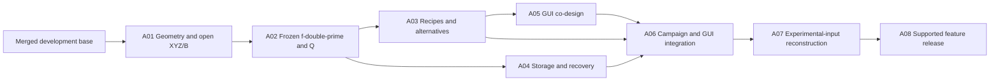

# Post-merge metal-coordination roadmap

Updated **17 November 2026**. Working branch **Alder**. The feature milestones
below are numbered **A01–A08** and are explicitly **post-merge work**. They are
not prerequisites for merging the current experimental implementation.
Historical implementation receipts A37–A40 retain their existing labels and
scientific limits; they are evidence references, not this milestone sequence.

The [handoff](development-handoff.md) owns exact validation and pending work;
the [anomalous workflow](metal-anomalous-doctor.md) and [restraint design](metal-restraint-builder.md)
own scientific contracts. A mechanism passing tests does not close its scientific
gate. Update milestone status, evidence, limitations and next action together.

**Current milestone: A01 — ligand geometry and open XYZ/B foundation.**
Source-preserving construction, explicit restraint coverage and actual-state
B export have mechanical evidence. Matched geometry, phase, iteration, map and
scale controls leave the FT_Hg open-fit geometry gate unresolved. New native XYZ
execution retains compact optimizer-stopping evidence: a completed job cannot
silently stand for a converged minimizer. Independent convergence and scientific
acceptance remain unassessed. A02 has not advanced.

Latest controls separate the final B transfer from the R deterioration and show
that the longer geometry-only preparation returns after a native line-search
error. Next inspect exact evaluator state around that stop with the shared owner;
do not repeat parameter sweeps or freeze neighbor counts on a ratio inference.
The [handoff](development-handoff.md) records prior attempts, exact validation,
private evidence and compatibility limits. Consult it before scheduling new tests.

## Merge checkpoint

Merging is the integration checkpoint: agree the destination with the project
owners, reconcile shared interfaces and conflicts, validate the affected
compatibility/integration contracts, and document which capabilities remain
experimental or disabled. Existing scientific records and readers must remain
usable. The post-merge feature qualifications below do not become merge blockers
by being listed here. Merge readiness and a scientifically complete supported
release are different decisions.

## Post-merge milestones

| Milestone | Current evidence | Post-merge completion gate | Dependencies |
| --- | --- | --- | --- |
| **A01 — Ligand geometry and open XYZ/B foundation** | PARTIAL; native stopping evidence implemented; FT_Hg open-fit geometry gate remains | Qualify exact source chemistry, linkage/terminal context, all intended NARestraints and metal recipe terms; demonstrate open XYZ/B refinement, explicit phase/Free-R policy, active-state B export and inspectable maps. FT_Hg first, then mixed Au/Ag. | Merged development base |
| **A02 — Controlled f″/Q quantitation** | PARTIAL; frozen fits, B environments and matched comparisons implemented | Use qualified endpoints; freeze XYZ/all ADPs/f′, prepare metal B from the refined environment, and qualify Q/start/budget responses, mixed elements, cluster sums/cancellation and anomalous-background controls. | A01 |
| **A03 — Editable recipes and structural alternatives** | PARTIAL; recipe core and candidate comparisons implemented | Source-backed ligand/metal-state targets, saved editable recipes, count/identity alternatives, optional chi flips and multiple/adjacent sites; preserve ambiguity and human choice. | A01–A02 |
| **A04 — Lean storage and regeneration** | SCOPED; [storage plan](metal-campaign-storage.md), no pruning implementation | Shared pristine parents, compact frozen-trial records, protected important nodes, size-capped map retention, cold native regeneration, crash-safe retirement and campaign disk reservations. | Qualified A01–A02 examples; before large fan-out |
| **A05 — Dedicated GUI co-design session** | OPEN; earlier sketches and inspection viewer are starting points | Scientist and developer jointly walk through real cases, debate navigation/controls, compare alternatives and agree a usable modular design with recorded decisions and usability checks. | Representative A02/A03 evidence; can run alongside A04 |
| **A06 — Campaign and GUI integration** | PARTIAL; identities, navigation and inspection mechanisms exist | Connect the agreed GUI to bounded multi-dataset execution, structures/sites, compact comparisons, branching history, maps/Coot, selection, reuse and recovery; include no-metal/empty-frame policy. | A02–A05 |
| **A07 — Reconstruct known metal solutions through the mechanics** | OPEN; solved references and diagnostic fixtures available | Reconstruct defensible solutions from declared experimental inputs and general NASolve mechanics, with reference models withheld from construction/search; record intervention and remaining ambiguity against predeclared criteria. | Mechanical rehearsals through A01–A03; campaign demonstration after A06 |
| **A08 — Supported feature completion and release** | OPEN | Complete end-to-end scientific/human review, independent/negative controls, installed/relocated/native integration, compatibility and release regression; publish the supported scope and remaining limits. | A01–A07 |

A01 includes saved-map, recipe/frame and scale controls, plus an exact stopping
replay of a longer geometry-only preparation. None supplies an accepted f″ parent.
The native stopping receipt is a reporting mechanism, not an automated repair or
new acceptance gate. Source-phosphate-state and open-fit geometry questions remain
with their owners. See the current handoff before extending these controls.

Statuses describe evidence already available, not completed post-merge work.
A01–A03 feed both the storage controls and GUI session. A04 must be qualified
before scaling native jobs; a large campaign is not the way to discover an
unbounded storage policy. A07's small mechanical rehearsals start early rather
than waiting until every interface is finished.

## A05: a working GUI session, not only visual polish

Schedule a dedicated collaborative session using actual saved single-metal,
mixed-metal and cluster results. Earlier sketches are design evidence, not
validated scientific outputs. We should debate the workflow and test alternatives
before building another large layer of controls.

Walk through choosing a dataset/site, understanding the current geometry,
editing a recipe, requesting refinement or a Q/f″ comparison, inspecting maps,
backtracking to another geometry and pinning a solution. Ask what the user needs
to decide at each step; keep advanced chemistry, fit settings and provenance
compact until opened. Record agreed choices, rejected alternatives, unresolved
questions and a small set of tasks the final interface must support.

Specific design topics include:

- Clear dataset/structure/site context and easy switching, with a sensible first
  selection and an explicit link between each result and its geometry branch.
- One compact trial row or small grouped row set for all its sites, expandable
  details, and side-by-side geometries. Prioritize Q (occ), fitted/expected f″,
  ratios and group/per-element responses; keep cancellation visible.
- Fit-to-atoms, understandable rotation/pan/zoom, light connectivity, distinct
  metal styling and non-overlapping labels that disappear at distant zoom.
- Recipe editing, metal state and ligand overrides without exposing unnecessary
  implementation details; reusable interface modules as the design evolves.
- Soft map controls for ordinary/difference/anomalous maps, direct Coot access,
  meaningful tree navigation and clear selected/pinned/recoverable states.

Close A05 when, in an agreed prototype, the user can follow where a row came
from, compare competing solutions, inspect their evidence and choose or defer
a branch without needing the CLI. This is a usability design gate; implementation and native correctness
remain A06/A08 work. A pretty mockup alone does not close it.

## A07: reconstruct solutions with limited prior knowledge

The test is more demanding than refining a supplied solved structure. Freeze
and record each request's allowed inputs before its run:

- Experimental reflections, original Free-R flags and wavelength metadata.
- Sequence and ligand identities from the experiment and authoritative chemistry
  definitions, plus a generic frame/model-search route appropriate to NASolve.
- Candidate elements and genuinely known experimental conditions, including
  whether reduction/clusters are plausible. Optional site or stronger chemical
  information must be explicit and reported as an additional prior.

Use the MR → PostMR/ligand preparation → AutoSol/phase/site mapping → restrained
open XYZ/B → frozen anomalous/Q → candidate-review mechanics. Preserve AutoSol
failures and the declared metal-free continuation policy. Do not seed from the
human-solved model, copy its metal coordinates/occupancies, use its final metal
count/identity as an unstated input, or encode dataset-name-specific answers.
General recipe families and chemical knowledge are allowed; reference-derived
case-specific geometry is not evidence of reconstruction with limited priors.

Keep human solutions for **endpoint comparison only**. Their XYZ/Q/B snapshots
may be useful, but their stored f″ values may be absent or reflect a later
refinement stage and must not be treated as fitted truth. Coordinate comparisons
must respect symmetry and atom correspondence. Compare local chemistry,
coordination, metal placement/count/identity where identifiable, Q/B plausibility,
f″ response, ordinary/anomalous maps and the recorded Rwork/Rfree context.
Rwork below 0.30 is the existing target, not sufficient scientific acceptance;
never change Free-R membership to improve a result.

The panel starts with **FT_Hg** and **FF_AuAg**, then covers **7CCA_Ag4**,
**7CCA_Ag6**, **FF_3Ag**, **iCiU_Ag**, and **PP_Hg** when its PDU ligand gate is
qualified. Include unresolved cluster geometry, mixed identity, iodinated
background and two-Hg slip alternatives. Exact fixture inputs and numeric
outputs stay local. A separate campaign demonstration stages these cases together.

Predeclare the input contract, resource limits, generic search/recipe policy,
comparison criteria and expected level of human involvement. Record all manual
interventions and stronger-prior retries. An auto run, a guided recipe selection
and a manually rebuilt answer are different results; do not combine them into
one success claim. If development uses a reference to tune a rule, record that
and require independent or withheld controls before claiming generality.

For each known-positive case, report **reconstructed**, **plausible but ambiguous**,
or **unresolved**, with the actual supporting evidence. Honest failure handling
is necessary but does not count as reconstructing that positive case. The gate
remains open for missing demonstrations or unsupported claims. Where the data
cannot distinguish alternatives, recover and expose defensible candidates rather
than force a unique answer. Include negative/failed controls to test that the
mechanics do not manufacture metals merely because a screen was requested.

## Feature-completion finish line

After A01–A08, a user should be able to start a bounded single-wavelength metal
campaign from experimental inputs, obtain qualified geometry candidates, explore
controlled anomalous/occupancy evidence, inspect/select alternatives, and reopen
or regenerate results within a disk budget. No-metal, failure and ambiguity are
usable outcomes. A pilot must demonstrate the whole flow, including recovery,
not just separately passing components.

MAD, wider chemistry/oxidation-state coverage and additional search heuristics
remain later extensions. They are not hidden conditions for the initial
single-wavelength release or for the earlier integration merge.

## Existing implementation evidence (historical checkpoint IDs)

| Update | Scope | Status |
| --- | --- | --- |
| A37 | Fresh MR/PostMR/AutoSol and screenshot-settings rehearsal | Private diagnostic; chemistry and production protocol qualification open |
| A38 | Native trial map/Coot inspection and chemistry discrepancies | Mechanism tested; GUI inspection and target-library work remain |
| A39 | Matched signed cluster responses from saved frozen fits | Implemented and pushed; accounting/provenance evidence, not accepted atom counts |
| A40 | FT_Hg foundation plus storage/roadmap scoping | Preparatory A01 native comparisons; scientific gate open |

A40 resumed as preparatory A01 work. Source-preserving linked DF, explicit
NARestraints and actual-state B export have native evidence. Matched open XYZ/B
comparisons and a source-supported missing-plane derivative are recorded in the
[current handoff](development-handoff.md). Supported mechanics checks pass;
formal-charge readback remains unsupported and scientific geometry/fit review
remains open. No new f″ fit or checkpoint adoption is implied.

## Handoff discipline

Update this queue, current handoff and scientific limitations together at each
substantial result. Use focused tests for affected behavior; broaden for changed
shared contracts or release integration. Record exact native/software versions,
complete versus dry execution, source revisions, input/output hashes and process
shutdown. Keep scientific artifacts local and immutable. Internal working names
are not scientific feature names.

Coordinate chemistry/native runtime and storage primitives with Cedar; coordinate
campaign ownership, navigation and shared budgets with Willow/Pine. Do not fork
shared validators or assume a peer's success qualifies this dataset. Retain
important tree nodes; incremental retention depends on the operation. A source
push is neither a merge nor scientific acceptance.
