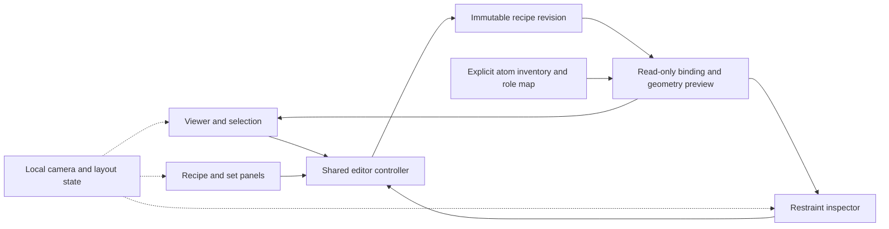

# Metal-coordination restraint builder

Status: **recipe core, generated-run integration and PHIL proposal export implemented; GUI and scientific execution planned**.
User request recorded 2026-10-06. This independent authoring feature is not a Pine
merge prerequisite.
Published examples and private cluster context have been supplied. The scope
now includes one-, two- and three-metal base pairs and an extensible cluster
graph. Numerical targets and uncertainties still require scientific review;
published structures do not automatically define reusable restraint defaults.

## Integration objectives and milestones

The metal workspace is a consumer of NASolve's generated models and immutable
checkpoint lineage. It uses the standard W/5W6W route: the first requested
nucleotide is A:12 and the second B:4. A supplied solved model is not a
prerequisite. This is existing frame-based MR/PostMR preparation, distinct from
external de novo model providers. Metal placement is a separate explicit
hypothesis on the generated scaffold.

| Milestone | Acceptance criterion | Current state |
| --- | --- | --- |
| M0: authoring core | Stable graph/revision IDs, exact role binding, numerical preview | Implemented and tested |
| M1: generated-model integration | Read a generated W checkpoint; preserve identities, q/B, dictionaries and original observations; export exact proposed restraints | Implemented; current native checks and test counts in the handoff |
| M2: hypothesis materialization and geometry | Explicit metal coordinates/count/species, complete native restraint consumption, immutable derived models, inspected geometry | Planned; begin with one Hg and then a mixed Au/Ag pair |
| M3: frozen anomalous diagnostics | Fixed f-prime; audited XYZ/ADP/q freeze; per-site f-double-prime and preserved Free-R | Planned |
| M4: interactive iteration | Broad/focused occupancy vectors, locks, exact result reuse, linked tables and selection | Planned |
| M5: campaign workbench | Switch datasets/structures/hypotheses in one GUI; independently owned jobs, failures and lineage | Planned |
| M6: bounded automatic proposals | Use declared chemistry/geometry/experimental priors and focused phasing to propose alternatives; retain ambiguity and rejected cases | Planned |

The two-metal PDU slip-geometry case waits for qualified upstream PDU
restraints and their integration. Do not fall back to ordinary saturated-chain
targets for its triple-bond chemistry. The first two controls use the single-Hg
and mixed Au/Ag cases. Later controls include three Ag, four-/six-atom clusters,
and iodine-bearing bases with an additional Ag site. All supplied cases are
known positive examples; processing anomalous-summary statistics are metadata,
not acceptance gates or a ranking of these structures.

The missing-HTML input adapter remains a named dependency: accept the
STARANISO PDF (`report_staraniso.pdf` or `staraniso_report.pdf`) for report
metadata, with explicit field provenance. A missing processing CIF must not
invalidate capabilities that are available from the authoritative MTZ. These
fallbacks are planned; ordinary AutoMR discovery still requires its current
companions. The first two controls contain those companions.

### Generated-run API and commands

`metal.context.load_run_context` reads the existing checkpoint registry (or its
validated in-memory PostMR root), inherits checksummed observations and active
dictionaries/restraints, and imports the selected model without creating a new
checkpoint or changing the current pointer. The adapter currently supports only
single-model PDB and the unambiguous W A:12/B:4 pair. It preserves prime marks,
insertion/alternate/segment identities, occupancy, isotropic B and ANISOU values;
ambiguous W alternates or insertions require a future explicit policy. Raw source
bytes are hashed; no atom-name, element or numeric defaults are invented.

Effective role records reuse PostMR's reviewed process-local corrections,
including DF O2-role to S1. The selected raw/effective records and correction
receipt accompany the context. Context schema 1 binds dataset/run/checkpoint,
model, observations, inherited resources and the imported inventory. Its ID is
independent of the checkout location. It is a view/input identity, not a complete
native-experiment cache key or a chemistry qualification.

```sh
nasolve metal inspect /path/to/dataset/AutoMR/run_001 --element Hg --json
nasolve metal preview /path/to/dataset/AutoMR/run_001 --recipe recipe.json --bindings bindings.json --export proposed.phil --output preview.json
```

`--checkpoint` defaults explicitly to `postmr`; `--dataset-id` can bind the
campaign's identifier. Neither command changes the local workspace selection.
Donor slots are named `first` and `second`; concrete atom bindings supply an
`atoms` object keyed by recipe node ID and `source_model_sha256` matching this
exact source. Outputs must be new files. An incomplete preview remains viewable
and returns exit 2; only fully resolved enabled constraints can be exported.
No missing metal is silently placed by a preview.

The observation adapter selects one populated F+/F- amplitude quartet within
one MTZ dataset and takes that dataset's wavelength, excluding the HKL_base
placeholder. Multiple complete quartets, empty arrays, invalid wavelengths or
missing integer Free-R columns are explicit errors. This is header/column
inspection, not a reflection-level consistency audit. Optional reference
f-prime/f-double-prime values come from the configured Phenix CCTBX Sasaki or
Henke tables with provider/version/wavelength and the native table-binary SHA-256 recorded. Reference values are
estimates, not fitted results; out-of-range lookup is an error. No unvalidated
interpolation table is generated.

PHIL export replays the complete preview inputs before writing distance/angle
edits and preserves restraint/set IDs in comments. Native selectors retain exact
supported residue/component/atom/alternate/segment scope. Export is limited to
one model and identity symmetry; unsupported selector characters and
case-normalized ambiguities are rejected. Native consumption, duplicate terms
against inherited restraints and chemical suitability must be checked before
geometry refinement. Existing recipe/preview schemas remain unchanged.

**Methods.** The integration resolves a declared NASolve checkpoint through the
existing anchored-path and checksum mechanisms, snapshots its PDB atom inventory
and effective NARestraints records, and binds the recipe to those exact inputs.
A separate Phenix header inspection associates observations with wavelength;
local CCTBX tables supply explicitly sourced reference scattering values. Pure
preview replay generates PHIL edit proposals without launching scientific jobs.
Synthetic malformed-input and relocation controls establish software behavior;
native receipts establish only the specific checks reported in the handoff.


## Implemented authoring core

The `nasolve.metal` Python API now stores a reusable coordination hypothesis and
previews its distances/angles against an explicitly supplied coordinate inventory.
It is the shared model beneath a future editor, detached window and scripting
adapter. The current interactive sketch is still separate and is not connected
to this API. The generated-run adapter now imports a single-model PDB, resolves the fixed W
pair, reads observation-associated wavelengths and exports proposed PHIL edits.
A production renderer and scientific execution remain separate milestones.

The core has three small modules:

| Module | Responsibility |
| --- | --- |
| `metal/recipe.py` | Immutable graph, stable IDs, named restraint sets, validation, revisions and JSON round-trip |
| `metal/binding.py` | Exact coordinate identities and a frozen effective NARestraints role-map snapshot |
| `metal/preview.py` | Read-only binding diagnostics, measured distances/angles and explicit requested targets |

`Recipe` takes a schema-1 `metal-restraint-recipe` document. Nodes are logical
`donor` slots (`residue_slot`, `role`), `metal` slots (explicit element), or
concrete-only `atom` slots. There is no three-metal limit. Sets have stable IDs,
names and an explicit scientific `enabled` flag. A distance has two node IDs;
an angle has three, with its vertex in the middle. Each restraint records its
set ID, target, sigma, unit (`angstrom` or `degree`), enabled state and source.
Target, sigma and source may be null in saved drafts; no numerical default is
inferred. A non-null source records `kind` (`user`, `reference` or `library`) and
an explanatory `note`; optional provenance belongs in its preserved `extensions`.
A source label is a declaration, not independent scientific qualification.

`Recipe.to_json()` / `Recipe.from_json()` preserve supported optional metadata in
`extensions`. Unknown required fields, future schema versions, duplicate JSON
keys, duplicate IDs, dangling endpoints and nonfinite/invalid numerics are
rejected. Returned dictionaries are independent copies. `with_node`, `with_set`
and `with_restraint` return new revisions; the corresponding `without_*` methods
refuse removal of a node/set still referenced by a restraint. They never silently
cascade deletion. An unchanged row leaves the revision unchanged. The caller
owns explicit saving and version/history retention; this API performs no file I/O.

`AtomKey` retains model, chain, residue, insertion code, component, atom name,
altloc, segment and symmetry identifiers. Blank altloc matches only blank;
prime marks are preserved. `ModelSnapshot` freezes supplied Cartesian coordinates
in angstroms and an input-source digest/checkpoint label. `RoleMap` freezes an
explicit effective workbook-record set and source digest, reusing NASolve's
existing `resolve_component_record` semantics. Equivalent descriptive aliases
may agree; conflicting operational records are reported. A logical O4 role can
therefore map to a differently named sulfur atom without being relabeled oxygen.
No installed-workbook discovery, correction or model-file interpretation occurs
in the pure binding layer; the separate context adapter supplies those inputs. Import adapters must verify the source bytes and capture any effective
role-map corrections before constructing these objects. Source digests in this
API are caller-supplied provenance; the separate inventory/role-map fingerprints
are calculated from the complete supplied objects.

`preview(...)` returns a schema-1 `metal-restraint-preview` with stable node and
restraint IDs, exact selections, source/recipe/input fingerprints, frozen inputs,
measured geometry, requested targets and per-row diagnostic codes. Its protocol
is `metal-coordinate-preview-v1`. Missing or ambiguous bindings, changed metal
species, repeated concrete endpoints and undefined angles remain explicit.
An incomplete draft can still be saved and unrelated rows inspected. Disabled
sets/constraints are retained with diagnostics but do not block enabled rows.
A preview with no enabled constraints is `draft`; `resolved` means that enabled
rows are bound and numerically specified in this inventory. `native_ready` is
always false. Nonidentity symmetry is explicitly unsupported in this first
preview; it is never silently treated as the ASU identity operator.

A recipe hash identifies the complete document, including revision and metadata.
A preview input hash also includes the supplied inventory, role map, bindings and
protocol. Neither is a complete native-experiment cache key. Neither proves that
a source model file was parsed correctly or that a target is chemically suitable.
The separate export adapter supplies proposed native selection strings/PHIL.
Checkpoint adoption, coordinate/chemistry edits, occupancy scans, anomalous fits
and target-library lookups remain unimplemented.

### Modular interface boundary

Keep camera, panel order/size, collapse state, overlay visibility and temporary
selection in a separate user-local view state. None is a recipe field or a
scientific result. Hiding an overlay does not set a restraint's scientific
`enabled` flag. Panels address objects by stable ID, never by their screen
position, rendered label or list index. All panels use the same current recipe
snapshot and the same preview; docked/detached modes must share the controller.
A panel may submit an explicit node/set/restraint edit, then render the resulting
new revision. Temporary orange drafts enter the recipe only through explicit add.



The controller and rendered panels in this figure are integration boundaries,
not delivered GUI code. Reordering panels or replacing the rendering toolkit
requires no change to the scientific graph, binding or geometry calculations.

**Methods.** The implementation validates a JSON graph, resolves logical donor
roles using the existing component-record resolver, and matches full atom keys
against an immutable caller-supplied inventory. It calculates Euclidean distances
and three-dimensional angles (normalized vectors and `atan2` of cross/dot terms),
retaining measured and requested quantities separately. SHA-256 fingerprints
bind canonical JSON inputs. Synthetic controls cover 0–3 metal graphs, mixed
species, a nonplanar six-site cluster, renamed donors, exact alternate/model/site
identity, ambiguity, draft/edit round-trips and source-removed relocation replay.
These tests establish software behavior, not native chemical or diffraction
qualification. See the [current validation handoff](development-handoff.md#parallel-metal-workflow-design).

## Purpose and interaction

Provide a toggleable metal-restraint workspace in the NASolve GUI, with an
optional small standalone/detached companion window using the same backend.
It does not need the entire future GUI to exist before a bounded prototype.

Show clickable atom spheres, selectable metal sites/elements, existing molecular
bonds, and visible proposed coordination-restraint edges. Let the scientist pick
atoms, select one or more metals, add/remove distance and angle restraints,
name the hypothesis, and save/load/select a reusable recipe. Toggle the overlay
or the whole tool without changing the underlying model or selected checkpoint.

The lines represent proposed restraints, not an assertion that a covalent bond
has been created. Do not snap atoms to target distances, minimize coordinates,
change bond order, or launch refinement merely because an edge was drawn.
Measured geometry and requested target geometry should be displayed separately.
Ordinary Coot remains the coordinate editor; this tool authors constraints.

The molecular workspace uses a dark grey background, blue dotted proposed
restraint edges and blue selection highlights. Existing molecular bonds remain
visually distinct. Pair color with line style, labels and selection rings;
proposed interactions never inherit an accepted-checkpoint marker. Design,
Experiment and Compare are connected views of the same hypothesis and atom
identities, not independent copies of the model.

## Camera and interactive restraint sets

Provide a zoom slider, genuine three-dimensional rotation, pan/recenter and fit
controls. Camera transformations change only the view; stored coordinates,
restraint targets, atom identities and checkpoint selection remain unchanged.
Preserve depth for nonplanar six-site clusters and show surrounding nucleotides
or explicit symmetry mates when requested. A flat graph layout is not a geometry
model. The public [8VH6 deposition](https://www.rcsb.org/structure/8VH6) is a
useful spread-out three-Au viewing case; it is not a universal geometry target.

Make donor atoms as well as metal sites selectable. In an explicit add-restraint
mode, choosing two atoms creates an orange draft edge; a third selection can
define an angle. Display endpoint identities and let the scientist add, cancel
or remove the draft. Confirmed recipe proposals retain blue dotted styling.
Orange denotes a draft interaction, not bad chemistry; green retains its
accepted-checkpoint meaning. Use labels and distinct line styles with color.
Keep named restraint sets independently visible and editable, with targets,
uncertainties and sources attached to the set's individual constraints.

## Portable atom roles, not fixed PDB atom names

A reusable donor selector uses a logical residue slot plus a canonical atom-role
key from the NARestraints ligand workbook, such as `O4` or `N3`. The key is a
spreadsheet column/semantic site. It is not a requirement for the actual target
atom to have that literal name or element. Resolve it using the selected
residue's workbook record; retain the resolved atom name and element explicitly.

For illustration only (not a frozen file schema):

```
residue_slot_1.role(N3) -- metal_site_1 -- residue_slot_2.role(N3)
residue_slot_1.role(O4) -- metal_site_2 -- residue_slot_2.role(O4)
```

The concrete instance binds those slots to exact model/chain/residue/alternate
and, where relevant, symmetry identities. Never erase primes from C5' or conflate
an atom-role key, a chemical element, a PDB name, or a mutation intermediate.

Selecting an atom should suggest its corresponding role. If several roles map
to it, let the user choose. A concrete-only draft is still useful when no role
mapping exists; mark its narrower scope instead of inventing portability.
Missing or ambiguous donors prevent only application of the affected requested
restraint, not browsing, saving a draft, or unrelated campaign members.

A matching role makes a recipe addressable on another similarly shaped base;
it does not by itself prove identical metal affinity, protonation, oxidation
state, or suitable bond targets. Show actual donor elements and let the user
review the mapped instance. Do not add a new universal residue-classification
gate or revive the rejected N9 intermediate-mutation rule.

## Manually buildable hypotheses

Support named variants including square-planar coordination, N3-N3 or O4-O4
bridges, one, two or three metals, and homo-/heterometal arrangements. Distinct
metal slots carry separately selected species; do not assume sites are identical.
Keep a zero-metal/omitted-site control available for downstream comparison.
These labels may compose one hypothesis rather than being mutually exclusive.

Recipes describe explicit metal-donor distances and donor-metal-donor angles,
with units, targets and uncertainties. Metal-metal distances, planarity or other
constraints are included only when deliberately requested. A named geometry can
help enumerate a pattern; metal-specific numerical values must come from user
examples or an explicitly reviewed source, not be inferred from a drawn picture.
Keep which constraints are enabled visible, and permit editing their values.

Existing metal atoms can be selected. Draft metal placeholders can describe a
hypothesis, but adding actual atoms/species/coordinates must be a separate
explicit materialization action in a derived model, never a hidden side effect
of saving or previewing a restraint recipe.

## Cluster extension and chemical declarations

Represent a recipe as a graph of stable donor/metal slots and explicit
interactions, without a three-slot limit in the underlying representation.
Simple base-pair presets can cover one to three metals first. Larger clusters
use the same graph with optional metal-metal restraints and neighboring-residue
donors; each native geometry and disorder policy needs its own qualification.
Polyhedral templates are editable hypotheses, not inferred chemical bonds.

Keep modeled site count, symmetry multiplicity, occupancy and formal charge
separate. A shared cluster occupancy describes an intact-cluster hypothesis;
independent site occupancies describe another disorder model. Same-site element
alternatives have a shared physical occupancy budget, while spatially distinct
sites do not. The [anomalous diagnostic contract](metal-anomalous-doctor.md)
defines these comparisons and their identifiability limits.

Record source chemistry, protonation and oxidation-state assumptions without
silently rewriting component dictionaries. A restraint graph and an element
label alone do not establish those chemical properties.

## Local chemistry-aware target suggestions

Maintain a versioned local library of suggested metal-donor distances and
uncertainties. Use reviewed recipes/reference data and, where the exact chemical
context is supported, targets from the existing PostMR/CIF generation and
qualified dictionary store. Reuse its source/graph/producer/consumer provenance
through an adapter; do not fork the CIF chemistry engine. Ordinary component
bond numerics do not automatically qualify a metal-coordination target.

Match more than element pairs: metal identity and declared oxidation state,
donor element, donor bond-order environment, formal charge, explicit hydrogen
state/tautomer and applicable coordination geometry belong in the lookup.
C=S, C-SH, thiolate, -OH and -O-minus represent distinct stated contexts; do
not silently infer a protonation or redox change from pH or a drawn edge.
Offer a suggested target and uncertainty with its source, applicability and
qualification status. The scientist may edit either value, with the override
retained alongside the original suggestion. No matching supported source means
an unset target or an explicitly unreviewed draft, not an invented default.

Changing a declared donor state invalidates the prior match and offers a fresh
lookup. It does not mutate component bond orders, hydrogens, charge or fitted
coordinates. An actual chemical variant needs an explicit derived dictionary
and native qualification under the existing source-preserving workflow.
Keep measured model distances separate from restraint targets; a distance from
the same refinement is not an independent reference validating its own target.

Store user recipes and optional suggestions outside Git. Each applied recipe
freezes the exact library entry/version/hash, chemistry selector, target, sigma,
source and override into its run artifacts. Later library updates do not alter
past recipes or satisfy an old full-experiment reuse key. See the existing
[qualified dictionary store](cif-doctor.md#persistent-local-reuse-of-qualified-repairs)
for the reusable provenance and native-consumer boundary.

## Template, application, and refinement remain separate

A saved recipe retains its name/version, logical donor slots/roles, metal slots,
coordination pattern, target values/uncertainties, applicability notes and source
examples. The implemented authoring core uses the versioned JSON representation described
above; its validator is the runtime schema authority. This design document and
the adjacent development-intent JSON are not runtime registration authority.

Each application freezes the recipe/version/hash, source checkpoint/model hash,
role-map source/version or fingerprint, resolved atom selections, explicit
instance overrides, and emitted restraint artifacts. Preview lists the resolved
atoms, donor elements, edges, angle triples and any unresolved selections.

Use one UI-independent restraint-building backend, reusing NARestraints atom-role
semantics and the existing NASolve/Phenix restraint pipeline. The docked and small
window modes must not have separate recipes, histories or scientific rules.

Refining several manually selected hypotheses creates distinct children from
explicit checkpoint sources. Preserve the original coordinates, observations,
Free-R and failed alternatives. Show each recipe and its results so the user can
select/reject a branch. Do not equate a lower Rfree or visual fit with proof of
metal identity/coordination. Automatic variant enumeration and campaign rescue
are later opt-ins, not requirements for the first authoring tool.

## First validation examples

Use the supplied scientific contexts to select explicit, reviewable fixtures.
Test the same recipe in both window modes; a literal N3/N3 case and an O4 role
whose actual target atom is renamed; reapplication to another compatible
modified base; save/load round-trip; one/two/three-metal and heterometal variants;
larger cluster graph round-trip without claiming native support; explicit
missing/ambiguous donor diagnostics; visible edges
and angle controls without any coordinate edit; and an emitted bundle interpreted
by Phenix in a fresh child run. Confirm that recipe toggling does not change
checkpoint selection or the original model, and that all resolved selections and
target uncertainties survive into the actual refinement command.

After authoring and geometry preparation, the separate
[anomalous workflow](metal-anomalous-doctor.md) runs bounded fixed-occupancy
f'' trials with audited XYZ/ADP/f' invariants. Tables bind exact trial/model/map
artifacts back to the same molecular sites. Inspecting a row or pinning a
comparison does not select a current checkpoint.

Metal anomalous evidence is separate from restraint authoring. Selecting a metal
or drawing an edge does not establish anomalous observations, phase quality,
occupancy or experimental support. Future application reports should expose
those facts without silently converting a geometric hypothesis into evidence.

See [GUI contract](gui.md), [GUI live checks](gui-live-checks.md), and the
[development handoff](development-handoff.md) for the current development order.
GUI and native scientific execution remain separate later scopes; this adds no gate to the
combined geometry trial or Cedar/Pine close-out.
