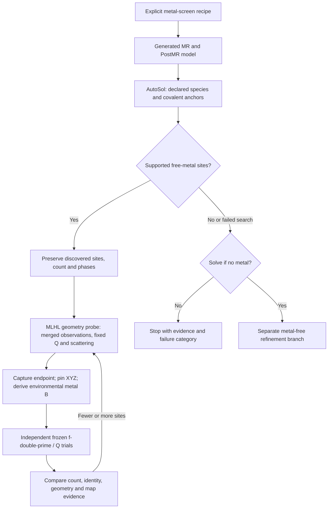

# Experimental metal-screen workflow

Status: **phase-restrained XYZ probe and refined-endpoint fdp diagnostic bridge implemented; full metal-screen integration planned**.
Updated 2026-10-29. This document records the experiment-driven workflow and
data contract. It does not enable an integrated metal-screen command, campaign option or GUI control.
The existing authoring, frozen f-double-prime trials and read-only viewer remain
implemented as described in the [anomalous workflow](metal-anomalous-doctor.md).

## Purpose and entry condition

A metal-screen recipe explicitly says that experimental chemistry motivates a
search for declared metals. It is not a general search added to every NASolve
run. The recipe records allowed species, known covalent scatterers, site groups,
chemical/redox priors, job/disk budgets and the no-metal continuation policy.
Mixed identities are hypotheses, not established by the recipe declaration.

Ordinary NASolve retains its nucleotide-bound I/Br/Se AutoSol gate. Metal-screen
mode must independently permit free metals, including alongside those covalent
anchors. Iodinated bases remain part of the model and anomalous context; do not
relabel their peaks as extra metals or remove them from global scattering.
Low auto-processing anomalous statistics alone do not veto an explicitly
requested metal screen.

## Candidate and phase lineage

Initial metal positions come from **Phenix AutoSol**, using the declared species,
real anomalous observations and the generated MR model. Start from the supported
free-metal sites AutoSol discovers, whether one, two or more; do not force a
one-metal start or replace discovery with donor-midpoint placement. AutoSol's
site identities and count are provisional. Preserve the original output and
record any symmetry/origin transformation, exact site mapping, covalent-anchor
assignment and reason for selecting or excluding a peak.

Retain AutoSol's phasing products and use eligible phases in the subsequent
geometry refinement. Record the observations, Free-R flags, wavelength, phase
file checksum, HL labels, phase origin/type and producing site hypothesis.
New AutoSol reports now record the actual complete HL quartet instead of the
observation quartet in `refinement_data_phase_labels`; older immutable reports
are not rewritten. The existing AutoRefine preference remains unchanged.
Do not infer the meaning of HL columns from their names alone: distinguish
anomalous-only coefficients from model-combined or density-modified products.
The chosen phase policy belongs to the comparison basis. Competing hypotheses
must use a declared comparable policy; phases obtained under different metal
hypotheses cannot silently become equivalent evidence. Phase sensitivity remains
a qualification question, including whether external HL restraints should also
enter the final frozen f-double-prime objective.

Current boundaries are explicit: ordinary AutoRefine can inherit eligible
experimental phases, but the metal frozen-f-double-prime worker currently uses
model phases **without external phase restraints**. It cannot yet claim the
complete phase-linked metal-screen workflow. Do not silently drop phases or
change that worker's protocol to make the rehearsal appear complete.

New native trials retain [fit and endpoint recipe diagnostics](metal-anomalous-doctor.md#implemented-native-fit-and-endpoint-recipe-diagnostics).
Inspect reflection-scale sensitivity and actual coordination residuals before
interpreting a response ratio as a count hypothesis. These reports do not trim
Free-R reflections, substitute a corrected R, or validate model-assisted phases
independently. Native completion remains distinct from scientific acceptance.

## Symmetry-aware distance lookup and cell mapping

AutoSol can report the correct crystallographic site in another unit cell or
symmetry copy. Before rejecting a distant-looking site, search the declared
space group's symmetry operators, centering and lattice translations using the
actual unit-cell metric. **Default to the copy closest to actual model atoms**,
excluding the search site's own overlay. Where the recipe declares an intended
site, use that site's real atoms as the target neighborhood. Apply an unambiguous
closest-copy choice automatically and record it; flag tied matches and clashes
without treating proximity as chemical acceptance.
Simple Cartesian proximity, wrapping fractional coordinates into [0,1), or
translation alone is not sufficient for general symmetry. Support offsets of
multiple cells rather than assuming the original copy is adjacent.

A cell-mapping preview should retain the raw site ID/coordinates, source cell
and setting, selected operator and integer shift, transformed coordinates,
exact target atoms, before/after distances and alternative near-equivalent
matches. Apply the selected mapping to a new candidate only; never rewrite the
AutoSol heavy-atom file. Avoid duplicate sites from equivalent copies and flag
special-position or ambiguous matches. A changed origin/setting that is not an
allowed symmetry operation needs an explicit validated transformation.

Connected cluster sites move under one coherent operation/translation unless
an explicit connectivity-aware unwrapping is required and recorded. Independent
nearest-copy choices must not tear a cluster apart. Score the connected group
against actual model atoms under coherent transformations, preserving internal
distances; do not substitute an unoccupied group centroid for atom proximity. Distinct free sites may map
to different declared groups, with shared atoms and cross-boundary bonds retained.
Nearest distance proposes a placement; it does not establish a chemical bond,
identity, count, or correct coordination state.

The existing nucleotide AutoSol matcher handles bounded P1/R3 distance checks;
it is not a general free-metal/cluster cell-jumping or model-writing adapter.
Qualification needs positive/negative multi-cell shifts, nonidentity rotations
and centering, nonorthogonal cells, tied alternatives, special positions,
cluster-distance preservation and immutable source/replay checks.

## Geometry refinement, environmental B and frozen trials

The quantitative B source is the **completed XYZ/ADP-open refinement endpoint**
for that particular candidate geometry. It is not the original 5W6W scaffold,
the metal-placement placeholder B, or a human-reference snapshot. Allow the
candidate geometry and the appropriate environmental ADPs to refine first;
then capture that endpoint, pin XYZ, and derive metal B from its coordinating
bases or explicit donors. Whole-base means exclude sugar and phosphate. Retain
the separate base means and their mismatch; high B values are not clamped to a
conventional low-B range. This remains an environmental assumption, not an
independent calibration proving occupancy.

Freeze the resulting XYZ and B basis. Within each f-double-prime fit, Q (occ)
and f-prime are fixed; independent sibling trials vary the requested Q vector.
A different geometry, environmental B policy/source, or phase policy requires
a new seed/comparison basis. Reusing an old trial requires the full experiment
identity, not merely matching displayed metal, XYZ, Q and fitted f-double-prime.

The diagnostic bridge now verifies an explicit XYZ/ADP-open endpoint and derives
B from its exact refined atoms before a new frozen f-double-prime trial.
[Declared shared environments](metal-anomalous-doctor.md#implemented-shared-cluster-b-environments)
can give interior cluster metals the same refined-base B without creating bonds. Existing
recipe-only geometry bundles still deterministically replay their own solver;
an external result is never substituted into one. The source XYZ manifest retains
its unaccepted state; the bridge establishes provenance and frozen-state mechanics,
not scientific eligibility for automatic count decisions. See the
[implemented endpoint and count methods](metal-anomalous-doctor.md#implemented-refined-endpoint-diagnostics-and-cluster-accounting).

*Figure: experiment flow with the separate MLHL XYZ probe now implemented.
The diagnostic bridge from its review endpoint to environmental B and frozen
anomalous trials is implemented; scientific qualification and campaign branches
remain planned. A search execution failure and a completed
search without supported sites remain distinct outcomes; neither proves absence.
All candidate branches retain their parent and phase provenance.*

## Implemented phase-restrained XYZ probe

The API `nasolve.metal.xyz.run_xyz(run, hypothesis, native=..., phases=...,
phase_labels=..., cycles=3, timeout=240)` creates an immutable numbered
`Metal/xyz_NNN` review bundle from a verified metal hypothesis and an explicit
anchored, checksum-verified phase file. `verify_xyz(run, directory)` replays its
inputs and audits offline without executing saved scripts. This is an API-only
experimental step; it adds no CLI/campaign execution or automatic checkpoint
selection. Explicit hypotheses may retain unrestrained sites, which remain
chemically unqualified. Existing geometry/fdp formats are unchanged.

The optional `xyz_weight_scale` argument creates a declared geometry/data-weight
probe; its bounded scale, companion native controls and readback audits are
specified in the [weight methods](metal-anomalous-doctor.md#implemented-explicit-xyz-weight-controls).
Omission preserves prior behavior. Tightening geometry is a hypothesis test,
not evidence that the metal count or recipe is correct.

The native target is **MLHL with merged Bijvoet observations**. Phenix
**2.2.1-6174** rejects MLHL combined with nonzero anomalous scattering in the
attempted geometry protocol. Consequently this separate step fixes f-prime at
the wavelength-dependent Sasaki reference and sets f-double-prime to zero for
**every atom only during geometry refinement**. Those zeros are not measured
f-double-prime results. The original anomalous MTZ and Free-R flags remain
byte-identical inputs for later quantitation; the derived phase MTZ header does
not supply the observation wavelength. Model-combined HLAM/HLBM/HLCM/HLDM was
used in the native controls; alternate complete naming families require explicit
selection and do not establish a different scientific phase origin by themselves.

Individual XYZ and isotropic ADPs may refine; Q, element/atom identity, f-prime,
and f-double-prime remain fixed. There is no occupancy refinement, automatic
metal linking, hydrogen/water addition, base flipping or optimized XYZ/ADP weight
search. All inherited and explicit recipe restraints remain inputs. Initial
structural Q must be declared within physical bounds; raw AutoSol phasing Q is
retained separately and is not imported as structural occupancy. ANISOU inputs
are rejected rather than silently converted. This first protocol retains the
existing no-ADP-backtrace scale policy; environmental B and scale sensitivity
still need qualification on representative geometries.

Each schema-1 `metal-xyz-trial` uses protocol `metal-phased-xyz-v1` and retains:

- The parent hypothesis manifest, input model, original observations, phase file,
  restraint resources, reference scattering and exact effective native parameters.
- Full-precision atoms/groups, active merged reflections/Free-R assignments and
  the selected source HL array. Active HL coefficients must match that source
  on every used index and remain unchanged; zero-coefficient entries are counted.
- Fixed-Q/scattering audits, XYZ/B changes, crystal symmetry, serialized endpoint
  agreement, native version/source fingerprints and process logs.

Native Phenix may sort atom records during model interpretation. The XYZ audit
requires a bijection over complete atom keys for native and serialized output,
remaps the expected scattering-group indices through that bijection, and checks
all fixed fields and endpoint serialization against the original identity.
Duplicate/missing atoms, stale group membership, changed Q/charge/scattering and
mismatched serialized coordinates still fail. A reordered endpoint records
`atom_order_mapping` in its schema-1 result; unchanged ordering keeps the prior
result format. Native workers and refinement parameters are unchanged. Failed
attempts from older audits remain failed; a correction requires a new attempt.

Cell comparisons allow PDB field precision at import/serialization and at most
1e-9 native numerical roundoff; actual setting/cell changes fail the audit.
The reflection audit permits only a common F/sigma scale, with exact indices and
Free-R membership. Its default remains anomalous-only for frozen fdp callers;
the new geometry caller explicitly requests merged observations. Worker timeout
and interruption terminate the process group, and failed numbered attempts are
retained without a completed manifest. Verification checks declared anchors and
checksums; it never searches by basename or uses historical absolute paths as
its sole reference. Relocation is tested after removing the original temporary
checkout/data path.

A completed bundle remains **XYZ_REVIEW**. Its immutable result records
`fdp_quantitation_ready=false`, `environmental_b_applied=false`, no automatic
checkpoint selection and no convergence claim. The separate diagnostic bridge
can now create a distinct frozen anomalous trial from this endpoint, after an
explicit B policy and exact donor/base rebinding. It does not edit those source
flags or claim scientific acceptance. Chemical restraints, count/identity,
phase/overall-B sensitivity and optimizer qualification remain review work.

## Count changes and no-metal outcome

Explore **fewer and more** sites around the discovered solution according to
the evidence. A fitted/reference f-double-prime ratio above approximately **1.3**
is a proposed configurable trigger for an additional-site test, after valid B
preparation, a valid fit and a defined nonzero reference. It is not a metal-count
measurement or a compulsory split. Q choice, B assumptions, element identity,
geometry and phase policy can also alter that ratio. Propose an actual new
position from supported search/map evidence, refine that geometry, derive its
own B basis, and compare its frozen trials with the retained parent candidate.
Pruning or merging a questionable site similarly creates a fewer-site child;
no universal low-ratio deletion rule is specified.

Campaign setup should expose **Solve if no metal is found? Yes / No**, frozen
in the recipe and shown per dataset. Default: **No**, stop the metal screen.
With **Yes**, continue on a distinct metal-free branch only when the existing
MR/PostMR model and observations are eligible. Preserve the metal-screen result
and the failure reason; an unusable MR model cannot become a solved empty frame.

Distinguish completed search with no supported site, unresolved/unsupported
output, native execution failure, timeout/budget exhaustion, and preparation
failure. A fallback does not erase these states. An absence of discovered sites
is not proof of chemical absence. If AutoSol did not produce eligible phases,
the empty-frame branch explicitly records its model-only phase policy; it must
not claim experimental phases. Failed search outputs are not promoted as valid
phase inputs. Whether to retry is separate from the no-metal fallback toggle.

## Bounded discovery rehearsal

Two isolated controls completed native molecular replacement, Coot/ReadySet
preparation and experimental free/mixed-metal AutoSol searches from the explicit
5W6W provider, using Phenix **2.2.1-6174** and Coot **1.3.3**. These were complete
executions within declared time/storage bounds, not parser-only dry runs. No
human solved model or forced metal positions/counts were used. Both produced
heavy-atom PDBs and MTZs containing anomalous observations and phase coefficients.
Per-dataset sites, scientific values and all native artifacts remain local.

The unchanged production entry point correctly rejected these controls because
there were no nucleotide heavy atoms. The separate rehearsal invoked AutoSol
with explicitly declared metal species and no prescribed site count; it did not
bypass production acceptance or create approved phase/checkpoint records. The
outputs still require site/origin mapping, chemical assessment and phase-policy
qualification. Phasing-site occupancy-like values must be preserved as raw search
output, not copied uncritically into physical structural Q bounds.

A subsequent bounded rehearsal used the AutoSol-derived sites and phase file in
the new XYZ API. Two final three-cycle native probes completed and passed offline
replay with Phenix **2.2.1-6174**; Coot was not invoked in this new step. Structural
Q was explicitly initialized to 1.0, with raw discovery Q retained separately.
No invented metal distance targets were added. The first MLHL/anomalous attempts
stopped at the native compatibility gate; intermediate cell-audit failures were
also retained and informed precision regression tests. The final protocol uses
merged geometry observations and explicit fixed scattering as described above.
Per-base endpoint B summaries and site displacements remain local review data.
No endpoint was accepted, environmental B applied, or new f-double-prime scan run.

## Data-management boundary and qualification order

Retain compact, source-bound records for the recipe; discovery attempt and
species; original and mapped sites; phase products; refined endpoint; exact
contributing B atoms; frozen trial vectors; results, audits and branch reasons.
Use declared run/dataset anchors with checksums. Human endpoints remain optional
comparison references and never become discovery seeds. Do not mutate existing
numbered runs, recipe geometry or a selected checkpoint to import new evidence.

Discovery alone does not authorize large occupancy grids. Work in stages with
explicit job/time/disk limits, preserve partial failure evidence, and inventory
actual storage. Heavy-output compaction remains a separate recovery-qualified
feature; these rehearsals do not prune existing data.

1. Rehearse explicit 5W6W preparation and free/mixed AutoSol searches on bounded
   local controls, retaining native outputs and effective parameters.
2. Implement and test the opt-in metal-screen request and result contract,
   including covalent anchors, no-site/failure outcomes and fallback policy.
3. Qualify site/symmetry mapping and chemistry around the implemented XYZ review
   adapter; evaluate phase and scale-policy sensitivity before accepting endpoints.
4. Connect environmental B preparation and frozen trials to that endpoint;
   qualify phase handling, reuse boundaries and numerical response.
5. Use those real result sets to settle the
   [compact table and comparison design](metal-anomalous-doctor.md#tables-plots-and-gui-selection),
   then expose recipe execution and the no-metal toggle in campaign setup.

**Methods.** The planned integration reuses NASolve's generated MR/PostMR models,
Phenix AutoSol substructure/phasing, checkpointed coordinate/ADP refinement and
the existing audited fixed-atomic-state f-double-prime worker. Separate immutable
records connect discovery, geometry and conditional quantitation. Native
success, software validation and scientific acceptance are reported separately.
The installed Phenix 2.2.1-6174 AutoSol documentation describes a primary atom
type plus additional species through `autosol.phasing.mad_ha_add_list` for
single-dataset SAD; this does not establish general mixed-species MAD support.
